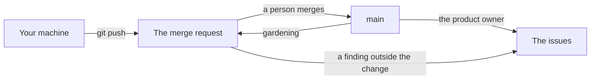

<!-- workline
sources:
  - cmd/workline/cli.go#init
  - defaults/routing.yaml#events
  - defaults/routing.yaml#states
  - defaults/routing.yaml#reconcile-max
  - defaults/routing.yaml#budgets.push
  - internal/forge/forge.go#Open
  - roles/committer/role.yaml#events
  - roles/committer/role.yaml#settings.rewrite
  - roles/committer/role.yaml#settings.ai-max-seconds
  - roles/documentalist/role.yaml#events
  - roles/documentalist/role.yaml#merge-request-ai
  - roles/reviewer/role.yaml#events
  - roles/inspector/role.yaml#events
  - roles/product-owner/role.yaml#events
  - defaults/ci/github/workline.yml#on
  - defaults/ci/github/workline-gardening.yml#on
  - internal/gate/gate.go#Check
  - internal/gate/gate.go#Gate.Validate
  - internal/gate/gate.go#execute
  - internal/gate/sarif.go#readSARIF
checked: e81df7b34
verified: agent:claude-code
reader: e375241655b6
-->
<h1>
  <picture>
    <source media="(prefers-color-scheme: dark)" srcset="docs/assets/logo-dark.svg">
    
  </picture>
</h1>

A software factory for AI-assisted development:

- each role — committer, documentalist… — does one job, with only the
  context it needs;
- tools do the mechanical work; an AI is called only when a decision
  needs judgement;
- every check keeps working without AI; for now a role may need an agent
  where working without one would make it rigid;
- people state the need and accept the result; the line does the work in
  between ([principles](docs/PRINCIPLES.md)).

Status: runs on every commit of its author, and in CI on the
pull requests and nightly gardening of workline and of another project;
<!-- workline:derive conformance-cases -->2288<!-- workline:end --> conformance cases green in CI.

## Get started

- **Install** the binary, then `workline setup`: the global hooks, your
  agent, the tools the roles use ([install](docs/install.md#on-your-machine)).
- **Choose your agent**: none, Claude Code, or any command as `cmd:`
  ([the choice](docs/install.md#3-the-agent-your-choice)).
- **Adopt a repository**: `workline init`
  ([install](docs/install.md#5-adopt-a-repository)).
- **Add CI**: the GitHub or GitLab templates ([install](docs/install.md#in-ci)).
- Step by step, in ten minutes: [the quickstart](docs/quickstart.md).
- **No forge**: the whole line, need to merge, on your machine
  ([the line with no forge](docs/local-line.md)).

## Documentation

| Start here | Use it | Go further |
|---|---|---|
| [Install](docs/install.md) — your machine, then CI | [Roles](docs/roles.md) — what each does and not, its settings | [Principles](docs/PRINCIPLES.md) |
| [Quickstart](docs/quickstart.md) — ten minutes, on your machine | [Usage](docs/usage.md) — commands, options, exit codes | [Role contract](docs/spec/role-contract.md) — what a role is |
| [Concepts](docs/concepts.md) — the words used everywhere | [Configuration](docs/config.md) — settings, files, variables | [Decisions](docs/adr/) · [Research](docs/research/) |
| [Troubleshooting](docs/troubleshooting.md) | [CI](docs/ci.md) — [GitHub](docs/ci-github.md), [GitLab](docs/ci-gitlab.md), [other forges, none](docs/ci-other-forges.md) | [Backlog](https://github.com/JN0V/workline/issues) |
| [Contributing](CONTRIBUTING.md) — build, test, commits | [Any trigger](docs/triggers.md) · [GitLab, started by a tool](docs/gitlab-trigger.md) · [Only a part](docs/parts.md) | [Boards](docs/boards.md) — the forge's board, its cards moved |

## The roles

| Role | What it does for you | [Status](docs/adr/0036-a-roles-status-is-earned-by-written-criteria.md) |
|---|---|---|
| [**Committer**](roles/committer/README.md) | checks each commit's message, the secrets it adds and its author | [built](roles/committer/docs/status.md) |
| [**Documentalist**](roles/documentalist/README.md) | keeps the docs true to the code they name | [beta](roles/documentalist/docs/status.md) |
| [**Reviewer**](roles/reviewer/README.md) | reads a change before a person does and says what it breaks; never approves | [beta](roles/reviewer/docs/status.md) |
| [**Product owner**](roles/product-owner/README.md) | keeps the open issues true to the code, refined and in order | [beta](roles/product-owner/docs/status.md) |
| [**Inspector**](roles/inspector/README.md) | explains the findings a merge request adds to your linters and scanners; never their verdict | [beta](roles/inspector/docs/status.md) |
| [**Tester**](roles/tester/README.md) | writes a ready issue's tests from its scenarios, each proven red on its base before the code | [beta](roles/tester/docs/status.md) |
| [**Developer**](roles/developer/README.md) | takes a ready issue nobody took, writes its code within bounds, opens its pull request, proven on the project's tests, and fixes its review | [beta](roles/developer/docs/status.md) |
| [**Auditor**](roles/auditor/README.md) | re-checks a weekly sample of the roles' acts | [beta](roles/auditor/docs/status.md) |
| [Security](https://github.com/JN0V/workline/issues/204) | will add security scanners as gates and a security lens | planned |
| [Process engineer](https://github.com/JN0V/workline/issues/89) | will read the line's measures and propose fixes | planned |
| [Architect](https://github.com/JN0V/workline/issues/207) | will read specs for structure and keep architecture rules | planned |
| [UX](https://github.com/JN0V/workline/issues/208) | will run accessibility tools as gates, and read the flows and wording they cannot ([ADR-0061](docs/adr/0061-the-ux-role-reads-what-the-accessibility-tools-cannot.md), proposed) | planned |
| [PM](https://github.com/JN0V/workline/issues/209) | will map the product and suggest functions | planned |

- What each role does and does not, its settings and costs: its page, or
  [all the roles](docs/roles.md).
- The judge is not a role: a service the roles' checks consult for a
  yes-or-no question ([the judge](roles/judge/docs/service.md)).
- A planned role links to its issue, which holds its design.
- V1, the product owner, the tester and the developer taking a need to
  a merged change on any repository, was accepted on 2026-11-11; the
  other planned roles start after v1.0
  ([ADR-0052](docs/adr/0052-v1-0-when-the-core-roles-are-out-of-beta.md#amendment-2026-11-11-1266-v1-accepted)).
- The auditor widening to every role: [#205](https://github.com/JN0V/workline/issues/205).
- Why these roles, in this order: [the roles panorama](docs/research/roles-panorama.md).

## Where it runs

- One routing says which roles each event runs: `defaults/routing.yaml` as
  shipped, changed in `.workline/config.yaml`.
- A role behaves the same wherever it runs; only the trigger, the agent at
  hand and how its proposals are applied differ.
- On a forge, one job proposes, with the agent and no write token; another
  applies, with the write token and no AI key ([the jobs](docs/ci.md#the-jobs)).
- Forges: GitHub and GitLab built in; none (`forge: local`, kept in the
  clone); any other through a command (`cmd:`,
  [a Forgejo and Gitea sample](docs/ci-forgejo.md), untried on a live instance).



Each role, from a hook, a script or a CI job: [triggers](docs/triggers.md).

Each role, on your machine, on the merge request, on main and on the
issues, and what it writes: [where each role runs](docs/where-it-runs.md).

## Gates

- A gate is a checkpoint before merging or releasing: it runs your tools
  and gives a verdict by rules, never by asking a model.
- Your tools, your thresholds: any command; its exit code, or its results
  in SARIF (the common format of static-analysis tools) counted against a
  `max` set before it runs.
- Three outcomes for each check: **pass**, **finding**, or **error** — a
  tool missing, timed out, or its SARIF missing or unreadable fails the
  gate, never passes it.
- Run with `workline gate <name>`, or as `gate:<name>` in a routing
  sequence.
- On a merge request, only the findings the change adds count, told
  against the merge base: old debt never blocks. Main's run after a merge
  keeps every finding by commit: a merge request based on it reads them
  rather than run its tools there again
  ([new findings](docs/spec/gates.md#on-a-merge-request-the-findings-the-change-adds)).
- In CI, the gates run in a job with no token; what they add is shown
  beside its line: on GitHub a check and one comment, on GitLab Code
  Quality ([gates in CI](docs/gates-in-ci.md)).

```yaml
gates:
  release:
    checks:
      - {id: load, run: k6 run load/checkout.js, output: exit}
      - {id: deps, run: "osv-scanner scan --format sarif --output {out}/deps.sarif .", output: sarif, max: {error: 0}}
```

- Everything else: [the gates spec](docs/spec/gates.md).
- The inspector explains what they add, apart from the verdict
  ([the inspector](roles/inspector/README.md)).
- Not built yet: a SonarQube quality gate read, never rerun
  ([#203](https://github.com/JN0V/workline/issues/203)); other outputs
  (k6 or benchmark JSON); baselines with an expiry date.
