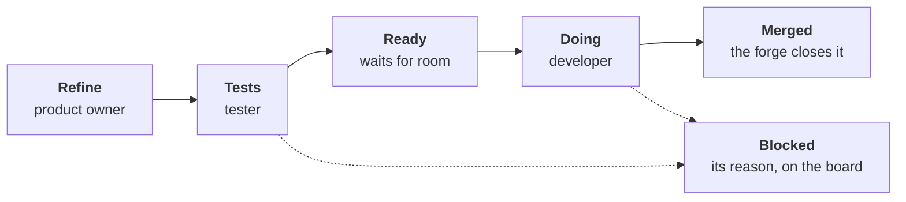

# ADR-0059: An issue moves by its state, each step wakes the next

- **Status:** proposed, until the maintainer merges it
- **Date:** 2026-10-31
- **Decided by:** the maintainer, on 2026-10-31: a line of states, after
  a six-persona panel critiqued their own proposal; the panel's
  recommendations followed ([research](../research/line-of-states.md))
- **Settles:** [#752](https://github.com/JN0V/workline/issues/752)
- **Builds on:** [ADR-0018], [ADR-0042], [ADR-0050], [ADR-0054],
  [ADR-0055], [ADR-0057]; principles 1, 4, 5, 10, 12, 13, 14
- **Amends, once built:** [ADR-0054] and [ADR-0055], their triggers
  (§3) and a person at the end of a dispute (§6); [ADR-0057], three
  slots more (§2); [ADR-0018], who sets which label (§2);
  [ADR-0032], `unready` done alone ([amendment](#amendment-2026-11-01-back-to-refine-needs-no-yes));
  [routing.md](../spec/routing.md), its states and
  [the chaining](#explicit-chaining-and-the-engines-own-writes)
- **Amended by:** [ADR-0060](0060-the-person-is-on-the-loop.md#4-a-person-validates-by-the-issues-kind), once built: Blocked's reason "not reproduced"; a bug's proof kind is always `new-tests`, red on the base;
  [ADR-0063](0063-every-open-issue-is-due-waiting-or-done.md#6-typed-outcomes),
  step 2, built: a run's machine error moves no state and is run again
  within a budget, the record's `lost` read as one; the code a role
  lacked given at its next run;
  [ADR-0063](0063-every-open-issue-is-due-waiting-or-done.md#9-the-developers-write-fence),
  step 3, built: the developer's first step with code only outside the
  Scope sends the issue back to refine, a Scope ask, not Blocked; the
  same files asked twice, whatever the head, block it for a person
- **To be amended by:** [ADR-0065](0065-code-only-what-converges-language-knowledge-in-packs.md#1-red-for-the-right-reason-goes-to-judgement),
  once built: a `red unproven` Draft, its judge unsure, moves the issue
  to ready too; the developer starts, the green proof settles it;
  [change 2, amended](0065-code-only-what-converges-language-knowledge-in-packs.md#2-scope-as-paths-a-hint-not-a-fence)
  2026-11-09: the [2026-11-03 amendment](#amendment-2026-11-03-a-fix-outside-the-scope-asks-the-product-owner)
  reversed, a file outside the Scope applied and listed, no scope-ask

## Context

The evidence in full: [research](../research/line-of-states.md#the-evidence-2026-10-31).

- **Nothing end to end** since about 2026-10-29: one red developer pull
  request ([#699](https://github.com/JN0V/workline/pull/699)), two
  tester Drafts, all open.
- **25 issues `workline:ready`**, weeks old, some stale, some not one
  run's work; refusals and claims said only in CI logs.
- **The night drives the line**: a late, sometimes skipped cron; the
  tester takes one issue a night; Ready wakes the developer before its
  tests exist ([#752](https://github.com/JN0V/workline/issues/752)).

## Decision

- Each arrow is one hop: the engine sets the next label and starts the
  next role at once.
- A reconciler, hourly, does what an event missed: a safety net, not
  the driver.
- The night only tidies: gardening, staleness, the curator.

### 1. Every refusal, claim, wait or block is on the issue

Built first, whatever else.

- **One sticky comment a role on the issue**, edited, never a new one a
  run: what it did, what it waits for and why, the next step
  (principle 14). A refusal in a job's log alone is a defect.
- **A claim with no pull request after `claim-hours` (24)** is released
  by the engine: its label off, the reason in the comment. The
  developer is woken on it again
  ([amended](#amendment-2026-11-02-a-ready-issue-left-free-wakes-the-developer-again)).

### 2. States are labels, one at a time

| State | Label | Board slot | Set by | Wakes |
|---|---|---|---|---|
| Refine | `workline:to-refine` | refine | a new issue; a stale one; the product owner | the product owner |
| Tests | `workline:needs-tests` | tests | the product owner, the need validated | the tester |
| Ready | `workline:ready` | ready | the engine, on the tester's result | the developer, when Doing has room |
| Doing | `workline:developing` | doing | the developer's claim ([ADR-0054]); a round back from a Scope widened ([amended](#amendment-2026-11-03-a-fix-outside-the-scope-asks-the-product-owner)) | — |
| Blocked | `workline:blocked` | blocked | any role, with its reason | nobody; the reconciler re-reads it, the product owner on news ([amended](#amendment-2026-11-01-blocked-is-read-again)) or on the developer's ask for its Scope ([amended](#amendment-2026-11-03-a-fix-outside-the-scope-asks-the-product-owner)) |
| Done | none | done | the forge's close at the merge (`Closes #n`) | — |

- **Exclusive**: the engine puts the new label on and takes the old one
  off, in one call, every forge. On a GitLab board with scoped column
  labels, the forge drops the old column itself ([ADR-0057]).
- **Existing labels kept**: `workline:to-refine`, `workline:ready` and
  `workline:developing` keep their names; two are new.
- **No tester routed**: the product owner goes straight to Ready, as
  today.

### 3. Tests wakes the tester; its result makes Ready

- **`workline:needs-tests`** starts the tester at once, not on the
  night's schedule.
- **Its result moves the issue to Ready**, checked by the engine with
  no agent (principle 4):
  - each Validation scenario has its row in the Draft's `## Tests`
    table;
  - the Draft passes the project's lint.
- **The product owner reads no tests by default.** It is called only
  when the tester says "no test possible", or an objection is about
  the need itself ([ADR-0055]); a review of every Draft waits for
  build step 5.

### 4. A proof kind, not always a new test

| Kind | When | Proof |
|---|---|---|
| `new-tests` | a behaviour to add or a bug to show | the tester's Draft, red first ([ADR-0055]) |
| `flaky-n-of-n` | a flaky test to make reliable ([#619](https://github.com/JN0V/workline/issues/619)) | the named test passes N runs of N |
| `existing-suite` | a refactor | the project's suite, unchanged and green |
| `docs-checks` | a docs change | the documentalist's checks |

- **The tester records the kind and its reason** in its sticky
  comment; the developer accepts it in place of a Draft.
- **"No test possible"** goes to the product owner, which picks a kind
  or sends the issue back to Refine.

### 5. To validate is the pull request's state, not an agent pass

- **A required check**: the frozen tests green, no agent ([ADR-0055]'s
  green proof).
- **A real try only for scenarios marked not tested**, by the tester,
  told under `## Tried` ([ADR-0043]).
- **Done is the merge**, by the project's policy ([ADR-0042]).

### 6. Disagreements end at the product owner, then Blocked

- **The product owner settles** a disagreement between roles, inside
  the existing cap of three exchanges ([ADR-0055]).
- **Past the cap**: Blocked, its reason on the issue and the board. No
  person is asked; a person on the loop reads the column.
- **Goes**: `workline:human` as a request to a person, and
  `objection-person`, whose default it is.

### 7. Staleness, per state

- **One limit per state** in `.workline/config.yaml`, counted from when
  the state's label was set: GitHub's issue timeline, GitLab's
  `resource_label_events`. Never `updated_at`, which any comment moves.
- **First a check with no agent**: the age; the Scope's paths and names
  still in the code. The product owner is woken only for what it flags.
- **Stale goes back to Refine**, with the reason.

### 8. Event-driven, the night for upkeep

- **The state machine lives in the engine**: one table, state → role →
  next state, in the routing's file, read by a pure function.
- **Thin forge adapters**: on GitHub one workflow on `issues: labeled`
  and `workflow_dispatch`; on GitLab one job set, started by a project
  webhook on issue and note events pointed at the project's own
  trigger URL, nothing outside GitLab, any tier
  ([tried](../research/line-of-states.md#tried-after-the-review-gitlab-alone-starts-a-pipeline-on-a-label)).
  The engine reads the event from `$TRIGGER_PAYLOAD`; `workline setup`
  and `doctor` create the hook and its trigger token (both to build).
- **A reconciler**, `workline route reconcile`: walks every open issue
  and runs what is overdue. Hourly in CI; a command on a person's
  machine. A safety net, not the driver: events move the line, and its
  correctness never depends on them. The one waiting longest first
  ([amended](#amendment-2026-11-03-the-one-waiting-longest-first-room-wakes-the-waiting)).
- **Idempotent**: a step re-reads the issue first, and records the
  state it acted on and the body's hash; the same record twice does
  nothing.
- **One concurrency group per issue** across every role: GitHub's
  `concurrency`, GitLab's `resource_group`.

### Explicit chaining and the engine's own writes

- **On GitHub the rule stays**: what the engine writes never wakes the
  line by itself ([routing.md](../spec/routing.md#the-line)). A label
  set by the App is ignored by the state workflow; only a person's
  label is read as an event. The apply job that moved the state starts
  the next step: `workflow_dispatch`.
- **On GitLab the webhook fires on the engine's own writes too**: the
  state label it sets starts the next step's pipeline, no explicit
  start. Any other event of the engine (a comment, a label that is no
  state) exits at once, read from the payload's `user` and `changes`;
  the reviewer's comment on a spec in refine starts refine's step
  ([amended](#amendment-2026-11-02-gitlabs-hook-hears-the-spec-review)).
- **On a machine**, the next loop of `reconcile`.
- **Not a handoff**: `max-handoffs` caps handoffs inside one line run.
  A state hop is a new run. Hops are counted per issue in its record
  and capped (`max-hops`); past the cap, Blocked with the count. The
  cap also stops a loop of GitLab's webhook on the engine's own labels.

### 9. Pull, and room in the next state

- **A role starts only when the next state has room**: a WIP limit per
  state in the config. A full Ready keeps the tester waiting, said on
  the issue. It counts what the developer can take
  ([amended](#amendment-2026-11-02-a-limit-counts-what-can-be-pulled),
  [and again](#amendment-2026-11-03-a-claim-with-no-code-holds-no-scope)).
  Room freed wakes the issues waiting on it
  ([amended](#amendment-2026-11-03-the-one-waiting-longest-first-room-wakes-the-waiting)).
- **A Definition of Ready per state**, checked by the engine:
  - to Tests: the four sections ([routing.md](../spec/routing.md#work-starts-from-a-clear-need)),
    named scenarios, Scope paths that exist, and fits one developer
    run;
  - to Ready: a proof kind, and for `new-tests` the checks of §3.

### 10. Tracked apart, not fixed by states

- **The developer's proof environment**, red on conformance cases it
  never touched ([#760](https://github.com/JN0V/workline/issues/760)).
- **The tester's malformed answer**, asked again once
  ([#761](https://github.com/JN0V/workline/issues/761)).

## Build plan

One pull request a step, its cases first in `tests/conformance/cases/`,
`pending.txt` listing what does not pass.

1. **Written on the issue** (§1,
   [#755](https://github.com/JN0V/workline/issues/755)).
2. **The line**: the state table, the reconciler, explicit chaining,
   the hop cap, proof kinds, GitLab's hook and `$TRIGGER_PAYLOAD` read
   by the engine (§2–§6, §8,
   [#756](https://github.com/JN0V/workline/issues/756)).
3. **A first result**: the ready issues re-checked once by the product
   owner, then two small fresh issues through the line, timed
   ([#757](https://github.com/JN0V/workline/issues/757)).
4. **The board and the flow**: the tests and blocked slots
   ([ADR-0057]), WIP limits, staleness (§7, §9,
   [#758](https://github.com/JN0V/workline/issues/758)).
5. **A product owner's review of the tests**, only if objections after
   step 3 show the need
   ([#759](https://github.com/JN0V/workline/issues/759)).

Docs to update with each step: [routing.md](../spec/routing.md) (its
states, the chaining), [boards.md](../boards.md),
[the developer's triggers](../../roles/developer/docs/triggers.md),
[GitLab's triggers](../gitlab-trigger.md),
[the tester's hand-over](../../roles/tester/docs/hand-over.md) and
[README](../../roles/tester/README.md) (`objection-person`),
[refine](../spec/backlog-acts/refine.md); the "Amended by" lines of the
ADRs above.

## Consequences

- **Need to pull request in hours, not nights**: each hop starts the
  next; the hourly reconciler bounds the wait an event missed.
- **Tokens**: the same agent calls an issue as today, less the
  developer runs that only refused. The reconciler asks no agent.
- **A person reads the board**: Blocked is a column with a reason; no
  label asks them to act.
- **A GitLab project needs its webhook and trigger token**, GitLab's
  own, any tier, a Maintainer to create them; without them, the
  reconciler alone moves the line, hourly. Every issue change starts a
  short pipeline that mostly exits at once. On a self-managed
  instance, an administrator allows webhooks to the local network.

## Not chosen

Each persona's case: [research](../research/line-of-states.md#each-personas-answer).

- **Today's line**: the evidence above, nothing end to end.
- **The maintainer's six states** (to-refine, needs-tests, tests-ready,
  ready-to-dev, to-validate, done): a product owner's re-read of every
  Draft costs an agent call and a hop an issue, for a mismatch the
  engine's scenario check catches (step 5 if objections show it); a
  tester's agent pass at to-validate repeats the green proof; done is
  the forge's close.
- **The tester woken on `workline:ready`** ([#752]'s alternative):
  Ready would mean "tests to come", and the developer still waits.
- **A `workline:human` label**: it asks a person to act; the person is
  on the loop, not in it.
- **The night as the line's engine**: a late or skipped cron stops all
  work.

## Amendment (2026-11-01): back to refine needs no yes

Decided by the maintainer, after the ready issues' re-check
([#757](https://github.com/JN0V/workline/issues/757)) left 11 moves back
to refine waiting for a person's `workline:accepted`.

- **The product owner moves a ready issue back to Refine alone**:
  `workline:ready` or `workline:needs-tests` off, a developer's claim
  `workline:developing` too (§2: one state at a time), `workline:to-refine`
  on, at every autonomy level, a changed need's
  ([ADR-0032]) included.
- **Its reason in the role's one comment** (§1), with how to undo it:
  put `workline:ready` back. No other comment.
- **Why**: the move is cheap and undone by a label; a person's yes
  stopped the line for nothing.
- **Undone by a person**: the next move back on that issue is proposed,
  as any act undone ([ADR-0038]).
- **A move proposed before, still waiting**, is done at the next run,
  with no agent.
- **Other acts keep their rules**: the autonomy levels
  ([ADR-0026]) never named this move.

## Amendment (2026-11-01): Blocked is read again

Settles [#833](https://github.com/JN0V/workline/issues/833): §2 said the
reconciler re-reads Blocked, not how. Eleven issues sat there, each
waiting on the maintainer to free it.

- **News wakes the product owner** on a blocked issue: its body edited,
  a comment by anyone but the engine, an issue it waits on closed
  ([ADR-0028]). Told by the reconciler with no agent, against the line's
  record of the issue when it was blocked or last read.
- **Else once a week**: `routing.revisit`, 7 days by default, the
  rhythm a person on the loop reads the board at; `0` turns it off.
- **It decides alone**, at every level, as back to refine:
  - `unblock` to the state it came from, or to refine;
  - `blocked`, the reason afresh, for a person when only one can lift
    it;
  - or a `close`, by its own rules ([ADR-0024]).
- **Said in its one comment** (§1); a label put back undoes a move.
- **No rule-based move**: a blocker closed, or a comment, says nothing
  of whether the block still holds — the tester's objection, a hop cap,
  a review's findings. Telling news from silence is the engine's;
  judging it, the role's.
- **Cost**: one API call a blocked issue a reconcile (its comments),
  the open issues' listing reused; an agent call only with news, or
  once a week.
- **Not chosen**: like a stale bot ([research](../research/product-owner.md#closing-on-silence-announced-first-2026-10-05)),
  activity alone moving the issue out — a role's verdict would be
  undone by a "+1".

## Amendment (2026-11-02): GitLab's hook hears the spec review

Settles [#846](https://github.com/JN0V/workline/issues/846): §8 named the
hook "on issue and note events"; it was built on issue events alone. A
reviewer's comment on a spec, written in refine's run, woke the product
owner an hour later at best; on GitHub, the apply that wrote it starts
the step.

- **The hook on issue and note events**, where the reviewer is routed
  on `issue`; on issue events alone else. `workline setup` creates it
  so, or turns its note events on; `doctor` warns when they are off.
- **One comment names an issue**: the reviewer's on the spec of an issue
  in refine (its marker, the issue's labels in the event). The line then
  says whether refine is due, as on a label: its record holds the
  review read, so the same review twice runs nothing.
- **Every other comment exits at once**: the engine's own records and
  states, a person's, any on a merge request. The engine's comments
  never start a run: one event, at most one run.
- **Not chosen**: GitHub's explicit start from GitLab's apply job. Its
  state labels fire the hook already: a second pipeline of the same
  step at each hop, for the one comment that needs it.
- **Cost**: every comment in the project starts a short pipeline that
  mostly exits at once, as every issue change does already.

## Amendment (2026-11-02): the reconciler starts its next run

Settles [#845](https://github.com/JN0V/workline/issues/845): §8 says
hourly; GitHub ran the schedule 4 to 6 times a day, gaps of 3 to 7 h,
and a quiet night has no event to start it
([research](../research/reliable-schedule.md)).

- **On GitHub, each reconcile starts the next**, by `workflow_dispatch`,
  even when it failed.
- **The next run waits the wait timer** of the environment
  `workline-heartbeat`, 55 minutes, limited to the default branch: in
  the forge, holding no runner. Then it reconciles.
- **One heartbeat a branch**: a new one cancels the one waiting.
- **The schedule and an issue labelled** start a reconcile only when the
  last is over 55 minutes old and no heartbeat waits: the heartbeat
  stopped. Each such run starts it again.
- **When it last ran** is read from the reconciler's own runs, by name,
  one API call: a run an issue's label starts may not write the Actions
  cache, and the line's own labels each ran a reconcile, cancelling the
  heartbeat waiting ([#853](https://github.com/JN0V/workline/issues/853)).
- **No environment, or no wait timer** (a private repository on
  GitHub's free plan has none): no heartbeat, said in the run's
  summary; the schedule and the events run it, as before.
- **GitLab unchanged**: its pipeline schedules run on time.
- **Measure**: no gap over 90 minutes between two reconciles over 7
  days (`gh run list --workflow workline-develop.yml`); tried on the
  sandbox first.
- **Cost a day**: 24 reconciles, each two short jobs, the heartbeat's
  a few seconds. API calls an hour: a reconcile's own (the open issues'
  listing, one a blocked issue, 4 to list the runs going, 1 for when it
  last ran) and 2 for the next heartbeat: about 20 on this repository,
  10 issues blocked, 2 % of the hour's 1,000; and 1 a `workline:`
  label.
- **Not chosen**:
  - an outside scheduler: nothing outside the forge;
  - a job that sleeps an hour: a runner held all day, and a private
    repository's minutes;
  - the line's runs alone starting it: a quiet night has none.

## Amendment (2026-11-02): a limit counts what can be pulled

Settles [#854](https://github.com/JN0V/workline/issues/854): §9 counted
every issue labelled ready. Ten ready issues waited for their tests,
labelled before the line had a Tests state; Ready, at its limit of 5,
kept the tester off two fresh issues in Tests. The tester waited on
Ready, Ready on the tester: a deadlock, three hours on
([sixth run](https://github.com/JN0V/workline/issues/757#issuecomment-6570780965)).

- **Ready's limit counts what the developer can take**: an issue whose
  tests are there (a tester's Draft open, a proof kind recorded, or no
  named scenario), waiting on no open issue, with no parts. The others
  are counted apart, said in the wait's reason.
- **A ready issue without its tests goes to Tests**, by rule, no agent,
  at the reconciler or its own event: the step it skipped, not a
  judgement on its need. The developer never takes it as it is. Said in
  the line's one comment (§1), with how to undo it: put
  `workline:ready` back.
- **A few a run**: each move wakes the tester, so the reconciler counts
  it in `reconcile-max`, after the steps due. Ten such issues reach
  Tests over a few hours, not ten agent calls at once.
- **Undone by a person, left to them**: a ready issue the line moved
  once and a person put back is not moved again. The line says once
  which label to put on it; it stays counted apart. As a move back
  undone ([amendment](#amendment-2026-11-01-back-to-refine-needs-no-yes)),
  and as [ADR-0032] wants a person's ready moved again only on their word.
- **No ring of limits**: limits on every state of a ring of `next` are
  refused at load. Each step would wait on the next, full, for good.
- **Why no deadlock remains**: a step waits only for room in its
  `next`. An issue counted in a state waits on nothing before it, only
  on its own role and the states after. Only the developer's state held
  issues waiting on a step before it: the product owner and the tester
  take any issue in theirs, whatever it waits on. With no ring of limits, every
  chain of waits ends at a state with no limit or no `next`, which
  drains; each state before it drains in turn. Tested by
  `routing/wip-ready-untested-*` and `routing/wip-no-deadlock-on-a-blocker`.
- **Borrowed from kanban**: an explicit pull policy says what may enter a
  column (a Definition of Ready). An item that does not meet it goes
  back upstream, not into the column's count. A blocked item counted in
  its column makes the team swarm on it; here the blocker sits upstream,
  behind the very limit it fills, so counting it only stops the line.
- **Cost**: at Ready's limit only, one call a run for the tester's open
  Drafts, and one a ready issue with scenarios and no Draft, its
  comments; none below the limit.
- **Not chosen**:
  - Ready's limit lifted: the developer's queue unbounded again;
  - every untested ready issue to Tests at once, ignoring a person who
    put one back: their act undone by a rule;
  - the product owner re-reading each one: an agent call for a check
    the engine does with none (principle 4).

## Amendment (2026-11-02): a ready issue left free wakes the developer again

Settles [#894](https://github.com/JN0V/workline/issues/894): Ready held
5 issues nobody held, each woken once. Three the developer took and let
go after `claim-hours` (§1), no pull request; two it passed over, their
Scope overlapping an issue it held. The record (§8) held the same state,
body and ready label: nothing woke the developer again, and Tests waited
on a full Ready for good.

- **Back from Doing is entering Ready anew** (§8): the claim's label put
  on after the line's last wake, now off, makes the step due again. It
  is a hop: a developer taking and letting go one issue ends at
  `max-hops`, Blocked, the count said on it (§6).
- **An issue passed over for a claim** is due again once that claim
  ends: the record keeps the issues held when the line woke the
  developer.
- **Once for each end, never on a clock**: each wake needs a claim to
  end, by a merge or `claim-hours`. A record from before is due once
  where the developer wrote its comment.
- **A person's issue is theirs**: assigned, it is not woken again.
- **Cost**: at each reconcile, one call per ready issue acted on, its
  claim's label events; the open issues' listing reused.
- **Not chosen**:
  - a wake again after a delay: a run a day on an issue whatever
    changed;
  - a let-go issue back to Refine: its need did not change, only a run
    failed;
  - Ready's limit counting only claims: a free ready issue still never
    woken.

## Amendment (2026-11-03): a fix outside the Scope asks the product owner

Settles [#921](https://github.com/JN0V/workline/issues/921): a review
round on [#909](https://github.com/JN0V/workline/pull/909) found the fix
of its red check, one line of a conformance case outside its issue's
Scope. It wrote nothing and said so on the pull request; the issue
stayed in Doing, the check read at that head, and nothing moved.

- **The Scope is the product owner's**
  ([ADR-0060](0060-the-person-is-on-the-loop.md#2-the-builders-part-is-the-product-owners-at-every-level)):
  the developer asks, never widens it itself.
- **Doing → Blocked, by the developer**: a round that keeps no fix, and
  names files outside the Scope its fix needs (its note's `needs`, or
  a fix there the bounds reverted), blocks its issue. Its one comment (§1) names the files, its agent's note and the
  end of the red check's log, with a mark the line reads.
- **The product owner is woken at once**: the reconciler, first seeing
  the issue blocked with the mark, wakes it as on news. No week, no
  comment needed. Since [2026-11-04](#amendment-2026-11-04-a-widened-scope-resumes-its-round-at-once),
  the job that applied the round wakes it.
- **It decides, as on any blocked issue**, alone:
  - widens: rewrites the Scope (`refine`), then `unblock` to ready;
  - or `blocked`, its reason why not, for a person when only one can
    decide.
- **Ready → Doing, by the round**: the issue back from the ask, the
  red check at the same head is asked again; the round resumes on the
  same pull request with the new bounds, and puts the claim's label
  back. The line starts that round, not the developer's pick, which
  would pass the issue over
  ([amended](#amendment-2026-11-04-a-widened-scope-resumes-its-round-at-once)).
- **Bounded**: one ask a head and a Scope. Asked again on the same, the
  issue is blocked for a person, with no mark. The review's rounds
  (`review-rounds`) cap the rest; the hops do not, since a move out of
  Blocked starts their count again (§8).
- **A round from before**, no fix on a red check and no ask, runs once
  more at its head, to ask, or to block as in the next amendment.
- **Cost**: one agent call of the product owner an ask; one API call a
  reconcile per pull request whose ask waits, the issue's labels.
- **Not chosen**:
  - back to Refine with the developer's note: the product owner would
    re-read the need and send the issue to Tests again, and Refine has
    no way to refuse into Blocked;
  - the developer widening its own Scope: its bounds would be its own;
  - a new issue for the file: the pull request stays red until it
    merges, and the fix is one line of the same change.

## Amendment (2026-11-03): a red check with no fix blocks for a person

Settles [#938](https://github.com/JN0V/workline/issues/938): three
developer pull requests sat red for hours. Each round's agent held the
red check wrong, or objected to a frozen test, and named no file
outside the Scope; the check is asked once a head, so nothing moved.

- **Doing → Blocked, by the developer**: a round that keeps no fix,
  names no file outside the Scope, and was asked a red project check
  blocks its issue. Its one comment (§1) names the checks, its agent's
  note, where its objections went, and the end of the check's log.
  Since [2026-11-04](#amendment-2026-11-04-an-objection-waits-for-the-tester-a-green-head-is-kept),
  a round that objects waits for the tester first.
- **For a person, no mark**: the product owner has no Scope to widen.
- **Ready → Doing, by the round**: a person who fixes the check or the
  test, re-runs it, or widens the Scope moves the issue back; the next
  round asks the check again at the same head.
- **A round from before**, no fix on a red check and nothing asked,
  runs once more at its head, to block.
- **Not chosen**:
  - waking the product owner: nothing of its to decide;
  - asking the check again at the same head: a loop of agent calls.

## Amendment (2026-11-03): a claim with no code holds no Scope

Settles [#952](https://github.com/JN0V/workline/issues/952): two claims
whose agent wrote no code held their Scopes for `claim-hours` (§1).
Four of Ready's five issues overlapped them, passed over; Ready sat at
its limit with one issue the developer could take, and two issues
waited in Tests about five hours, in the ninth end-to-end run.

- **A claim holds its Scope while it holds code**: an open pull request
  closes it. One with none holds nothing: no branch of its can conflict
  with another. The pick, and the record of a wake (`held`, the
  [amendment](#amendment-2026-11-02-a-ready-issue-left-free-wakes-the-developer-again)
  above), read the same rule.
- **The claim itself stays** until `claim-hours`: a pause before its own
  issue is taken again. Let go at once, the next reconcile would take it
  again, an agent call an hour until `max-hops`; the run that wrote no
  code says why on the issue, for a person to read meanwhile.
- **Ready's limit counts it apart**: a ready issue whose Scope overlaps
  a claim holding code waits on that claim, in Doing, a state after: as
  an issue waiting for its tests, it is not one the developer can take
  now. The tester starts on Tests meanwhile. Counted, it would keep
  Tests waiting until that pull request merges, hours or days.
- **No deadlock added**: it waits on a state after Ready, which drains
  by a merge; a pull request closed unmerged holds nothing more.
- **Cost**: at Ready's limit, with a claim open, one call a run for the
  open pull requests; one a developer's wake, the same.
- **Not chosen**:
  - the claim let go at once: a retry loop of agent calls;
  - the claim to Blocked: a failed agent run is no judgement on the
    need, and a retry a day later often codes it;
  - the wait saying when it ends alone: Tests still starved, said.

## Amendment (2026-11-03): an issue left unrefined is woken again

Settles [#951](https://github.com/JN0V/workline/issues/951): a bug in
refine got one product owner run that labelled its kind and named its
sources, no line quoted, and nothing more. The engine dropped the
sources, said only in the job's log. The record (§8) held the same
state, body and labelling: nothing woke the product owner again.

- **A sources needs no quote**: named from the repository's folders, as
  the task says when no code was given, it is written; the issue is
  read again with that code. Named again with that code given, they
  are dropped: the read must refine or ask.
- **Left unrefined is not acted**: a run that read the issue's body as
  it is and left it lacking a section — nothing drafted nor asked, no
  proposal, drafts or question waiting on a person — makes the step
  due again on the same body. The agent is told what its last read left.
- **Bounded**: twice on the same body (the record's `retry`). The third
  time, refine → Blocked, by the line: what it lacks, and what a person
  does, on the issue (§1). A body changed starts the count again.
- **Never silent**: an issue read that got nothing that refines it — a
  kind, an order or a link alone —, says so in the product owner's
  comment on it: what it lacks, each act dropped with why, what comes
  next.
- **Cost**: at most two more agent calls an issue and body; none with
  no agent, which reads nothing, so the count never starts.
- **Not chosen**:
  - a wake on every reconcile until refined: an endless loop of calls;
  - Blocked at once: a run's slip is not a person's work;
  - a retry setting: one more knob for a rare case.

## Amendment (2026-11-03): the one waiting longest first; room wakes the waiting

Settles [#960](https://github.com/JN0V/workline/issues/960): two issues
waited 3 h 25 min in Tests, 2 h after Ready had room. The developer's
claim freed Ready and woke nobody (§9 says "the next event or
reconcile"). Two reconciles then started the backlog's first 3 due
each, all older issues; the new ones were each time "past
reconcile-max".

- **Room freed wakes the waiting**: the job that moved an issue asks
  the line, no agent, which issues' steps wait on a state with a limit
  and have room now (`--input room=true`), and starts each one's run.
  On GitHub the apply job, after the issue's own next step; on GitLab
  the hook's job, on a state's label put on.
- **Only where room can be**: the issues in a state whose `next` has a
  limit; a `next` still full is counted once and its issues not read.
  The waits, blocks and stale moves stay the reconciler's.
- **The one waiting longest first**: the reconciler, and the room's
  listing, start the steps due by how long each waited, not by the
  backlog's order:
  - a first step in its state: since its state's label was put on;
  - a step due again in the same state (a body changed, a claim let
    go, a run lost): since its last run, kept in the record (`ran`).
    A record from before has none: after the others, once;
  - a block or a write with no agent: first, it asks no agent; so is a
    blocked issue read again, due once a news or `revisit` days;
  - ties in the backlog's order.
- **Bounded**: a step started waits anew from its run, behind every
  step due then. With N due ahead of an issue, it starts within
  N / `reconcile-max` runs, whatever its age.
- **Room counted again**: steps are sorted after the walk, so before
  each starts, room in its `next` is counted with the steps started
  before it in the run; one that finds it full waits.
- **Borrowed from kanban**: first in, first out within a column's
  pull; a card that went back gets in line again.
- **Cost**: a move's job, one listing of the open issues, and the
  comments and label events of the issues waiting on a state with room;
  none when it is full. No agent.
- **Not chosen**:
  - a higher `reconcile-max` alone: more starts a run, still the old
    first ([#961](https://github.com/JN0V/workline/pull/961) raised it
    to 8 here, kept);
  - first steps always before re-tries: a stream of new issues starves
    a re-try for good;
  - a reconcile started on each move: every step due, not only those
    room woke, and the heartbeat's hour reset each time.

## Amendment (2026-11-03): a read again is given new code, or none is made

Settles [#980](https://github.com/JN0V/workline/issues/980), amends
"an issue left unrefined is woken again". A bug's first read was given
one config file, not the code it is about. Its sources, named with no
quote, were dropped: the no-quote rule held only when no code was
given. Each read again got the same input; Blocked after three.

- **A quote only from code shown**: a `sources` naming only paths the
  run did not give — each neither in nor holding one the issue's state,
  title or body names — needs no line quoted. The issue is read again
  with them. One naming code given too still quotes it.
- **Never the same input twice**: the line's record keeps the code
  each wake gave, the state's sources (`given`). Left unrefined with
  the same sources, the issue is not woken again: Blocked at once, the
  code it got said on it. New sources wake it, twice at most as before.
  This takes back "Blocked at once" from that amendment's not chosen,
  for the same input only: a read again on it asked the same thing.
- **Cost**: fewer agent calls; a record from before has no `given`,
  woken as before.
- **Not chosen**: listing the repository's folders on every read: the
  task grows for every issue; the folders named are enough.

## Amendment (2026-11-04): an objection waits for the tester; a green head is kept

Settles [#987](https://github.com/JN0V/workline/issues/987): a green
fix ([#967](https://github.com/JN0V/workline/pull/967)) was made red by
its own review round, the reviewer asking to remove the line its frozen
test needed. The next round objected to the test, posted on the
tester's Draft, and blocked the issue for a person (the amendment
above); the tester rewrote the test four minutes later, the issue
blocked and the rounds' cap spent.

- **A green head is kept**: a round on a head whose last proof is green,
  no red check asked, does not push a fix its proof finds red on a
  frozen test; red on its own tests only, it is pushed, the next round
  fixes them. The green code is never undone for a finding: a frozen test
  is the tester's ([ADR-0055]), the Scope the product owner's ([ADR-0060](0060-the-person-is-on-the-loop.md)).
- **Doing stays Doing, the objection waits for the tester**: a round
  that objects, code pushed or not, and names no file outside the
  Scope, does not block its issue. Its record says it objected at this
  head.
  - A rewrite is the next round, as before ([#939](https://github.com/JN0V/workline/issues/939)).
  - A test kept, the tester's answer on its Draft, is news: the round
    asks again at the same head what it held. Once a head: objected
    again there, it blocks for a person, as the amendment above.
- **Held with nothing asked**: a fix kept off a green head, with no
  objection and no file named, blocks for a person, the red tests and
  the findings on the issue; sent back, the findings are asked again.
- **A frozen test red** is told by name: a red test's last part is a
  frozen file's name, or a word in it. No match, the old rule: pushed
  red, the next round reads the check.
- **Cost**: one call of the forge a round with a tester's Draft (its
  threads, the answers that kept a test); one a reconcile per pull
  request whose objection waits. No agent.
- **Not chosen**:
  - the issue blocked for a person on an objection: the tester answers
    within minutes, a person is the bottleneck ([ADR-0060](0060-the-person-is-on-the-loop.md));
  - the reviewer's finding dropped: it stays, answered by the round's
    note; a warning holds no merge;
  - waking the product owner on every objection: the test is the
    tester's to keep or rewrite, the product owner's only past the
    three exchanges (§6).

## Amendment (2026-11-04): an overlap ends where its Scope reads as a guess

Settles [#998](https://github.com/JN0V/workline/issues/998): a bug,
refined before the `Guessed:` mark
([#970](https://github.com/JN0V/workline/issues/970)), waited behind a
feature's claim. Its Scope said in words that no code was given. The
feature's pull request, green, waited for a person's yes: nothing woke
the bug.

- **A Scope's own words count as the mark**: one saying no code was
  given or read when it was written ("no `init` code was given in this
  run") is a guess, as a line `Guessed:` is. It overlaps nothing. No
  agent call: the developer reads the code as it builds, and asks the
  product owner to widen a Scope too narrow
  ([amendment](#amendment-2026-11-03-a-fix-outside-the-scope-asks-the-product-owner)).
- **An overlap that ended wakes the issue**: a ready issue the
  developer passed over for an overlap is due again once its Scope
  overlaps no claim held, whatever ended it. Before, only a claim held
  at the wake and held no more woke it. Once for the developer's comment
  that said the overlap (`unheld`): a run that leaves it as it is does
  not wake the issue again.
- **The wait names a person's yes**: passed over for an issue that is
  not a bug, whose pull request is open, the issue's comment says that
  pull request merges on a person's yes. Only a fix merges alone
  ([ADR-0060](0060-the-person-is-on-the-loop.md)).
- **A bug still waits on a claim's pull request**, even one green and
  waiting for a yes. Taken, its pull request would touch the same
  files: the one merged second meets a conflict. On the feature's side,
  its head would move under the person reading it, its review run again.
- **Cost**: none more for the wake: the claims' listing is already
  read for `held`.
- **Not chosen**:
  - waking the product owner to read the Scope again: an agent call
    for paths the developer reads anyway;
  - a bug taking a Scope a waiting feature holds: a conflict moved
    onto the pull request a person is reading.

## Amendment (2026-11-04): a widened Scope resumes its round at once

Settles [#1013](https://github.com/JN0V/workline/issues/1013): the
product owner widened
[#949](https://github.com/JN0V/workline/issues/949)'s Scope at the
developer's ask and moved it to ready. The job that applied it started
the Ready step: the developer's pick passed the issue over, its pull
request closing it, and no round ran. The ask itself had waited 47
minutes for the hourly reconcile.

- **Ready's step on an issue with its own pull request is its round**:
  in the developer's state, the developer's pull request open from
  `workline/developer/<n>`, the issue is no new claim. The line lists
  the round on that pull request (`reviews`), not the issue's step,
  and writes no record: the round moves it to Doing.
- **The job that moved it starts the round**: on GitHub, the apply's
  next step starts each round listed, by `workflow_dispatch`; on
  GitLab, the issue webhook's job, as for a round the reconciler lists.
- **The round's own moves chain too**: once `review-apply` applied, it
  asks the line whether the issue's new state is due, and starts it.
  Blocked on a Scope ask, the product owner is woken within a minute,
  not at the next reconcile. GitLab's issue webhook already did.
- **The reconciler stays the net**: it lists the round with the
  others, and leaves the issue alone.
- **A person's own pull request** closing a ready issue, from another
  branch, changes nothing: the developer's step passes it over.
- **Cost**: one merge requests listing a run that reaches a ready
  issue's due step, kept for the run; one engine call more after each
  round applied, and at most 30 s of its job waiting for GitHub's
  listing.
- **Not chosen**:
  - the developer's pick resuming the round itself: an issue run would
    then work on a pull request, which a round's own job does, its
    concurrency and its apply from that head;
  - waking the product owner from the round's own run: it holds the
    agent's token and no write one.

## Amendment (2026-11-04): progress starts the hop count again

Settles [#1068](https://github.com/JN0V/workline/issues/1068): on a
trial copy, an issue went between refine and tests four times, then
got its tests and reached ready at its 9th step. `max-hops` (8)
blocked it, its tests written and waiting.

- **The cap counts the steps since the last progress**: the record
  keeps `reached`, the furthest state the issue was in, along each
  state's `next`. A step into a state further than it is hop 1.
- **Reset, not "progress does not count"**: an issue that spent 8 hops
  before reaching ready would else have none left for the developer's
  steps; reset gives each stretch of the line the whole cap.
- **Loops still end**: `reached` only moves forward, so the count
  starts again at most once per state of the line. Back in a state
  reached before (retested, stale, freed), the count goes on.
- **A record from before** has no `reached`: its state stands for it,
  or the state it was blocked from.
- **Not chosen**:
  - a higher `max-hops`: the next issue needing one more try would hit
    it;
  - counting backward moves alone: refine to tests is a forward move
    each time in a refine and tests loop.

[ADR-0024]: 0024-obsolete-is-announced-then-closed-on-silence-and-a-second-judge.md
[ADR-0028]: 0028-an-issue-names-what-it-waits-on.md
[#752]: https://github.com/JN0V/workline/issues/752
[ADR-0026]: 0026-the-product-owners-autonomy-is-a-level.md
[ADR-0032]: 0032-a-changed-need-flags-the-issues-built-on-it.md
[ADR-0038]: 0038-the-product-owner-proposes-on-the-issue-a-person-answers-there.md
[ADR-0018]: 0018-the-product-owner.md
[ADR-0042]: 0042-the-engine-merges-by-the-projects-policy.md
[ADR-0043]: 0043-a-try-is-told-in-its-pull-request.md
[ADR-0050]: 0050-each-act-has-its-moment-and-a-wait-budget.md
[ADR-0054]: 0054-the-developer-takes-a-ready-issue-to-a-pull-request.md
[ADR-0055]: 0055-the-tester-writes-the-acceptance-tests-before-the-code.md
[ADR-0057]: 0057-workline-finds-the-forges-board-and-moves-its-cards.md
