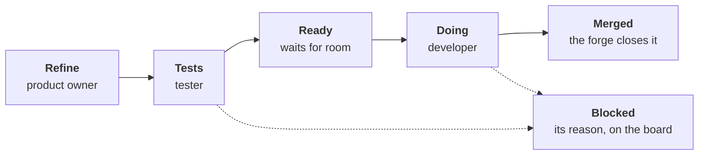

# ADR-0059: An issue moves by its state, each step wakes the next

- **Status:** proposed, until the maintainer merges it
- **Date:** 2026-10-31
- **Decided by:** the maintainer, on 2026-10-31: a line of states, after
  a six-persona panel critiqued their own proposal; the panel's
  recommendations followed ([research](../research/line-of-states.md))
- **Settles:** [#752](https://github.com/JN0V/workline/issues/752)
- **Builds on:** [ADR-0018], [ADR-0042], [ADR-0050], [ADR-0054],
  [ADR-0055], [ADR-0057]; principles 1, 4, 5, 10, 12, 13, 14
- **Amends, once built:** [ADR-0054] and [ADR-0055], their triggers
  (§3) and a person at the end of a dispute (§6); [ADR-0057], three
  slots more (§2); [ADR-0018], who sets which label (§2);
  [routing.md](../spec/routing.md), its states and
  [the chaining](#explicit-chaining-and-the-engines-own-writes)

## Context

The evidence in full: [research](../research/line-of-states.md#the-evidence-2026-10-31).

- **Nothing end to end** since about 2026-10-29: one red developer pull
  request ([#699](https://github.com/JN0V/workline/pull/699)), two
  tester Drafts, all open.
- **25 issues `workline:ready`**, weeks old, some stale, some not one
  run's work; refusals and claims said only in CI logs.
- **The night drives the line**: a late, sometimes skipped cron; the
  tester takes one issue a night; Ready wakes the developer before its
  tests exist ([#752](https://github.com/JN0V/workline/issues/752)).

## Decision

- Each arrow is one hop: the engine sets the next label and starts the
  next role at once.
- A reconciler, hourly, does what an event missed.
- The night only tidies: gardening, staleness, the curator.

### 1. Every refusal, claim, wait or block is on the issue

Built first, whatever else.

- **One sticky comment a role on the issue**, edited, never a new one a
  run: what it did, what it waits for and why, the next step
  (principle 14). A refusal in a job's log alone is a defect.
- **A claim with no pull request after `claim-hours` (24)** is released
  by the engine: its label off, the reason in the comment.

### 2. States are labels, one at a time

| State | Label | Board slot | Set by | Wakes |
|---|---|---|---|---|
| Refine | `workline:to-refine` | refine | a new issue; a stale one; the product owner | the product owner |
| Tests | `workline:needs-tests` | tests | the product owner, the need validated | the tester |
| Ready | `workline:ready` | ready | the engine, on the tester's result | the developer, when Doing has room |
| Doing | `workline:developing` | doing | the developer's claim ([ADR-0054]) | — |
| Blocked | `workline:blocked` | blocked | any role, with its reason | nobody; the reconciler re-reads it |
| Done | none | done | the forge's close at the merge (`Closes #n`) | — |

- **Exclusive**: the engine puts the new label on and takes the old one
  off, in one call, every forge. On a GitLab board with scoped column
  labels, the forge drops the old column itself ([ADR-0057]).
- **Existing labels kept**: `workline:to-refine`, `workline:ready` and
  `workline:developing` keep their names; two are new.
- **No tester routed**: the product owner goes straight to Ready, as
  today.

### 3. Tests wakes the tester; its result makes Ready

- **`workline:needs-tests`** starts the tester at once, not on the
  night's schedule.
- **Its result moves the issue to Ready**, checked by the engine with
  no agent (principle 4):
  - each Validation scenario has its row in the Draft's `## Tests`
    table;
  - the Draft passes the project's lint.
- **The product owner reads no tests by default.** It is called only
  when the tester says "no test possible", or an objection is about
  the need itself ([ADR-0055]); a review of every Draft waits for
  build step 5.

### 4. A proof kind, not always a new test

| Kind | When | Proof |
|---|---|---|
| `new-tests` | a behaviour to add or a bug to show | the tester's Draft, red first ([ADR-0055]) |
| `flaky-n-of-n` | a flaky test to make reliable ([#619](https://github.com/JN0V/workline/issues/619)) | the named test passes N runs of N |
| `existing-suite` | a refactor | the project's suite, unchanged and green |
| `docs-checks` | a docs change | the documentalist's checks |

- **The tester records the kind and its reason** in its sticky
  comment; the developer accepts it in place of a Draft.
- **"No test possible"** goes to the product owner, which picks a kind
  or sends the issue back to Refine.

### 5. To validate is the pull request's state, not an agent pass

- **A required check**: the frozen tests green, no agent ([ADR-0055]'s
  green proof).
- **A real try only for scenarios marked not tested**, by the tester,
  told under `## Tried` ([ADR-0043]).
- **Done is the merge**, by the project's policy ([ADR-0042]).

### 6. Disagreements end at the product owner, then Blocked

- **The product owner settles** a disagreement between roles, inside
  the existing cap of three exchanges ([ADR-0055]).
- **Past the cap**: Blocked, its reason on the issue and the board. No
  person is asked; a person on the loop reads the column.
- **Goes**: `workline:human` as a request to a person, and
  `objection-person`, whose default it is.

### 7. Staleness, per state

- **One limit per state** in `.workline/config.yaml`, counted from when
  the state's label was set: GitHub's issue timeline, GitLab's
  `resource_label_events`. Never `updated_at`, which any comment moves.
- **First a check with no agent**: the age; the Scope's paths and names
  still in the code. The product owner is woken only for what it flags.
- **Stale goes back to Refine**, with the reason.

### 8. Event-driven, the night for upkeep

- **The state machine lives in the engine**: one table, state → role →
  next state, in the routing's file, read by a pure function.
- **Thin forge adapters**: on GitHub one workflow on `issues: labeled`
  and `workflow_dispatch`; on GitLab one job set, started by the
  pipelines API.
- **A reconciler**, `workline route reconcile`: walks every open issue
  and runs what is overdue. Hourly in CI; a command on a person's
  machine. Events only make the line faster: its correctness never
  depends on them.
- **Idempotent**: a step re-reads the issue first, and records the
  state it acted on and the body's hash; the same record twice does
  nothing.
- **One concurrency group per issue** across every role: GitHub's
  `concurrency`, GitLab's `resource_group`.

### Explicit chaining and the engine's own writes

- **The rule stays**: what the engine writes never wakes the line by
  itself ([routing.md](../spec/routing.md#the-line)). A label set by
  the App is ignored by the state workflow; only a person's label is
  read as an event.
- **The next step is started explicitly**, by the apply job that moved
  the state: `workflow_dispatch` on GitHub, a pipeline by the API on
  GitLab, the next loop of `reconcile` on a machine. It does not depend
  on which token set the label.
- **Not a handoff**: `max-handoffs` caps handoffs inside one line run.
  A state hop is a new run. Hops are counted per issue in its record
  and capped (`max-hops`); past the cap, Blocked with the count.

### 9. Pull, and room in the next state

- **A role starts only when the next state has room**: a WIP limit per
  state in the config. A full Ready keeps the tester waiting, said on
  the issue.
- **A Definition of Ready per state**, checked by the engine:
  - to Tests: the four sections ([routing.md](../spec/routing.md#work-starts-from-a-clear-need)),
    named scenarios, Scope paths that exist, and fits one developer
    run;
  - to Ready: a proof kind, and for `new-tests` the checks of §3.

### 10. Tracked apart, not fixed by states

- **The developer's proof environment**, red on conformance cases it
  never touched ([#760](https://github.com/JN0V/workline/issues/760)).
- **The tester's malformed answer**, asked again once
  ([#761](https://github.com/JN0V/workline/issues/761)).

## Build plan

One pull request a step, its cases first in `tests/conformance/cases/`,
`pending.txt` listing what does not pass.

1. **Written on the issue** (§1,
   [#755](https://github.com/JN0V/workline/issues/755)).
2. **The line**: the state table, the reconciler, explicit chaining,
   the hop cap, proof kinds (§2–§6, §8,
   [#756](https://github.com/JN0V/workline/issues/756)).
3. **A first result**: the ready issues re-checked once by the product
   owner, then two small fresh issues through the line, timed
   ([#757](https://github.com/JN0V/workline/issues/757)).
4. **The board and the flow**: the tests and blocked slots
   ([ADR-0057]), WIP limits, staleness (§7, §9,
   [#758](https://github.com/JN0V/workline/issues/758)).
5. **A product owner's review of the tests**, only if objections after
   step 3 show the need
   ([#759](https://github.com/JN0V/workline/issues/759)).

Docs to update with each step: [routing.md](../spec/routing.md) (its
states, the chaining), [boards.md](../boards.md),
[the developer's triggers](../../roles/developer/docs/triggers.md),
[the tester's hand-over](../../roles/tester/docs/hand-over.md) and
[README](../../roles/tester/README.md) (`objection-person`),
[refine](../spec/backlog-acts/refine.md); the "Amended by" lines of the
ADRs above.

## Consequences

- **Need to pull request in hours, not nights**: each hop starts the
  next; the hourly reconciler bounds the wait an event missed.
- **Tokens**: the same agent calls an issue as today, less the
  developer runs that only refused. The reconciler asks no agent.
- **A person reads the board**: Blocked is a column with a reason; no
  label asks them to act.
- **A GitLab project needs its webhook tool** for events; without it,
  the reconciler alone moves the line, hourly.

## Not chosen

Each persona's case: [research](../research/line-of-states.md#each-personas-answer).

- **Today's line**: the evidence above, nothing end to end.
- **The maintainer's six states** (to-refine, needs-tests, tests-ready,
  ready-to-dev, to-validate, done): a product owner's re-read of every
  Draft costs an agent call and a hop an issue, for a mismatch the
  engine's scenario check catches (step 5 if objections show it); a
  tester's agent pass at to-validate repeats the green proof; done is
  the forge's close.
- **The tester woken on `workline:ready`** ([#752]'s alternative):
  Ready would mean "tests to come", and the developer still waits.
- **A `workline:human` label**: it asks a person to act; the person is
  on the loop, not in it.
- **The night as the line's engine**: a late or skipped cron stops all
  work.

[#752]: https://github.com/JN0V/workline/issues/752
[ADR-0018]: 0018-the-product-owner.md
[ADR-0042]: 0042-the-engine-merges-by-the-projects-policy.md
[ADR-0043]: 0043-a-try-is-told-in-its-pull-request.md
[ADR-0050]: 0050-each-act-has-its-moment-and-a-wait-budget.md
[ADR-0054]: 0054-the-developer-takes-a-ready-issue-to-a-pull-request.md
[ADR-0055]: 0055-the-tester-writes-the-acceptance-tests-before-the-code.md
[ADR-0057]: 0057-workline-finds-the-forges-board-and-moves-its-cards.md
