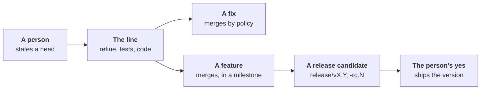

# ADR-0060: The person is on the loop: questions time out, autonomy per role, features wait for a release candidate

- **Status:** accepted (2026-11-02)
- **Date:** 2026-11-02
- **Decided by:** the maintainer, on 2026-11-02: the six decisions
  below, in substance; the three points under
  [For the maintainer](#for-the-maintainer) as proposed
- **Builds on:** [ADR-0018], [ADR-0021], [ADR-0022], [ADR-0039],
  [ADR-0054], [ADR-0055]; principles 1, 4, 12, 14
- **Amends, once built:** [ADR-0026] (levels per role; drafts on
  silence; its threshold moved to the candidate), [ADR-0038] ("silence
  is never a yes", for questions), [ADR-0018] (a Validation draft taken
  as an assumption), [ADR-0039] (a bug not reproduced is Blocked),
  [ADR-0042] and [ADR-0054] (a feature's yes moves to the candidate at
  `enterprising`), [ADR-0017] (the candidate's branch), [ADR-0059]
  (Blocked's reason; the bug's proof kind)
- **To be amended by:** [ADR-0065](0065-code-only-what-converges-language-knowledge-in-packs.md#2-scope-as-paths-a-hint-not-a-fence),
  once built: §2's "the developer asks it to widen the Scope" goes; a
  file outside the Scope is applied and listed on the pull request
- **Amended by:** [ADR-0066](0066-a-role-mirrors-a-human-role-ai-first-where-code-is-rigid.md#1-a-role-mirrors-a-human-role),
  built in [#1261](https://github.com/JN0V/workline/issues/1261): §2's
  Verification moves to the tester; the product owner keeps the Scope,
  as a hint
- **Research:** [person-on-the-loop.md](../research/person-on-the-loop.md)
- **Amended by:** [ADR-0068](0068-the-line-steps-back-on-its-own-drift.md#8-a-release-is-split-by-its-nature)
  (not built): §4's "a version ships on a person's yes" holds for a
  feature release; a fixes-only release ships after the process
  engineer's step back, a setting on workline only for now. §3: the
  process engineer has a level, starting `cautious`. §1 confirmed:
  silence is never a yes to merge, release or delete

## Context

- **A person's answer stops the line.** On
  [#844](https://github.com/JN0V/workline/issues/844), the reviewer found
  a problem in a Verification the maintainer wrote. `Revisable`
  (`internal/backlog/spec.go`) leaves a person's section to them, so the
  product owner asked and waits, since 2026-11-01.
- **Questions wait for ever.** [ADR-0038]: "Silence is never a yes". At
  `cautious` and `normal` alike, an unanswered question holds the issue
  in refine.
- **One level, two places.** Only the product owner ([ADR-0026]) and the
  merge ([ADR-0042]) have a level. The tester, the developer and the
  reviewer have none.
- **A feature waits on each pull request.** At `normal`, a fix or a task
  merges alone; a feature, or an issue with no kind, waits for a
  person's yes ([the developer's merge](../../roles/developer/docs/merge.md)).
  On 2026-11-02, four developer pull requests wait so
  ([#808](https://github.com/JN0V/workline/pull/808),
  [#809](https://github.com/JN0V/workline/pull/809),
  [#810](https://github.com/JN0V/workline/pull/810),
  [#817](https://github.com/JN0V/workline/pull/817)): their issues have
  no kind.

## Decision

- **The goal**: a person describes a need; the line does the rest, as
  far as its autonomy setting lets it.
- **A person is on the loop, never a bottleneck**: they read and correct
  what the line did; no step waits on them for ever but the ones below.

### 1. Questions time out, as lazy consensus

- **The product owner asks on the issue** when a need is unclear, as
  today ([ADR-0021], [ADR-0038]).
- **Without an answer after the level's delay**, it goes on with its
  best assumption, written plainly on the issue: "Assumption taken: …".
  The person corrects it later; an answer against it is a changed need
  ([ADR-0032]).
- **The person's Need is never rewritten**: assumptions are written
  beside it, in a section the product owner owns.
- **The delay, by level**:

  | Level | A question unanswered |
  |---|---|
  | `cautious` | waits for the answer |
  | `normal` | waits a set delay (a setting, 24 h by default), then the assumption |
  | `enterprising` | asks and goes on at once, the assumption written in the same run |

- **A Validation draft is a question too**: unanswered past the delay,
  at `normal` and `enterprising`, it is taken as an assumption and the
  issue may go on. At `cautious`, `ready` still needs a person's
  Validation ([ADR-0026]).
- **Silence is still never a yes** to close, merge or release: an
  assumption is written, and undone by a comment.
- **Why**: Apache's lazy consensus states the plan where people read,
  waits a set time, then goes on; an agent writes its defaults in an
  Assumptions section ([research](../research/person-on-the-loop.md)).

### 2. The builder's part is the product owner's, at every level

- **Verification and Scope** (below the `---`) are the product owner's
  at every level, even when a person wrote them: it rewrites them to
  answer the reviewer, without asking. Amended by [ADR-0066], built in
  [#1261](https://github.com/JN0V/workline/issues/1261): the
  Verification is the tester's; a finding there goes to the tester.
- **Need and Validation stay the person's**, with an Example and Steps
  to reproduce: never rewritten, as today.
- **Changes `Revisable`**: today a finding in a person's Verification
  makes the product owner ask and wait ([#844]).
- **Said in its one comment**: "Changed: Verification"; the text before
  is in the forge's edit history.
- **The developer asks it to widen the Scope** when a fix lies outside
  it; it widens it or says why not, alone
  ([ADR-0059, amended](0059-an-issue-moves-by-its-state-each-step-wakes-the-next.md#amendment-2026-11-03-a-fix-outside-the-scope-asks-the-product-owner)).

### 3. Autonomy is a level per role

- **Each role a level of its own**, `cautious`, `normal` or
  `enterprising`: product owner, tester, developer, reviewer, merge, and
  each role to come.
- **One project default**, a top-level `autonomy:`; a role's own level
  over it; `merge: {autonomy: …}` stays the merge's.
- **Precedence**, said in each task: a kind demoted ([ADR-0025]), an
  act's explicit setting, the role's level, the project's default, the
  role's own default.
- **What a level means is the role's**, in its `role.yaml` `levels`
  ([ADR-0026]); a role with no levels ignores the default, said by
  `workline doctor`.

### 4. A person validates by the issue's kind

The kind is the forge's ([ADR-0039]): bug, feature, task.

- **A bug fix never needs a person**:
  - reproduced first: the tester's failing test confirms the bug on the
    base, which removes any doubt ([ADR-0055], proof kind `new-tests`);
  - then fixed; it merges by the policy once every gate passes.
- **A bug that cannot be reproduced**: its reporter is asked, with the
  same delay as a question. No answer: Blocked, reason "not reproduced"
  ([ADR-0059]). Never turned into a feature, never fixed blind.
- **A bug fix is never a feature**, whatever its size.
- **A task** waits for a person's yes, as a feature does
  ([amended 2026-11-03](#amendment-2026-11-03-a-task-waits-as-a-feature)).
- **A feature** (a function the person has not seen):
  - goes into a milestone;
  - when the milestone's issues are all merged, the line cuts a release
    candidate on a versioned branch, `release/vX.Y`, tagged
    `vX.Y.0-rc.N` by the project's release tool ([ADR-0017]);
  - the person tries it; their yes ships the version.
- **At `enterprising`, the candidate is the only person step.**

| Merge level | A fix | A feature, a task |
|---|---|---|
| `cautious` | a person's yes on the pull request | a person's yes on the pull request |
| `normal` | merges by the policy | a person's yes on the pull request, as today |
| `enterprising` | merges by the policy | merges by the policy; the person's yes on the candidate |

- **At every level, a version ships on a person's yes** ([ADR-0042]:
  never a release without one).

### 5. The guard kept: the person checks the result

- **[ADR-0026]'s threshold moves** from each issue to the release
  candidate: drafts accepted unchanged were counted to let
  `enterprising` move drafts on silence; now the person checks the
  result, not each text.
- **A candidate refused** is recorded with its milestone, as an act
  undone is ([ADR-0026]); what it demotes is proposed below.

## For the maintainer

Decided as proposed, by the maintainer, on 2026-11-02.

1. **A fix release between candidates**: proposed, a patch from the last
   release branch, the fix backported, as Rust's beta and git-flow's
   release branch take fixes. Or released from `main`, which then ships
   features nobody tried.
2. **A feature with no milestone**: proposed, the product owner puts it
   in the next open milestone; none open, it opens one.
3. **A candidate refused**: proposed, the merge's `enterprising` falls
   back to `normal` for features until a person sets it again, said in
   one issue, as a revert demotes a kind ([ADR-0042]).

## Build plan

One pull request a step, its cases first in `tests/conformance/cases/`,
`pending.txt` listing what does not pass.

1. **The builder's part, the product owner's** (§2,
   [#857](https://github.com/JN0V/workline/issues/857)): unblocks issues
   held on a person's Verification today, [#844] among them. Small, no
   setting.
2. **Questions time out into assumptions** (§1,
   [#858](https://github.com/JN0V/workline/issues/858)): unblocks
   issues waiting on an answer; gives step 3 its delay.
3. **Fixes merge alone, bugs reproduced first** (§4,
   [#859](https://github.com/JN0V/workline/issues/859)): the kind set by
   the product owner, a bug's red test required, "not reproduced"
   Blocked. Unblocks pull requests held for an unknown kind; step 5
   needs fixes told from features.
4. **Autonomy per role** (§3,
   [#860](https://github.com/JN0V/workline/issues/860)): the key and
   its precedence. Lets step 5 set the merge at `enterprising` apart
   from the other roles.
5. **Milestone, release candidate, the person's yes ships** (§4–§5,
   [#861](https://github.com/JN0V/workline/issues/861)): research on
   pre-releases first. Ends a feature's yes on each pull request.
   *Built*: [the release candidate](../release-candidate.md); the yes is
   the label `workline:accepted` on the candidate's issue; release-please
   asked for each version by its `Release-As:` footer. Not yet: a patch
   release after the version shipped
   ([#880](https://github.com/JN0V/workline/issues/880)), the version's
   notes and changelog
   ([#879](https://github.com/JN0V/workline/issues/879)), GitLab's
   template ([#881](https://github.com/JN0V/workline/issues/881)).

Docs to update with each step: [writing.md](../../roles/product-owner/docs/writing.md),
[refine](../spec/backlog-acts/refine.md), [settings](../../roles/product-owner/docs/settings.md),
[the developer's merge](../../roles/developer/docs/merge.md),
[the merge policy](../merge-policy.md) and [at `normal`](../merge-policy-normal.md),
[config.md](../config.md); the "Amended by" lines of the ADRs above.

## Consequences

- **A need to a merged fix with no person**: a question costs a delay,
  not a stop.
- **The person's work moves to the end**: correcting assumptions when
  they read the issue; trying one candidate a milestone.
- **More is merged on `main` that no person saw** at `enterprising`:
  features, until the candidate. A project that wants each feature
  seen stays at `normal`.
- **Assumptions can be wrong**: a late answer reworks what was built
  on them; the cost of a delay that is too short, set per level.
- **Tokens**: no new agent call; an assumption is written in the run
  that asked, or the one after the delay.

## Not chosen

- **Waiting for every answer**: the line stood still on [#844] for a
  question about one flag.
- **Silence as a yes to the draft**: the draft would read as the
  person's; an assumption says it is the product owner's.
- **Rewriting the person's Need** to fold an answer in: the Need is
  what the person accepts against ([ADR-0018]).
- **A bug not reproduced turned into a feature**, or fixed from a
  guess: a fix with no failing test proves nothing.
- **A person's yes on every feature at every level**: the person checks
  each text, not the result; at `normal` it stays a choice.
- **Feature flags in the code**: they need the project's code to carry
  them; a release branch needs only the forge and the release tool.

## Amendment (2026-11-03): a task waits as a feature

- **Why**: a `task` is a label an agent may put. On 2026-11-03 the
  product owner's light read labelled
  [#83](https://github.com/JN0V/workline/issues/83) `task` at 09:36; the
  policy merged [#809](https://github.com/JN0V/workline/pull/809) at
  09:44 with no person's yes. #83 was a person's own try: the public
  quickstart changed unasked.
- **Decided by** the maintainer: only a reproduced bug's fix merges
  alone; a task waits for a person's yes, as a feature does
  ([#937](https://github.com/JN0V/workline/issues/937)).
- **At `enterprising`**, a task goes into a milestone as a feature
  does: the person's yes is on the candidate.

[ADR-0017]: 0017-the-release-manager.md
[ADR-0018]: 0018-the-product-owner.md
[ADR-0021]: 0021-the-product-owner-talks-with-the-reporter.md
[ADR-0022]: 0022-a-split-keeps-the-need-a-rename-keeps-a-persons-title.md
[ADR-0025]: 0025-a-persons-tick-is-done-ignored-runs-pause.md
[ADR-0026]: 0026-the-product-owners-autonomy-is-a-level.md
[ADR-0032]: 0032-a-changed-need-flags-the-issues-built-on-it.md
[ADR-0038]: 0038-the-product-owner-proposes-on-the-issue-a-person-answers-there.md
[ADR-0039]: 0039-issue-sections-are-read-by-meaning-the-kind-is-the-forges.md
[ADR-0042]: 0042-the-engine-merges-by-the-projects-policy.md
[ADR-0054]: 0054-the-developer-takes-a-ready-issue-to-a-pull-request.md
[ADR-0055]: 0055-the-tester-writes-the-acceptance-tests-before-the-code.md
[ADR-0059]: 0059-an-issue-moves-by-its-state-each-step-wakes-the-next.md
[#844]: https://github.com/JN0V/workline/issues/844
[ADR-0066]: 0066-a-role-mirrors-a-human-role-ai-first-where-code-is-rigid.md
