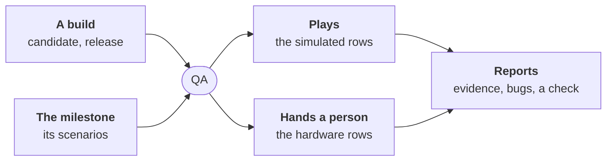

# ADR-0062: The QA role plays a campaign on a running build, apart from the tester

- **Status:** proposed, until the maintainer merges it
- **Date:** 2026-11-04
- **Decided by:** the maintainer, on 2026-11-04: the tester's job and
  the QA's job are two roles; the rest as proposed below
- **Builds on:** [ADR-0017], [ADR-0018], [ADR-0046], [ADR-0051],
  [ADR-0055], [ADR-0059], [ADR-0060]; principles 1, 2, 4, 5, 10, 12, 13, 14
- **Research:** [qa-campaigns.md](../research/qa-campaigns.md)

## Context

- **The tester proves scenarios, before the code**: one test a named
  scenario, red on the base, frozen for the builder ([ADR-0055]). It
  never sees the application run.
- **Nobody checks the running build.** At `enterprising`, features
  merge alone; a person tries the release candidate and says yes
  ([ADR-0060]). What to try, on which cases, and what was seen, is
  left to that person's memory.
- **[#264](https://github.com/JN0V/workline/issues/264) asked** whether
  a human test plan belongs to the tester; the assumption taken left it
  to a separate issue.
- **Two projects show the gap**:
  - *DomoticsCore*, a C++ framework for ESP32: host tests run in CI;
    the board, its radio and its relays cannot. A person tries the
    candidate on real hardware, with no list of what to try.
  - *TraceGlass*, an Android AR tracing app: the hard part is seeing
    what the camera detector does on concrete frames. Tests pass while
    the overlay drifts; only screenshots, logs and the detector's
    metrics show it.

## Decision



### 1. Two roles, two questions

| | Tester | QA |
|---|---|---|
| Asks | does this test prove this scenario? | does the app behave right for a user? |
| When | before the code, an issue at a time | on a build: a candidate, a release |
| Reads | an issue's scenarios, the code's Scope | a milestone's scenarios, a running build |
| Writes | tests, in the repository | a campaign, its evidence, bugs |
| Proof | red on the base, green on the head | what was observed, kept beside each row |

- **The tester keeps its name and scope** ([ADR-0055]).
- **The QA brings judgement**: reading a screenshot, a log, a metric
  against a scenario's Then and the issue's Need. What a rule can
  decide (an exit code, an expected log line, a threshold) is the
  engine's, with no agent (principle 4).

### 2. What it reads

- **The build**: the candidate's tag and its published assets
  ([the release candidate](../release-candidate.md)), or a release, or
  a commit named on demand.
- **The milestone's issues**: their Need and named scenarios.
- **Each scenario's environment**: a line in the issue's Verification,
  the product owner's part ([ADR-0060] §2): `QA: <scenario>: <recipe>`.
  No line: the project's default recipe.
- **The project's recipes**, in `.workline/config.yaml`: how to start
  the build, play a case and capture what happened (§4).
- **The last campaigns**: their rows are the regression set.

### 3. What it does

1. **Plans the campaign**: one row a scenario of the milestone, plus
   the regression rows; each row its recipe. Written before anything
   runs, as a test plan.
2. **Plays the simulated rows** with their recipe; keeps each row's
   evidence.
3. **Judges each row** against the scenario's Then:
   - a rule the recipe gives decides alone (exit code, log line,
     metric threshold);
   - else the agent reads the evidence and says pass or fail, quoting
     what it saw;
   - no agent and no rule: the row goes to the person's checklist.
4. **Hands a person the rest**: rows whose recipe is `person`, as a
   checklist (§5).
5. **Turns each failure into a bug** (§6).
6. **Reports** the campaign (§7).

- **A row with no evidence never passes**; one not run says so
  (principle 12).
- **Rows already proven by a test** (the tester's, green in CI on that
  commit) are read from the check run, not played again.

### 4. The app is observed through the project's recipe

```yaml
# .workline/config.yaml
qa:
  default: emulator
  recipes:
    emulator:
      start: qa/start-emulator.sh {build}     # boots, installs the build
      play: qa/play.sh {case}                 # feeds qa/frames/{case}.mp4 as the camera
      evidence: [qa/out/{case}/*.png, qa/out/{case}/logcat.txt, qa/out/{case}/metrics.json]
      expect: qa/out/{case}/verdict.json      # optional: a rule's verdict
      stop: qa/stop-emulator.sh
    hardware: person
```

- **The recipe is the project's**: an emulator fed by recorded frames,
  a simulator such as Wokwi for an ESP32, a lab of boards, a browser.
  workline runs it and keeps what it captures.
- **TraceGlass, for example**: the emulator's back camera set to a
  webcam fed from a recorded clip; per case, a screenshot every second,
  the app's log, and the detector's metrics (frames, detections, mean
  confidence, latency) written by a debug build.
- **DomoticsCore, for example**: `host` rows read from CI's tests;
  `hardware` rows go to a person.
- **No recipe, never a silent harness**: the rows that need one are
  reported `no-recipe`, and the QA opens an issue asking for it, by the
  product owner's rules, with the cases it would serve. It never writes
  the harness itself.

### 5. A person's checklist, with a timeout

- **Where**: a comment on the candidate's issue, one task box a row:
  the scenario's Given / When / Then, the build to install (the
  candidate's asset), what to note.
- **A tick is a pass. A failure is a comment**: `fail: <row>: <what
  you saw>`, a photo welcome. One click per row that works.
- **Collected on each issue event**, and by the hourly reconciler
  ([ADR-0059]).
- **The timeout, by the QA's level** ([ADR-0060] §3):

  | Level | A row unanswered |
  |---|---|
  | `cautious` | waits |
  | `normal` | after a delay (72 h by default), reported `not run` |
  | `enterprising` | reported `not run` at once in each report, updated as answers come |

- **`not run` is never a pass**, and never ships a version: the yes on
  the candidate stays the person's ([ADR-0060] §4). The timeout only
  lets the report be written.

### 6. A failure becomes a bug

- **Written by the product owner's rules**
  ([writing an issue](../../roles/product-owner/docs/writing.md)):
  who it hurts; Steps to reproduce from the Given / When; Expected, the
  Then; Actual, what was observed, its evidence linked; the version,
  the candidate's tag.
- **Labelled `bug`, in the milestone**: the line takes it as any bug,
  the tester reproduces it red, the developer fixes it, workline copies
  the fix to the release branch, the next candidate is cut
  ([the release candidate](../release-candidate.md#a-problem-in-the-candidate)).
- **On the next candidate**, the QA plays the failed rows first, then
  the regression set.
- **A failure seen once** by an agent's reading is played again; seen
  twice, a bug; else a note in the report, not a bug.

### 7. What it outputs

- **A check run on the build's commit**, `workline/qa`: success when
  every row passed; failure when one failed; neutral when rows are
  `not run` or `no-recipe`. Its summary is the table of rows.
- **The campaign report**, a sticky comment on the candidate's issue:
  each row, its result, its evidence (CI artifacts, or a link to the
  run folder on a person's machine).
- **The bugs** of §6, and the `no-recipe` issues of §4.
- **The campaign kept** as the run's record, read by the next one as
  its regression set and by the auditor.

### 8. When it runs

- **A release candidate cut**: `workline follow` wakes it, as the line
  wakes each role ([ADR-0059]).
- **A release**: a smaller campaign, the regression set, on the tag.
- **On demand**: `workline qa run --build <ref>` on a person's machine,
  with the device or emulator at hand.
- **Locally and in CI alike** (principle 10): the same recipe; in CI,
  an emulator on a KVM runner; hardware rows always a person's.

### 9. What the agent does, and what it never does

- **The agent is a choice**: none, `claude`, `cmd:<any command>`. With
  none, rows a rule decides are played; the others go to the person.
- **Reads evidence**: quotes the screenshot's text, the log line, the
  metric, and the Then it judged against.
- **Never**: changes the code; edits a test, the tester's frozen ones
  above all; writes the harness; accepts a candidate or ships a
  version; marks a person's row passed.
- **Auditor**: one in ten of its judged rows drawn each week, the
  evidence read again by another model; a bug found later on a row it
  passed is counted as an escape ([ADR-0046]).

## Build plan

One pull request a step, its cases first in `tests/conformance/cases/`,
`pending.txt` listing what does not pass.

1. **The campaign checklist, no agent**: `workline qa plan --milestone
   vX.Y` reads the milestone's closed issues, their named scenarios and
   `QA:` lines, and writes the campaign as a checklist comment on the
   candidate's issue. Provable on a fixture milestone; already useful
   to a person trying DomoticsCore on hardware.
2. **Answers collected**: ticks and `fail:` comments read into the
   report; the check run; the timeout by level.
3. **Recipes played, no agent**: `qa:` in the config, `workline qa
   run`, evidence kept, rule verdicts; `no-recipe` reported and its
   issue opened.
4. **Failures to bugs**: §6, and the rerun on the next candidate.
5. **The agent's reading** of evidence; replay before a bug.
6. **The auditor's row**, and the role's status page
   ([ADR-0036](0036-a-roles-status-is-earned-by-written-criteria.md)).

Later, if a campaign shows the need: exploratory sessions, an agent
exploring a screen from a charter, bounded in time and tokens.

## Consequences

- **The person's try becomes a checklist**: only the rows a machine
  could not play, with what to note.
- **A project with no recipe** gets the checklist and a `no-recipe`
  issue, never a false pass.
- **Bugs from the field enter the line** as any bug: reproduced red,
  fixed, copied to the release branch.
- **Tokens**: none for steps 1 to 4; one reading a judged row from
  step 5, at each candidate, not each pull request.
- **A project writes and keeps its recipe**: the cost of observing its
  own application, which no tool can guess.

## Not chosen

- **Widening the tester**: two questions, two moments; one role, one
  job (principle 2).
- **A test management server** (Kiwi TCMS, TestRail): the forge's
  issues, milestones and check runs hold plans, runs and results.
- **The QA building the harness**: an emulator setup or a frame feed is
  the project's code, reviewed as code; built silently, nobody owns it.
- **An agent exploring freely at each candidate**: costly and
  unrepeatable; kept for later, bounded.
- **Silence as a pass** on a person's row: the version ships on a
  person's yes, never on a timeout.

## For the maintainer

1. **Where a scenario's environment is marked**: proposed, a `QA:` line
   in Verification, the product owner's; or a tag on the scenario
   itself, the person's.
2. **A failed row and the candidate**: proposed, the check fails and
   says so; the person can still say yes. Or the yes is refused while a
   row fails.
3. **The delay on a person's row** at `normal`: proposed 72 h, then
   `not run`.
4. **The regression set**: proposed, every row of the last two
   campaigns; or only rows that once failed.
5. **The first project to try it on**: proposed DomoticsCore, whose
   checklist (step 1) needs no recipe.

[ADR-0017]: 0017-the-release-manager.md
[ADR-0018]: 0018-the-product-owner.md
[ADR-0046]: 0046-the-auditor-re-checks-every-roles-acts.md
[ADR-0051]: 0051-a-check-sits-where-its-catch-is-worth-its-cost.md
[ADR-0055]: 0055-the-tester-writes-the-acceptance-tests-before-the-code.md
[ADR-0059]: 0059-an-issue-moves-by-its-state-each-step-wakes-the-next.md
[ADR-0060]: 0060-the-person-is-on-the-loop.md
