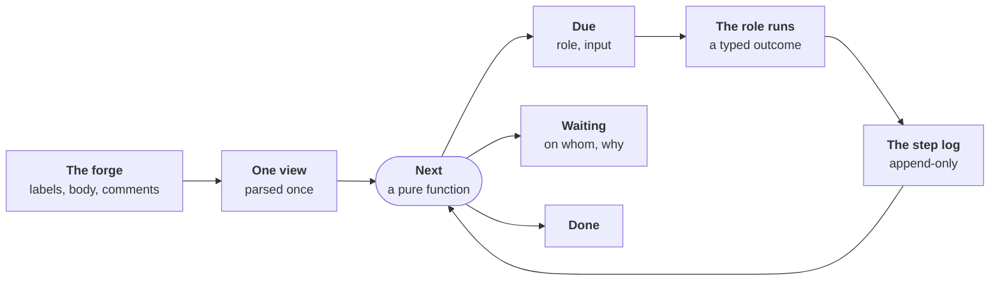

# ADR-0063: Every open issue is due, waiting or done, decided by one function

- **Status:** proposed (draft, for review before the maintainer reads it)
- **Date:** 2026-11-04
- **Decided by:** not yet. Written from the root-cause analysis of the
  trial's defects of 2026-11-04; independent reviewers read it first,
  then the maintainer decides the questions under
  [For the maintainer](#for-the-maintainer)
- **Evidence:** [#757](https://github.com/JN0V/workline/issues/757)
  (the twelfth run, on a C++ copy), the defects below
- **Builds on:** [ADR-0046], [ADR-0054], [ADR-0055], [ADR-0056],
  [ADR-0059], [ADR-0060]; principles 4, 5, 7, 10, 11, 12, 13, 14
- **Amends, once built:** [ADR-0059] §8's record and hop cap, and its
  amendments that added a once-field (listed under
  [What it replaces](#what-it-replaces)); [ADR-0054]'s bounds (a new
  test file beside the Scope); [ADR-0056] (read-only tools for the
  product owner, the tester and the reviewer, where the agent has them);
  [routing.md](../spec/routing.md#once-a-state-the-record)
- **Research:** [line-liveness.md](../research/line-liveness.md)

## Context

### What happened

- **On 2026-11-04, the first trial outside workline**: seven real bugs
  of a C++ framework, copied to a public trial repository, run through
  the line in three rounds
  ([#757](https://github.com/JN0V/workline/issues/757)).
- **5 of 7 merged; 30 defects of workline found in one day**, each
  opened and most fixed the same day.
- **Most were one of three shapes**:
  - **parked in silence**: an issue in refine with drafts, nothing
    due for 1 h 40 min; `route issue` said `state-acted … nothing more
    to run` ([#1070](https://github.com/JN0V/workline/issues/1070),
    [#1041](https://github.com/JN0V/workline/issues/1041),
    [#1053](https://github.com/JN0V/workline/issues/1053),
    [#1062](https://github.com/JN0V/workline/issues/1062));
  - **a loop guard on the wrong key**: an issue blocked 34 s after its
    tests came, "9 state steps, past max-hops (8)"
    ([#1068](https://github.com/JN0V/workline/issues/1068)); one blocked
    3 min after it opened, on a folder its agent guessed
    ([#1057](https://github.com/JN0V/workline/issues/1057)); a second
    Scope ask at the same head sent to a person
    ([#1073](https://github.com/JN0V/workline/issues/1073));
  - **an engine failure routed as a verdict**: a test calling a
    constructor that does not exist blocked an issue for 7 days
    ([#1048](https://github.com/JN0V/workline/issues/1048)); a token
    budget spent read as "no test proposed"
    ([#1017](https://github.com/JN0V/workline/issues/1017)); code not
    given read as "no test possible", sent back to refine
    ([#1047](https://github.com/JN0V/workline/issues/1047),
    [#1059](https://github.com/JN0V/workline/issues/1059)); a patch
    with a miscounted hunk blocked an issue at its first try
    ([#1075](https://github.com/JN0V/workline/issues/1075)).

### Four root causes

1. **No liveness invariant.** A step is due only when the state, body,
   labelling or spec review changed (`due` in `internal/line/record.go`).
   Anything else is `state-acted`: an `info` finding, nothing on the
   issue. That default breaks
   [ADR-0059 §1](0059-an-issue-moves-by-its-state-each-step-wakes-the-next.md#1-every-refusal-claim-wait-or-block-is-on-the-issue)
   by itself. Each legitimate reason to run again became a field and a
   branch: 29 fields in `Record`, 11 exception branches in `stateOf`.
2. **State scattered, facts parsed per caller.** One issue's state sits
   in about eight places: state labels, `draft`/`proposed`/`accepted`
   labels, the line's record, the product owner's YAML, the reviewer's
   spec mark, the tester's proof, the developer's claim and Scope ask,
   draft marks in the body. "Ready", "draft", "guessed", "Need" are
   computed where needed, and disagree
   ([#1062](https://github.com/JN0V/workline/issues/1062),
   [#1021](https://github.com/JN0V/workline/issues/1021),
   [#840](https://github.com/JN0V/workline/issues/840)). The exclusive
   labels of §2 do not hold: one trial issue carried `ready` and
   `developing` together.
3. **Untyped outcomes.** A run's result is free text and a finding code,
   mapped to a state move. Nothing says "the machine failed: retry, do
   not move the issue, do not count it".
4. **Code pushed by per-role heuristics; agents cannot pull it.** The
   product owner and the tester get pre-cut code, each with its own
   cut, tuned on Go; only the developer's agent has tools
   ([ADR-0056]). Each miss costs a wake, which needs a once-field, which
   strands an issue.

### Why the fixes did not converge

- **They fix one shape, not the class**: build errors retried
  ([#1052](https://github.com/JN0V/workline/pull/1052)), then a
  miscounted hunk found within hours
  ([#1075](https://github.com/JN0V/workline/issues/1075)).
- **Each fix adds the next stranding case**: a new once-field is absent
  from older records, so issues held under the old rule stay held
  ([#1041](https://github.com/JN0V/workline/issues/1041),
  [#1070](https://github.com/JN0V/workline/issues/1070)).
- **Proxies move, loops stay**: `max-hops` blocked progress, and was
  patched to restart on it
  ([#1069](https://github.com/JN0V/workline/pull/1069)).
- **No test checks the line over time**: each conformance case runs one
  command on one snapshot; one even expects the silent park
  (`routing/ready-overlap-gone-wakes-once.yaml`). Defects surface one
  hop at a time, at trial speed.
- **[ADR-0059] took 15 amendments in four days**; 27 commits touched
  `internal/line` since 2026-10-31.

## Decision

- **Keep**: the six states and their labels, the roles and their acts,
  events for speed and the reconciler as the net
  ([ADR-0059](0059-an-issue-moves-by-its-state-each-step-wakes-the-next.md)).
- **Change**: how the line decides what is next, what it remembers, and
  how a role's result reads.

### 1. The invariants

- **I1, every open item has a status.** After each tick, every open
  issue and every pull request of the line is exactly one of:
  - **Due(role, input)**: started this tick, or queued, its place said;
  - **Waiting(on, reason)**, `on` one of: a person (named when known),
    an event (named: "the reviewer's comment on the spec"), an issue
    (`#n`), room in a state, a time, the forge ("2 conversations
    unresolved");
  - **Done**: closed, merged.

  Said in the line's one comment on it, edited in place. "Acted,
  nothing to run" is not a status.
- **I2, never the same input twice for the same answer.** A role runs
  at most once on the same input with the same kind of outcome. The
  second time is Waiting(person, "the same input gave the same
  outcome: …").
- **I3, a machine error never moves an issue.** It retries with changed
  input under its kind's budget, then waits for a person. It never
  routes backward, and never counts toward a loop.
- **I4, one view.** Every rule and every role reads one typed view of
  the issue, parsed once a tick. No caller parses the body's prose
  itself.

### 2. One view of an issue

- **Parsed once a tick** from what the forge holds: labels, body,
  comments (the roles' sticky comments and marks included), label
  events, dependencies, the linked pull request.
- **Derived, never stored**: the forge stays the one source of truth
  (principle 13); no new store.
- **Holds, typed**: state; kind; sections (text on top read as the
  Need); drafts (label or marks, either one); named scenarios; Scope
  (paths, guessed or not); proof kind; open questions and their age;
  the spec review and its rounds; claim; Scope asks; pull request;
  Definition of Ready per state, with what fails.
- **Moved onto it, behaviour kept**: `backlog.NotReady`, the reviewer's
  `waitingSpecs`, draft detection, the `Guessed` read and its prose
  form, scenarios, the tester's proof, the time-outs of [ADR-0060].
- **Time enters as facts**, not timestamps: "a question past its
  delay", "a claim older than `claim-hours`". A fact that turns true
  changes the role's input, so the role is due again (§4).

### 3. One append-only step log

- **An entry a step**: when, role, state, input digest, outcome kind,
  outcome code, what was said.
- **Kept in the line's existing comment** (`line/state`): the last 20
  entries, older ones folded into counts. No new comment, no new label.
- **The input digest** is the hash of the task the engine builds for
  the role, its volatile parts left out (dates, run ids). It holds
  everything the role reads: the body, the comments it reads, the code
  given, the review, the tests, the head.
  - Same task, same input: the agent would see the same thing.
  - A role with no agent hashes the same task, built with `--ai none`.
- **Replaces the record's once-fields**: "due again?" becomes "is there
  an entry for this role and this digest, of an outcome that is not a
  machine error?".

### 4. One pure function decides

`Next(view, log, config, now)` returns one status, with no forge call
and no agent. For an open issue whose state wakes a role:

| The log for (role, digest) | Status |
|---|---|
| no entry | Due(role, digest); Waiting(room in X) when the next state is full |
| `progress` | the state moved; a person moved it back, so the labelling is new input |
| `waiting(on)` | Waiting(on, reason), until `on` answers: the answer changes the digest |
| `needs-input(from role R)` | Due(R) on R's own input |
| `needs-input(from a person)` | Waiting(person, the question) |
| `machine-error(kind)`, budget left | Due(role, digest), after its back-off |
| `machine-error(kind)`, budget spent | Waiting(person, kind), Blocked on the board |
| any other kind, again | Waiting(person, "the same input gave the same outcome") |

- **A ring of roles on unchanged inputs** (refine → tests → refine)
  meets an entry already there: I2 stops it, with no count.
- **A last fuse stays**: `max-hops` counts only judgements, never a
  machine error; past it, Waiting(person). It should never fire; a
  fire is a defect to file.
- **Blocked is Waiting(person)**: news on it changes the product
  owner's input, so the product owner is due, as
  [revisit](0059-an-issue-moves-by-its-state-each-step-wakes-the-next.md#amendment-2026-11-01-blocked-is-read-again)
  does today.
- **The table lives in the routing config** with the states, as
  [ADR-0059 §8](0059-an-issue-moves-by-its-state-each-step-wakes-the-next.md#8-event-driven-the-night-for-upkeep)
  asked: "one table, read by a pure function".

### 5. Typed outcomes

Each role's run ends with one outcome, beside its finding codes:

| Kind | Means | Example |
|---|---|---|
| `progress` | it moved the issue | the tester's Draft, its checks passed |
| `waiting` | it waits, on whom, why | the product owner asked a question |
| `needs-input` | another role or a person must act | "no test is possible for this need", to the product owner |
| `machine-error` | the engine's or the agent's run failed | over budget, a build error, a patch that does not apply, a run lost |

- **A machine error has a kind and a retry**: each kind changes the
  input before the next try (the compiler's output, the patch error,
  narrower code), a budget per kind (2 by default), then a person.
- **New failure shapes need no new code**: an unknown error of a run is
  a machine error, never a verdict (principle 12).
- **Transition**: a role keeps its codes; a table in the engine maps
  each to a kind until the role emits it.

### 6. One code picker, and tools where the agent has them

- **One picker for the product owner, the tester and the reviewer**,
  any language: `git grep -n -w` for the symbols and paths the view
  names, the lines around each hit, ranked by hits, under the role's
  budget, the cut said in the task.
- **Room for one existing test, always**: the nearest test file under
  the project's `test-paths` to a Scope path, so the tester has a test
  to copy.
- **Read-only tools where the agent has them**: `claude` gets read,
  search and list tools in a worktree ([ADR-0056]'s sandbox, no write,
  no shell); the picker's result seeds its task.
- **`cmd:` agents keep the seeded task**; a project may declare that its
  agent reads files itself. **No agent**: the step goes to a person, as
  today (principle 5).
- **The "name the code, be read again" protocol** stays only for agents
  with no tools; each read again is new input, so I2 bounds it.

### 7. The developer's write fence

- **The Scope, plus a new test file** under `test-paths` beside a Scope
  path: written by rule, no ask.
- **Anything else is an ask**: needs-input(product owner, the files),
  its digest the file set. The same set asked twice waits for a person;
  a new set is new input, whatever the head.

### 8. Pull requests through the same function

- **The same statuses**: Due(reviewer, head), Due(developer's round,
  head and findings), Waiting(forge, its reason), Waiting(person, a
  yes), Done (merged).
- **The forge says why it does not merge**: GitHub's
  `mergeStateStatus`, GitLab's `detailed_merge_status`; workline adds
  only what is its own (a verdict, a person's yes,
  [ADR-0042]).
- **Level, not events**: the reconciler evaluates `Next` on every open
  pull request of the line; an event only brings it sooner.

### What it replaces

| Today | By |
|---|---|
| `due`'s equality key; `stateOf`'s 11 exception branches | `Next` |
| `Record`'s once-fields: `Asked`, `Revise`, `Timeout`, `Woke`, `Held`, `Unheld`, `Lost`, `Retry`, `Given`, `Unread`, `ReviewAgain`, `Reached` | the log and I2 |
| `max-hops` as the loop guard | I2; the hop count a fuse on judgements |
| `refine-capped`, `no-test-unsettled`, `tests-refused` as special routes | outcomes in the table |
| per-shape retries (lint, build error, [#1052](https://github.com/JN0V/workline/pull/1052)) | one retry per machine-error kind |
| the per-role code cuts (the tester's pieces, the product owner's named code, the reviewer's reach) | the picker |
| the Scope ask once a head, then once a file set ([#1074](https://github.com/JN0V/workline/pull/1074)) | the ask keyed by its file set, through I2 |
| `follow`'s own readiness model | the forge's merge state |

- **Today's patches removed**: [#1071](https://github.com/JN0V/workline/pull/1071)
  (`ReviewAgain`), [#1069](https://github.com/JN0V/workline/pull/1069)
  (`Reached`), [#1044](https://github.com/JN0V/workline/pull/1044)
  (`Unread`), [#1054](https://github.com/JN0V/workline/pull/1054)
  (`no-test-unsettled`), [#1028](https://github.com/JN0V/workline/pull/1028)
  (drafts with no label), [#1074](https://github.com/JN0V/workline/pull/1074)
  (the ask once a file set), [#1052](https://github.com/JN0V/workline/pull/1052)
  (build error retried), the context cuts
  [#1058](https://github.com/JN0V/workline/pull/1058),
  [#1049](https://github.com/JN0V/workline/pull/1049),
  [#1060](https://github.com/JN0V/workline/pull/1060),
  [#1024](https://github.com/JN0V/workline/pull/1024); older:
  `Given` and `Unheld` ([#986](https://github.com/JN0V/workline/pull/986),
  [#1000](https://github.com/JN0V/workline/pull/1000)).
- **Moved, their logic kept**: [#1067](https://github.com/JN0V/workline/pull/1067)
  (the Need on top) into the view; [#1037](https://github.com/JN0V/workline/pull/1037)
  and [#1025](https://github.com/JN0V/workline/pull/1025)'s holds into
  the Definition of Ready; [#1014](https://github.com/JN0V/workline/pull/1014)'s
  chaining, its branch gone; [#1065](https://github.com/JN0V/workline/pull/1065)'s
  "no false unblock".

### What stays

- **The six states, their labels, the board** ([ADR-0057]); no label
  per condition.
- **Each role's acts and judgement**; only its outcome's form changes.
- **Events start steps; the reconciler is the net**, now on the level.
- **Fixes that were real reads or tools**:
  [#1066](https://github.com/JN0V/workline/pull/1066) (C++ methods),
  [#1042](https://github.com/JN0V/workline/pull/1042) (a frozen test's
  rule), [#1045](https://github.com/JN0V/workline/pull/1045) and
  [#1051](https://github.com/JN0V/workline/pull/1051) (threads
  resolved), [#1032](https://github.com/JN0V/workline/pull/1032)'s
  latest check run, [#1046](https://github.com/JN0V/workline/pull/1046)
  (a fork's verdict), the install and doctor fixes.

### Migration

- **An old record becomes one log entry**: its state, its body's hash,
  outcome `progress`, its once-fields kept as entries of their own
  (`Given` as a read with that code, `Lost` as a machine error).
- **Its digest is old-style**, so the new `Next` finds no entry for the
  new digest: an issue the old line called acted is due once, in the
  reconciler's order, `reconcile-max` a run. See
  [question 2](#for-the-maintainer).
- **Labels stay**; two state labels at once are read as the further
  state, the other taken off, said.
- **Old sticky comments stay readable**; new writes go to the same
  `line/state` comment.

### Everywhere

- **GitHub and GitLab alike**: `Next` reads the view, not the forge;
  each forge fills the view (GitLab's label events, its `is_blocked_by`,
  `detailed_merge_status`). The local forge fills it from
  `.workline/work/` and keeps the comment as it keeps others.
- **On a machine and in CI**: the same binary, `workline route
  reconcile` on a person's machine, hourly and by event in CI.
- **The agent stays a choice**: none, `claude`, or `cmd:<any command>`.
  `Next` asks no agent; with none, a judgement goes to a person as
  Waiting(person).
- **The auditor observes it** ([ADR-0046]): the log is the trail it
  samples; an open issue with no status is a finding; it reports
  machine errors by kind and Waiting(person) by reason, per week.

## Build plan

One pull request a step, its failing traces first, as for a
conformance case. No step changes behaviour before its traces are red.

1. **A simulator, red first, no behaviour change.** The trial's issues
   frozen as fixtures (title, body, labels, comments, label events) on
   the fake forge; fake agents, one per outcome kind; `route reconcile
   --ai none` run K ticks with no outside event. It asserts I1: no open
   issue ends a tick quiet. Random outcome sequences, seeded, with Go's
   `testing/quick` and `math/rand` (no new dependency). The traces that
   fail today are listed as pending, never lying. *Proof: it reproduces
   the trial's stranded issues from the fixtures alone.*
2. **The view, one parse.** Every caller moved onto it, no behaviour
   change. *Proof: the suite green; every caller gives the same answer
   on the trial's bodies.*
3. **Typed outcomes.** The engine maps each role's codes to a kind; a
   machine error retries and never moves the issue. *Proof: the traces
   of [#1017](https://github.com/JN0V/workline/issues/1017),
   [#1047](https://github.com/JN0V/workline/issues/1047),
   [#1048](https://github.com/JN0V/workline/issues/1048),
   [#1059](https://github.com/JN0V/workline/issues/1059),
   [#1068](https://github.com/JN0V/workline/issues/1068),
   [#1075](https://github.com/JN0V/workline/issues/1075) green.*
4. **`Next` and the log**, replacing `due` and the once-fields; I2.
   *Proof: random sequences hold I1 and I2; the traces of
   [#840](https://github.com/JN0V/workline/issues/840),
   [#1021](https://github.com/JN0V/workline/issues/1021),
   [#1036](https://github.com/JN0V/workline/issues/1036),
   [#1041](https://github.com/JN0V/workline/issues/1041),
   [#1053](https://github.com/JN0V/workline/issues/1053),
   [#1062](https://github.com/JN0V/workline/issues/1062),
   [#1070](https://github.com/JN0V/workline/issues/1070) green, with no
   code for any one of them.*
5. **The picker, and read-only tools.** *Proof: the traces of
   [#1056](https://github.com/JN0V/workline/issues/1056),
   [#1057](https://github.com/JN0V/workline/issues/1057),
   [#1063](https://github.com/JN0V/workline/issues/1063),
   [#1064](https://github.com/JN0V/workline/issues/1064); a real agent on
   the C++ copy, told under `## Tried`.*
6. **The write fence with `test-paths`; asks keyed by file set.**
   *Proof: [#1061](https://github.com/JN0V/workline/issues/1061),
   [#1073](https://github.com/JN0V/workline/issues/1073) green.*
7. **Pull requests through `Next`.** *Proof:
   [#1029](https://github.com/JN0V/workline/issues/1029),
   [#1031](https://github.com/JN0V/workline/issues/1031),
   [#1039](https://github.com/JN0V/workline/issues/1039),
   [#1050](https://github.com/JN0V/workline/issues/1050) green.*
8. **A fourth round on the C++ copy**, timed: issues reaching Done or
   Waiting(person) with a reason; no step started by hand.

Docs to update with each step: [routing.md](../spec/routing.md) (the
record, the reconciler, where state lives), the roles' outcome codes,
the "Amended by" lines of the ADRs above.

## Consequences

- **A person reads one line per issue** that says what it waits on, or
  what runs next; the board's Blocked column holds only what needs a
  person.
- **Fewer agent calls**: the same input is never run twice for the
  same answer; a machine error retries with new input rather than a
  round trip through refine.
- **More calls at first**: the migration wakes once each issue the old
  line called acted.
- **A defect of the line is found offline**, as a red trace, not one
  hop at a time on a live repository.
- **The tester and the product owner read more code** where the agent
  has tools: tokens per run may rise; runs per issue should fall. To
  measure at step 5.

## Not chosen

- **Keep fixing per defect**: the evidence above; 15 amendments in four
  days and the next shape found within hours.
- **Raise the caps and budgets** (`max-hops`, `reconcile-max`,
  `code-lines-max`) until a trial passes: it moves the proxy.
- **A label per sub-state** ("awaiting-review", "machine-error"): the
  board fills with workline's internals; the view and the log hold them.
- **The reconciler as the driver**: events keep the line fast; the
  reconciler is the net, on the same function.
- **A workflow server** (Temporal) or a controller framework: a
  service to run, against principles 10 and 11.
- **TLA+ or a model checker**: the property is checked by a simulator
  in Go, on the real code.
- **Write tools for the product owner and the tester**: read-only;
  the fence and the forge's guards stay (principle 6).
- **Patching on the live trial meanwhile**: its traces are frozen into
  the simulator; the trial runs again at step 8.

## What not to do while it is built

- **No new once-field nor exception branch in `stateOf`**: a new stall
  is a red trace first.
- **No new per-shape retry**: [#1075](https://github.com/JN0V/workline/issues/1075)
  waits for step 3, its hunk recount in the tool kept as a fair fix.

## Risks

- **The digest too wide**: a volatile part (a date, a comment's edit
  time) makes every input new; I2 never fires and a loop runs to the
  fuse. Mitigation: the simulator runs the same tick twice and expects
  no second step.
- **The digest too narrow**: an input left out makes a real change look
  the same; the issue waits for a person wrongly. Mitigation: the digest
  is the task itself, not a list of fields.
- **A big step 4**: `Next` replaces `stateOf` at once. Mitigation: it
  runs beside the old code from step 2, its status compared in the
  simulator and in the reconciler's log, before it decides.
- **The log outgrows its comment**: 20 entries and counts fit GitHub's
  65,536 characters and GitLab's note limit with room.
- **Read-only tools cost tokens**: a budget per role, said; measured at
  step 5.

## For the maintainer

1. **Scope of the first pull requests**: steps 1 to 4 only, the picker
   and pull requests later, or all eight planned now?
2. **Migration's cost**: wake once each issue the old line called acted
   (some agent calls, spread by `reconcile-max`), or say Waiting(person)
   on them until a person touches each?
3. **Machine-error budget**: 2 retries per kind and state by default,
   then a person: right, or per kind?
4. **Tools for the product owner and the tester with `claude`**: read
   and search only, from step 5: agreed?
5. **A new stall on a live project while this is built**: a red trace
   that waits for its step, or a patch allowed when the stall costs a
   person's day?

[ADR-0042]: 0042-the-engine-merges-by-the-projects-policy.md
[ADR-0046]: 0046-the-auditor-re-checks-every-roles-acts.md
[ADR-0054]: 0054-the-developer-takes-a-ready-issue-to-a-pull-request.md
[ADR-0055]: 0055-the-tester-writes-the-acceptance-tests-before-the-code.md
[ADR-0056]: 0056-the-developers-agent-works-in-a-sandbox-with-tools.md
[ADR-0057]: 0057-workline-finds-the-forges-board-and-moves-its-cards.md
[ADR-0059]: 0059-an-issue-moves-by-its-state-each-step-wakes-the-next.md
[ADR-0060]: 0060-the-person-is-on-the-loop.md
