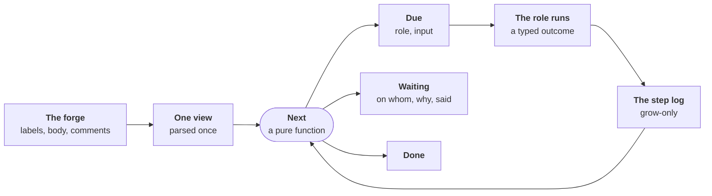

# ADR-0063: Every open issue is due, waiting or done, decided by one function

- **Status:** accepted (2026-11-04)
- **Date:** 2026-11-04
- **Decided by:** the maintainer, on 2026-11-04, after a review by
  seven independent readers: the five questions under
  [Decided](#decided), each on the reviewers' recommendation
- **Evidence:** [#757](https://github.com/JN0V/workline/issues/757)
  (the twelfth run: rounds 1–2, then round 3), the defects below; code
  read at `be8a12de` on `main`
- **Builds on:** [ADR-0026], [ADR-0042], [ADR-0046], [ADR-0054],
  [ADR-0055], [ADR-0056], [ADR-0059], [ADR-0060]; principles 4, 5, 6,
  7, 10, 11, 12, 13, 14
- **Amends, once built:** [ADR-0059] §8's record and hop cap, and its
  amendments that added a once-field
  ([What it replaces](#what-it-replaces)); [ADR-0054]'s bounds (a new
  test file beside the Scope); [ADR-0056] (read-only tools for the
  product owner, the tester and the reviewer, where the agent has them);
  [routing.md](../spec/routing.md#once-a-state-the-record)
- **Research:** [line-liveness.md](../research/line-liveness.md)
- **Amended by:** [ADR-0068](0068-the-line-steps-back-on-its-own-drift.md#9-the-old-brakes-hold-until-replaced)
  (not built): the standing stop holds until ADR-0068's step 3, the
  wake script, is built, then is superseded: a fix repeated in one area
  is a wake script trigger and anyone's `step-back` cord. The other
  working agreements stand
- **Amended:**
  - [2026-11-05](#amendment-2026-11-05-the-testers-read-tools-first):
    the tester's read tools before step 9, the token ceiling measured;
  - [2026-11-08](#amendment-2026-11-08-a-persons-labels-are-input-a-roles-own-write-is-not):
    §3's input, a person's labels in, the role's own write out
- **To be amended by:** [ADR-0065](0065-code-only-what-converges-language-knowledge-in-packs.md#the-four-changes), once built: §8's
  picker frozen, its tables in packs
- **Amended by:** [ADR-0065, change 2](0065-code-only-what-converges-language-knowledge-in-packs.md#2-scope-as-paths-a-hint-not-a-fence),
  built in [#1228](https://github.com/JN0V/workline/issues/1228): §9's
  fence on the Scope dropped, a file beyond it listed on the pull
  request

## Context

### What happened

- **On 2026-11-04, the first trial outside workline**: seven real bugs
  of a C++ framework for ESP32, copied to a public trial repository,
  run through the line in three rounds
  ([#757](https://github.com/JN0V/workline/issues/757)).
- **Rounds 1–2: 5 of 7 merged, 2 alone. Round 3: 0 of 5 merged** in
  2 h 40 min, each held by at least one defect of workline; 11 opened,
  9 fixed during the round, the engine rebuilt six times.
- **30 defects of workline in one day.** Most were one of three shapes:
  - **parked in silence**: an issue in refine with drafts, nothing due
    for 1 h 40 min; `route issue` said `state-acted … nothing more to
    run` ([#1070](https://github.com/JN0V/workline/issues/1070),
    [#1041](https://github.com/JN0V/workline/issues/1041),
    [#1053](https://github.com/JN0V/workline/issues/1053),
    [#1062](https://github.com/JN0V/workline/issues/1062),
    [#1072](https://github.com/JN0V/workline/issues/1072));
  - **a loop guard on the wrong key**: an issue blocked 32 s after its
    tests came, "9 state steps, past max-hops (8)"
    ([#1068](https://github.com/JN0V/workline/issues/1068)); one blocked
    3 min after it opened, on a folder its agent guessed
    ([#1057](https://github.com/JN0V/workline/issues/1057)); a second
    Scope ask at the same head sent to a person
    ([#1073](https://github.com/JN0V/workline/issues/1073));
  - **an engine failure routed as a verdict**: a test calling a
    constructor that does not exist moved an issue to Blocked, to be
    read again in 7 days
    ([#1048](https://github.com/JN0V/workline/issues/1048)); a token
    budget spent read as "no test proposed"
    ([#1017](https://github.com/JN0V/workline/issues/1017)); code not
    given read as "no test possible", sent back to refine
    ([#1047](https://github.com/JN0V/workline/issues/1047),
    [#1059](https://github.com/JN0V/workline/issues/1059)); a patch with
    a miscounted hunk blocked an issue at its first try
    ([#1075](https://github.com/JN0V/workline/issues/1075)); a mark that
    could not be read taken for no mark
    ([#1030](https://github.com/JN0V/workline/issues/1030)).
- **Where the chains start**: round 3's report puts 8 of its 11 defects
  in one zone, the code given to a role, the Scope, and the wake after
  a hold. A role short of code fails; the failure is routed as a
  verdict; the next wake needs a guard; the guard strands the issue.

### Four root causes

1. **No liveness invariant.** A step is due only when the state, body,
   labelling or spec review changed (`due`,
   [record.go](https://github.com/JN0V/workline/blob/be8a12de/internal/line/record.go)).
   Anything else is `state-acted`: an `info` finding, nothing on the
   issue ([states.go](https://github.com/JN0V/workline/blob/be8a12de/internal/line/states.go)).
   That default breaks
   [ADR-0059 §1](0059-an-issue-moves-by-its-state-each-step-wakes-the-next.md#1-every-refusal-claim-wait-or-block-is-on-the-issue)
   by itself. Each legitimate reason to run again became a field and a
   branch: 29 fields in `Record`, 11 exception branches in `stateOf`.
2. **State scattered, facts parsed per caller.** One issue's state sits
   in about eight places: state labels, `draft`/`proposed`/`accepted`
   labels, the line's record, the product owner's YAML, the reviewer's
   spec mark, the tester's proof, the developer's claim and Scope ask,
   draft marks in the body. "Ready", "draft", "guessed", "Need" are
   computed where needed, and disagree
   ([#1062](https://github.com/JN0V/workline/issues/1062),
   [#1021](https://github.com/JN0V/workline/issues/1021),
   [#840](https://github.com/JN0V/workline/issues/840)). The exclusive
   labels of §2 do not hold through a claim: trial
   [#36](https://github.com/JN0V/DomoticsCore-trial/issues/36) carried
   `ready` and `developing` together for 25 minutes (17:47–18:12), the
   claim adding one before the other came off.
3. **Untyped outcomes.** A run's result is free text and one of 453
   finding codes, mapped to a state move. Nothing says "the machine
   failed: retry, do not move the issue, do not count it". A read that
   failed is read as "absent".
4. **Code pushed by per-role cuts, tuned to file size and language;
   agents cannot pull it.** The product owner and the tester get
   pre-cut code, each role with its own cut; only the developer's agent
   has tools ([ADR-0056]). Misses came from a 7,576-line Markdown file
   given whole ([#1063](https://github.com/JN0V/workline/issues/1063)),
   a C++ method defined out of its class
   ([#1064](https://github.com/JN0V/workline/issues/1064)), a budget
   that left the tester no test to copy
   ([#1059](https://github.com/JN0V/workline/issues/1059)).

### Why the fixes did not converge

- **They fix one shape, not the class**: build errors retried
  ([#1052](https://github.com/JN0V/workline/pull/1052)), then a
  miscounted hunk found within hours
  ([#1075](https://github.com/JN0V/workline/issues/1075)).
- **Each fix adds the next stranding case**: a new once-field is absent
  from older records, so issues held under the old rule stay held
  ([#1041](https://github.com/JN0V/workline/issues/1041),
  [#1070](https://github.com/JN0V/workline/issues/1070)), or the field
  is lost when the step is due for another reason
  ([#1072](https://github.com/JN0V/workline/issues/1072)).
- **Proxies move, loops stay**: `max-hops` blocked progress, and was
  patched to restart on it
  ([#1069](https://github.com/JN0V/workline/pull/1069)).
- **No test checks the line over time**: each conformance case runs one
  command on one snapshot; one even expects the silent park
  (`routing/ready-overlap-gone-wakes-once.yaml`). Defects surface one
  hop at a time, at trial speed, on a live repository rebuilt mid-round.
- **[ADR-0059] took 15 amendments in four days**; 27 commits touched
  `internal/line` since 2026-10-31.

### Out of this ADR

- **CI wiring**: a closed demotion issue that started nothing
  ([#1029](https://github.com/JN0V/workline/issues/1029)), a fork's
  pull request into another branch never followed
  ([#1055](https://github.com/JN0V/workline/issues/1055)): the
  reconciler on the level (§10) makes them late, not lost; their
  triggers stay template fixes.
- **Install and doctor** ([#1016](https://github.com/JN0V/workline/issues/1016),
  [#1033](https://github.com/JN0V/workline/issues/1033)); a failed
  role run that exits 0 ([#1011](https://github.com/JN0V/workline/issues/1011)),
  which §6 types but whose exit code is its own fix.
- **A prompt's judgement** of kinds and scenarios
  ([#1019](https://github.com/JN0V/workline/issues/1019),
  [#1020](https://github.com/JN0V/workline/issues/1020)):
  `tests/evaluation`; the view only shows a miss sooner.

## Decision

- **Keep**: the six states and their labels, the roles and their acts,
  events for speed and the reconciler as the net
  ([ADR-0059](0059-an-issue-moves-by-its-state-each-step-wakes-the-next.md)).
- **Change**: how the line decides what is next, what it remembers, how
  a role's result reads, and how roles get code.

### 1. The invariants

- **I1, every open item has a status, said.** After each tick, every
  open issue and every pull request of the line is exactly one of:
  - **Due(role, input)**: started this tick, or queued, its place said;
  - **Waiting(on, reason)**, `on` one of: a person (named when known),
    an event (named: "the reviewer's comment on the spec"), an issue
    (`#n`), room in a state, a time, the forge ("2 conversations
    unresolved");
  - **Done**: closed, merged.

  Said on it ([§7](#7-what-a-person-reads)). "Acted, nothing to run" is
  not a status.
- **I2, never the same input twice.** A role does not run again on an
  input it already ran on, unless its last outcome there was a machine
  error with budget left.
- **I3, a machine error never moves an issue.** No label, no state, no
  hop. It retries under its budget, then waits for a person.
- **I4, one view.** Every rule and every role reads one typed view of
  the issue, parsed once a tick. No caller parses the body's prose.

### 2. One view of an issue

- **Parsed once a tick** from what the forge holds: labels, body,
  comments (the roles' sticky comments and marks included), label
  events, dependencies, the linked pull request.
- **Derived, never stored**: the forge stays the source of truth
  (principle 13); no new store.
- **Holds, typed**: state; kind; sections (text on top read as the
  Need); drafts (label or marks); named scenarios; Scope (paths,
  guessed or not); proof kind; open questions and their age; the spec
  review and its rounds; claim; Scope asks; pull request; the
  Definition of Ready per state, with what fails.
- **Unknown is a value**: a read that failed, or a mark that does not
  parse, is `unknown`, never "absent"
  ([#1030](https://github.com/JN0V/workline/issues/1030)). `Next` on an
  unknown fact is a machine error (`forge-read`), retried.
- **Time enters as facts**, from the forge's timestamps only (label
  events, comments' dates), never `updated_at` nor the runner's clock
  alone: "a question past its delay", "a claim older than
  `claim-hours`".
- **Moved onto it, behaviour kept**: `backlog.NotReady`, the
  reviewer's `waitingSpecs`, draft detection, the `Guessed` read and its
  prose form, scenarios, the tester's proof, the time-outs of [ADR-0060].

### 3. The input of a step

The input is what decides whether a role has something new to read.

- **Canonical, from the view**, not the task the role builds:
  - the body, as the step's own run left it
    ([amended](#amendment-2026-11-08-a-persons-labels-are-input-a-roles-own-write-is-not));
  - a person's labels besides the state's: `workline:accepted`, the
    size tiers (amended);
  - comments by others than the line and than this role (a role's own
    sticky would make each run new input; the line's own comment too);
  - for each Scope file and each file the picker gave: its path and
    blob SHA, never the head commit (a merge elsewhere changes nothing);
  - the view's facts that turned true (a delay passed, a review came,
    a blocker closed);
  - for a pull request's round: its head SHA and the findings' ids.
- **A version of the input's schema**, in the engine, bumped on purpose
  when the input's parts change. A bump is new input for every issue,
  handled as the [migration](#migration): spread by `reconcile-max`,
  its number of calls said in the release notes.
- **A role with read tools logs what it read**: paths and blob SHAs,
  with its entry. Any of them changed is new input.
- **Digest**: 12 hex characters of SHA-256 over the canonical form.
- **One function, one place to run it**: the picker needs the code, so
  the input is computed in a job with a checkout of the default branch,
  at its current commit (blob SHAs from `git ls-tree`). The reconciler
  and the role's own job run the same function on the same checkout;
  the reconciler already runs in one, to read `.workline/`.
- **Not chosen**: the hash of the role's built task. `Next` cannot
  build it without the role's code; a prompt or picker change in a
  release would make every issue new; tools read past the task.

### 4. The step log

- **Kept in the line's existing comment** (`line/state`), in a new mark
  `line-log` beside the old `line-record`, which stays written for one
  release. A `v` field versions it.
- **Grow-only**: a set of entry ids `(role, input digest, outcome kind)`,
  each 12 hex characters, plus counters per state entry (machine errors
  by kind, judgement rounds by role pair). A state entry starts when its
  label is put on, as the forge dates it. No folding, no last-N: a set
  of short ids fits the comment for hundreds of steps.
- **Two writers never lose an entry**:
  - **in CI, the reconciler writes nothing itself**: it lists what is
    due and dispatches one job per issue, which holds that issue's
    concurrency group (GitHub's `concurrency`, GitLab's
    `resource_group`), as
    [ADR-0059 §8](0059-an-issue-moves-by-its-state-each-step-wakes-the-next.md#8-event-driven-the-night-for-upkeep)
    has for roles. A reconcile walking many issues cannot hold their
    groups; a job per issue can. Its writes with no agent (a wait said,
    a stale move) go through the same per-issue job;
  - **on a person's machine**, one process walks the issues one at a
    time: no group needed;
  - **a second net, not the guarantee**: a write is read, union, edit,
    read back; an entry missing on the read back is merged again.
- **Started before it runs**: a step writes `started(role, digest)`
  first. Started with no outcome after the run's time-out is a machine
  error, `run-lost`.
- **The state label is compared before it moves**: the step moves it
  only from the state it started on. A person moved it meanwhile: the
  outcome is `superseded`, which neither counts nor moves.

### 5. One pure function decides

`Next(view, log, config, now)` returns one status, with no forge call
and no agent. It is level-triggered: it reads the view's facts, not
what changed.

| The view and the log | Status |
|---|---|
| closed, merged | Done |
| state wakes role R; no entry for (R, input) | Due(R, input); Waiting(room in X) when the next state is full |
| last entry for (R, input) is `waiting(on)` | Waiting(on, reason) while `on` holds in the view: blocker still open, room still full, time not reached, forge still not mergeable |
| `needs-input(R2)` | Due(R2) on R2's own input |
| `needs-input(engine: what)` | Due(R, input) with what was lacking given; a second time, Waiting(person) |
| `needs-input(person)` | Waiting(person, the question), with its delay ([§7](#7-what-a-person-reads)) |
| `machine-error(kind)`, budget left | Due(R, input), after its back-off |
| `machine-error(kind)`, budget spent | Waiting(person, kind), Blocked on the board, its state kept |
| `progress` | the state moved; back in it by a person: the labelling is new input |

- **Each `Waiting(on)` is checked on the view**, every tick: a blocking
  issue closed, room freed, the time reached, the forge's merge state
  changed. Not only through the input changing.
- **I2 is guarded in the role too**: a step started on a (role, input)
  already in the log ends at once as `waiting`, no agent call. `Next`
  may say "due" from a stale view; the role, holding the issue's
  concurrency group, has the last word.
- **Machine-error budget**: per issue, state entry, role and error
  kind, 2 tries within 24 h of the first error by default, a back-off
  between. Spent, it stays spent until a new state entry or a person
  acts on the issue (a label, a comment); the 24 h never give it back.
  The supervisor's shape, so many restarts then escalate; a window that
  reset would loop once a day.
- **Judgement rounds**: per state entry and role pair (product owner and
  tester, product owner and reviewer), 3 exchanges by default, as
  [ADR-0055]'s cap. Past it, the line asks a person a worded question:
  "the tester and the product owner disagree on …: pick a proof kind,
  or rewrite the scenario". A designed outcome, not a fuse. It stops the
  ring the trial's #36 ran, whose inputs changed each time.
- **`max-hops` stays a last fuse**, on judgements only. A fire is a
  defect, filed with its trace.
- **Blocked is Waiting(person)**; news on it changes the product
  owner's input, so the product owner is due, as
  [revisit](0059-an-issue-moves-by-its-state-each-step-wakes-the-next.md#amendment-2026-11-01-blocked-is-read-again)
  does today.
- **The table lives in the routing config** with the states, as
  [ADR-0059 §8](0059-an-issue-moves-by-its-state-each-step-wakes-the-next.md#8-event-driven-the-night-for-upkeep)
  asked.

### 6. Typed outcomes

Each role's run ends with one outcome, beside its finding codes:

| Kind | Means | Example |
|---|---|---|
| `progress` | it moved the issue | the tester's Draft, its checks passed |
| `waiting` | it waits, on whom, why | the product owner asked a question |
| `needs-input(role or person)` | another role or a person must act | "no test is possible for this need", to the product owner |
| `needs-input(engine: what)` | the agent lacked something the engine can give | "no existing test to copy", "the definition of `getWebUIVersion` not given" |
| `machine-error(kind)` | the engine's or the agent's run failed | over budget, a build error, a patch that does not apply, a forge read failed, a run lost |
| `superseded` | a person moved the issue during the run | the label changed under it |

- **`needs-input(engine)` is declared by the agent**, in its answer:
  what it lacked. A tester starved of code
  ([#1047](https://github.com/JN0V/workline/issues/1047),
  [#1059](https://github.com/JN0V/workline/issues/1059)) then differs
  from a real "no test possible".
- **A machine error changes the input of its retry** where it can: the
  compiler's output, the patch error, narrower code.
- **An unknown error of a run is a machine error**, never a verdict
  (principle 12): a new failure shape needs no new code.
- **Mapped only where it moves state**: of the 453 finding codes, the
  ones that move a state today get a kind in a table in the engine; the
  rest are information. A role emits its kind itself later.

### 7. What a person reads

- **One status block on top of the line's comment**, fixed form:
  - **Who moves next**: a named person, a role, or "nobody: waits for
    #12" / "waits until 14:00";
  - **What**: one sentence, in the person's words, no internal code;
  - **How**: one action, one click where it can be (a label, a reply);
    that action changes the input, so the line moves on it.
- **Edited only when its text changes**, never per tick. The log stays
  hidden in its mark.
- **The roles' own comments defer to it**: they say what they did; the
  status says what is next.
- **No Waiting(person) waits for ever**: each has a delay by autonomy
  level, then the line goes on with a written assumption
  ([ADR-0060 §1](0060-the-person-is-on-the-loop.md#1-questions-time-out-as-lazy-consensus)).
  The one exception: a person's yes to a feature
  ([ADR-0060 §4](0060-the-person-is-on-the-loop.md#4-a-person-validates-by-the-issues-kind)).

### 8. One code picker, and tools where the agent has them

- **One picker for the product owner, the tester and the reviewer**,
  any language:
  - the symbols and paths named in the title, the Need, the Steps and
    the Scope;
  - `git grep -n -w` for each, ranked by hits; for each hit, its
    enclosing definition (the code navigation, with
    [#1066](https://github.com/JN0V/workline/pull/1066)'s C++ methods),
    else the lines around;
  - one level of includes and imports, and the types used, at least as
    paths (the trial's #34 needed its base class's header);
  - under the role's budget, the cut said in the task.
- **Room for one existing test, always**: the nearest file matching the
  tester's `test-paths` patterns to a Scope path.
- **Read-only tools where the agent has them**: `claude` gets a second
  tool set, `Read,Glob,Grep`, beside the developer's
  `Read,Edit,Write,Glob,Grep,Bash` (`claudeTools`,
  [claude.go](https://github.com/JN0V/workline/blob/be8a12de/internal/agent/claude.go)),
  in a worktree, no shell. The picker seeds its task; its reads are
  logged ([§3](#3-the-input-of-a-step)).
- **A token ceiling before it ships**: a run's tokens per merged bug no
  more than the median of rounds 1–2, measured from their run
  artifacts; a role's tool budget said in its task.
- **`cmd:` agents keep the seeded task**; a project may declare that its
  agent reads files itself. **No agent**: the step goes to a person, as
  today (principle 5).
- **The "name the code, be read again" protocol** stays only for agents
  with no tools, as `needs-input(engine: paths)`.

### 9. The developer's write fence

- **The Scope, plus a new test file** matching the tester's
  `test-paths` patterns, in or beside a Scope path's folder: written by
  rule, no ask.
- **Said and folded in**: such a file is listed on the pull request and
  in the product owner's comment, and added to the Scope at its next
  run.
- **Anything else is an ask**: `needs-input(product owner, the files)`,
  the file set in its input. The same set asked twice waits for a
  person; a new set is new input, whatever the head.
- **Amended by [ADR-0065, change 2](0065-code-only-what-converges-language-knowledge-in-packs.md#2-scope-as-paths-a-hint-not-a-fence)**,
  built in [#1228](https://github.com/JN0V/workline/issues/1228): the
  Scope is a hint, not a fence; a file beyond it is applied, never
  asked, and listed on the pull request for the reviewer. A new test
  beside it, by the project's one definition, is not listed.

### 10. Pull requests through the same function

- **The same statuses**: Due(reviewer, head), Due(developer's round,
  head and findings), Waiting(forge, its reason), Waiting(person, a yes)
  for a feature only, Done (merged).
- **The forge says why it does not merge**:
  - GitHub: `mergeStateStatus`, with `reviewThreads.isResolved`,
    `statusCheckRollup` and `reviewDecision` for the why; `UNKNOWN` is
    asked again, never read as mergeable or blocked;
  - GitLab: `detailed_merge_status`; `checking` and `unchecked` asked
    again.
  - workline adds only its own: a verdict, a person's yes for a feature
    ([ADR-0042], [ADR-0060]).
- **Level, not events**: the reconciler evaluates `Next` on every open
  pull request of the line; an event only brings it sooner.

### 11. What it reads from the forge

- **Today, estimated**: a reconcile reads per open issue its comments,
  its label events and the claims listing: about 3 to 5 requests an
  issue, 100 to 150 a tick on 30 open issues. The heartbeat every
  10 min of round 2 came near a `GITHUB_TOKEN`'s 1,000 requests an hour
  a repository; the App's token has at least 5,000. Step 1 measures it
  on the fake forge.
- **After**: a list pass first (labels, `updated_at`, one page of 100);
  the full view only for an issue changed since its last view, or with a
  time fact due, or a `Waiting` to check. On GitHub one GraphQL query
  for the view of a page of issues. The target: no more requests a tick
  than today.

### What it replaces

| Today | By |
|---|---|
| `due`'s equality key; `stateOf`'s 11 exception branches | `Next` |
| `Record`'s once-fields: `Asked`, `Revise`, `Timeout`, `Woke`, `Held`, `Unheld`, `Lost`, `Retry`, `Given`, `Unread`, `ReviewAgain`, `Reached` | the log, I2, the budgets |
| `max-hops` as the loop guard | I2 and judgement rounds; the hop count a fuse |
| `refine-capped`, `no-test-unsettled`, `tests-refused` as special routes | outcomes in the table |
| per-shape retries (lint, build error) | one retry per machine-error kind |
| the per-role code cuts (the tester's pieces, the product owner's named code, the reviewer's reach) | the picker |
| the Scope ask once a head, then once a file set | the ask's file set in its input |
| `follow`'s own readiness model | the forge's merge state |

- **Today's patches removed**: [#1071](https://github.com/JN0V/workline/pull/1071)
  (`ReviewAgain`), [#1069](https://github.com/JN0V/workline/pull/1069)
  (`Reached`), [#1044](https://github.com/JN0V/workline/pull/1044)
  (`Unread`), [#1054](https://github.com/JN0V/workline/pull/1054)
  (`no-test-unsettled`), [#1028](https://github.com/JN0V/workline/pull/1028)
  (drafts with no label), [#1074](https://github.com/JN0V/workline/pull/1074)
  (the ask by file set), [#1052](https://github.com/JN0V/workline/pull/1052)
  (build error retried), the context cuts
  [#1058](https://github.com/JN0V/workline/pull/1058),
  [#1049](https://github.com/JN0V/workline/pull/1049),
  [#1060](https://github.com/JN0V/workline/pull/1060),
  [#1024](https://github.com/JN0V/workline/pull/1024); older: `Given`
  and `Unheld` ([#986](https://github.com/JN0V/workline/pull/986),
  [#1000](https://github.com/JN0V/workline/pull/1000)).
- **Moved, their logic kept**: [#1067](https://github.com/JN0V/workline/pull/1067)
  (the Need on top) into the view; [#1037](https://github.com/JN0V/workline/pull/1037)
  and [#1025](https://github.com/JN0V/workline/pull/1025)'s holds into
  the Definition of Ready; [#1014](https://github.com/JN0V/workline/pull/1014)'s
  chaining, its branch gone; [#1065](https://github.com/JN0V/workline/pull/1065)'s
  "no false unblock".

### What stays

- **The six states, their labels, the board** ([ADR-0057]); no label
  per condition.
- **The product owner's ground** ([ADR-0060 §2](0060-the-person-is-on-the-loop.md#2-the-builders-part-is-the-product-owners-at-every-level)):
  Need and Validation are a person's, never rewritten, a draft of them
  a question; Verification and Scope are the product owner's; the
  issue's kind is the forge's; autonomy is a level per role
  ([ADR-0026]).
- **Each role's acts and judgement**; only its outcome's form changes.
- **Events start steps; the reconciler is the net**, now on the level.
- **Fixes that were real reads or tools**:
  [#1066](https://github.com/JN0V/workline/pull/1066) (C++ methods),
  [#1042](https://github.com/JN0V/workline/pull/1042) (a frozen test's
  rule), [#1045](https://github.com/JN0V/workline/pull/1045) and
  [#1051](https://github.com/JN0V/workline/pull/1051) (threads
  resolved), [#1032](https://github.com/JN0V/workline/pull/1032)'s
  latest check run, [#1046](https://github.com/JN0V/workline/pull/1046)
  (a fork's verdict), the install and doctor fixes.

### Migration

- **An old record becomes log entries**: its state entry, its body's
  hash, outcome `progress`; `Given` as a read with that code, `Lost` as
  a `run-lost`, `Retry` as judgement rounds.
- **Its input is of the old schema**, so the new `Next` finds no entry
  for the new input. Only an issue whose state wakes a role is due, once,
  spread by `reconcile-max`, the one waiting longest first. Expected on
  2026-11-04: at most 22 agent calls on workline (10 in refine, 5 in
  tests, 7 ready), 2 on the trial copy; with `reconcile-max` at 3, about
  8 hourly runs.
- **Two state labels at once** are said on the issue; the record's state
  is kept when it matches one of them, else the further one; the other
  label comes off.
- **Old sticky comments stay readable**; new writes go to the same
  `line/state` comment.

### Everywhere

- **GitHub and GitLab alike**: `Next` reads the view, not the forge;
  each forge fills the view (GitLab's label events, its `is_blocked_by`,
  `detailed_merge_status`). The local forge fills it from
  `.workline/work/` and keeps the comment as it keeps others.
- **On a machine and in CI**: the same binary; `workline route
  reconcile` on a person's machine, hourly and by event in CI.
- **The agent stays a choice**: none, `claude`, or `cmd:<any command>`.
  `Next` asks no agent; with none, a judgement goes to a person as
  Waiting(person).
- **The auditor observes it** ([ADR-0046]): the log is the trail it
  samples; an open issue with no status is a finding; it reports machine
  errors by kind, Waiting(person) by reason, and the reconciler's last
  run (late past N hours is a finding).

## Working agreements

Ways of working that hold while this is built, and after.

- **A standing stop**: three fixes to one package within 48 h, or a
  core ADR amended three times in a week, stops the fixing. A root-cause
  review first, then a red simulator trace before any fix. The auditor
  counts, weekly, amendments per ADR and fix pull requests per package.
- **A live patch, only so**: when a stall costs a person a day; a red
  trace first; time-boxed to one day; an issue opened to remove it.
- **No new once-field nor exception branch in `stateOf`**; no new
  per-shape retry
  ([#1075](https://github.com/JN0V/workline/issues/1075) waits for
  step 2; its hunk recount in the tool is a fair fix to keep).
- **No cap raised to pass a trial** (`max-hops`, `reconcile-max`,
  `code-lines-max`).
- **Trials pin one engine version a round**: no rebuild mid-round.
  Defects are logged, frozen as traces, fixed between rounds. The trial
  copy stays as it is until the next round.
- **One step in flight at a time.** A step touching `internal/line`
  needs the simulator green and an independent review before merge.
- **A shared definition of done** for every step:
  - its own traces green; `pending.txt` only shrinks;
  - N seeded runs hold I1 and I2;
  - the same tick run twice starts nothing the second time;
  - the docs it makes wrong moved;
  - `## Tried` covers several ticks, not one command.

## Build plan

One pull request a step unless said; about 15 to 18 in all. Steps 1–4
are committed ([Decided](#decided)), then the pinned round (step 5),
which decides the rest.

1. **The simulator, red first, no behaviour change** (1–2 pull
   requests).
   - *Given* the trial's issues frozen with their comments and label
     events, and fake agents, *when* the simulator runs K ticks with no
     outside event, *then* it reproduces the trial's stranded issues
     (#34, #37 in refine; #35 blocked on a guess) and names, per trace,
     the first property that fails.
   - *Done*: [the test plan](#step-1-the-test-plan) below; the
     requests a tick measured.
2. **Typed outcomes**, only the codes that move a state; an unknown run
   error a machine error; `needs-input(engine)` in the tester's and the
   product owner's answers.
   - *Given* the trial's #20 with a tester's test that does not build,
     *when* the line runs, *then* the tester is asked again with the
     compiler's output, the issue stays in tests, its hops unchanged;
     after the budget, it waits for a person with the error said.
   - *Done*: the traces of [#1017](https://github.com/JN0V/workline/issues/1017),
     [#1047](https://github.com/JN0V/workline/issues/1047),
     [#1048](https://github.com/JN0V/workline/issues/1048),
     [#1059](https://github.com/JN0V/workline/issues/1059),
     [#1068](https://github.com/JN0V/workline/issues/1068),
     [#1075](https://github.com/JN0V/workline/issues/1075) green.
3. **The write fence with `test-paths`.**
   - *Given* the trial's #35, its fix green and a new test file beside
     its Scope, *when* the round ends, *then* the file is kept, listed
     on the pull request, and no Scope ask is made.
   - *Done*: [#1061](https://github.com/JN0V/workline/issues/1061),
     [#1073](https://github.com/JN0V/workline/issues/1073) green.
4. **The shared code picker, without tools** (§8), for the product
   owner, the tester and the reviewer.
   - *Given* the trial's #35, *when* the product owner refines it,
     *then* its Scope names all 7 definitions of `getWebUIVersion()`,
     with no `Guessed:`, no read again, no block.
   - *Done*: per-role contract tests on frozen real code (a C++ method
     in 7 files, a 7,576-line file, a Python module); the traces of
     [#1056](https://github.com/JN0V/workline/issues/1056),
     [#1057](https://github.com/JN0V/workline/issues/1057),
     [#1063](https://github.com/JN0V/workline/issues/1063),
     [#1064](https://github.com/JN0V/workline/issues/1064) green.
5. **A short pinned round on the C++ copy**: three fresh bugs, one
   engine version, no rebuild. It checks steps 2–4 on real agents
   before the line's core changes.
   - *Done*: the round told on
     [#757](https://github.com/JN0V/workline/issues/757); each defect
     frozen as a trace; the steps below confirmed or changed by it.
6. **The view**: a facade first, then the callers moved one package a
   pull request, no behaviour change.
   - *Given* the trial's #34 (its Need as text on top), *when* the
     product owner, the reviewer and the line read it, *then* all three
     agree it is drafted and waits on a review.
   - *Done*: every caller gives the same answer on every frozen body.
7. **`Next` and the log, in shadow** beside `stateOf`.
   - *Given* the simulator's traces and a pinned live repository
     (workline itself and the trial copy), *when* both functions run for
     N reconciles, *then* every divergence is listed and explained.
   - *Done*: no unexplained divergence over N reconciles; a config
     switch back kept one release.
8. **`Next` decides**; `due` and the once-fields removed; the budgets
   and judgement rounds on; the [migration](#migration).
   - *Given* random seeded outcome sequences and every frozen trace,
     *when* the simulator runs, *then* I1 and I2 hold, with no code for
     any one issue.
   - *Done*: the traces of [#840](https://github.com/JN0V/workline/issues/840),
     [#1021](https://github.com/JN0V/workline/issues/1021),
     [#1036](https://github.com/JN0V/workline/issues/1036),
     [#1041](https://github.com/JN0V/workline/issues/1041),
     [#1053](https://github.com/JN0V/workline/issues/1053),
     [#1062](https://github.com/JN0V/workline/issues/1062),
     [#1070](https://github.com/JN0V/workline/issues/1070),
     [#1072](https://github.com/JN0V/workline/issues/1072) green;
     `ready-overlap-gone-wakes-once.yaml` in its I1 form.
9. **Read-only tools** (`Read,Glob,Grep`) for the product owner, the
   tester and the reviewer under `claude`; the tester's built first
   ([amendment](#amendment-2026-11-05-the-testers-read-tools-first)).
   - *Given* the same three frozen cases as step 4, *when* each role
     runs with tools, *then* it finds the code with no read again, under
     the token ceiling.
   - *Done*: the ceiling held; a real agent on the copy, told under
     `## Tried`.
10. **Pull requests through `Next`**, the forge's merge state.
    - *Given* a green pull request held by an unresolved thread, *when*
      the reconciler runs, *then* its status says "waits: 1 conversation
      unresolved" and who resolves it.
    - *Done*: [#1031](https://github.com/JN0V/workline/issues/1031),
      [#1039](https://github.com/JN0V/workline/issues/1039),
      [#1043](https://github.com/JN0V/workline/issues/1043),
      [#1050](https://github.com/JN0V/workline/issues/1050) green on a
      richer fake forge.
11. **A full round**, pinned, on the C++ copy and on a second repository
    unlike both (another language and layout).
    - *Pass mark*: at least 6 of 7 bugs merged on the copy; 0 steps
      started by hand; every open issue with a said status; median time
      and tokens per bug told.

Docs to update with each step: [routing.md](../spec/routing.md) (the
record, the reconciler, where state lives), the roles' outcomes, the
"Amended by" lines of the ADRs above.

### Step 1: the test plan

- **In process**: a Go test calling `line.RunWith`
  ([line.go](https://github.com/JN0V/workline/blob/be8a12de/internal/line/line.go)),
  on the fake forge.
- **One clock**: every time read of the line goes through one seam,
  `var clock` ([stale.go:32](https://github.com/JN0V/workline/blob/be8a12de/internal/line/stale.go#L32)), moved
  there first, no behaviour change. Today `time.Now()` is also read at
  [states.go:324](https://github.com/JN0V/workline/blob/be8a12de/internal/line/states.go#L324),
  [:508](https://github.com/JN0V/workline/blob/be8a12de/internal/line/states.go#L508),
  [:511](https://github.com/JN0V/workline/blob/be8a12de/internal/line/states.go#L511),
  [:636](https://github.com/JN0V/workline/blob/be8a12de/internal/line/states.go#L636),
  [hold.go:39](https://github.com/JN0V/workline/blob/be8a12de/internal/line/hold.go#L39) and
  [productowner.go:215](https://github.com/JN0V/workline/blob/be8a12de/internal/builtin/productowner/productowner.go#L215).
  A test fails on any other `time.Now` in those packages. One fake agent's state kept across K ticks: today's
  fake counts calls per process (`fakeCalls`,
  [agent.go](https://github.com/JN0V/workline/blob/be8a12de/internal/agent/agent.go)).
- **Fake outcomes, seeded per call**: progress, waiting, needs-input
  (each source), every machine-error kind, malformed answers (a
  miscounted hunk as [#1075](https://github.com/JN0V/workline/issues/1075),
  a test that does not build as
  [#1048](https://github.com/JN0V/workline/issues/1048)), and the
  trial's real agent answers replayed.
- **A small C++ project as a fixture**: one header, one source, one
  test, built by the system's `g++`, with the tester's `build-errors`
  shapes. #1048's test, which calls a constructor that does not exist,
  meets a real compiler. With no `g++`, the test says it did not run,
  never passes (principle 12).
- **Traces**: the trial's issues (#3, #4, #5, #16, #18, #19, #20,
  #33–#37) and workline's own eleventh run, so the path that works is
  kept. Each trace has its expected end: Done, or Waiting on a named
  target.
- **Properties**, checked after each tick:
  - I1: every open item has a status, said;
  - no Waiting(person) while a machine-error budget remains;
  - always-progress fakes take every trace to Done;
  - I2, by a digest the simulator computes of what the fake receives,
    independent of the engine's;
  - I3: labels and state unchanged after a machine error;
  - one state label at a time;
  - the same tick twice starts no second step; one byte of a body
    changed makes it due;
  - quiet within K ticks, K = S × (B + 1) + 2R + 2: S the states on
    the line, B the machine-error budget, R the judgement-rounds cap.
    With today's defaults (6, 2, 3), K = 26; the test computes it from
    the config.
- **A digest mismatch counts against `Next`**: the simulator's digest
  is the oracle. The same input to the fake twice and `Next` due a
  second time: its input is too wide. A different input and `Next` not
  due: too narrow. The simulator's own list of volatile parts (dates,
  run ids) is written in the test; a part is added to it only with a
  reason in the trace, reviewed.
- **Speed and seeds**: about 200 seeds a trace in under 60 s in CI;
  fixed seeds on a pull request, new seeds each night. A failure prints
  its seed, shrinks, and is frozen as a named trace before its fix. A
  seeded `math/rand` driver: Go's `testing/quick` is frozen and has no
  shrinking.
- **`pending.txt`** names, per trace, the first property that fails; a
  random property is never pending. Each trace runs twice, to check it
  is deterministic.
- **What the simulator does not cover**, and where it is:
  - picking code ([#1056](https://github.com/JN0V/workline/issues/1056),
    [#1057](https://github.com/JN0V/workline/issues/1057),
    [#1059](https://github.com/JN0V/workline/issues/1059),
    [#1063](https://github.com/JN0V/workline/issues/1063),
    [#1064](https://github.com/JN0V/workline/issues/1064)): per-role
    contract tests on frozen real code, step 4;
  - the forge's merge state ([#1050](https://github.com/JN0V/workline/issues/1050),
    [#1031](https://github.com/JN0V/workline/issues/1031),
    [#1043](https://github.com/JN0V/workline/issues/1043)): a richer
    fake forge, step 10;
  - CI wiring ([#1029](https://github.com/JN0V/workline/issues/1029),
    [#1018](https://github.com/JN0V/workline/issues/1018),
    [#1055](https://github.com/JN0V/workline/issues/1055)): the
    workflow templates' tests, and the auditor's "the reconciler ran
    within N hours";
  - kinds and scenarios: `tests/evaluation`; install: doctor's tests.

## Consequences

- **A person reads one block per issue**: who moves next, what, how.
  The board's Blocked column holds only what needs a person.
- **Fewer agent calls**: an input is never run twice for the same
  answer; a machine error retries in place, not through refine.
- **More calls once**: the migration, about 22 on workline.
- **A defect of the line is found offline**, as a red trace, not one
  hop at a time on a live repository.
- **The product owner and the tester may read more code** where the
  agent has tools; the token ceiling bounds it.

## Not chosen

- **Keep fixing per defect**: the evidence above.
- **Raise the caps and budgets** until a trial passes: it moves the
  proxy.
- **The hash of the role's task as its input**: [§3](#3-the-input-of-a-step).
- **A label per sub-state** ("awaiting-review", "machine-error"): the
  board fills with workline's internals.
- **The reconciler as the driver**: events keep the line fast; the
  reconciler is the net, on the same function.
- **A workflow server** (Temporal) or a controller framework: a service
  to run, against principles 10 and 11.
- **TLA+ or a model checker**: the property is checked by a simulator in
  Go, on the real code.
- **`rapid` for the random part**: a new dependency (principle 11); a
  seeded driver with recorded seeds and a simple shrink is enough. To
  weigh again if shrinking proves too weak.
- **Write tools for the product owner and the tester**: read-only; the
  fence and the forge's guards stay (principle 6).

## Risks

- **The input too wide**: a volatile part makes every input new; I2
  never fires and a loop runs to the judgement-rounds cap. Mitigation:
  the simulator's same-tick-twice property.
- **The input too narrow**: a part left out makes a real change look the
  same; the issue waits for a person wrongly. Mitigation: the one-byte
  property; the read set logged for tool agents.
- **A schema bump wakes every issue**: spread by `reconcile-max`, its
  count said before the release.
- **A big switch**: shadow mode first (step 7), a switch back for one
  release.
- **Forge requests**: §11's list pass; measured at step 1, held at no
  more than today.
- **Read-only tools cost tokens**: the ceiling of §8.

## Decided

By the maintainer, on 2026-11-04, each on the reviewers' recommendation.

1. **Steps 1–4 are committed**; the pinned round on the C++ copy
   (step 5) decides the rest.
2. **The shared code picker, without tools, comes before the pinned
   round** (step 4): 8 of round 3's 11 defects sit in the code-given
   zone.
3. **The migration wakes once each issue the old line left idle**,
   spread by `reconcile-max`: about 22 agent calls on workline, over
   about 8 runs. Waiting(person) on them would make a person the
   bottleneck.
4. **Machine-error budget**: 2 tries per error kind within 24 h, then a
   person; a spent budget stays spent until a new state entry or a
   person acts.
5. **Read-only tools** (`Read,Glob,Grep`) for the product owner, the
   tester and the reviewer under `claude`, within the token ceiling, at
   step 9. Amended on 2026-11-05: the tester's
   [brought forward](#amendment-2026-11-05-the-testers-read-tools-first).

## Amendment (2026-11-05): the tester's read tools first

Decided by a panel of three independent reviewers, unanimous, on a
five-whys of the C++ copy's #36. Changes Decided 5's order, for the
tester alone; the product owner and the reviewer stay at step 9.

**Why.** The tester writes no test on the copy's
[#36](https://github.com/JN0V/DomoticsCore-trial/issues/36):

- Its tests build on the project's test harness: the stubs that drop
  a link, the clock helper called first, the events read through a
  running core. No issue names it, so the picker cannot give it.
- With no tools, it either invents the harness
  ([!41](https://github.com/JN0V/DomoticsCore-trial/pull/41): three
  stub helpers that do not exist) or asks for more files at each run,
  a new set each time
  ([#1106](https://github.com/JN0V/workline/pull/1106#tried),
  [#1108](https://github.com/JN0V/workline/pull/1108#tried)). The
  second ask blocks the issue.
- The developer, with tools, found the real helpers in one run.

**What changes.**

- **The tester under `claude`** reads a copy of the project at the
  issue's base, `Read,Glob,Grep`, no shell (§8), the picker's code its
  start. Its turns are capped (`ai-max-turns`, 40), told in its task.
- **What it read is logged** with the call, each file's path and blob
  (§3), in the run's `calls.jsonl`. `Next` does not read it yet
  (steps 6–8).
- **With tools, no `needs:`**: a helper it could not confirm is written
  and said as assumed on the Draft. `cmd:` agents and no agent keep the
  seeded task and `needs:`.

**The token ceiling (§8), measured.** From the twelfth run's cost
table ([#757](https://github.com/JN0V/workline/issues/757), rounds 1–2,
from the runs' `calls.jsonl`):

| Round | Merged bugs | Fresh tokens | With cache reads | Fresh per merged bug |
|---|---|---|---|---|
| 1 | 3 | 482,464 | 811,201 | 160,821 |
| 2 | 2 | 770,267 | 1,434,229 | 385,134 |

- **The ceiling: about 273,000 fresh tokens per merged bug** (about
  494,000 with cache reads), the median of the two rounds. Fresh is
  what the engine's caps count (`Call.Fresh`, ADR-0056 step 7).
- **Not finer**: the runs' artifacts are kept a day; on 2026-11-05, 23
  of them held calls, all the reviewer's and the documentalist's. Round
  1's earliest runs may be missing from the table.
- **The tester's share**: about 20,000–25,000 tokens a call with no
  tools. With tools, on the copy's #36: 48,919 fresh for its first
  answer, about 105,000 with one retry; on workline's Go #1081, 30,873
  ([#1110](https://github.com/JN0V/workline/pull/1110#tried)). Under
  the ceiling.

[ADR-0018]: 0018-the-product-owner.md
[ADR-0026]: 0026-the-product-owners-autonomy-is-a-level.md
[ADR-0042]: 0042-the-engine-merges-by-the-projects-policy.md
[ADR-0046]: 0046-the-auditor-re-checks-every-roles-acts.md
[ADR-0054]: 0054-the-developer-takes-a-ready-issue-to-a-pull-request.md
[ADR-0055]: 0055-the-tester-writes-the-acceptance-tests-before-the-code.md
[ADR-0056]: 0056-the-developers-agent-works-in-a-sandbox-with-tools.md
[ADR-0057]: 0057-workline-finds-the-forges-board-and-moves-its-cards.md
[ADR-0059]: 0059-an-issue-moves-by-its-state-each-step-wakes-the-next.md
[ADR-0060]: 0060-the-person-is-on-the-loop.md

## Amendment (2026-11-08): a person's labels are input, a role's own write is not

Decided by a panel of three independent readers on the round-6 root
causes ([#1199](https://github.com/JN0V/workline/pull/1199)): §3 as
written woke the product owner on its own body edit, and listed no
label, so a person's `workline:accepted` woke nothing
([#1196](https://github.com/JN0V/workline/issues/1196)).

- **§3, the input of a step, adds**: a person's labels that are not a
  state's, `workline:accepted` and the size tiers.
- **A role's own write is not new input for it**: the body and the size
  tiers are recorded as they stand after the step's run, its writes in.
  No lookup of who wrote what. `workline:accepted` is recorded as the
  step started on it: no role puts it on, and one put on while CI's
  apply job waits is new input.
- **Records from before**, with no `labels`: a size tier on the issue
  was seen; `workline:accepted` was seen unless the forge dates it after
  the record's last run (`ran`), read from the trail the step already
  asks. No issue wakes for the migration alone.
- **A bot's issue is the project's**: a split's children the line's App
  opened are never an outsider's
  ([#1195](https://github.com/JN0V/workline/issues/1195)). This widens
  [ADR-0018]'s outsider rule, which read only the author's association.
  A role's marker counts only with a bot as its author; GitHub Actions'
  own bot only with that marker, a role's finding.
- **A move to ready after a clean spec review takes no agent**
  (principle 4). If it does not happen, the line says so
  (`state-ready-held`) and the agent reads the review at the next run.

Built on `due`, the record of today, ahead of steps 6–8: the
record's `labels` field is what the step log's input digest will take
in. **Steps 6–8** (the view, `Next` in shadow, `Next` decides) **stay
unbuilt**; this amendment changes their input, not their order.
