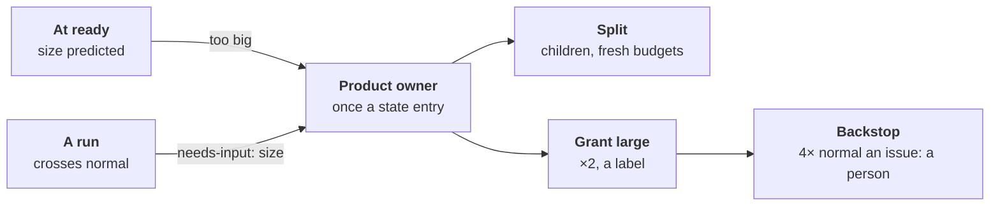

# ADR-0064: Size is a target, not a wall

- **Status:** accepted (2026-11-06)
- **Date:** 2026-11-06
- **Decided by:** the maintainer, on 2026-11-06, in direction; details
  by three independent reviewers, splits under [Settled](#settled)
- **Builds on:** [ADR-0022], [ADR-0026], [ADR-0040], [ADR-0046],
  [ADR-0050], [ADR-0060], [ADR-0063]; principles 1, 3, 4, 10, 12, 13, 14
- **Amends, once built:** [ADR-0063] §6 (over budget is no longer a
  machine error), §4 (a token counter in the log), §8 (the ceiling a
  measure, never a cap); [ADR-0038] (`split` on past an issue's size)

## Context

- **Every size limit was sized on small bugs of one project**: the
  C++ copy's rounds ([#757](https://github.com/JN0V/workline/issues/757)).
  - `ai-max-tokens` a run, `context.budget` and `code-lines-max` a
    prompt, `diff-lines-max` × `parts-max` a review, `ai-max-seconds`
    and the wait budgets of [ADR-0050];
  - about 273,000 fresh tokens a merged bug
    ([ADR-0063](0063-every-open-issue-is-due-waiting-or-done.md#amendment-2026-11-05-the-testers-read-tools-first)).
- **A big bug or a feature never went through**; workline must hold
  for any project and size.
- **Past a limit today, the line fails badly**:
  - **silent**: a cut of what a role reads is never told to the person
    ([#1159](https://github.com/JN0V/workline/issues/1159));
  - **wasteful**: a prompt over budget is retried twice on the same
    input ([#1160](https://github.com/JN0V/workline/issues/1160));
  - **orphaned**: the reviewer says "split the change", and no role owns
    the split ([#1113](https://github.com/JN0V/workline/issues/1113)).
- **The split act** ([ADR-0022]) is off by default ([ADR-0038]), never
  run on a real trial. **No cap per issue**, only per run.

## Decision

### 1. Normal size is measured, per project

- **Per role and issue kind** (bug, feature, task): fresh tokens a run,
  prompt size, changed lines a review.
- **Normal per issue**: the cumulative fresh tokens of all its runs.
- **The project's own 85th percentile** of its merged issues.
- **The seed**, until about 10 merged issues of a kind exist:
  - a run: today's caps for effort Low and Medium (sized on small
    bugs, never lower), ×2 for High ([ADR-0040]); effort scales only
    the seed, tiers multiply on top;
  - an issue: 400k, the worst measured round (385k a bug) rounded up;
    273k is the median of two rounds' per-bug averages (161k, 385k);
    effort High doubles the issue seed too (800k, backstop 3.2M).
- **Counted in the log**: each step's entry in `line-log`
  ([ADR-0063 §4](0063-every-open-issue-is-due-waiting-or-done.md#4-the-step-log))
  adds its role and fresh tokens, so an issue's total holds across
  machines. A run's `calls.jsonl` is lost with its CI job. Until
  [ADR-0063](0063-every-open-issue-is-due-waiting-or-done.md#build-plan)
  step 7 builds `line-log`, the counter lives in `line-record`.
- **Kept on the forge**, derived each night from the logs in one
  comment kept in place, as the auditor's count ([ADR-0046]); the local
  forge alike (principles 10, 13).

### 2. Two checkpoints

- **At ready**: the product owner predicts the issue's size against
  normal, from its Scope, scenarios and effort, and splits before any
  token is spent. Part of its refine act: no extra agent call.
- **On crossing**: a run past its role's normal ends with
  `needs-input(product-owner: size)`, the existing `needs-input(R2)` of
  [ADR-0063 §5](0063-every-open-issue-is-due-waiting-or-done.md#5-one-pure-function-decides),
  with what was done and what remains.
  - It fires on a prompt over budget, a cut of the code, a change too
    large to review whole, a run's token cap; said in the status block.
  - **Never a machine error, never retried**: same input, same size
    ([ADR-0063 §6](0063-every-open-issue-is-due-waiting-or-done.md#6-typed-outcomes)
    lists over budget as one today).
  - **The work is kept**: the developer's Draft and branch stay; a
    child may start from them.

### 3. The product owner decides, once a state entry

- **Split** ([ADR-0022]) when the parts pass their Verification apart.
  Each child is sliced vertically, keeps its own Verification, and
  starts with fresh budgets and its own backstop: at most 6 × 4× normal
  in all. The parent stays open until a person accepts it
  ([ADR-0029]); closing the children undoes the split.
- **Grant `workline:size/large`** when the need is atomic: ×2 every
  size target, a forge label a person undoes in one click.
- **`workline:size/x-large` (×4) is a person's answer**, never the
  product owner's; it lifts the issue's backstop to 16× normal.
- **Under its autonomy level** ([ADR-0026], [ADR-0060 §3](0060-the-person-is-on-the-loop.md#3-autonomy-is-a-level-per-role)):
  `cautious` proposes, `normal` and `enterprising` act.
- **`split` turns on past an issue's size**, off by default otherwise.

### 4. No loops

- **The tier only goes up**: normal, large, x-large.
- **One size escalation a state entry**: a second crossing in the same
  state entry, or a crossing at the top tier, is Waiting(person).
- **Split depth 1**: a child may be granted a tier, never split.
- **The size exchange counts** in the judgement rounds of
  [ADR-0063 §5](0063-every-open-issue-is-due-waiting-or-done.md#5-one-pure-function-decides);
  a split never resets `max-hops`.

### 5. The hard backstop

- **Fresh tokens per issue, cumulative**, all roles and runs: at about
  4× normal per issue (1.6M at the seed), Waiting(person). A granted
  `large` never raises it: a `large` issue whose every run hits its ×2
  cap reaches a person, by design. A person's `x-large` lifts it to 4×
  the x-large normal, 16× normal (6.4M at the seed).
- **No lazy-consensus time-out**, like a feature's yes
  ([ADR-0060 §1](0060-the-person-is-on-the-loop.md#1-questions-time-out-as-lazy-consensus)).
- **The liveness caps stay hard**: `max-hops`, `ai-max-turns`,
  `ai-max-seconds`, the machine-error budget.
- **The documentalist gets a token cap**; it has none today.
- **The 273k ceiling is never enforced at runtime**: a measure.

### 6. Every grant observed

- **Grants and splits are counted** in the auditor's weekly count
  ([ADR-0046]) and sampled: a grant where a split was possible, or
  children that cannot pass apart, is a false act.

## Build plan

One pull request a step, each shippable alone; conformance cases first.

1. **Every cut visible, no retry of size errors**, built apart:
   [#1159](https://github.com/JN0V/workline/issues/1159), [#1160](https://github.com/JN0V/workline/issues/1160).
2. **Normal size measured**: the token counter in `line-log`, the
   seed, the normals kept on the forge; reported, not yet acted on.
3. **The crossing outcome**: `needs-input(product-owner: size)` in place
   of the machine errors and silent cuts of step 1.
4. **The product owner's split or grant**, the tier labels, the
   at-ready prediction, the auditor's count. A conformance case: a
   granted tier's run targets stay under the backstop.
5. **The per-issue backstop.** A simulator trace where every run
   crosses its target ends in Waiting(person) within the hard caps.
6. **Round 6**, pinned: on a second repository, in another language, a
   small bug, a big bug and a feature, `split` on.
   - *Pass mark*: the feature split at ready into 2–4 children within
     target; the big bug granted, not split; nothing loops; tokens and
     time per issue told.

## Settled

- **p85, not p75**: at p75, one normal issue in four crosses and wakes
  the product owner; grants would become the habit. p85 is the
  convention of service-level expectations.
- **The product owner grants ×2 alone; ×4 is a person's**, as the
  product owner's and prior-art reviewers held, against the engine
  reviewer's ×4 by the product owner: the backstop never follows a tier
  the line granted itself.
- **Split depth 1, not 2**: one level is simple to check, cannot loop.
- **A second repository, not the C++ copy**: the limits were sized on
  the copy; only a project they were not sized on shows them agnostic.

## Prior art

- **Kanban's service-level expectation**
  ([ProKanban](https://prokanban.org/blog/the-kanban-pocket-guide-chapter-2-the-service-level-expectation)):
  normal is the team's own 85th percentile; an item
  [aging](https://prokanban.org/blog/what-the-heck-is-work-item-aging-and-why-is-it-so-important)
  past it asks "bigger than thought?".
- **SRE's [error budget policy](https://sre.google/workbook/error-budget-policy/)**:
  a soft limit holds only with a policy written before; §3 is it.
- **INVEST and [SPIDR](https://www.mountaingoatsoftware.com/blog/five-simple-but-powerful-ways-to-split-user-stories)**,
  [small changes](https://google.github.io/eng-practices/review/developer/small-cls.html):
  size at the door, split vertically, each part testable.
- **Coding agents** (SWE-agent, OpenHands, Claude Code): a hard wall a
  run, the work kept; none asks "too big?" first.

## Not chosen

- **Raise the caps** until a big issue passes: it moves the proxy.
- **No cap at all**: a loop would spend without bound.
- **Ask a person mid-run**: it assumes someone watches the screen.
- **A role's own estimate as normal**: estimates inflate to fit.

## Consequences and risks

- **A big bug or a feature can go through**, granted or split; more
  product owner calls past the size, none within it.
- **The product owner's splits are unproven**: an evaluation case
  before step 4. **Granting as a habit**: counted and sampled (§6).
  **A noisy percentile** on few runs: the seed holds until about 10.

[ADR-0022]: 0022-a-split-keeps-the-need-a-rename-keeps-a-persons-title.md
[ADR-0026]: 0026-the-product-owners-autonomy-is-a-level.md
[ADR-0029]: 0029-a-parent-is-accepted-by-a-person-from-what-its-parts-delivered.md
[ADR-0038]: 0038-the-product-owner-proposes-on-the-issue-a-person-answers-there.md
[ADR-0040]: 0040-priority-and-effort-are-the-forges-the-product-owner-estimates-them.md
[ADR-0046]: 0046-the-auditor-re-checks-every-roles-acts.md
[ADR-0050]: 0050-each-act-has-its-moment-and-a-wait-budget.md
[ADR-0060]: 0060-the-person-is-on-the-loop.md
[ADR-0063]: 0063-every-open-issue-is-due-waiting-or-done.md
