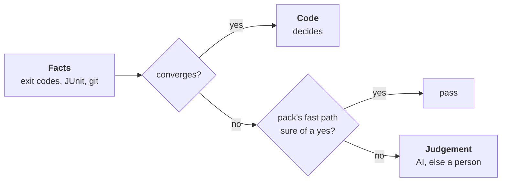

# ADR-0065: Code only what converges; language knowledge in packs

- **Status:** proposed
- **Date:** 2026-11-09
- **Decided by:** the maintainer, on 2026-11-09, in direction; details
  from three independent genericity reviews, which agree on the
  essentials; choices they left open under [Settled](#settled)
- **Builds on:** [ADR-0005], [ADR-0045], [ADR-0046], [ADR-0063],
  [ADR-0064]; principles 4, 5, 7, 10, 12, 13
- **Amends, once built:** [ADR-0055] (the red proof of a broken build,
  its amendment "a missing name, told from a broken build");
  [ADR-0054] and [ADR-0063 §9] (the developer's bounds read paths only);
  [ADR-0063 §8] (the code picker frozen)
- **Research:** [round6-root-causes.md](../research/round6-root-causes.md)

## Context

- **Each trial on a new language opens fixes in the same few places**:
  the Kotlin/Android copy's rounds, about 310 engine commits since
  2026-10-25.
  - The red proof's "right reason": [#1111], [#1114], [#1183], [#1192],
    [#1202], [#1209], [#1214].
  - The developer's Scope fence: [#1207], [#1211]; `bounds.go` took 17
    commits in two weeks.
  - Which test covers which scenario: [#1136], [#1147], [#1155], [#1158].
  - The code picker: [#1109], [#1139], [#1152], [#1154], [#1188], [#1189].
- **One cause under all of them**: the engine decides by a guess where
  the facts do not converge.
  - A compiler's prose, a project's layout, a name's casing, free text:
    each new project brings a shape no regex has seen.
  - A regex can be extended, never finished. Its miss blocks or passes.
- **Ecosystem knowledge is compiled into Go**: about twelve tables in
  eight packages (extensions, `src/main` ↔ `src/test`, Gradle module
  words, JVM `package` lines, mutation tools, comment syntax), five
  definitions of "a test file" that disagree.
- **Two places already do it right**: the linters' table borrowed from
  trunk (`internal/linters`), and the tester's settings (`build-errors`,
  `test-paths`, `module-files`): data, not logic.

## Decision

### Rule A: a guess may only pass

- **A verdict may rest on a guess** (a regex over prose, a heuristic)
  **only if its miss falls back to judgement**: the AI, or a person
  where there is none (principle 5).
- **Never to a silent pass, never to a hard block** (principle 12).
- **A fast path may only pass**: sure of a yes, it passes, said; unsure,
  it hands the raw facts on.
- **A context guess** (which file to show an agent) is no verdict: its
  miss costs a read. It may stay, but stops growing.

### Rule B: no ecosystem pattern in the engine

- **No language or ecosystem pattern in `internal/`**: no extension
  list, marker file, test folder, compiler message, build tool word.
- **It goes in a pack** ([below](#language-packs)); the engine reads the
  pack's fields, never names a language.
- **Enforced by a test, proposed**: a Go test walks the string literals
  of `internal/` outside the pack loader and fails on one equal to a
  pack's marker, extension or path pattern. A baseline file lists
  today's offenders and may only shrink. Cheap: one AST walk, no tool.

### Language packs

- **One YAML file an ecosystem, embedded in the binary** (principle 11):
  `go`, `kotlin-gradle`, `java-maven`, `python-pytest`, `js-jest`,
  `c-platformio`…; a project overrides or adds one under `.workline/`.
- **Data only, never a verdict**. A pack holds:
  - `detect`: marker files and extensions;
  - `test-paths` and `test-homes` (`src/main/** → src/test/**`; Go: the
    same folder), `aside` folders (examples, fixtures);
  - `test-report` patterns, `module-files`, suggested `test-command`;
  - `problem-matchers` for build errors, in the GitHub Actions and
    VS Code format (owner, regexp, file, line, message), so shipped
    matchers are copied, not written;
  - an optional `missing-name` fast path (Rule A);
  - code navigation rows (definitions, imports, keywords), comment
    syntax;
  - the mutation tool, runner filters.
- **Selection**:
  - detected at `workline init` from marker files and **written into
    `.workline/config.yaml`**: a run never guesses again, a person
    sees and edits it (principle 14);
  - several packs for a polyglot repository;
  - an explicit role setting (`build-errors`, `test-paths`) wins;
  - `workline doctor` lists the packs, the languages with none, and
    drift from what it detects.
- **No pack, the generic path, never a refusal**: the JUnit report,
  the raw output to the AI, the agent's read tools, generic test paths
  (`**/test/**`, `**/tests/**`, `*_test.*`, `*.test.*`, `*.spec.*`).
  Said by `doctor`.
- **Moving data, mostly**: the tables of `internal/codenav`,
  `internal/codepick`, `internal/tester` (`coverage.go`, `notrun.go`),
  the reviewer's and the documentalist's comment tables, the tester's
  role.yaml defaults.

### The four changes

1. **Red for the right reason goes to judgement**, amending [ADR-0055]:
   - **Kept mechanical**: the run, the report, whether the build broke,
     the files the output names, the names the base lacks (`git grep -w`).
   - **Fast path**: a build broken only by a name the base lacks, which
     the issue names verbatim: red, proven, said.
   - **Else the judge** ([ADR-0045]) with the raw facts: the issue's
     Scope and scenarios, the test diff, the build output (clipped,
     masked), the names the base lacks. "Does each test fail only
     because what the issue asks for does not exist yet?" Yes is red;
     no is `build-broken`, the judge's line quoted.
   - **No AI**: the Draft opens `red unproven`, the compiler's lines
     quoted, Waiting(person). Never a pass.
   - **Deleted**: `redfirst.go`'s knock-on, declaration and casing rules.
2. **Scope as paths and globs, the fence matches paths only**:
   - The product owner, who reads the code, writes the Scope's files as
     repository paths or globs; its writing check finds each, or a line
     marks it new.
   - The developer's fence matches those paths, `test-homes` for new
     tests, nothing else. A miss is the existing scope-ask
     ([bounds](../../roles/developer/docs/bounds.md#asking-the-product-owner-for-files)).
   - **An issue with no path or glob**: its backticked words that are
     tracked paths count, as today; anything else asks.
   - **Deleted**: class name to file, Gradle module word to folder, the
     `src/test` ↔ `src/main` helper rule.
3. **One definition of a test file**: the project's `test-paths` and
   `test-homes`, from its packs or its config, read by the tester, the
   developer, the product owner and the code picker. Four copies deleted.
4. **The agent says which test covers which scenario**: a structured
   field in its answer; the engine checks each test id in the JUnit
   report, red on the base. An id not found is told the agent once,
   then a person. The fuzzy name matcher is deleted.

**And the code picker is frozen**: no new heuristic; its tables move
to packs. An agent with read tools reads the files itself
([ADR-0063 §8]); a `cmd:` agent with none keeps "name the code, be read
again".

### When it is done

- **A round on two repositories in two languages, with no engine
  change between them**: the Kotlin/Android copy and one in another
  language.
- **Defects per round fall**: counted as the defect issues each round
  opens, fewer than the round before. A round that opens a language
  fix in Go, not in a pack, fails it.

## Build plan

One pull request a step, conformance cases first.

1. **One test-file definition** (change 3), [#1226]: cheapest, and
   the fence needs it.
2. **The red proof's judgement** (change 1), [#1227].
3. **Scope paths, a dumb fence** (change 2), [#1228].
4. **Scenarios declared** (change 4), [#1229].
5. **Packs**, [#1230]: the format, the loader, detection into config, `doctor`;
   the tables moved.
6. **Rule B's test**, [#1231], its baseline only shrinking.
7. **The two-repository round**, [#1232].

## Settled

- **The judge, not the tester's agent asked again**: an independent
  reader ([ADR-0005]); the tester's agent wrote the test it would judge.
- **Packs written into config, not detected each run**: the same on a
  laptop and in CI (principle 10); a person reads what was chosen.
- **The fast path stays**: a name the issue names and the base lacks
  converges well enough; dropping it would call the judge on most Go
  and Kotlin tests.
- **Problem matchers' format, not our own**: borrowed (principle 13).
- **Tree-sitter or ctags not adopted**: a dependency per language
  (principle 11); the codenav rows move to packs as they are.
- **Agent answer repair** (`intent.NormalizeDiff`, prose before a
  list) is not changed here: its miss already falls back to asking the
  agent again, Rule A holds. A worktree for the tester is a later
  choice.

## Prior art

- **Renovate managers**: one module an ecosystem, default `fileMatch`,
  overridable, enabled by detection.
- **MegaLinter descriptors**: one YAML a language; no descriptor, the
  language is not linted, said.
- **GitHub Actions / VS Code problem matchers**: build output to file,
  line, message, shipped by each `setup-*` action.
- **GitHub linguist**: extensions, file names, comment syntax as data.
- **Cloud Native Buildpacks `detect`**: per-ecosystem detection by files.
- **workline's own `internal/linters/trunk.json`**: borrowed, generated
  data; the model the packs follow.

## Not chosen

- **More rules per compiler**: the loop this ends.
- **Packs as Go code, a plugin a language**: logic per language again,
  and a build to add one.
- **No packs, the AI for everything**: JUnit, git and a missing name
  converge; replacing code that converges with AI is waste.
- **The red proof refusing with no AI**: a block where judgement is due.

## Consequences and costs

- **A new language is data**, not an engine release; with no pack, the
  generic path works, slower.
- **Judge tokens on the red proof: not measured.** Only on a broken
  build the fast path did not pass; measured in step 2's try.
- **More scope-asks at first**, until the product owner writes paths;
  its output grows by the paths.
- **Kept, because it converges**: the JUnit XML and coverage readers
  (Go profile, LCOV), the mutation report schema, `module-files` and
  `{packages}`, sizes, labels, timeouts, exit codes, git facts, our own
  markers, the commit-message rule, gitleaks, missing tools confirmed by
  `exec.LookPath`, path normalising, Gherkin scenario parsing.
- **Not yet read against Rule A**: the documentalist's prose rules on
  counts and versions; they flag suspects, which may be enough.

[#1109]: https://github.com/JN0V/workline/issues/1109
[#1111]: https://github.com/JN0V/workline/issues/1111
[#1114]: https://github.com/JN0V/workline/issues/1114
[#1136]: https://github.com/JN0V/workline/issues/1136
[#1139]: https://github.com/JN0V/workline/issues/1139
[#1147]: https://github.com/JN0V/workline/issues/1147
[#1152]: https://github.com/JN0V/workline/issues/1152
[#1154]: https://github.com/JN0V/workline/issues/1154
[#1155]: https://github.com/JN0V/workline/issues/1155
[#1158]: https://github.com/JN0V/workline/issues/1158
[#1183]: https://github.com/JN0V/workline/issues/1183
[#1188]: https://github.com/JN0V/workline/issues/1188
[#1189]: https://github.com/JN0V/workline/issues/1189
[#1192]: https://github.com/JN0V/workline/issues/1192
[#1202]: https://github.com/JN0V/workline/issues/1202
[#1207]: https://github.com/JN0V/workline/issues/1207
[#1209]: https://github.com/JN0V/workline/issues/1209
[#1211]: https://github.com/JN0V/workline/issues/1211
[#1214]: https://github.com/JN0V/workline/issues/1214
[#1226]: https://github.com/JN0V/workline/issues/1226
[#1227]: https://github.com/JN0V/workline/issues/1227
[#1228]: https://github.com/JN0V/workline/issues/1228
[#1229]: https://github.com/JN0V/workline/issues/1229
[#1230]: https://github.com/JN0V/workline/issues/1230
[#1231]: https://github.com/JN0V/workline/issues/1231
[#1232]: https://github.com/JN0V/workline/issues/1232
[ADR-0005]: 0005-independence-takes-the-best-level-available.md
[ADR-0045]: 0045-the-judge-asks-for-the-code-it-needs.md
[ADR-0046]: 0046-the-auditor-re-checks-every-roles-acts.md
[ADR-0054]: 0054-the-developer-takes-a-ready-issue-to-a-pull-request.md
[ADR-0055]: 0055-the-tester-writes-the-acceptance-tests-before-the-code.md
[ADR-0063]: 0063-every-open-issue-is-due-waiting-or-done.md
[ADR-0063 §8]: 0063-every-open-issue-is-due-waiting-or-done.md#8-one-code-picker-and-tools-where-the-agent-has-them
[ADR-0063 §9]: 0063-every-open-issue-is-due-waiting-or-done.md#9-the-developers-write-fence
[ADR-0064]: 0064-size-is-a-target-not-a-wall.md
