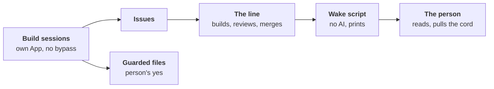

# ADR-0068: The line steps back on its own drift, and its builders go through it

- **Status:** accepted by the maintainer's merge of its pull request;
  not built. It commits to [build steps 1 to 3](#build-order) and
  [principles 4 and 7](#3-principles-4-and-7-reworded), which alone
  take effect at merge. The rest waits for step 1's
  [test](#6-credentials-kept-apart)
  ([§9](#9-the-old-brakes-hold-until-step-1-passes)); steps 4 to 7 are
  [next](#next-each-decided-when-reached), each decided when reached.
- **Date:** 2026-11-13
- **Decided by:** the maintainer, in direction, after three independent
  reviews and an adversarial review of this record; its scope narrowed
  after a further independent review, 2026-11-13
- **Builds on:** [ADR-0005], [ADR-0018], [ADR-0026], [ADR-0044],
  [ADR-0064], [ADR-0065], [ADR-0066]; principles 1, 4, 6, 7, 13, 15
  ([PRINCIPLES.md](../PRINCIPLES.md))
- **Amends:** principles 4 and 7, at merge; [ADR-0042] (what never
  merges alone), [ADR-0054] (the developer's steering bound) and
  [ADR-0058] (the sessions' credentials), once step 1 is built;
  [ADR-0052] (its freeze) and [ADR-0063] (its standing stop), once
  step 1 passes its test
- **Confirms:** [ADR-0038] and [ADR-0060] §1 (silence is never a yes);
  [ADR-0044] (the App's key stays with the default branch's runs)
- **Research:** [stepping-back.md](../research/stepping-back.md)

## Context

Measured on `main` at `e16e4e7b0`, the forge read on 2026-11-13
([the measures](../research/stepping-back.md#the-runaway-measured)):

- **Growth ran away**: non-test Go 13,856 lines (09-30) → 110,989
  (11-13); role settings 20 → 118 and rule codes 50 → 531, never
  falling; about 16% of the Go added was deleted. [ADR-0052]'s freeze
  did not hold: its exception swallowed the rule.
- **The build sessions drove it, not the line**: sessions under the
  maintainer's account opened 237 of the last 300 merged pull requests
  (10-31 → 11-13), workline's App 62, 34 of them the developer's; from
  11-09, 81 of the 89 merged. They bypassed `main`'s ruleset 262 times,
  under standing orders kept outside the repository. workline's roles
  wrote 0.6% of the Go; no role observes a session ([ADR-0046]).
- **The line kept building, and well**: its developer's [#1452] merged
  on 11-13, four more were open; on DomoticsCore, 8 of 8 of its code
  pull requests were accepted, one over-built, which the reviewer
  missed.
- **Only the maintainer's unease stepped back**; agent panels, briefed by
  the builder, answered "how", never "whether".
  [A backtest](../research/stepping-back.md#the-unease-backtest): AI
  judges caught the fix storm only, and a one-line rule matched them.

## Decision

### 1. Drift, defined

- **Building what no stated need asks for.** A need is stated in an
  issue's Need, by a person or the product owner. A builder's or a
  role's is a proposal the product owner takes at its level
  ([ADR-0018], [ADR-0026]).
- **Building it more complicated than the need requires.** The
  appetite, the size the need deserves, is stated with the need.
- **Fixing symptoms without going up to their cause.**

### 2. Prompt first, code what converges

- **A new role starts as a prompt**, with no new code of its own, on
  the engine's plumbing: the agent call, the propose/apply allowlist,
  the traces. Its acts are traced and sampled ([ADR-0046]).
- **What converges moves to code**: the same result each run,
  verifiable without judgement ([ADR-0065]'s rule A, [ADR-0066] §2),
  by a written criterion.
- **The reverse, for the roles already built**: judgement frozen in Go
  may move to prompts, each move an issue on the line's normal path
  ([§4](#4-the-guard-is-guarded)).

### 3. Principles 4 and 7, reworded

Principle 4 gains a sentence: "A new role starts as a prompt on the
engine's plumbing, safe and observed from day one." Principle 7's last
sentence, "Every defect that got through ends as a proven, mechanical
guard", becomes:

> A defect that got through ends as a conformance or evaluation case
> failing without its fix. The case is the default; a rule code, a
> setting or a marker (a label or comment the engine reads) is added
> only where a case cannot hold the defect, and its issue says why.

- **Why**: the old sentence ordered a guard per defect, the source of
  the 531 rule codes; each had its issue, so "answers a need" alone
  would not bite.
- **Both take effect at merge**: their mechanisms exist. The
  conformance and evaluation suites hold a case today; principle 4
  orients the next new role, whose first task checks that `run-role`
  takes a role made of a prompt and shared `pre`/`post`.

### 4. The guard is guarded

- **Only the files that define oversight and authority** go under
  CODEOWNERS, with code-owner review:
  - `CODEOWNERS`, `AGENTS.md`, `CLAUDE.md`, `docs/PRINCIPLES.md`;
  - `.github/workflows/**`, `.github/actions/**`: what runs the checks
    and holds the App's key;
  - `.workline/config.yaml`, the only file under `.workline/`: merge
    autonomy, routing, gates, the reviewer's ignore list, and each
    role's level, pinned there in step 1;
  - the wake script and its triggers (step 3); the process engineer's
    brief, if step 6 builds it.
- **Role prompts are not guarded**: a role's `instruction.md`,
  `policy.md`, lenses and `role.yaml` take the line's normal path. The
  reviewer reads them (step 1 takes them out of workline's ignore list
  of `*.md` and `docs/**`); the auditor samples the acts; the process
  engineer, if built, may subtract.
- **Why**: the person stays on the loop, not in it. Since 10-16, 313 of
  534 commits on `main` touched `roles/` (59%); the guarded list, 79
  (15%), 59 of them workflows
  ([the count](../research/stepping-back.md#what-codeowners-would-hold)).
  Moving judgement from Go to prompts sends more change into `roles/`;
  a yes on each would make the person a bottleneck, or a rubber stamp.
- **[ADR-0042]'s rule narrows**: "a pull request changing what steers
  agents never merges alone" keeps applying to the guarded list, no
  longer to role prompts. The steering test the routine merge shares
  with [ADR-0054]'s developer bounds narrows alike in step 1: a role's
  folder and a file named a prompt or an instruction leave it; agent
  files and gate files stay.
- **Who writes them**: a session under its own App (§5); they merge on
  the person's code-owner review, an assisted yes (§7).
- **Escapes it, said**: a role's `levels` table in its `role.yaml`
  (the wake script prints each change); a facet kept in
  `~/.config/workline/roles/`; a role prompt the line changes, with the
  reviewer and the auditor as its net.
- **Outcome measures are never builders' goals**: no brief cites them.

### 5. Build sessions write issues; the line builds

- **Sessions no longer code workline directly.** They write issues, as
  the person does, under their own App; the line builds them.
- **Paused from 2026-11-13**, the trial's hourly line too, until steps
  1 and 2 are done. This record pauses no role: the line keeps building
  workline's own issues.
- **Fallback, when the line is broken and cannot fix itself**: the
  person opens it; a session's pull request waits for the person's yes.
- **Their standing orders move into `AGENTS.md`**, versioned and
  visible; the out-of-repository orders that contradict it are deleted,
  since a session reloads them.
- **What it costs**: longer latency per item; when CI is broken,
  sessions get stuck instead of forcing.

### 6. Credentials, kept apart

An **autonomous session** works without the person reading each act: a
background run, an overnight loop, a fleet of subagents, a scheduled
job. An **interactive session** is the person at the keyboard, in their
own OS user, each act on their explicit instruction: the person acting
([§7](#7-a-persons-yes-is-assisted-never-delegated)), under their
account. Where a session runs tells which, never what it says.

- **On a person's machine**: autonomous sessions run as a second OS
  user (say `workline-builder`), or in a rootless container whose only
  mounts are the working copy and the session's token.
  - **Its credentials**: a git credential helper and `GH_TOKEN`, set per
    session, mint a one-hour installation token of the sessions' App,
    whose key that user alone reads.
  - **Out of its reach**: the person's `gh` login, keyring, SSH keys and
    browser; workline's App key. The person's home is `0700`; the
    keyring answers on the person's own session bus only.
- **In CI or a remote session**: the job holds only the sessions' App
  token, a secret of its own environment. workline's App key stays in
  the environment only the default branch may use ([ADR-0044]); no
  session's job declares it, and the workflows that do are guarded.
- **On the forge**: the sessions' App is on no bypass list and owns no
  path; `main` requires a pull request, its checks, and code-owner
  review on the guarded list. The admin bypass is the person's alone.
- **Enforced**: the kernel's rights between two users, or the
  container's mounts; the forge's ruleset, code owners, environments.
- **Convention, said**: that autonomous work starts as the second user,
  never in the person's shell, with no copy of their token.
  [ADR-0058] §2's limit stands for a session in the person's user, and
  for a role's agent.
- **Caught after the fact**: the wake script prints the ruleset bypasses
  and the share of pull requests opened by the person's account against
  the sessions' App.
- **The test**, from an autonomous session's shell, and alike from its
  CI job: `gh auth status` shows the sessions' App only; a push to
  `main` is refused; reading the person's `gh` config, keyring or
  workline's App key fails; no token in the environment bypasses the
  ruleset.

### 7. A person's yes is assisted, never delegated

Where a person's yes is asked (a guarded file, a session's fallback
pull request), they need not read the change line by line:

- **How it goes**: their own assistant (any agent, or none) gives an
  independent analysis; they look closer at the sharp points, then say
  yes. The assistant may act in their name, on that instruction.
- **It is the person's yes when** given for that item, at that moment,
  on their explicit instruction, never a standing order ("the panel
  signs for me"): standing orders are what ran away; on an analysis not
  from the session or role that wrote the change; traced, who
  instructed it on which summary.
- **Silence is never a yes** to merge, release or delete
  ([ADR-0060] §1, [ADR-0038]).

### 8. The wake script, print only

On each merge to `main`, with no AI, it prints the triggers met in one
issue kept in place; the person reads it until a role does (step 6).
It never blocks a merge (principle 15).

| Trigger | Why |
|---|---|
| An ADR created or changed; a new role, setting, command or rule code | growth of the contract |
| A role's prompt, `levels` table or default level changed; words per prompt | prompts steer the line |
| The same area fixed again and again; a fix reopened | symptoms without cause |
| A pull request merged closing no issue; issues opened by builders | need laundering |
| Ruleset bypasses; pull requests by the person's account against the sessions' App | the credentials' split |
| The cord: a `step-back` label anyone may set | the person's unease, or a role's |

- **What real use runs** is logged in each project's run records:
  which settings, acts and commands fire. A mechanism that never fires
  is a deletion candidate.
- **Its limit**: a tripwire for honest drift; a mechanism hidden inside
  existing code escapes it.

### 9. The old brakes hold until step 1 passes

- **[ADR-0052]'s freeze and [ADR-0063]'s standing stop stay in force**
  until step 1 passes [§6's test](#6-credentials-kept-apart). Merging
  this record lifts neither.
- **Then both are superseded**: sessions go through the line with no
  bypass; a fix repeated in one area is a trigger (step 3) and anyone's
  cord. [ADR-0063]'s other working agreements stand.
- **[ADR-0052]'s v1.0 bar stands** until step 7 decides what replaces
  it.

## Not chosen

- **Budgets, quotas, hard limits** on growth, caps on the sessions
  included: a wall moves the proxy, as [ADR-0064] found for size.
- **A clock**: the wake runs on merges, never on a calendar.
- **`roles/**` under CODEOWNERS**: a yes on most commits (§4).
- **A bot account or workline's App for the sessions**: a machine user
  counts as a person's yes; the App signs the acceptance.

## Consequences and risks

- **No teeth until step 1 passes its test**, and partly convention
  after it on a person's machine (§6); the old brakes hold until then.
- **The person's yes, sized**: about 15% of commits, mostly workflows;
  if it slows the line, a record revisits the list.
- **Throughput**: the line merged 5 of the 89 pull requests merged from
  11-09, the sessions 81; latency per item grows until the line takes
  their share.
- **Prompts reviewed by an agent**: the reviewer has never read prose;
  its first rounds on role prompts are unmeasured.
- **In-sample**: the triggers come from one runaway.

## Build order

Each an issue through the product owner. Decided:

1. **The sessions' App, credentials apart, CODEOWNERS** on §4's list:
   the person's one-time setup (§6); the steering test narrowed, role
   prompts out of the reviewer's ignore list, each role's level pinned
   in `.workline/config.yaml`. Done when §6's test passes, on the
   machine and in CI.
2. **`AGENTS.md`**: the sessions' rules (§5 to §7); their
   out-of-repository orders listed, those contradicting it deleted.
   Sessions resume.
3. **The wake script**, print only (§8), with its conformance cases.

## Next, each decided when reached

Listed, not decided; each its own record or amendment, after a
real-use round on steps 1 to 3.

4. **A simplicity lens** in the reviewer, advisory first, calibrated on
   past pull requests.
5. **The auditor's draw** of a person's own changes, a session's
   included ([ADR-0046]).
6. **The process engineer** ([ADR-0019], [#89]): reads the wake script
   and the auditor, runs five whys, at a level ([ADR-0060] §3); with
   it, whether a fixes-only release ships after its step back
   ([ADR-0060] §4).
7. **What replaces [ADR-0052]'s v1.0 bar**: criteria from real use,
   defects per processed issue preferred to a fix share.

## Open questions

Each part of its step's issue, none blocking.

- **The second user or the container first**, and how each reads on
  GitLab's CI and the local forge (step 1).
- **The steering test on a project other than workline**: its role
  folders, its files named a prompt (step 1).
- **"Again and again", "an area"**: read from files and the forge,
  never from titles or commit types, which the judged choose (step 3).
- **Sign-offs already posted in the maintainer's name** by agent panels
  ([#155]): relabelled, not counted for a role's criteria (step 2).
- **Cost**: each step's issue states its tokens and wait ([ADR-0051]).

[ADR-0005]: 0005-independence-takes-the-best-level-available.md
[ADR-0018]: 0018-the-product-owner.md
[ADR-0019]: 0019-the-line-evaluates-itself.md
[ADR-0026]: 0026-the-product-owners-autonomy-is-a-level.md
[ADR-0038]: 0038-the-product-owner-proposes-on-the-issue-a-person-answers-there.md
[ADR-0042]: 0042-the-engine-merges-by-the-projects-policy.md
[ADR-0044]: 0044-the-apps-key-stays-with-the-default-branchs-runs.md
[ADR-0046]: 0046-the-auditor-re-checks-every-roles-acts.md
[ADR-0051]: 0051-a-check-sits-where-its-catch-is-worth-its-cost.md
[ADR-0052]: 0052-v1-0-when-the-core-roles-are-out-of-beta.md
[ADR-0054]: 0054-the-developer-takes-a-ready-issue-to-a-pull-request.md
[ADR-0058]: 0058-the-forge-guards-the-project-not-the-agents-environment.md
[ADR-0060]: 0060-the-person-is-on-the-loop.md
[ADR-0063]: 0063-every-open-issue-is-due-waiting-or-done.md
[ADR-0064]: 0064-size-is-a-target-not-a-wall.md
[ADR-0065]: 0065-code-only-what-converges-language-knowledge-in-packs.md
[ADR-0066]: 0066-a-role-mirrors-a-human-role-ai-first-where-code-is-rigid.md
[#89]: https://github.com/JN0V/workline/issues/89
[#155]: https://github.com/JN0V/workline/issues/155
[#1452]: https://github.com/JN0V/workline/pull/1452
