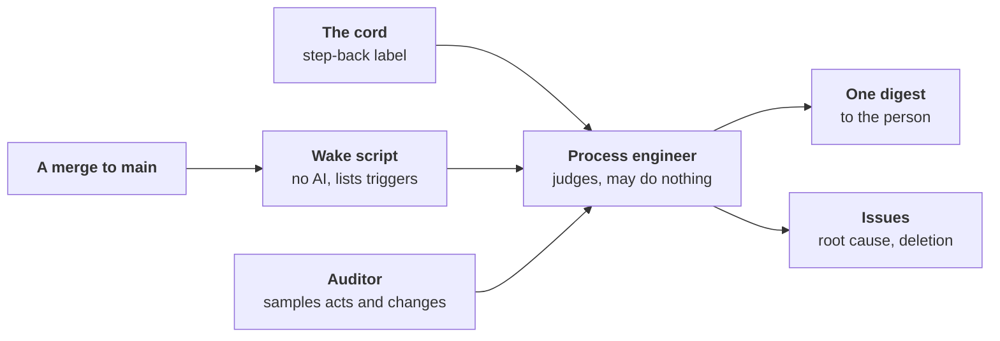

# ADR-0068: The line steps back on its own drift, and its builders go through it

- **Status:** accepted by the maintainer's merge of its pull request,
  which lands [principles 4 and 7](#11-principles-4-and-7-reworded);
  not built
- **Date:** 2026-11-13
- **Decided by:** the maintainer, in direction, after three independent
  reviews and an adversarial review of this record; the defaults that
  review proposed for its blocking questions accepted, 2026-11-13
- **Builds on:** [ADR-0005], [ADR-0018], [ADR-0026], [ADR-0036],
  [ADR-0064], [ADR-0065], [ADR-0066]; principles 1, 2, 4, 6, 7, 12, 15
  ([PRINCIPLES.md](../PRINCIPLES.md))
- **Amends:** principles 4 and 7; [ADR-0019] (the process engineer);
  [ADR-0046] (whose changes are drawn); [ADR-0052] (its v1.0 bar and
  its freeze go); [ADR-0042] and [ADR-0060] §3–§4 (releases, levels);
  [ADR-0058] (the build sessions' credentials); [ADR-0063] (its
  standing stop on fixes goes)
- **Confirms:** [ADR-0038] and [ADR-0060] §1 (silence is never a yes);
  [ADR-0044] (the App's key stays with the default branch's runs);
  [ADR-0051] §1 (what an agent judges never holds a release)
- **Research:** [stepping-back.md](../research/stepping-back.md)

## Context

Measured on `main` at `e16e4e7b0`, the forge read on 2026-11-13
([the measures](../research/stepping-back.md#the-runaway-measured)):

- **Growth ran away**: non-test Go 13,856 lines (09-30) → 110,989
  (11-13); role settings 20 → 118 and rule codes 50 → 531, never
  falling; about 16% of the Go added was deleted. [ADR-0052]'s freeze
  did not hold: its exception swallowed the rule.
- **The build sessions drove it, not the line**: coding-agent sessions
  under the maintainer's account opened 238 of the last 300 merged pull
  requests and bypassed `main`'s ruleset 262 times, under standing
  orders kept outside the repository; workline's roles wrote 0.6% of
  the Go. No role observes a session ([ADR-0046]).
- **The line's own output was good**: 8 of 8 of its code pull requests
  accepted on DomoticsCore; one over-built, which the reviewer missed.
- **Only the maintainer's unease stepped back**; agent panels, briefed by
  the builder, answered "how", never "whether".
  [A backtest](../research/stepping-back.md#the-unease-backtest): AI
  judges caught the fix storm only, and a one-line rule matched them.

## Decision

### 1. Drift, defined

Drift is any of three:

- **Building what no stated need asks for.** A need is stated in an
  issue's Need, by a person or by the product owner; the issue says
  which. A need from a builder or a role is a proposal the product
  owner takes at its level ([ADR-0018], [ADR-0026]), as principle 1
  wants.
- **Building it more complicated than the need requires.** The
  appetite, the size the need deserves, is stated with the need, before
  its design.
- **Fixing symptoms without going up to their cause.**

No need laundering: every pull request, a role's or a builder's,
carries a Need. Today the reviewer's intent lens is asked only of a
change that closes an issue.

### 2. Who steps back

| Who | Its question | Its reach |
|---|---|---|
| **Auditor** | Was this act right? | judges acts, never proposes; draws a person's own changes too, a session's included, where the project sets it |
| **Process engineer** | Is our way of working producing the right result? | reads the auditor's verdicts, computed facts, design content (ADRs, new mechanisms); runs five whys (asks why until the root cause) at the source; sees "without need" as a pattern |
| **Architect** | Is the product simple and coherent? | starts as a simplicity lens in the reviewer, on every pull request; a periodic role later |
| **Product owner, reviewer's intent lens** | Does this change answer a stated need? | per change; today only for a change closing an issue |

- **[ADR-0019]'s split holds**: the first never proposes, the second
  never re-judges an act.
- **Both are generic**, for any project using workline. The process
  engineer is un-parked ([#89], closed not planned on 11-09); it may
  request an architecture review, never do one.
- **The simplicity lens starts advisory**, calibrated on 20–50 past pull
  requests with known verdicts, the over-built one first. It blocks
  once its false-positive rate is known: the person sets it, in
  `.workline/config.yaml`.
- **The reviewer reads no prose**: workline's `.workline/config.yaml`
  ignores `*.md` and `docs/**`, so every prompt, lens, ADR and
  `AGENTS.md`. A prompt-first frame lands there: what adds a mechanism
  in prose reaches the process engineer, not the lens.

### 3. Prompt first, code what converges

- **A new role starts as a prompt, with no new code of its own.** It
  reuses the engine's plumbing: the agent call, the propose/apply
  allowlist, the traces.
- **What converges moves to code**: the same result each run,
  verifiable without judgement (principle 4, [ADR-0065]'s rule A,
  [ADR-0066] §2).
- **The reverse, for the roles already built**: judgement frozen in Go
  moves to prompts. No role is excluded; the critique of the extras is
  of their size and form, each move an issue.
- **Conditions, from day one:**
  - safety in code: the agent holds no write token; its acts go through
    the engine's allowlist;
  - observability: its acts traced and sampled ([ADR-0046]);
  - a written criterion for moving a part to code;
  - its prompt's size printed by the wake script, never capped.

### 4. Authority

- **A role acts alone when the act is reversible and subtracts.**
  Adding goes through the product owner like any need, at its autonomy
  level ([ADR-0026]). Changing direction is the person's.
- **The auditor, alone**: samples, publishes its verdicts, opens an
  issue for a wrong act. It never undoes, never proposes.
- **The process engineer has a level** ([ADR-0060] §3); the person
  raises it, in `.workline/config.yaml`:
  - **`cautious`**, where it starts: one digest per step back, and
    issues: a root cause after five whys, a deletion, an architecture
    review;
  - **`normal`**: the pause besides, once it beats its pre-registered
    baselines ([§10](#10-verification));
  - **`enterprising`**: undefined until `normal` has run a real-use
    round.
- **A deletion is an issue** the developer builds; its pull request
  merges by the policy for its kind ([ADR-0060] §4). It states why the
  thing was built: downstream projects pin versions, and the release
  notes say what they lose.
- **A pause**, from `normal`: the build sessions and the line stop
  adding in a work area. It has an exit condition, set with it; it
  lapses at the next step back; it fails only changes that add contract
  surface ([§8](#8-a-release-is-split-by-its-nature)) in the area:
  never a reproduced bug's fix, never a deletion. Where the forge has
  required checks, it is one; how far it holds on each forge is said.
- **The process engineer never** changes a principle, accepts an ADR,
  edits its own brief, or signs for the person.
- **The person**: one digest per step back. Replies, all optional: dig,
  stop, go, undo. Silence is never a yes to merge, release or delete
  ([ADR-0060] §1, [ADR-0038]).

### 5. Triggers, in two stages

1. **A wake script, no AI**, on each merge to `main`: it lists the
   triggers met. It never blocks a merge (principle 15); its counts are
   reused by the release split and the pause.
2. **The process engineer judges**: doing nothing is a valid answer.

| Trigger | Why |
|---|---|
| An ADR created or changed; a new role, mechanism, setting, command or rule code | growth of the contract |
| The same area or issue fixed again and again; a fix reopened | symptoms without cause |
| A topic active long without closing, judged in context | a long justified job is normal |
| A real-use round ends; the person's verdicts on pull requests | an outside fact arrived |
| Each release | the release boundary ([§8](#8-a-release-is-split-by-its-nature)) |
| The cord: a `step-back` label anyone may set | the person's unease, or a role's |
| Many merges since the last step back | counts work, never hours |

- **One step back at a time**: triggers met while one runs join the
  next; its digest says how many merges it covers.
- **Dropped**: off-hours merges; a big job can run at night, which is
  not drift. **Not used until checked**: pull requests closed unmerged.
- **The wake is the process engineer's `pre`** ([role contract](../spec/role-contract.md)):
  it sits in the role's folder, traced by `run-role`, not a mechanism
  apart.
- **What real use never runs** is logged: which settings, acts and
  commands fire, kept in each project's run records; nothing leaves it.
  A mechanism that never fires is a deletion candidate.
- **Limits, said**: a mechanism hidden inside existing code escapes the
  script; the auditor's draw covers it. The script is a tripwire for
  honest drift, not a guard against a builder told to go round it.

### 6. The guard is guarded

- **Files that steer agents or guard the line**, under CODEOWNERS with
  code-owner review, a forge's native guard:
  - `CODEOWNERS` itself, `AGENTS.md`, `CLAUDE.md`, `docs/PRINCIPLES.md`;
  - `roles/**`: every prompt and lens, the process engineer's brief and
    wake script, the auditor's folder;
  - `.github/workflows/**` and `.workline/**`: what runs the script and
    the pause's check, the lenses' and roles' levels, the reviewer's
    ignore list;
  - the baselines and the planted drift cases.
- **Who writes them**: a session under its own App (§7); they merge
  with the person's yes ([§9](#9-a-persons-yes-is-assisted-never-delegated)).
  The line does not: the developer's bounds refuse them
  ([ADR-0058] §4), and [ADR-0042] never merges them alone.
- **Escapes it, said**: a facet a person keeps in their config folder
  (`~/.config/workline/roles/`) overrides the shipped one with no pull
  request.
- **Outcome measures are never shown to builders as goals**: a watched
  number becomes a target. The digest goes to the person; briefs and
  `AGENTS.md` never cite them. This record lists them; nothing else
  enforces it.

### 7. Build sessions write issues; the line builds

- **Sessions no longer code workline directly.** They write issues, as
  the person does, under their own App: a builder's need is a forge
  fact. The line builds them: workline builds workline.
- **Paused** from 2026-11-13, with the trial's hourly line. They resume
  once [build order](#build-order) steps 1 and 2 are done.
- **Files that steer agents** are theirs to write (§6), under the same
  App, with no bypass.
- **Fallback, only when the line is broken and cannot fix itself**: the
  person opens it; a session's pull request under its App, as a builder
  pull request kind the line judges. Until that kind exists, it waits
  for the person's yes. The wake script lists each use.
- **Credentials isolated, for autonomous sessions**: they cannot use
  the maintainer's admin token nor the existing App's key; the admin
  bypass is the person's alone.
  - **On a person's machine, no setting does it**: a session runs as
    the person's user and reads what they read, keyring included; each
    seal [ADR-0058] tried was broken. It holds only where the session
    runs apart: another OS user, a container, a remote session.
  - **The App's key** stays where [ADR-0044] puts it, in the default
    branch's environment; a copy a session can read breaks it.
  - **The test**: from a session's shell, no token that bypasses
    `main`'s ruleset, no App key.
  - **A tripwire**: the wake script prints the ruleset bypasses since
    the last step back, from the forge; one is a trigger.
- **Their standing orders move into `AGENTS.md`**: versioned, visible
  to the process engineer. The out-of-repo orders that contradict them
  are deleted, since a session reloads them.
- **What it costs**: longer latency per item; big cross-cutting work
  sliced by the product owner; a change to the line takes effect after
  a release and a re-pin (the project's engine version raised); when CI
  is broken, sessions get stuck instead of forcing.

### 8. A release is split by its nature

- **A setting**, on workline only for now; elsewhere [ADR-0042]'s yes
  on every release holds.
- **Two kinds, a partition**: a release is fixes-only when the wake
  script finds no contract surface added or removed and the project's
  release tool proposes a patch; any other is a feature release.
- **A fixes-only release** ships alone, after the process engineer's
  step back.
- **A feature release** waits for the person's yes, with a digest of
  about seven lines from the process engineer. Silence is never a yes.
- **The step back comes first, never vetoes**: the release waits for it
  to run, not for its verdict. [ADR-0051] §1 holds: what an agent
  judges never holds a release. A hold is the person's
  (`workline:hold-release`, [release holds](../release-holds.md)).
- **Until the process engineer's first traced step back**, every
  release waits for the person's yes.
- **Contract surface**: what a project using workline sees and may
  depend on. A closed list, kept with the wake script and guarded (§6);
  the first: roles, settings, commands and flags, rule codes, marker
  kinds (a label or comment marker the engine reads).
- **Its limit**: a feature typed as a fix, adding nothing on the list,
  ships as a patch; the auditor's draw is the net there.
- **workline stays 0.x** until real use judges it stable, on GitLab too
  as soon as workline is roughly stable. v1.0 comes then, by criteria to
  define; defects per processed issue are preferred over a fix share.
  [ADR-0052]'s bar and its "until then" freeze go: the freeze forbade
  building this frame and deleting code.

### 9. A person's yes is assisted, never delegated

Where a person's yes is asked (a feature release, a file that steers
agents, a task below `enterprising`), they rarely read the change line
by line, and need not:

- **How it goes**: they ask their own assistant (any agent, or none)
  for an independent analysis and the big lines; check it goes where
  they want; look closer at the sharp points only; then say yes. The
  assistant may perform the act in their name, on that instruction.
- **It is the person's yes when:**
  - **it is given for that item, at that moment**, on their explicit
    instruction. Never a standing order ("approve every release", "the
    panel signs for me"): standing orders are what ran away.
  - **the analysis is independent of the builder**: not from the
    session or role that wrote the change. The process engineer's
    digest is an input, never the verdict.
  - **the act is traced**: who instructed it, on which summary, where
    the auditor can draw it ([ADR-0046]).
- **Credential isolation (§7) targets autonomous build sessions**: an
  interactive session acting on the person's explicit instruction is
  the person acting.

### 10. Verification

- **A forward test, from the process engineer's first wake**: each wake
  is traced.
  - **A miss**: the person pulls the cord before it; the missing signal
    is added. The unease is a bundle of weak signals; it can be learned.
  - **A false alarm**: its digest answered "go". Silence is not scored.
- **Planted drift cases**, now and then, measure its catch rate without
  the person: the cord is not the only yardstick.
- **Predictions**: it writes some at each step back; the next scores
  them.
- **Baselines**, pre-registered in a guarded file before its first
  wake: the backtest's fix share of 40% or more
  ([research](../research/stepping-back.md#the-unease-backtest)). Date
  rank cannot run forward; off-hours merges were dropped as a signal.
- **Outcomes, observed, never capped**: fix chains shorten after five
  whys; contract surface stops growing without a need; real use
  accepts the line's pull requests.
- **Who watches it**: the auditor samples the process engineer. After a
  number of step backs, or each real-use round, a cross-model
  adversarial review of this frame runs inside workline, its
  independence level said ([ADR-0005]).

### 11. Principles 4 and 7, reworded

Principle 4 gains a sentence: "A new role starts as a prompt on the
engine's plumbing, safe and observed from day one." Principle 7, before:

> **A rule that matters is a check.** A rule written only in prose is a
> wish. Every defect that got through ends as a proven, mechanical
> guard.

After:

> **A rule that matters is a check.** A rule written only in prose is a
> wish. A defect that got through ends as a conformance or evaluation
> case failing without its fix. The case is the default; a rule code, a
> setting or a marker (a label or comment the engine reads) is added
> only where a case cannot hold the defect, and its issue says why.

- **Why**: the old last sentence ordered a guard per defect, the source
  of the 531 rule codes; each had its issue, so "answers a need" alone
  would not bite.
- **Landed with acceptance**, in [PRINCIPLES.md](../PRINCIPLES.md).

### What it needs in code, and what goes

- **Code, because it converges**: the wake script; the pause's check;
  the release split, reusing the script's count; the usage log; the
  auditor's wider draw; the builder pull request kind. The roles'
  judgement stays in prompts.
- **Goes**: [ADR-0052]'s v1.0 bar and its freeze; [ADR-0063]'s standing
  stop (three fixes to one package in 48 h), replaced by the second
  trigger, the other working agreements standing; [ADR-0019]'s weekly
  run, its window report and its self-pause after ignored windows,
  replaced by the triggers and §10.

## Not built, not chosen

- **Budgets, quotas, blocking thresholds, hard limits** on growth,
  weekly caps on the sessions included: a wall moves the proxy, as
  [ADR-0064] found for size.
- **A clock**: no time-of-day rule; the step back runs on events, never
  on a calendar, unlike [ADR-0019]'s weekly design.
- **A person in the loop**: no person's yes on a fixes-only release once
  the step back runs, no person reading each pull request. The
  exceptions are named: a feature release and a file that steers agents,
  each with an assisted yes (§9). The person stays on the loop: the
  direction, the cord, the verdicts on real use.
- **Silence as consent** to merge, release or delete.
- **A panel outside workline**: the periodic review is the line's own.
- **Each change answers for what it adds, a person reads the answers at
  each release**: kept in part (a Need on every change, the feature
  release's digest).

## Consequences and risks

- **Until build order steps 1 and 2 are done, this record has no
  teeth**: CODEOWNERS, the sessions' App and the credentials' split are
  its only forge facts. Without them it is [ADR-0052]'s freeze again.
- **Throughput is expected to hold, unmeasured**: the line wrote 0.6% of
  the Go, and the developer opened no pull request after 11-09. Latency
  per item grows.
- **In-sample**: the triggers come from one runaway. With the sessions
  paused, the storm may not recur; weeks with no positive conclude
  nothing.
- **Same model family**: the cross-model review is, today, another
  model of one provider. The level is said.
- **A prompt-only judge has no ground truth**: its calibration sets and
  planted cases are its tests; it is re-calibrated when its model or
  prompt changes.
- **Some unease leaves no trace in the repository**: a new role proposed
  in a session, a lost overview. The cord and the ADR trigger are there
  for those.
- **The auditor is unverified from outside**: still beta, an open defect
  on the developer's records ([#1398]). Until checked, the process
  engineer reads its verdicts as "auditor: unverified".

## Build order

Each an issue through the product owner:

1. **Credentials isolated, the sessions' App, CODEOWNERS** on §6's
   paths: the person's one-time setup, checked by §7's test.
2. **`AGENTS.md`**: the sessions' rules (§7, §9); an inventory of their
   out-of-repo orders, those contradicting it deleted. Sessions resume.
3. **The wake script**, print only: the triggers, the release boundary,
   what fires in real use, the ruleset bypasses, pull requests merged
   closing no issue, issues opened by builders and built, words per
   prompt; its conformance cases.
4. **The simplicity lens**, advisory, and its calibration set.
5. **The auditor's draw** of a person's own changes, a setting.
6. **The process engineer**, prompt first, at `cautious`: its
   `status.md` and criteria ([ADR-0036]), its baselines pre-registered,
   its planted cases.
7. **The stable criteria** that replace [ADR-0052]'s bar.

## Open questions

Not blocking; each becomes an issue when its step comes.

- **The appetite of this frame**: proposed, steps 1 to 3, one real-use
  round, then decide 4 to 6.
- **A prompt-only role today?** `run-role` needs a `pre` and a `post`;
  whether shell scripts suffice, alike on a laptop and both CIs, is the
  first task of step 6.
- **A work area**: paths, labels or an issue family. A pause on GitLab,
  which has required pipelines but whose merge request can edit its own
  ([ADR-0058] §4), and on the local forge. Needed at `normal` only.
- **"Many" merges, a "topic"; what triggers read**: proposed, files and
  the forge, never titles or commit types, which the judged choose.
- **The cord**: proposed, anyone may pull it, counted by who; only a
  person's pull scores a miss.
- **Predictions and the frame review**: who scores them, after how many
  step backs the review runs.
- **Proposed defaults**: the product owner states a need's appetite at
  refine; the digest is one issue kept in place, as [ADR-0019]'s
  report; planted drift cases run on frozen fact sheets and a copy,
  never `main`.
- **Who verifies the auditor.**
- **Sign-offs already posted in the maintainer's name** by agent panels
  ([#155]): proposed, relabelled and not counted for a role's criteria.
- **Cost**: each build issue states its tokens and its wait, print only
  first ([ADR-0051]).
- **GitHub Agentic Workflows as a runtime**: decided later.

[ADR-0005]: 0005-independence-takes-the-best-level-available.md
[ADR-0018]: 0018-the-product-owner.md
[ADR-0019]: 0019-the-line-evaluates-itself.md
[ADR-0026]: 0026-the-product-owners-autonomy-is-a-level.md
[ADR-0036]: 0036-a-roles-status-is-earned-by-written-criteria.md
[ADR-0038]: 0038-the-product-owner-proposes-on-the-issue-a-person-answers-there.md
[ADR-0042]: 0042-the-engine-merges-by-the-projects-policy.md
[ADR-0044]: 0044-the-apps-key-stays-with-the-default-branchs-runs.md
[ADR-0046]: 0046-the-auditor-re-checks-every-roles-acts.md
[ADR-0051]: 0051-a-check-sits-where-its-catch-is-worth-its-cost.md
[ADR-0052]: 0052-v1-0-when-the-core-roles-are-out-of-beta.md
[ADR-0058]: 0058-the-forge-guards-the-project-not-the-agents-environment.md
[ADR-0060]: 0060-the-person-is-on-the-loop.md
[ADR-0063]: 0063-every-open-issue-is-due-waiting-or-done.md
[ADR-0064]: 0064-size-is-a-target-not-a-wall.md
[ADR-0065]: 0065-code-only-what-converges-language-knowledge-in-packs.md
[ADR-0066]: 0066-a-role-mirrors-a-human-role-ai-first-where-code-is-rigid.md
[#89]: https://github.com/JN0V/workline/issues/89
[#155]: https://github.com/JN0V/workline/issues/155
[#1398]: https://github.com/JN0V/workline/issues/1398
