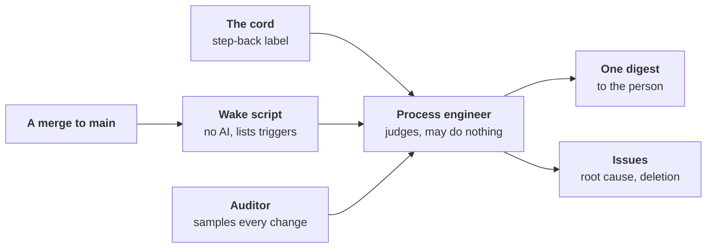

# ADR-0068: The line steps back on its own drift, and its builders go through it

- **Status:** proposed
- **Date:** 2026-11-13
- **Decided by:** the maintainer, on 2026-11-13, in direction: seven
  decisions, corrected after three independent reviews (adversarial,
  completeness, outside practice), then [sessions](#7-build-sessions-write-issues-the-line-builds)
  and [releases](#8-a-release-is-split-by-its-nature) decided apart;
  what stays undecided is under [Open questions](#open-questions)
- **Builds on:** [ADR-0005], [ADR-0018], [ADR-0026], [ADR-0036],
  [ADR-0051], [ADR-0064], [ADR-0065], [ADR-0066]; principles 1, 2, 4,
  6, 7, 12, 15 ([PRINCIPLES.md](../PRINCIPLES.md))
- **Amends:** principles 4 and 7; [ADR-0019] (the process engineer:
  prompt first, woken by events, a level); [ADR-0046] (every change
  drawn, the build sessions' included); [ADR-0052] (its v1.0 bar and its
  "until then" freeze go); [ADR-0042] and [ADR-0060] §4 (a fixes-only
  release ships after the step back); [ADR-0058] (workline's build
  sessions hold neither the maintainer's token nor the App's key)
- **Confirms:** [ADR-0038] and [ADR-0060] §1: silence is never a yes,
  a subtraction's included
- **Research:** [stepping-back.md](../research/stepping-back.md)

## Context

- **workline's growth ran away**, from 2026-09-23 to 11-13
  ([measures](../research/stepping-back.md#the-runaway-measured)):
  - non-test Go 13,856 lines (09-30) → 108,069 (11-13), about 2,100
    lines a day;
  - role settings 20 → 118, rule codes 50 → 531; neither ever fell;
  - about 16% of the Go lines added were deleted; after 10-30, no commit
    removed more than 100 net lines;
  - under [ADR-0052]'s freeze (from 10-26): 111 `feat` commits, 38
    settings and 254 rule codes added; its exception, "work toward
    leaving beta", swallowed the rule;
  - fixes became the growth: 62% of merged pull requests in W45; since
    11-01, a median fix added 57 lines.
- **It came from the build sessions, not the line.**
  - Of the last 300 merged pull requests (10-31 → 11-13), 238 were
    opened by coding-agent sessions under the maintainer's account, 61
    by workline's App. workline's own roles wrote 0.6% of the net Go
    added.
  - The maintainer's account bypassed `main`'s ruleset 262 times from
    10-21 to 11-13.
  - The sessions followed standing orders kept outside the repository:
    merge without asking, a panel of agents decides and signs for the
    maintainer, keep going overnight, merge batches past the ruleset.
  - No role observes a session: the auditor draws roles' acts only
    ([ADR-0046]).
- **The line's output in real use was good**: the maintainer accepted 8
  of 8 of its code pull requests on DomoticsCore; one was over-built,
  and the reviewer missed it.
- **Every step back that changed something started with the
  maintainer's unease** (10-21, 11-06, 11-09, 11-13). Panels ran all
  along, convened and briefed by the builder, on one model family; they
  answered "how", never "whether", and none said "stop".
- **A backtest of that unease** ([stepping-back.md](../research/stepping-back.md#the-unease-backtest)):
  AI judges on repository facts caught the fix storm and missed the
  other kinds; a one-line rule matched them.

## Decision

### 1. Drift, defined

Drift is any of three:

- **Building what no stated need asks for.** A need is stated in an
  issue's Need, by a person or by the product owner; the issue says
  which. A need stated by a builder or a role is allowed, and said.
- **Building it more complicated than the need requires.** The
  appetite, the size the need deserves, is stated with the need, up
  front ([ADR-0064]'s normal size is its measure).
- **Fixing symptoms without going up to their cause.**

No need laundering: every pull request, a role's or a builder's,
carries a Need. Today the reviewer's intent lens is asked only of a
change that closes an issue.

### 2. Who steps back

| Who | Its question | Its reach |
|---|---|---|
| **Auditor** | Was this act right? | judges acts, never proposes; widened from roles' acts to every change in the repository |
| **Process engineer** | Is our way of working producing the right result? | reads the auditor's verdicts, computed facts, design content (ADRs, new mechanisms); runs five whys at the source; sees "without need" as a pattern |
| **Architect** | Is the product simple and coherent? | starts as a simplicity lens in the reviewer, on every pull request; a periodic role later |
| **Product owner, reviewer's intent lens** | Does this change answer a stated need? | per change, as today |

- **[ADR-0019]'s split holds**: the first never proposes, the second
  never re-judges an act.
- **Both the auditor and the process engineer are generic**: any project
  using workline has a line to step back on.
- **The process engineer is un-parked** ([#89] was closed not planned on
  11-09). It may request an architecture review, never do one.
- **The simplicity lens starts advisory.** It is calibrated on 20–50
  past pull requests with known verdicts, the over-built one first; it
  blocks once its false-positive rate is known. On workline today only
  the correctness lens blocks, and the reviewer ignores `docs/**`: an
  ADR adding a mechanism reaches the process engineer, not the lens.

### 3. Prompt first, code what converges

- **A new role starts as a prompt, with no new code.** It reuses the
  engine's plumbing: the agent call, the propose/apply allowlist, the
  traces.
- **What converges moves to code**: the same result each run,
  verifiable without judgement (principle 4, [ADR-0065]'s rule A,
  [ADR-0066] §2).
- **Conditions, from day one:**
  - safety in code: the agent holds no write token; its acts go through
    the engine's allowlist;
  - observability: its acts traced and sampled ([ADR-0046]);
  - a written criterion for moving a part to code;
  - a watch on the prompt's size, so it does not become a monster.

### 4. Authority

- **A role acts alone when the act is reversible and subtracts.**
  Adding goes through the product owner like any need, at its autonomy
  level ([ADR-0026]). Changing direction is the person's.
- **The auditor, alone**: samples, publishes its verdicts, opens an
  issue for a wrong act. It never undoes, never proposes.
- **The process engineer has a level, starting `cautious`**
  ([ADR-0060] §3). As its level allows, alone, it may:
  - pause a work area: the build sessions and the line stop adding
    there;
  - run five whys and open the root-cause issue;
  - request an architecture review;
  - propose deletions, as issues or pull requests that go through the
    line's normal policy.
- **Before it may pause, it must beat pre-registered simple baselines**
  ([§9](#9-verification)).
- **A pause** has an exit condition, set with it; lapses at the next
  step back unless renewed; fails only changes that add contract
  surface in the area: never a reproduced bug's fix, never a deletion.
  Where the forge has required checks, it is one.
- **A deletion states why the thing was built**: downstream projects pin
  versions; what they see is said in the release notes.
- **The process engineer never** changes a principle, accepts an ADR,
  edits its own brief, or signs for the person.
- **The person**: one digest per step back. Replies, all optional: dig,
  stop, go, undo. Silence is never consent: a subtraction merges by the
  policy, never on silence ([ADR-0060] §1, [ADR-0038]).

### 5. Triggers, in two stages

1. **A wake script, no AI**, on each merge to `main`: it lists the
   triggers met and never blocks (principle 15).
2. **The process engineer judges**: doing nothing is a valid answer.

| Trigger | Why |
|---|---|
| An ADR created or changed; a new role, mechanism, setting, command or rule code | growth of the contract |
| The same area or issue fixed again and again; a fix reopened | symptoms without cause |
| A topic active long without closing, judged in context | a long justified job is normal |
| A real-use round ends; the person's verdicts on pull requests | an outside fact arrived |
| Each release | the release boundary ([§8](#8-a-release-is-split-by-its-nature)) |
| The cord: a `step-back` label anyone may set | the person's unease, or a role's |
| Many merges since the last step back | counts work, never hours |

- **Dropped**: off-hours merges; a big job can run at night, which is
  not drift.
- **Not used until checked**: pull requests closed unmerged.
- **What real use never runs** is logged: which settings, acts and
  commands fire in real use. A mechanism that never fires is a deletion
  candidate.
- **Limits, said**: a mechanism hidden inside existing code escapes the
  script; the auditor's sampling covers it. The script is a tripwire for
  honest drift, not a guard against a builder told to go round it.

### 6. The guard is guarded

- **Out of the builders' reach**: the process engineer's brief, the wake
  script and `AGENTS.md`, under CODEOWNERS with code-owner review, a
  forge's native guard.
- **Outcome measures are never shown to builders as goals**: a watched
  number becomes a target.

### 7. Build sessions write issues; the line builds

- **Sessions no longer code workline directly.** They write issues, as
  the person does; the line builds them: workline builds workline.
- **Fallback, only when the line is broken and cannot fix itself**:
  sessions under a second GitHub App, with no bypass, and a builder
  pull request kind the line judges.
- **Credentials isolated**: the maintainer's admin token and the
  existing App's key are not usable by sessions. The admin bypass is
  the person's alone.
- **Their standing orders move into `AGENTS.md`**: versioned, visible
  to the process engineer. The out-of-repo orders that contradict them
  are retired.
- **What it costs**: throughput unchanged; longer latency per item; big
  cross-cutting work sliced by the product owner; a change to the line
  takes effect after a release and a re-pin; when CI is broken, sessions
  get stuck instead of forcing.

### 8. A release is split by its nature

- **A fixes-only release** (a patch) ships alone, after the process
  engineer's step back.
- **A release that adds contract surface** (a setting, a command, a rule
  code, a marker kind…) is a feature release (a minor). It waits for the
  person's yes, with a digest of about seven lines from the process
  engineer. Silence is never a yes there.
- **The boundary is computed** by the wake script, never judged.
- **workline stays 0.x** until real use judges it stable. v1.0 comes
  then, by criteria to define; defects per processed issue are preferred
  over a fix share. [ADR-0052]'s bar and its "until then" freeze go: the
  freeze forbade building this frame and deleting code.

### 9. Verification

- **A forward test, from now**: each wake of the process engineer is
  traced.
  - **A miss**: the person pulls the cord before it; the missing signal
    is added.
  - **A false alarm**: its digest ignored, or answered "go".
- **Planted drift cases**, now and then, measure its catch rate without
  the person: the cord is not the only yardstick.
- **Predictions**: it writes some at each step back; the next scores
  them.
- **Baselines**, pre-registered: the backtest's one-line rules beat both
  AI judges ([research](../research/stepping-back.md#the-unease-backtest)).
  The process engineer earns the pause only by beating them.
- **Outcomes, observed, never capped**: fix chains shorten after five
  whys; contract surface stops growing without a need; real use
  accepts the line's pull requests.
- **Who watches it**: the auditor samples the process engineer. After a
  number of step backs, or each real-use round, a cross-model
  adversarial review of this frame runs inside workline, its
  independence level said ([ADR-0005]).

## Not built

- **Budgets, quotas, blocking thresholds, hard limits** on growth, as
  [ADR-0064] chose for size: a soft target and a judgement.
- **A clock**: no time-of-day rule, no routine run on a calendar.
- **A person in the loop**: no person's yes on a fixes-only release, no
  person reading pull requests. The person stays on the loop: the
  direction, the cord, the verdicts on real use.
- **Silence as consent**, for any act.
- **A panel outside workline**: the periodic review is the line's own.

## Not chosen

- **A budget on the build sessions**: weekly line and surface caps. A
  wall moves the proxy, as [ADR-0064] found.
- **Each change answers for what it adds, a person reads the answers at
  the release**: kept in part (a Need on every change, the release's
  digest); a person reading every release's list puts them in the loop.
- **A weekly process engineer**, on a schedule, as [ADR-0019] designed
  it: events wake it (§5), never a calendar.

## Consequences and risks

- **Longer latency per item** for workline's own changes; the same
  throughput.
- **In-sample**: the triggers come from one runaway. With the sessions
  paused, the storm may not recur; weeks with no positive conclude
  nothing.
- **Same model family**: the cross-model review is, today, another
  model of one provider. The level is said.
- **A prompt-only judge has no ground truth**: its calibration sets and
  planted cases are its tests; it is re-calibrated when its model or
  prompt changes.
- **Some unease leaves no trace in the repository**: a new role proposed
  in a session, a lost overview. The cord and the ADR trigger are there
  for those.
- **The auditor is unverified from outside**: still beta, an open defect
  on the developer's records ([#1398]). Until checked, the process
  engineer reads its verdicts as "auditor: unverified".

## Build order

Follow-up work, each an issue through the product owner:

1. **`AGENTS.md`**: the sessions' rules (§7), their standing orders
   moved in; the contradicting out-of-repo orders retired.
2. **Credentials isolated** and **CODEOWNERS** on the guard's files
   (§6, §7): the person's one-time setup.
3. **The wake script**, print only: the triggers, the release boundary,
   what fires in real use.
4. **The simplicity lens**, advisory, and its calibration set.
5. **The auditor widened** to every change.
6. **The process engineer**, prompt first, at `cautious`; its baselines
   pre-registered, its planted cases.
7. **The stable criteria** that replace [ADR-0052]'s bar.

## Open questions

- **A prompt-only role today?** `run-role` needs a `pre` and a `post`
  file; whether shell scripts suffice, and run alike on a laptop and
  both CIs, is unchecked.
- **The process engineer's levels**: what `normal` and `enterprising`
  allow beyond `cautious`, and the bar its baselines set.
- **Who writes a deletion's code**: the process engineer's own pull
  request, or an issue the developer builds ([ADR-0066] §1).
- **A work area**: paths, labels or an issue family; how a pause holds on
  GitLab and on the local forge, which have no such required check.
- **Debounce**: one step back open at a time or not; how many merges
  "many" is; what a "topic" is.
- **What triggers read**: only files and the forge, or also titles and
  commit types, which the judged choose.
- **The cord**: who may set it, and whether pulls are counted by who
  pulled.
- **Predictions and the frame review**: who scores the predictions, and
  after how many step backs the review runs.
- **The build sessions' pause** (from 2026-11-13): what ends it.
- **The fallback's builder pull request kind**: its criteria
  ([ADR-0042]).
- **Releases elsewhere**: whether §8 is workline's own policy or every
  project's default ([ADR-0042], [ADR-0060] §4).
- **The auditor on a person's own changes**: drawn by default, or a
  project's opt-in.
- **Sign-offs already posted in the maintainer's name** by agent panels
  ([#155]): voided, relabelled, or kept.
- **[ADR-0063]'s standing stop on fixes**: replaced by the triggers, or
  kept.
- **Cost**: tokens and wait time of the lens on every pull request, the
  widened auditor, and a process engineer's run per wake.
- **v1.0**: the stable criteria themselves.

[ADR-0005]: 0005-independence-takes-the-best-level-available.md
[ADR-0018]: 0018-the-product-owner.md
[ADR-0019]: 0019-the-line-evaluates-itself.md
[ADR-0026]: 0026-the-product-owners-autonomy-is-a-level.md
[ADR-0036]: 0036-a-roles-status-is-earned-by-written-criteria.md
[ADR-0038]: 0038-the-product-owner-proposes-on-the-issue-a-person-answers-there.md
[ADR-0042]: 0042-the-engine-merges-by-the-projects-policy.md
[ADR-0046]: 0046-the-auditor-re-checks-every-roles-acts.md
[ADR-0051]: 0051-a-check-sits-where-its-catch-is-worth-its-cost.md
[ADR-0052]: 0052-v1-0-when-the-core-roles-are-out-of-beta.md
[ADR-0058]: 0058-the-forge-guards-the-project-not-the-agents-environment.md
[ADR-0060]: 0060-the-person-is-on-the-loop.md
[ADR-0063]: 0063-every-open-issue-is-due-waiting-or-done.md
[ADR-0064]: 0064-size-is-a-target-not-a-wall.md
[ADR-0065]: 0065-code-only-what-converges-language-knowledge-in-packs.md
[ADR-0066]: 0066-a-role-mirrors-a-human-role-ai-first-where-code-is-rigid.md
[#89]: https://github.com/JN0V/workline/issues/89
[#155]: https://github.com/JN0V/workline/issues/155
[#1398]: https://github.com/JN0V/workline/issues/1398
