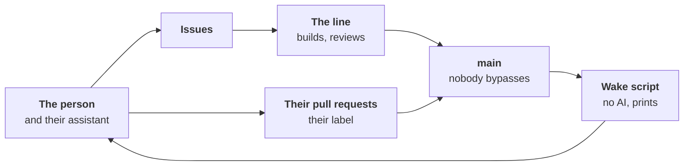

# ADR-0068: The line steps back on its own drift, and its builders go through it

- **Status:** accepted by the maintainer's merge of its pull request;
  not built. Only [principles 4 and 7](#3-principles-4-and-7-reworded)
  take effect at merge. It commits to [build steps 1 to 3](#build-order);
  the old brakes hold until replaced
  ([§9](#9-the-old-brakes-hold-until-replaced)); steps 4 to 7 are
  [next](#next-each-decided-when-reached). Standing orders kept outside
  the repository are retired at acceptance ([§5](#5-the-persons-assistant-goes-through-the-line)).
- **Date:** 2026-11-13
- **Decided by:** the maintainer, in direction, after three independent
  reviews and an adversarial review of this record; its scope narrowed
  after a further independent review; a sessions' own identity and OS
  isolation replaced by "nobody bypasses" after a check of the forge,
  2026-11-13
- **Builds on:** [ADR-0005], [ADR-0018], [ADR-0026], [ADR-0044],
  [ADR-0064], [ADR-0065], [ADR-0066]; principles 1, 4, 6, 7, 10, 13, 15
  ([PRINCIPLES.md](../PRINCIPLES.md))
- **Amends:** principles 4 and 7, at merge; [ADR-0042] (what never
  merges alone) and [ADR-0054] (the developer's steering bound), once
  step 1 is built; [ADR-0052] (its freeze), once step 1 passes its
  test; [ADR-0063] (its standing stop), once step 3 is built
- **Confirms:** [ADR-0038] and [ADR-0060] §1 (silence is never a yes);
  [ADR-0044] (the App's key stays with the default branch's runs);
  [ADR-0058] §1 and §2 (whoever pushes meets the forge's guards;
  locally an agent has the person's rights, isolation an opt-in)
- **Research:** [stepping-back.md](../research/stepping-back.md),
  [nobody-bypasses.md](../research/nobody-bypasses.md)

## Context

Measured on `main` at `e16e4e7b0`, the forge read on 2026-11-13
([the measures](../research/stepping-back.md#the-runaway-measured)):

- **Growth ran away**: non-test Go 13,856 lines (09-30) → 110,989
  (11-13); role settings 20 → 118 and rule codes 50 → 531, never
  falling; about 16% of the Go added was deleted. [ADR-0052]'s freeze
  did not hold: its exception swallowed the rule.
- **The build sessions drove it, not the line**: sessions under the
  maintainer's account opened 237 of the last 300 merged pull requests
  (10-31 → 11-13), workline's App 62, 34 of them the developer's; from
  11-09, 81 of the 89 merged. Under standing orders kept outside the
  repository, they bypassed `main`'s ruleset 392 times in the month to
  11-13, 375 of them (96%) only for a missing `workline:accepted`
  label, the other checks green. workline's roles wrote 0.6% of the
  Go; no role observes a session ([ADR-0046]).
- **The line kept building, and well**: its developer's [#1452] merged
  on 11-13, four more open; on DomoticsCore, 8 of 8 of its code pull
  requests accepted, one over-built, missed by the reviewer.
- **Only the maintainer's unease stepped back**; agent panels, briefed by
  the builder, answered "how", never "whether".
  [A backtest](../research/stepping-back.md#the-unease-backtest): AI
  judges caught the fix storm only, and a one-line rule matched them.

## Decision

### 1. Drift, defined

- **Building what no stated need asks for.** A need is stated in an
  issue's Need, by a person or the product owner. A builder's or a
  role's is a proposal the product owner takes at its level
  ([ADR-0018], [ADR-0026]).
- **Building it more complicated than the need requires.** The
  appetite, the size the need deserves, is stated with the need.
- **Fixing symptoms without going up to their cause.**

### 2. Prompt first, code what converges

- **A new role starts as a prompt**, with no new code of its own, on
  the engine's plumbing: the agent call, the propose/apply allowlist,
  the traces. Its acts are traced and sampled ([ADR-0046]).
- **What converges moves to code**: the same result each run,
  verifiable without judgement ([ADR-0065]'s rule A, [ADR-0066] §2),
  by a written criterion.
- **The reverse, for the roles already built**: judgement frozen in Go
  may move to prompts, each move an issue on the line's normal path
  ([§4](#4-the-guard-is-guarded)).

### 3. Principles 4 and 7, reworded

Principle 4 gains a sentence: "A new role starts as a prompt on the
engine's plumbing, safe and observed from day one." Principle 7's last
sentence, "Every defect that got through ends as a proven, mechanical
guard", becomes:

> A defect that got through ends as a conformance or evaluation case
> failing without its fix. The case is the default; a rule code, a
> setting or a marker (a label or comment the engine reads) is added
> only where a case cannot hold the defect, and its issue says why.

- **Why**: the old sentence ordered a guard per defect, the source of
  the 531 rule codes; each had its issue, so "answers a need" alone
  would not bite.
- **Both take effect at merge**: the suites exist; the next new role's
  first task checks that `run-role` takes a prompt and shared
  `pre`/`post`.

### 4. The guard is guarded

- **Only the files that define oversight and authority are guarded.**
  Their list is `CODEOWNERS`, in the forge's words; the engine reads it
  as [ADR-0042]'s "never merges alone", so the two are one list:
  - `CODEOWNERS`, `AGENTS.md`, `CLAUDE.md`, `docs/PRINCIPLES.md`;
  - `.github/workflows/**`, `.github/actions/**`: what runs the checks
    and holds the App's key;
  - `.workline/config.yaml`, the only file under `.workline/`: merge
    autonomy, routing, gates, the reviewer's ignore list, and each
    role's level, pinned there in step 1;
  - the reviewer's and the auditor's prompts (`instruction.md`,
    `persona.md`, `policy.md`, lenses, kinds): the oversight that reads
    every other change;
  - the wake script and its triggers (step 3); the process engineer's
    brief, if step 6 builds it.
- **A guarded file merges on the person's label**, never by the policy
  alone. GitHub's required code-owner review stays off with one owner:
  an author cannot approve their own pull request, nor an App own a
  path; a second owner turns it on. On GitLab Premium, Code Owner
  approval is used, on the CI files at least, since a merge request
  runs its own `.gitlab-ci.yml` (from the documentation, not tried).
- **Other role prompts are not guarded**: they take the line's normal
  path. The reviewer reads them (step 1 takes them out of its ignore
  list); the auditor samples the acts.
- **Why**: the person stays on the loop, not in it. Since 10-16, 313 of
  534 commits touched `roles/` (59%), the guarded list 90 (17%), 59 of
  them workflows ([the count](../research/stepping-back.md#what-codeowners-would-hold));
  a yes on each prompt would make the person a bottleneck, or a stamp.
- **[ADR-0042]'s "what steers agents never merges alone" narrows** to
  that list, and [ADR-0054]'s steering bound alike: other role folders
  and files named a prompt leave it; agent and gate files stay.
- **Escapes it, said**: a role's `levels` table (printed by the wake
  script); a facet in `~/.config/workline/roles/`; a role prompt the
  line changes, the reviewer and the auditor as its net; an ADR,
  printed, not guarded (160 of 534 commits touch `docs/adr/`).
- **Outcome measures are never builders' goals**: no brief cites them.

### 5. The person's assistant goes through the line

- **On explicit instruction, the assistant is a contributor.** The
  person, locally with their own assistant (any agent, or none), works
  the normal way: workline's local roles run on the commits; the person
  pushes and accepts with the label. In `AGENTS.md` (step 2): never
  `--admin`, never a ruleset edit, never the label on its own.
- **A body of work goes to the line as issues**: a series of changes,
  a night's run, a fleet of subagents write issues; the line builds
  them. The difference, a specific act or a body of work, is kept for
  traceability only: who instructed what, on which item.
- **Paused, from acceptance until step 2**: sessions building workline
  on their own under standing orders; the person instructs it.
  **Not paused**: the line's roles; the person's assisted work on
  explicit instruction, steps 1 to 3 included.
- **Standing orders kept outside the repository** (merge after a
  re-check, panels sign, keep going overnight) are retired at
  acceptance; the maintainer's assistant removes them.
- **Fallback, when the line is broken and cannot fix itself**: the
  person's pull request fixes it, on their label; when even the label
  cannot merge, §6's emergency.
- **What it costs**: 141 of the last 300 merges were the maintainer's
  account's, with no label; each now takes it. When CI is broken, work
  waits instead of forcing.

### 6. Nobody bypasses on `main`

- **`main`'s ruleset has an empty bypass list**, the person included.
  Every merge goes through the same required checks and
  `workline/accepted`, which only workline's App sets, on a head the
  policy or the person's `workline:accepted` label accepts: [ADR-0058]
  §1 as written. Only `main`: the release branch keeps workline's App
  on its bypass list, an allow-list of who pushes there.
- **Nothing legitimate needs a bypass**: the App's merges, releases,
  gardening, a labelled pull request ([the forge read](../research/nobody-bypasses.md)).
- **The emergency, written** in [the merge policy](../merge-policy.md)
  (step 1): when no head can get `workline/accepted` (say `follow`
  broken on `main`, so its own fix cannot merge), the person
  deliberately edits the ruleset: adds themself, merges, removes
  themself.
- **Detected**: the wake script prints a change of the ruleset (its
  public `updated_at`) and a merged head without the App's successful
  `workline/accepted`; `workline doctor` checks
  `current_user_can_bypass: never`.
- **Locally, nothing changes**: the assistant has the person's rights,
  isolation an opt-in ([ADR-0058] §2; principle 10).
- **The honest limit**: a session holding the person's token can still
  set the label or edit the ruleset. It can no longer force without
  breaking a written rule, and leaves a trace. With no forge, nothing
  enforces who merges (principle 12).
- **An optional guard, untested, a follow-up**: the daily login as a
  fine-grained token without Administration; rulesets edited in the
  browser only. Never required.
- **On GitLab Premium**, from its documentation, not tried: `main`
  protected with "Allowed to push and merge: No one", "Pipelines must
  succeed", Code Owner approval required; the emergency is a Maintainer
  changing the protection, recorded in the project's audit events.
- **The test** of step 1, with the person's token: `doctor`'s check
  passes; `gh pr merge --admin` without `workline/accepted` and a push
  to `main` are refused. On GitLab: a Maintainer's push to `main` and a
  merge on a failed pipeline are refused.

### 7. A person's yes is assisted, never delegated

Where a person's yes is asked (a guarded file, a pull request of
theirs), they need not read the change line by line:

- **How it goes**: their own assistant (any agent, or none) gives an
  independent analysis; they look closer at the sharp points, then say
  yes. The assistant may act in their name, on that instruction.
- **It is the person's yes when** given for that item, at that moment,
  on their explicit instruction, never a standing order ("the panel
  signs for me"); on an analysis not from whoever wrote the change;
  traced, who instructed it on which summary.
- **Silence is never a yes** to merge, release or delete
  ([ADR-0060] §1, [ADR-0038]).

### 8. The wake script, print only

On each merge to `main`, with no AI, it prints the triggers met in one
issue kept in place; the person reads it until a role does (step 6).
It never blocks a merge (principle 15).

| Trigger | Why |
|---|---|
| An ADR created or changed; a new role, setting, command or rule code | growth of the contract |
| A role's prompt, `levels` table or default level changed; words per prompt | prompts steer the line |
| The same area fixed again and again; a fix reopened | symptoms without cause |
| A pull request merged closing no issue; issues opened by builders | need laundering |
| `main`'s ruleset changed; a merged head without the App's `workline/accepted`; pull requests by the person's account against the line's | nobody bypasses |
| The cord: a `step-back` label anyone may set | the person's unease, or a role's |

- **What real use runs** is logged in each project's run records; a
  setting, act or command that never fires is a deletion candidate.
- **Its limit**: a tripwire for honest drift; a mechanism hidden in
  existing code escapes it.

### 9. The old brakes hold until replaced

- **[ADR-0052]'s freeze stays** until step 1 passes
  [§6's test](#6-nobody-bypasses-on-main). Steps 1 to 3 are its written
  exception: the person builds them with their assistant (§5), the
  guarded files on their label.
- **[ADR-0063]'s standing stop stays** until step 3 is built, which
  brings its replacement: a fix repeated in one area is a trigger, and
  anyone's cord. Its other working agreements stand.
- **[ADR-0052]'s v1.0 bar stands** until step 7.

## Not chosen

- **Budgets, quotas, hard limits** on growth, caps on the sessions
  included: a wall moves the proxy, as [ADR-0064] found for size.
- **A clock**: the wake runs on merges, never on a calendar.
- **`roles/**` under CODEOWNERS**: a yes on most commits (§4).
- **A sessions' own App or bot, a second OS user or a container as a
  requirement**: it bends the person's machine so the forge holds;
  [ADR-0058] §2 keeps isolation an opt-in.
- **Required code-owner review with one owner** on GitHub: a guarded
  file could never merge, or the bypass would come back.

## Consequences and risks

- **Teeth at step 1 are the forge's**; the label and the ruleset edit
  stay in reach of the person's token, printed (§6).
- **The person's yes, sized**: about 17% of commits, mostly workflows;
  if it slows the line, a record revisits the list.
- **Throughput**: from 11-09 the developer merged 5 of 89, the
  sessions 81; latency grows until the line takes their share.
- **Prompts reviewed by an agent**: the reviewer has never read prose;
  its first rounds on role prompts are unmeasured.
- **In-sample**: the triggers come from one runaway.

## Build order

Each an issue through the product owner. Decided:

1. **Nobody bypasses, CODEOWNERS** on §4's list: `main`'s bypass list
   emptied; the emergency written; `doctor`'s check; the steering test
   reading `CODEOWNERS`; role prompts out of the reviewer's ignore
   list; each role's level pinned in `.workline/config.yaml`. Done when
   §6's test passes.
2. **`AGENTS.md`**: the assistant's rules (§5 to §7). Sessions resume
   under them.
3. **The wake script**, print only (§8), with its conformance cases.

## Next, each decided when reached

Listed, not decided; each its own record or amendment, after a
real-use round on steps 1 to 3.

4. **A simplicity lens** in the reviewer, advisory first, calibrated on
   past pull requests.
5. **The auditor's draw** of a person's own changes, an assistant's
   included ([ADR-0046]).
6. **The process engineer** ([ADR-0019], [#89]): reads the wake script
   and the auditor, runs five whys, at a level ([ADR-0060] §3); with
   it, a fixes-only release's yes ([ADR-0060] §4).
7. **What replaces [ADR-0052]'s v1.0 bar**: criteria from real use,
   defects per processed issue preferred to a fix share.

## Open questions

Each part of its step's issue, none blocking.

- **Whether workline's App can read** the ruleset's history and the
  rule suites, or the wake script reads `updated_at` only (step 3).
- **The steering test on a project other than workline**: its role
  folders, its files named a prompt (step 1).
- **"Again and again", "an area"**: read from files and the forge,
  never from titles or commit types, which the judged choose (step 3).
- **Sign-offs already posted in the maintainer's name** by agent panels
  ([#155]): relabelled, not counted for a role's criteria (step 2).
- **Cost**: each step's issue states its tokens and wait ([ADR-0051]).

[ADR-0005]: 0005-independence-takes-the-best-level-available.md
[ADR-0018]: 0018-the-product-owner.md
[ADR-0019]: 0019-the-line-evaluates-itself.md
[ADR-0026]: 0026-the-product-owners-autonomy-is-a-level.md
[ADR-0038]: 0038-the-product-owner-proposes-on-the-issue-a-person-answers-there.md
[ADR-0042]: 0042-the-engine-merges-by-the-projects-policy.md
[ADR-0044]: 0044-the-apps-key-stays-with-the-default-branchs-runs.md
[ADR-0046]: 0046-the-auditor-re-checks-every-roles-acts.md
[ADR-0051]: 0051-a-check-sits-where-its-catch-is-worth-its-cost.md
[ADR-0052]: 0052-v1-0-when-the-core-roles-are-out-of-beta.md
[ADR-0054]: 0054-the-developer-takes-a-ready-issue-to-a-pull-request.md
[ADR-0058]: 0058-the-forge-guards-the-project-not-the-agents-environment.md
[ADR-0060]: 0060-the-person-is-on-the-loop.md
[ADR-0063]: 0063-every-open-issue-is-due-waiting-or-done.md
[ADR-0064]: 0064-size-is-a-target-not-a-wall.md
[ADR-0065]: 0065-code-only-what-converges-language-knowledge-in-packs.md
[ADR-0066]: 0066-a-role-mirrors-a-human-role-ai-first-where-code-is-rigid.md
[#89]: https://github.com/JN0V/workline/issues/89
[#155]: https://github.com/JN0V/workline/issues/155
[#1452]: https://github.com/JN0V/workline/pull/1452
