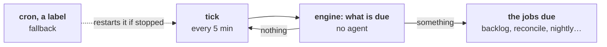

# ADR-0069: One wake every five minutes starts what is due

- **Status:** proposed, until the maintainer merges it; built by the
  [slices](#slices) of [#1611]
- **Date:** 2026-11-15
- **Decided by:** the maintainer, on 2026-11-15, after the night of
  11-14 to 11-15: one wake at a regular interval, the engine deciding
  what is due; the open points settled in this record
- **Settles:** [#1611]
- **Builds on:** [ADR-0037], [ADR-0059], [ADR-0060] §1, [ADR-0063];
  principles 5, 10, 12, 13, 14 ([PRINCIPLES.md](../PRINCIPLES.md))
- **Amends, once built:** [ADR-0059] [§8](0059-an-issue-moves-by-its-state-each-step-wakes-the-next.md#8-event-driven-the-night-for-upkeep)
  (the night for upkeep, an hourly reconciler) and
  [its 2026-11-02 amendment](0059-an-issue-moves-by-its-state-each-step-wakes-the-next.md#amendment-2026-11-02-the-reconciler-starts-its-next-run)
  (the heartbeat for the reconcile alone; GitLab on its schedules)
- **Leaves as they are:** [ADR-0037] (how a `schedule` line runs);
  [ADR-0068] §8 (the wake script, print only)
- **Research:** [reliable-schedule.md](../research/reliable-schedule.md)
- **Amended:** [2026-11-17](#amendment-2026-11-17-a-beat-every-minute-no-event-moves-the-line):
  a beat every minute, no event moves the line; the GitHub loop

Called **the tick** below, to keep it apart from
[ADR-0068 §8](0068-the-line-steps-back-on-its-own-drift.md#8-the-wake-script-print-only)'s
`workline wake`; the builder picks the command's name.

## Context

The night of 2026-11-14 to 15, on this repository ([#1611]):

- **Crons missed**: backlog (`47 * * * *`) fired 2 times out of 9,
  develop (:41) once, merge (:53) twice; the simulator's at 03:41
  never. The nightly, due 02:17 UTC, starts ~7 h late ([#607]).
- **Ready emptied** at about 02:45 UTC; the line sat idle until 07:13
  UTC, then again from 07:13 to 08:50 UTC.
- **The heartbeat never missed**: an environment's wait timer, each run
  starting the next, every ~15 minutes that night; 5 minutes since
  2026-11-15
  ([ADR-0059's amendment](0059-an-issue-moves-by-its-state-each-step-wakes-the-next.md#amendment-2026-11-02-the-reconciler-starts-its-next-run)).
  It reconciles issues only.
- **GitHub says so**: `schedule` "can be delayed", "some queued jobs may
  be dropped" ([research](../research/reliable-schedule.md#what-github-says-of-schedule)).
- **No code decides** a backlog run nor a timed job: the times sit in
  workflow crons; `internal/line/states.go` and `internal/line/room.go`
  decide issues, review rounds and room only.

## Decision

**One wake, every 5 minutes, for the whole line. On each, the engine
lists what is due, per role and per task, and only that starts. No role
depends on a cron; each cron stays as a fallback that runs nothing the
tick already ran.**

### 1. One wake, same everywhere

- **GitHub**: the heartbeat becomes the tick. The environment
  `workline-heartbeat`'s wait timer, 5 minutes, limited to the default
  branch; each tick dispatches the next, even when it failed. One job
  a tick, the environment on it: it waits in the forge, then runs.
- **GitLab**: one pipeline schedule, `*/5 * * * *`, runs the same
  command ([§7](#7-gitlab)).
- **A person's machine**: any timer (cron, systemd, launchd) runs the
  same command every 5 minutes.
- **The period is the timer's**: 5 minutes by default; a project
  sets its own (a wait timer, a schedule, a timer). The engine reads no
  period of its own but the gaps below.

### 2. The engine decides what is due

- **One command**, with `--json`: the jobs due now, each with why. The
  workflow, the pipeline or the timer starts only those.
- **No agent** when nothing is due; the command calls none ever.
- **Due when**:

| Job | Due when |
|---|---|
| Backlog run (product owner, reviewer) | Ready below `wip.ready`, none running or queued ([#1549]) |
| Reconcile: tester, developer, review rounds | every tick, its listing; per-issue reads at their gap ([§3](#3-api-cost)) |
| Merge's safety net | its gap passed since its last run |
| Nightly gardening, release dry run | its time passed, not run since |
| Weekly docs, weekly sample, simulator's seeds | its time passed, not run since |

- **Idempotent**: a job running or queued is not due; a timed job
  that ran since its time is not due, whoever started it.

### 3. API cost

The open point: a whole reconcile is about 20 calls; 12 an hour is
about 240 of the job token's 1,000.

- **Decided**: a few listings a tick, the per-issue reads at a gap.
  - **Every tick, 7 to 11 calls**: the open issues and the open pull
    requests (1 page each); one listing of runs per workflow with a
    timed job, filtered by event and branch: develop (1 to 5 pages, as
    `reconcile-due` reads its own runs today), gardening, merge,
    sample, and test (its seeds; it also runs on every pull request).
    One page of 100 runs is not enough alone: 288 ticks a day fill it
    in ~8 h, the issues' runs sooner.
  - **At the reconcile's gap** (`WORKLINE_RECONCILE_GAP_MINUTES`: 55
    when unset in the workflows and the template, 15 on this
    repository): the per-issue reads, a blocked issue's revisit and
    the like.
  - **A dispatch** a job due, 1 call; the next tick, 1 call.
- **The rule**: the tick's calls an hour stay under a quarter of the
  job token's hour; the listings alone are 84 to 132, derived. Each
  tick says its count in its summary; past the quarter, it warns, and
  the reconcile's gap is the knob, not the tick's period.
- **Measured in slice 2**, on this repository, a night and a day; the
  numbers go in its pull request's `## Tried`.

### 4. Where the times live

- **In `.workline/config.yaml`**, under `routing`, beside `wip`: each
  timed job, its time in UTC (a cron expression), its gap for gap
  jobs. Not in workflows: the engine reads them on every forge and on
  a machine.
- **A workflow's `schedule:`** keeps the same time as its fallback;
  `doctor` says when the two differ.
- **Not set**: a job keeps today's default times
  ([#1611]'s table); none is invented. A job set `off` is not timed.

### 5. When a job last ran

- **In CI, from the forge's runs**, as `reconcile-due` reads them today:
  runs named by job (`run-name` on GitHub, the pipeline's `name` on
  GitLab), newest first; the last that succeeded, or one going. One
  listing per workflow, read on past a page ([§3](#3-api-cost)).
  Not the Actions cache ([#853]).
- **On a machine, from its own record**, kept under the clone's
  `.git/workline/`, never committed: the forge's runs do not tell what
  a machine ran.
- **One place runs the timed jobs** of a project: CI, or a machine.
  `doctor` says when both are set; the record of one is not the
  other's.
- **Not read** (an API error): no job is called due on a guess; said
  loud in the summary (principle 12), and the next tick asks again.

### 6. The tick does not stop while a time is waiting

- **[#1397]'s idle stop** stays, narrowed: the tick starts no next
  one only when nothing is due, no review round due, no question
  waiting on a time ([ADR-0060] §1), **and no timed job configured**.
- **A timed job counts as waiting**: a line with a nightly run never
  stops its tick; otherwise only a cron restarts it before 02:17, and
  the cron is what failed.
- **So [#1397]'s idle stop never applies by default**: [§4](#4-where-the-times-live)
  keeps the default times; every line has a timed job, its tick runs
  for ever.
- **Its cost on a private repository**: each job billed, rounded up to
  the minute. Today's heartbeat run bills 2 jobs (`heartbeat`, a few
  seconds; `reconcile`, 56 to 78 s): 2 to 3 minutes a tick, 17,280 to
  25,920 a month of 8,640 ticks; [§1](#1-one-wake-same-everywhere)'s
  one job a tick, 8,640 at least. GitHub Team includes 3,000. A
  project sets a longer wait timer (15 minutes, a third), or sets its
  timed jobs `off`, and the idle stop applies again. Public repositories
  are not billed.
- **The tick stopped anyway** (the timer removed, a dispatch failed):
  any fallback cron or `workline:` label starts a tick, which says in
  its summary that it had stopped, and since when.

### 7. GitLab

- **One pipeline schedule** every 5 minutes, `WORKLINE_TASK=tick`,
  replaces the per-task schedules; the engine says what is due.
- **Schedules run no more often than GitLab's schedule worker**
  ([limits](https://docs.gitlab.com/administration/cicd/limits/#maximum-scheduled-pipeline-frequency)):
  - **Self-managed**: `3-59/10 * * * *` by default, every 10 minutes;
    an administrator sets `pipeline_schedule_worker_cron`.
  - **GitLab.com** ([settings](https://docs.gitlab.com/user/gitlab_com/)):
    `*/5 * * * *`, but 24 pipelines a schedule a day on Free (hourly),
    288 on paid tiers.
  - **Not measured here**: slice 6 measures a day of them.
- **Where they fall short** (Free, a default worker, misses): the
  chained form, as on GitHub (a delayed job, `when: delayed`,
  `start_in: 5 minutes`, holds no runner while it waits, then triggers
  the next pipeline). Decided by that measure.

### 8. Crons demoted to fallback

- **Each `schedule:` stays**, and `reconcile-due`: a run they start
  first asks the engine, and exits when nothing is due, saying what ran
  already ("the nightly ran at 02:20, by the tick").
- **The schedule probe** is removed apart, once its answer is known.

## What changes in ADR-0059

- **§8, "the night for upkeep"**: the night no longer starts work;
  timed jobs start on the first tick after their time.
- **§8, "A reconciler … hourly in CI"**: every tick in its listing, its
  per-issue reads at their gap; on a machine, the same command on a
  timer.
- **The 2026-11-02 amendment**: the heartbeat no longer belongs to the
  reconcile alone; it is the line's tick. Its 55 minutes become 5;
  its "GitLab unchanged" becomes [§7](#7-gitlab); its cost of a day
  becomes [§3](#3-api-cost)'s and [the consequences](#consequences)'.
- **Unchanged**: events still move the line; the tick is their safety
  net and the driver of time.

## Alternatives

What exists elsewhere ([research](../research/reliable-schedule.md#what-exists)):

- **An outside scheduler** (a hosted cron, a cloud's scheduler, a
  self-hosted server) calling `workflow_dispatch`: a personal token
  outside the forge, a machine to keep up; refused. A person may still
  run the tick from one ([§1](#1-one-wake-same-everywhere)).
- **More crons, the first that runs does the work** ([#607]): still
  GitHub's scheduler; 2 of 9 fired.
- **A job that sleeps**: a runner held all day; a private repository's
  minutes.
- **A chain per workflow**: each its own heartbeat; as many chains to
  break, as many API listings.
- **GitLab's pipeline schedules alone**: kept for GitLab, unmeasured
  ([§7](#7-gitlab)).

## Consequences

- **A role due starts within 5 minutes**, not hours; the nightly
  within 5 minutes of 02:17.
- **Runs**: 288 ticks a day; free on a public repository; a private
  one pays [§6](#6-the-tick-does-not-stop-while-a-time-is-waiting)'s
  minutes. GitHub Free on a private repository has no wait timer: the
  crons alone, as today, said.
- **Tokens**: no agent a tick; agents only for the jobs due, as today.
- **API**: [§3](#3-api-cost)'s quarter, measured.
- **The template** carries the same tick for projects (slice 6).
- **Risk**: the tick's chain is now the line's single driver of time;
  the fallback crons and labels restart it, and its stop is said.

## Slices

From [#1611], in order:

1. [#1549]: the engine says Ready is below target; a backlog run
   starts. Its dispatch moves to the tick in slice 2.
2. **The tick**: the heartbeat becomes it; one engine command lists
   every job due, with `--json`; the workflow dispatches only those.
3. **Timed jobs behind it**: nightly, weekly docs, weekly sample,
   simulator's seeds; their times in `.workline/config.yaml`.
4. **Merge's safety net** behind it.
5. **Crons demoted**: each run first asks the engine and exits when
   nothing is due. The idle stop counts the next timed job.
6. **Everywhere**: the template for projects; GitLab's one schedule; a
   machine's timer, in `docs/ci.md` and
   [heartbeat.md](../github/heartbeat.md).

## Amendment (2026-11-17): a beat every minute, no event moves the line

Still proposed. The first part is decided; the second is proposed, for
the slices to settle.

### Decided by the maintainer (2026-11-17)

In a session, [recorded on #1665](https://github.com/JN0V/workline/issues/1665#issuecomment-6961071716).
Why: in the maintainer's reading, nearly every defect reported lately
is in the workflows (runs stepping on each other, cancelled by another
run, blocked).

- **Priority**: the tick moves up, before the 1.0 tag.
- **A regular beat**: at each beat, only what is due starts
  ([§2](#2-the-engine-decides-what-is-due)), as a cron would.
- **Nothing moves from events**: no issue, comment, label or finished
  run starts line work; but the required pull request checks (gates,
  judge, bounds, test, warn) and the release keep their triggers.
- **GitHub, a loop**: `schedule` runs every 5 minutes at best, late or
  never: 2 of 9 hourly runs one night ([#1611]); 167 of about 9,000
  probe runs in a month
  ([reliable-schedule.md](../research/reliable-schedule.md#what-this-repository-saw)).
  So one long job ticks every minute, dispatches its successor before
  the 6 h job limit, one at a time by a concurrency group.
- **Elsewhere, the native schedule**: a GitLab pipeline schedule
  ([§7](#7-gitlab)), a person's machine (cron, systemd, launchd).
- **Two checks**: the loop dispatches exactly the list
  `workline tick --json` prints, on a fixed state and a fake forge; a
  test reads the workflows and their templates, and keeps only the
  allowed triggers.

### Proposed, not decided

- **Two more exceptions**: `workline/verdict` (applied from the
  checks' results; protection needs it on the head) and release-please
  (not the line; it opens the release pull request on a push to main).
- **A restart is an event**: an hourly cron or a person's `workline:`
  label may start the beat when it stopped, nothing else; the beat then
  reads state, and says since when it was down.
- **Cost on a private repository**: the loop bills about 1,440 runner
  minutes a day (43,000 a month) before the jobs it starts; GitHub
  Free includes 2,000 a month, Team 3,000. A project chooses instead a
  self-hosted runner, a person's machine on a timer, the wait-timer
  chain of [§1](#1-one-wake-same-everywhere) at 5 to 15 minutes (not on
  GitHub Free), or the crons alone, said. Public: not billed.
- **API budget**: 60 beats an hour at [§3](#3-api-cost)'s 7 to 11
  listings would be 420 to 660 calls of the token's 1,000. Each beat
  sends the last `ETag`; a `304 Not Modified` costs no quota
  ([GitHub](https://docs.github.com/en/rest/using-the-rest-api/best-practices-for-using-the-rest-api#use-conditional-requests-if-appropriate)).
  §3's quarter stays the rule, measured in the try.
- **Migration with the pinned line** ([ADR-0071]), in order: `workline
  tick` ([#1665]), released; tried on a copy; the pin's pull request,
  on the person's label; the loop in dry run beside today's workflows,
  a day; the event workflows removed one per pull request, crons kept
  as restart until a week without a missed beat.
- **What it does not fix**: engine defects; the beat ends only the
  duplicate and cancelled runs events start.
- **Supersedes, once decided**: the title's "every five minutes";
  [§1](#1-one-wake-same-everywhere)'s GitHub wait timer;
  [§3](#3-api-cost)'s "about 240" a reconcile;
  [§6](#6-the-tick-does-not-stop-while-a-time-is-waiting)'s stop at
  rest and its figures; [§8](#8-crons-demoted-to-fallback)'s crons per
  job; [What changes in ADR-0059](#what-changes-in-adr-0059)'s "events
  still move the line"; [Consequences](#consequences)' "288 ticks a
  day"; the [Slices](#slices).

[#607]: https://github.com/JN0V/workline/issues/607
[#853]: https://github.com/JN0V/workline/issues/853
[#1397]: https://github.com/JN0V/workline/issues/1397
[#1549]: https://github.com/JN0V/workline/issues/1549
[#1611]: https://github.com/JN0V/workline/issues/1611
[#1665]: https://github.com/JN0V/workline/issues/1665
[ADR-0037]: 0037-the-schedule-runs-every-step.md
[ADR-0059]: 0059-an-issue-moves-by-its-state-each-step-wakes-the-next.md
[ADR-0060]: 0060-the-person-is-on-the-loop.md
[ADR-0063]: 0063-every-open-issue-is-due-waiting-or-done.md
[ADR-0068]: 0068-the-line-steps-back-on-its-own-drift.md
[ADR-0071]: 0071-the-line-runs-a-pinned-release-tried-on-a-copy.md
