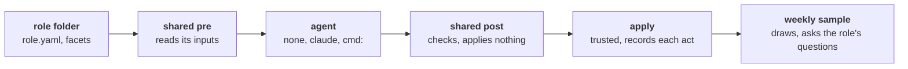

# ADR-0070: A new role runs from its files, on a shared pre and post

- **Status:** proposed, until the maintainer merges it; built by the
  [slices](#slices) of [#1630]
- **Date:** 2026-11-15
- **Decided by:** the maintainer asked for this record on 2026-11-15;
  its three open points are settled here for their review
- **Settles:** [#1630]'s decision (its slice 1)
- **Builds on:** [ADR-0046], [ADR-0065], [ADR-0066], [ADR-0068] §2 and
  §4; principles 4, 5, 6, 10, 12, 15 ([PRINCIPLES.md](../PRINCIPLES.md))
- **Records:** [ADR-0068]'s step 6a
  ([next](0068-the-line-steps-back-on-its-own-drift.md#next-each-decided-when-reached))
- **Amends, once built:** the [role contract](../spec/role-contract.md):
  `pre` and `post` optional, `role.yaml` gains `inputs` and `acts`
- **Research:** [skills.md](../research/skills.md),
  [portability.md](../research/portability.md),
  [roles-panorama.md](../research/roles-panorama.md),
  [agent-sandbox.md](../research/agent-sandbox.md)

## Context

- **No role runs from its files alone**: each `pre` and `post` calls
  Go written for it, about 1,070 lines for the committer, 13,700 for
  the documentalist ([#1630]). A folder with no `pre` stops at once:
  `role "x" has no pre script` (`internal/engine/engine.go`).
- **The auditor draws each role with code of its own**
  (`internal/sample/draw.go`, `developer.go`, `tester.go`) and maps
  each kind to a question in a `switch` (`verdict.go`, `kindOf`). A role
  without that code is never sampled ([ADR-0046]).
- **Its questions sit in `roles/auditor/kinds/`**, guarded: a change
  there merges only on the person's label
  ([ADR-0068 §4](0068-the-line-steps-back-on-its-own-drift.md#4-the-guard-is-guarded)).
- **[ADR-0068 §2](0068-the-line-steps-back-on-its-own-drift.md#2-prompt-first-code-what-converges)**
  wants a new role to start as a prompt on the engine's plumbing; that
  plumbing does not exist yet.

## Decision

**A role made of `role.yaml`, facets and prompts runs on a shared `pre`
and `post` the engine brings. Adding such a role adds no code under
`internal/` nor `cmd/`. Its acts are recorded in one shared form, drawn
by the weekly sample like any other role's, and asked its own questions.**

### 1. `pre` and `post` become optional

- **No `pre` file: the shared one runs.** It reads the role's declared
  `inputs` ([§2](#2-inputs-from-a-short-fixed-list)), writes the
  facets' task with them to `in/task.md`, what it cut to `in/cuts`, the
  role's declared skills to `in/skills`.
- **No `post` file: the shared one runs.** It checks each proposal
  against the role's `intentions`, `duties` and `acts`, and applies
  nothing; the trusted apply step does, as today.
- **Each is optional on its own**: a role may bring its own `pre` and
  take the shared `post`. Its own script may call the shared one first
  (a command the builder names) and add to it.
- **The shared `post` blocks on converging facts only**: an input
  not read, a facet missing, an intention or kind not declared, a write
  outside `duties` (principles 12 and 15). It never blocks on what the
  agent judged: on a merge request, a prompt-only role comments, it
  does not gate.
- **Agent `none`**: the run follows `without-ai`; `report` by default
  for such a role, saying what it skipped (principle 5, as relaxed by
  [ADR-0066]). A `cmd:` agent gets the task inlined, as every role's.
- **A role still brings its own `pre` or `post`** when part of its job
  converges ([§4](#4-when-a-part-moves-to-code)):
  - a routine it settles without the agent (the committer's message
    checks: no call when the message passes);
  - a verdict that gates a merge request on a fact;
  - parts, a judge's questions, a worktree: the contract's machinery a
    plain task does not use.
- **The roles built today keep their scripts**; moving their judgement
  to prompts is an issue each ([ADR-0068 §2](0068-the-line-steps-back-on-its-own-drift.md#2-prompt-first-code-what-converges)).

### 2. Inputs, from a short fixed list

`role.yaml` gains `inputs`, from this list only:

| Input | What the shared `pre` reads |
|---|---|
| `target` | the issue or merge request the run is on: text, comments, labels, diff |
| `commits` | a commit range: messages and diff |
| `issues` | issues by label or state, a page at most |
| `wake` | the wake script's latest output ([ADR-0068 §8](0068-the-line-steps-back-on-its-own-drift.md#8-the-wake-script-print-only)) |
| `sample` | the weekly sample's results ([ADR-0046]) |
| `runs` | the run records of a window |

- **Each has a cap**; what is cut is said in `in/cuts`, as today.
- **An input not read** (an API error, a record missing) is said on the
  run and blocks it: never a task written without it (principle 12).
- **A new kind of input is engine code**, an issue of its own. The list
  grows by need, never with each role.

### 3. Acts recorded once; questions in the role's folder

- **Each act carries one record** the apply step writes: role, kind,
  run, day, commit, models, a digest of what it read. On the forge, a
  hidden line on the item the act lands on, as the reviewer's summary
  and the product owner's state keep theirs today; a label or a
  closing gets it in its one-line comment saying why ([ADR-0059 §1](0059-an-issue-moves-by-its-state-each-step-wakes-the-next.md#1-every-refusal-claim-wait-or-block-is-on-the-issue)).
  Locally with no forge: the run folder only, not sampled, said.
- **`role.yaml` gains `acts`**: the kinds of act the role does (`ask`,
  `proposal`…). A proposal names its kind; one not listed is refused,
  said. With no `acts`, the kind is the intention's.
- **The sampler draws from that record** for every role that has one:
  one in ten per role and kind ([ADR-0046]), no per-role code. The
  built roles keep their draws until each moves.
- **A kind's question lives in the role's folder**:
  `roles/<name>/audit/<kind>.md`, read by the auditor, never by the
  role's agent. The auditor looks it up in its own `kinds/` first, the
  project's then the shipped, then in the role's `audit/`.
- **Why there**: adding a role needs no label on the guarded folder;
  the oversight stays guarded where it acts: the auditor's persona,
  instruction and policy frame every question, the engine checks every
  quote, a panel settles a dispute ([ADR-0046]).
- **The risk, and its net**: a role's author writes a soft question for
  its own acts. The reviewer reads that file like any prompt; the wake
  script prints a role's prompt changed; a person may copy the question
  into `roles/auditor/kinds/`, where it wins and is guarded.
- **A kind with no question is still drawn**, asked with the auditor's
  generic question ("does the act hold against what it was done on, as
  the role's mission says?"), its missing question said in the report.

### 4. When a part moves to code

[ADR-0065]'s rule A, [ADR-0066] §2: code for what gives the same
result each run, verifiable without judgement.

- **The trigger**: evidence on the role's own recorded acts, all three:
  - a conformance case decides the part, no agent;
  - a backtest: the rule gives what the agent gave on the acts the
    sample held;
  - its worth: the tokens or wait the agent spends on it.
- **Who proposes**: the process engineer once built ([#89]); anyone
  else as an issue ([ADR-0068 §5](0068-the-line-steps-back-on-its-own-drift.md#5-the-persons-assistant-goes-through-the-line)).
- **Who decides**: the product owner takes the proposal at its level,
  like any need ([ADR-0018], [ADR-0026]); the line builds it. The
  person's label only where the change touches a guarded file.
- **Not before evidence**: a guess at convergence stays a prompt.
- **The move**: the role gains its own `pre` or `post`, its
  conformance case first; the wake script prints it as growth. Code
  that makes a role rigid moves back to its prompt by the same path.

### 5. Same everywhere

- **Locally** `workline run-role`, **in CI** routed per event in
  `.workline/config.yaml` and run by `workline route`: no workflow per
  role, no write token in the agent's step (principle 6).

## Alternatives

- **The role as a skill** ([skills.md](../research/skills.md),
  [#1494]): a `SKILL.md` the agent loads when it judges the task fits.
  A role must run on its event and its acts be bounded by the engine;
  skills stay the role's optional know-how, declared in `context.skills`.
- **An agent's own definition files** (Claude Code's subagents, Codex's
  TOML, Kiro's JSON): no standard ([portability.md](../research/portability.md#standards)),
  and one agent's format would impose that agent. `role.yaml` stays the
  neutral source; native files may be generated later.
- **GitHub Agentic Workflows** ([agent-sandbox.md](../research/agent-sandbox.md),
  [code-review.md](../research/code-review.md)): a Markdown file per
  workflow, a read-only agent job, declared safe outputs written by a
  separate job. The nearest; its shape is borrowed (declared outputs,
  a trusted apply). Not adopted: GitHub only, a workflow per role, no
  run on a person's machine, no record the auditor draws.
- **Persona files an agent drives** ([roles-panorama.md](../research/roles-panorama.md#roles-in-real-teams-and-in-agent-methods)):
  the LLM drives the flow, locally only, no apply step guarding it.
- **A shared `pre` as a shell script**: not the same on every machine
  (principle 10); the engine is the one binary ([ADR-0001]).
- **Code per role, as today**: the growth [ADR-0068] measured.

## Consequences

- **The engine gains the shared `pre` and `post` once**, and the
  generic record and draw; each later role adds files only.
- **A prompt-only role advises, never gates** on judgement: a gate on a
  merge request is a converging fact, its own `post`.
- **Tokens**: the shared `pre` has no routine to skip the agent on; a
  prompt-only role runs on rare events (schedule, a label), not on each
  push. Each role's first try tells its tokens under `## Tried`.
- **Routing a new role on workline** edits `.workline/config.yaml`, a
  guarded file: the person's label once per role. The process
  engineer's brief is guarded too
  ([ADR-0068 §4](0068-the-line-steps-back-on-its-own-drift.md#4-the-guard-is-guarded)).
- **Two sources of auditor questions**, `kinds/` and `audit/`; the
  report says which was asked.
- **Risk**: the shared `pre` becomes the new place the engine grows.
  Its input list is fixed, each addition an issue, and the wake script
  prints it.

## Slices

From [#1630], in order, each starting with its conformance case under
`tests/conformance/cases/`:

1. **This record.**
2. **A role with no scripts runs**: the shared `pre` and `post`; a
   fixture role made only of files passes with agent `none` and a fake
   agent.
3. **Inputs declared**: the fixed list, each input not read said.
4. **Acts recorded and drawn**: the generic record, the sampler drawing
   from it, the role's `audit/` question read.
5. **Tried for real**: the fixture role on a clone of the trial copy,
   locally then in CI, with `claude` and a `cmd:` agent; tokens told
   under `## Tried`.
6. **The proof**: the process engineer's first version as files only
   ([#89]), its pull request touching nothing under `internal/` nor
   `cmd/`, run on one case of its test bench ([#1629]).

[#89]: https://github.com/JN0V/workline/issues/89
[#1494]: https://github.com/JN0V/workline/issues/1494
[#1629]: https://github.com/JN0V/workline/issues/1629
[#1630]: https://github.com/JN0V/workline/issues/1630
[ADR-0001]: 0001-engine-in-go.md
[ADR-0018]: 0018-the-product-owner.md
[ADR-0026]: 0026-the-product-owners-autonomy-is-a-level.md
[ADR-0046]: 0046-the-auditor-re-checks-every-roles-acts.md
[ADR-0065]: 0065-code-only-what-converges-language-knowledge-in-packs.md
[ADR-0066]: 0066-a-role-mirrors-a-human-role-ai-first-where-code-is-rigid.md
[ADR-0068]: 0068-the-line-steps-back-on-its-own-drift.md
