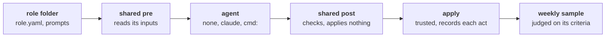

# ADR-0070: A new role runs from its files, on a shared pre and post

- **Status:** proposed, until the maintainer merges it; built by
  [#1630]'s [slices](#slices), all before v1.0
- **Date:** 2026-11-15; the [layout](#6-the-layout-reached-before-10) on
  2026-11-16, by the maintainer: before 1.0 anything may break, not after
- **Settles:** [#1630]; how [ADR-0068]'s [step 6], the process engineer, is built
- **Builds on:** [ADR-0046], [ADR-0065], [ADR-0066], [ADR-0068] §2 and
  §4; principles 4, 5, 6, 10, 12, 15 ([PRINCIPLES.md](../PRINCIPLES.md))
- **Amends, once built:** the [role contract](../spec/role-contract.md)
  (`pre`, `post` optional; `inputs`, `acts`; `without-ai` read, `report`
  its default) and the [layout](../spec/layout.md); [ADR-0052]'s 1.0 bar requires it
- **Research:** [skills.md](../research/skills.md), [agent-sandbox.md](../research/agent-sandbox.md)

## Context

- **No role runs from its files alone**: each `pre` and `post` calls
  Go written for it, 1,070 lines for the committer, 13,700 for the
  documentalist ([#1630]); the auditor draws each role with code of its
  own, a role without it never sampled ([ADR-0046]).
- **A role is spread out** over `roles/`, `internal/` and `tests/`;
  the core imports six roles' code, and roles import each other's.

## Decision

**A role made of `role.yaml` and prompts runs on a shared `pre` and
`post` the engine brings, adding no code under `internal/` nor `cmd/`.
Its acts are recorded in one shared form, drawn by the weekly sample
and judged against its criteria. Every role lives whole in its folder,
in the [layout](../spec/layout.md) reached before 1.0.**

### 1. `pre` and `post` become optional

- **No `pre`: the shared one runs.** It reads the declared `inputs`
  ([§2](#2-inputs-from-a-short-fixed-list)), writes the task to
  `in/task.md`, its cuts to `in/cuts`, the declared skills to
  `in/skills`. The agent has no tools (`--tools ""`).
- **No `post`: the shared one runs.** It checks each proposal against
  `intentions`, `duties` and `acts`; the apply step applies. What runs:
  the role's code, else its file, else the shared one, each on its own.
- **The shared `post` blocks on converging facts only**: an input not
  read, a prompt missing, an intention or kind not declared, a write
  outside `duties` (principles 12, 15). Never on what the agent judged:
  on a merge request, a prompt-only role comments, never gates.
- **Agent `none`**: `without-ai` read, `report` by default, saying what
  it skipped ([ADR-0066]). A `cmd:` agent gets the task inlined. Same
  locally (`run-role`) and in CI (`route`), principle 10.

### 2. Inputs, from a short fixed list

`role.yaml` gains `inputs`, from this list only:

| Input | What the shared `pre` reads |
|---|---|
| `target` | the issue or merge request the run is on: text, comments, labels, diff |
| `commits` | a commit range: messages and diff |
| `issues` | issues by label or state, a page at most |
| `wake` | the wake script's latest output ([ADR-0068 §8](0068-the-line-steps-back-on-its-own-drift.md#8-the-wake-script-print-only)) |
| `sample` | the weekly sample's results ([ADR-0046]) |
| `runs` | the run records of a window |

- **Each has a cap**, cuts said; an input not read blocks the run, said
  (principle 12). `duties.reads`, enforced nowhere today, is enforced on
  what the shared `pre` reads. A new kind of input is engine code.

### 3. Acts recorded once, judged against criteria

- **Each act carries one record** the apply step writes: role, kind,
  run, day, commit, models, the ids and states it read. A hidden line on
  the forge item it lands on ([ADR-0059 §1](0059-an-issue-moves-by-its-state-each-step-wakes-the-next.md#1-every-refusal-claim-wait-or-block-is-on-the-issue)),
  read only from workline's own account (`forge.Own`); a proposal
  holding such a line is refused. No forge: not sampled, said.
- **`role.yaml` gains `acts`**, the kinds of act it does; a kind not
  listed is refused. With none, the kind is the intention's.
- **The sampler draws from that record**, one in ten per role and kind
  ([ADR-0046]), no per-role code.
- **`roles/<name>/criteria/<kind>.md`**: per kind of act, the fixed,
  versioned question saying what a well-done act is; the auditor draws
  acts at random and judges them against it, its verdicts on the forge,
  never in the repository.
- **The auditor's guarded criteria win**: `roles/auditor/criteria/<role>/<kind>.md`
  (today's `kinds/`) first, the project's then the shipped, then the
  role's own. A role's own criteria need no label; a soft one shows in
  the wake script, and a person may copy it to the auditor's, where it wins.
- **A kind with no criteria is still drawn**, judged on the auditor's
  generic question, the gap said in the report.

### 4. When a part moves to code

[ADR-0065]'s rule A, [ADR-0066] §2: code for what gives the same
result each run, verifiable without judgement.

- **The trigger**: a part of a role moves to code only when all three
  hold, each shown on its recorded acts: (1) a conformance case decides
  it with no agent; (2) that code, run on the sampled acts, gives what
  the agent gave; (3) it saves tokens or wait time. Short of any one,
  it stays a prompt.
- **Who proposes**: the process engineer once built ([#89]); anyone as
  an issue. **Who decides**: the product owner ([ADR-0018], [ADR-0026]);
  the person's label only on a guarded file.
- **The move**: a shipped role gains `code/`, its case first; the wake
  script prints it as growth. Code that makes a role rigid moves back.

### 5. The common part, a role's part

- **The common part**: the engine (shared `pre`, `post`, apply, record,
  draw), the [role contract](../spec/role-contract.md), routing
  (`defaults/routing.yaml`; the project's `.workline/config.yaml`, guarded)
  and shared skills (`skills/`).
- **A role's part**, `roles/<name>/`: `role.yaml`, `prompts/`,
  `criteria/`, `cases/`, docs, optional `code/`, `pre`, `post`; it names
  no other role's. One from another repository is
  [shaped the same](../spec/layout.md#an-external-role).

### 6. The layout, reached before 1.0

The [layout](../spec/layout.md) holds the tree and the role skeleton.
Five moves reach it, smallest first:

- **a. Shims out, criteria in**: the 3-line `pre`/`post` shims go, the
  engine resolves code, file, shared; today's auditor `kinds/` move to
  `roles/auditor/criteria/<role>/`, their `CODEOWNERS` lines in the
  same pull request ([guarded](../spec/layout.md#guarded-paths)).
- **b. Prompts into `roles/<name>/prompts/`**, one role a pull request.
  [A person's overrides](../spec/layout.md#a-persons-overrides) move
  the same way; one left at the old path makes the run refuse, never
  run on the shipped prompt; `workline doctor` names each.
- **c. Cases into `roles/<name>/cases/`**, one `pending.txt`;
  `roles.go`, renamed `workline.go`, embeds `role.yaml`, `prompts/`,
  `criteria/` by name, not `all:roles`: the 3 MB of cases never ship.
- **d. `routing.default.yaml` and `ci/` into `defaults/`**, the root
  `*_test.go` files into `tests/`.
- **e. Role code into `roles/<name>/code/`**, untangled first
  ([detail](../spec/layout.md#role-code-untangled)):
  - **Data and functions, not hooks only**: engine, line and sample use
    about 55 developer and tester symbols, the developer 19 of the
    tester's; each moves to `internal/contract/` (role interfaces, the
    registry roles join in `init()`) or `internal/kit/` (shared helpers).
  - **No cycle**: `contract` and `kit` never import engine, line or
    sample. A check in `tests/`, `_test.go` files included, fails if
    `internal/` imports `roles/`, or a role another role's code.
  - Then by size, judge (300 lines) to documentalist (13,700), one
    role a pull request; last, `sample`'s per-role draws.

## Alternatives

- **A skill** ([skills.md](../research/skills.md), [#1494]): loaded at
  the agent's choice, not on its event. **An agent's definition files**:
  no standard ([portability.md](../research/portability.md#standards)).
- **GitHub Agentic Workflows** ([agent-sandbox.md](../research/agent-sandbox.md)):
  read-only agent, separate writer borrowed; GitHub only. **Persona
  files**: local, no apply. **A shell `pre`**: not portable ([ADR-0001]).
- **Code per role, in `internal/`**: the growth [ADR-0068] measured.

## Consequences

- **The engine gains the shared `pre`, `post`, record and draw once**;
  each later role adds a folder only. **Tokens**: no routine skips the
  agent; such a role runs on rare events. **Risk**: the shared `pre` grows.
- **Breaks before 1.0, none after**: paths in user docs, a person's
  prompt overrides, `CODEOWNERS` (criteria with a, prompts with b, the
  person's label) and the routing file's name change once.

## Slices

From [#1630], in order, each starting with its conformance case:

1. **This record.**
2. **A role with no scripts runs**, shims out (a): a fixture role passes.
3. **Inputs declared**. 4. **Acts recorded and drawn**, `criteria/` (a).
5. **Prompts in `prompts/`** (b), overrides moved, doctor says.
6. **Tried for real**: the fixture role on a clone of the trial copy,
   locally and in CI, `claude` and a `cmd:` agent, tokens told.
7. **The proof**: the process engineer as files only ([#89]), touching
   nothing under `internal/` nor `cmd/`, run on a case of [#1629].
8. **Cases** (c). 9. **Defaults** (d). 10. **Role code** (e), one
   role a pull request. External roles (`from`): after 1.0.

[#89]: https://github.com/JN0V/workline/issues/89
[#1494]: https://github.com/JN0V/workline/issues/1494
[#1629]: https://github.com/JN0V/workline/issues/1629
[#1630]: https://github.com/JN0V/workline/issues/1630
[ADR-0001]: 0001-engine-in-go.md
[ADR-0018]: 0018-the-product-owner.md
[ADR-0026]: 0026-the-product-owners-autonomy-is-a-level.md
[ADR-0046]: 0046-the-auditor-re-checks-every-roles-acts.md
[ADR-0052]: 0052-v1-0-when-the-core-roles-are-out-of-beta.md
[ADR-0065]: 0065-code-only-what-converges-language-knowledge-in-packs.md
[ADR-0066]: 0066-a-role-mirrors-a-human-role-ai-first-where-code-is-rigid.md
[ADR-0068]: 0068-the-line-steps-back-on-its-own-drift.md
[step 6]: 0068-the-line-steps-back-on-its-own-drift.md#next-each-decided-when-reached
