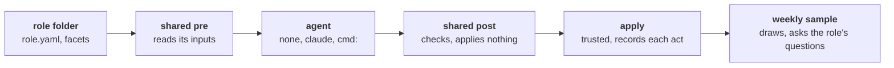

# ADR-0070: A new role runs from its files, on a shared pre and post

- **Status:** proposed, until the maintainer merges it; built by the
  [slices](#slices) of [#1630]
- **Date:** 2026-11-15
- **Decided by:** the maintainer asked for this record on 2026-11-15;
  its three open points are settled here for their review
- **Settles:** [#1630]'s decision; [ADR-0068]'s step 6a
  ([next](0068-the-line-steps-back-on-its-own-drift.md#next-each-decided-when-reached))
- **Builds on:** [ADR-0046], [ADR-0065], [ADR-0066], [ADR-0068] §2 and
  §4; principles 4, 5, 6, 10, 12, 15 ([PRINCIPLES.md](../PRINCIPLES.md))
- **Amends, once built:** the [role contract](../spec/role-contract.md):
  `pre` and `post` optional; `role.yaml` gains `inputs` and `acts`;
  `without-ai` read at last, `report` its default for a role of files
  only (today "not read yet", default `block`)
- **Research:** [skills.md](../research/skills.md), [agent-sandbox.md](../research/agent-sandbox.md)

## Context

- **No role runs from its files alone**: each `pre` and `post` calls
  Go written for it, about 1,070 lines for the committer, 13,700 for
  the documentalist ([#1630]). A folder with no `pre` stops at once:
  `role "x" has no pre script` (`internal/engine/engine.go`).
- **The auditor draws each role with code of its own**
  (`internal/sample/`); a role without it is never sampled ([ADR-0046]).
- **[ADR-0068 §2](0068-the-line-steps-back-on-its-own-drift.md#2-prompt-first-code-what-converges)**
  wants a new role to start as a prompt on the engine's plumbing; that
  plumbing does not exist yet.

## Decision

**A role made of `role.yaml`, facets and prompts runs on a shared `pre`
and `post` the engine brings. Adding such a role adds no code under
`internal/` nor `cmd/`. Its acts are recorded in one shared form, drawn
by the weekly sample like any other role's, and asked its own questions.**

### 1. `pre` and `post` become optional

- **No `pre` file: the shared one runs.** It reads the role's declared
  `inputs` ([§2](#2-inputs-from-a-short-fixed-list)), writes the
  facets' task with them to `in/task.md`, what it cut to `in/cuts`, the
  role's declared skills to `in/skills`.
- **The agent has no tools** (`--tools ""`): it sees what `pre` wrote.
- **No `post` file: the shared one runs.** It checks each proposal
  against `intentions`, `duties` and `acts`; the apply step applies.
- **Each is optional on its own**; a role's own may call the shared one.
- **The shared `post` blocks on converging facts only**: an input
  not read, a facet missing, an intention or kind not declared, a write
  outside `duties` (principles 12 and 15). Never on what the agent
  judged: on a merge request, a prompt-only role comments, not gates.
- **Agent `none`**: `without-ai` is not read today; slice 2 reads it,
  `report` by default for such a role, saying what it skipped
  ([ADR-0066]). A `cmd:` agent gets the task inlined.
- **A role still brings its own `pre` or `post`** when part of its job
  converges ([§4](#4-when-a-part-moves-to-code)): a routine, a gate on
  a fact, a judge's questions, a worktree. Built roles keep theirs.
- **Same everywhere**: `run-role` locally, `route` in CI (principle 10).

### 2. Inputs, from a short fixed list

`role.yaml` gains `inputs`, from this list only:

| Input | What the shared `pre` reads |
|---|---|
| `target` | the issue or merge request the run is on: text, comments, labels, diff |
| `commits` | a commit range: messages and diff |
| `issues` | issues by label or state, a page at most |
| `wake` | the wake script's latest output ([ADR-0068 §8](0068-the-line-steps-back-on-its-own-drift.md#8-the-wake-script-print-only)) |
| `sample` | the weekly sample's results ([ADR-0046]) |
| `runs` | the run records of a window |

- **Each has a cap**, cuts said in `in/cuts`; `runs` and `wake` are
  sent as recorded, not re-summarised.
- **An input not read** (an API error, a record missing) is said on the
  run and blocks it: never a task written without it (principle 12).
- **`duties.reads` is enforced nowhere today**; slice 3 enforces it on
  what the shared `pre` reads.
- **A new kind of input is engine code**, an issue of its own.

### 3. Acts recorded once; questions in the role's folder

- **Each act carries one record** the apply step writes: role, kind,
  run, day, commit, models, what it read. A hidden line on the forge
  item the act lands on, as the reviewer's summary keeps its own; a
  label or a closing in its comment saying why ([ADR-0059 §1](0059-an-issue-moves-by-its-state-each-step-wakes-the-next.md#1-every-refusal-claim-wait-or-block-is-on-the-issue)).
  With no forge: the run folder only, not sampled, said.
- **What it read lets the auditor re-read it**: a digest alone cannot
  for moving inputs (`wake`, `runs`, `issues`); the record keeps their
  ids and states read, or says the act is checked on the digest only.
- **Only workline's records count**: the sampler reads a record only
  from a comment workline's own account wrote (`forge.Own`). A
  proposal's text holding such a line is refused, said: a role fed
  untrusted comments cannot forge an act nor hide one.
- **`role.yaml` gains `acts`**: the kinds of act the role does (`ask`,
  `proposal`…). A proposal names its kind; one not listed is refused,
  said. With no `acts`, the kind is the intention's.
- **The sampler draws from that record** for every role that has one:
  one in ten per role and kind ([ADR-0046]), no per-role code. The
  built roles keep their draws until each moves.
- **A kind's question lives in the role's folder**:
  `roles/<name>/audit/<kind>.md`, read by the auditor, never by the
  role's agent. The auditor looks it up in its own `kinds/` first, the
  project's then the shipped, then in the role's `audit/`.
- **Why there**: adding a role needs no label; the auditor's guarded
  prompts frame every question, the engine checks quotes ([ADR-0046]).
  A soft question for one's own acts: the wake script prints it changed;
  a person may copy it into `roles/auditor/kinds/`, where it wins.
- **A kind with no question is still drawn**, asked the auditor's
  generic one, its missing question said in the report.

### 4. When a part moves to code

[ADR-0065]'s rule A, [ADR-0066] §2: code for what gives the same
result each run, verifiable without judgement.

- **The trigger**: evidence on its recorded acts, all three; a guess
  stays a prompt: a conformance case decides the part, no agent; a
  backtest gives what the agent gave on the sampled acts; its worth in
  tokens or wait.
- **Who proposes**: the process engineer once built ([#89]); anyone
  else as an issue ([ADR-0068 §5](0068-the-line-steps-back-on-its-own-drift.md#5-the-persons-assistant-goes-through-the-line)).
- **Who decides**: the product owner, like any need ([ADR-0018],
  [ADR-0026]); the person's label only on a guarded file.
- **The move**: the role gains its own `pre` or `post`, its
  conformance case first; the wake script prints it as growth. Code
  that makes a role rigid moves back to its prompt by the same path.

### 5. Layout: the common part, a role's part

- **The common part**, in the engine: the shared `pre` and `post`, the
  apply step, the record and the draw, the [role contract](../spec/role-contract.md).
- **A role's part**, its folder `roles/<name>/`: `role.yaml`, facets,
  prompts, `audit/<kind>.md`, and an optional `pre` or `post`.
- **A role folder is self-contained**: it names no engine file and no
  other role's. A later ADR may load roles from another repository;
  not decided here.

## Alternatives

- **The role as a skill** ([skills.md](../research/skills.md),
  [#1494]): loaded at the agent's choice, not on its event.
- **An agent's own definition files**: no standard
  ([portability.md](../research/portability.md#standards)).
- **GitHub Agentic Workflows** ([agent-sandbox.md](../research/agent-sandbox.md)):
  a read-only agent, safe outputs a separate job writes; that shape is
  borrowed. Not adopted: GitHub only, a workflow per role, no local run.
- **Persona files an agent drives** ([landscape.md](../research/landscape.md)):
  local only, no apply step. **A shell `pre`**: not portable ([ADR-0001]).
- **Code per role, as today**: the growth [ADR-0068] measured.

## Consequences

- **The engine gains the shared `pre` and `post` once**, and the
  generic record and draw; each later role adds files only.
- **Tokens**: no routine skips the agent; such a role runs on rare
  events (schedule, a label), its first try's tokens under `## Tried`.
- **Routing a new role**: in `.workline/config.yaml`, guarded, the
  person's label; in `routing.default.yaml`, not guarded today, the
  line's normal path. An option: add it to `CODEOWNERS`.
- **Risk**: the shared `pre` grows; its input list is fixed, each
  addition an issue.

## Slices

From [#1630], in order, each starting with its conformance case:

1. **This record.**
2. **A role with no scripts runs**: the shared `pre` and `post`,
   `without-ai` read; a fixture role of files only passes with agent
   `none` and a fake one.
3. **Inputs declared**: the fixed list, each input not read said,
   `duties.reads` enforced.
4. **Acts recorded and drawn**: the generic record, own-account only,
   the sampler drawing from it, the role's `audit/` question read.
5. **Tried for real**: the fixture role on a clone of the trial copy,
   locally then in CI, `claude` and a `cmd:` agent, tokens told.
6. **The proof**: the process engineer's first version as files only
   ([#89]), its pull request touching nothing under `internal/` nor
   `cmd/`, run on one case of its test bench ([#1629]).

[#89]: https://github.com/JN0V/workline/issues/89
[#1494]: https://github.com/JN0V/workline/issues/1494
[#1629]: https://github.com/JN0V/workline/issues/1629
[#1630]: https://github.com/JN0V/workline/issues/1630
[ADR-0001]: 0001-engine-in-go.md
[ADR-0018]: 0018-the-product-owner.md
[ADR-0026]: 0026-the-product-owners-autonomy-is-a-level.md
[ADR-0046]: 0046-the-auditor-re-checks-every-roles-acts.md
[ADR-0065]: 0065-code-only-what-converges-language-knowledge-in-packs.md
[ADR-0066]: 0066-a-role-mirrors-a-human-role-ai-first-where-code-is-rigid.md
[ADR-0068]: 0068-the-line-steps-back-on-its-own-drift.md
