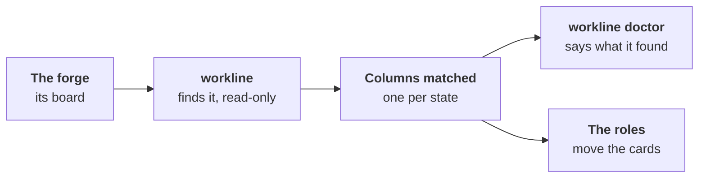

---
sources:
  - internal/doctor/board.go#boards
  - internal/doctor/board.go#projectWorkflows
  - internal/forge/board.go#Board
  - internal/forge/board.go#Boards
  - internal/forge/board.go#github.boards
  - internal/forge/board.go#github.workflows
  - internal/forge/board.go#gitlab.boards
  - internal/forge/board.go#gitlabColumns
  - internal/forge/board.go#projectsUnread
  - internal/board/board.go#LinkedWorkflow
  - internal/board/board.go#ClosedWorkflow
  - internal/board/board.go#To
  - internal/board/board.go#Along
  - internal/board/board.go#Move.Write
  - internal/engine/backlog.go#applier.moveCard
checked: c46a93d6c
verified: agent:claude-code
judged-in-parts: eb16524
---
# Boards

People follow the work on a board: To do, Doing, Done, and where an
issue waits, its tests or a block. workline finds the forge's board
each run and creates none
([ADR-0057](adr/0057-workline-finds-the-forges-board-and-moves-its-cards.md),
[ADR-0059](adr/0059-an-issue-moves-by-its-state-each-step-wakes-the-next.md)).

- **`workline doctor`** says the board found and its columns matched.
- **The roles move its cards** with the issue's state: to Tests,
  Ready, Doing, Blocked, back to Refine
  ([what each state moves](board-moves.md)); GitHub's own
  workflows do what they can first.
- **workline's labels stay** (`workline:ready`, `workline:blocked`…):
  they are the issue's state, board or not.
- **Only when it matters**: the doctor looks for a board when the line
  routes the product owner, the tester or the developer, the roles
  that move cards.
- **No board**: nothing to do; the labels alone say the state.

## What is found, by forge

| Forge | The board | Its columns |
|---|---|---|
| GitHub | the open projects linked to the repository; their owner, an organization or a user | the options of the project's Status field |
| GitLab | the project's boards, and its group's | the labels of each board's label lists, scoped (`workflow::Doing`) or plain |
| `local`, `cmd:`, none | none | none: workline's labels only |

- **GitHub's built-in workflows** are read too: *Item closed*, *Pull
  request merged*, *Pull request linked to issue*, each on or off.
- **GitLab's tier is not asked**: Free and Premium boards read the same.
- **Done on GitLab** is the Closed list: the issue's close moves it.

## Detail

- [Board columns](board-columns.md): the names each slot takes, and
  the `board:` setting when they do not fit.
- [What each state moves](board-moves.md): the card a state's label
  moves, on GitLab's Free and Premium tiers.
- [GitHub projects](board-github.md): a Status set or left to the
  project's workflows, who may write a project, what a run says.

## What you switch on

| Forge | Switch on | Where |
|---|---|---|
| GitHub, an organisation's project | *Item closed*, *Pull request linked to issue*; the App's *Organization projects: read and write* | the project's menu, *Workflows*; the App's settings, *Permissions* |
| GitHub, a user's project | *Item closed*, *Pull request linked to issue* | the project's menu, *Workflows* |
| GitLab Premium | a board with a list per column, scoped labels (`workflow::Doing`) | the project's *Plan → Issue boards* |
| GitLab Free | a board with a list per column, plain labels | the same |

- **A GitHub project closed, then reopened**: GitHub turns all its
  workflows off; turn them on again.
- **A new GitHub project** starts with its workflows on.
- **Nothing else**: workline finds the board and its columns itself.

## What the doctor says

| Rule | Level | Means |
|---|---|---|
| `board-found` | ok | the board, each slot's column, GitHub's workflows on and off |
| `board-none` | note | no board, or none with a column workline can set |
| `board-ambiguous` | note | several boards; the fix names the setting |
| `board-setting-unmatched` | warn | `board:` names a column or project that is not there |
| `board-unread` | warn | the forge did not answer; the reason, never read as no board |

- **GitHub, `board-unread`**: a person's token needs the `read:project`
  scope: `gh auth refresh -s read:project`. A GitHub App needs
  *Organization projects: read*; it reads no project a user owns.
