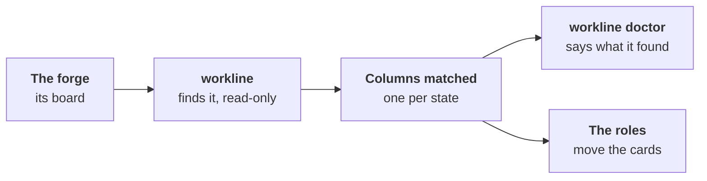

# Boards



People follow the work on a board: To do, Doing, Done, and where an
issue waits, its tests or a block. workline finds the forge's board
each run and creates none
([ADR-0057](adr/0057-workline-finds-the-forges-board-and-moves-its-cards.md),
[ADR-0059](adr/0059-an-issue-moves-by-its-state-each-step-wakes-the-next.md)).

- **`workline doctor`** says the board found and its columns matched.
- **The roles move its cards** with the issue's state: to Tests,
  Ready, Doing, Blocked, back to Refine (below); GitHub's own
  workflows do what they can first.
- **workline's labels stay** (`workline:ready`, `workline:blocked`…):
  they are the issue's state, board or not.
- **Only when it matters**: the doctor looks for a board when the line
  routes the product owner, the tester or the developer, the roles
  that move cards.
- **No board**: nothing to do; the labels alone say the state.

## What is found, by forge

| Forge | The board | Its columns |
|---|---|---|
| GitHub | the open projects linked to the repository; their owner, an organization or a user | the options of the project's Status field |
| GitLab | the project's boards, and its group's | the labels of each board's label lists, scoped (`workflow::Doing`) or plain |
| `local`, `cmd:`, none | none | none: workline's labels only |

- **GitHub's built-in workflows** are read too: *Item closed*, *Pull
  request merged*, *Pull request linked to issue*, each on or off.
- **GitLab's tier is not asked**: Free and Premium boards read the same.
- **Done on GitLab** is the Closed list: the issue's close moves it.

## Columns matched by their names

A name is matched lowercase, letters only, a scope's key dropped
(`workflow::In progress` reads `inprogress`). In each slot, the first
name of its list wins:

| Slot | Names it takes |
|---|---|
| ready | Ready, Todo, To do, Backlog |
| doing | In progress, Doing, WIP, In development, Started |
| done | Done, Closed, Complete, Completed |
| refine | Refine, To refine, Refinement, Triage, New, Backlog, Icebox |
| tests | Tests, Test, Needs tests, To test, Acceptance tests |
| blocked | Blocked, On hold, Impeded |

- **One column, one slot**: the slots take their columns in the
  table's order, a column taken by one never another's. Backlog is
  ready's on a board with no Ready column, refine's beside one.
- **A slot with no column** moves nothing. *Testing* and *QA* are not
  taken: on many boards they come after the code, where workline's
  tests come before it; name them in `board:` if they are yours.

## The `board:` setting

Only when the names above do not fit, in `.workline/config.yaml`:

```yaml
board:
  ready: "Sprint backlog"   # a column's name, matched as loosely
  doing: "Build"
  tests: "QA"               # refine, tests and blocked too
  project: 3                # GitHub: a project's number, when several are linked
```

- **A name no column holds**: a warning, `board-setting-unmatched`; that
  step moves nothing.
- **Several projects, no `project:`**: none is chosen, a note,
  `board-ambiguous`. GitLab boards listing the same labels count as
  one: a label is the same move on each. `project:` applies on GitHub
  only.
- **GitLab, a group's boards unread**: a warning; the project's own
  boards still count.

## What each state moves

A card follows the issue's state, its label
([states](spec/routing.md#the-line-of-states)):

| State | Who moves it there | On GitLab, Free and Premium |
|---|---|---|
| tests | the product owner, its ready sending the issue to its tests | the tests column's label on, beside `workline:needs-tests`; with no tests column, the ready column's |
| ready | the product owner's ready; the tester's result | the ready column's label on, beside `workline:ready` |
| doing | the developer, at its claim | the doing column's label on |
| blocked | the line past its hop cap; the tester or developer that blocks it, its reason on the issue | the blocked column's label on, beside `workline:blocked` |
| refine | the product owner moving it back; the tester's "no test possible"; the line, for a stale issue ([staleness](spec/routing.md#staleness)) | the refine column's label on |
| done | the forge, closing the issue at the merge (`Closes #n`) | the Closed list |

- **One call, both tiers**: on Premium, a scoped label
  (`workflow::Doing`) takes its sibling off by itself; on Free, the
  role takes the other columns' labels off, in the same call: a card
  sits in one column. GitLab's tier is never asked.
- **Blocked says why** on the issue, in the comment of whoever blocked
  it; the product owner reads it again when there is news, or a week on,
  and moves it back or says why it stays
  ([blocked, read again](spec/routing.md#blocked-read-again)); a person
  may move it back by its label at any time.
- **In the role's record**: the product owner's act says the column;
  the developer's claim comment says it, and its hidden line keeps it.
- **With no agent**, neither role acts: no card moves.
- **A board out of reach**, even in part, moves nothing, said in the run's output;
  no verdict changes.
- **A person's drag is theirs**: it never frees a claim, and no role
  moves a card back.

### On GitHub

A column is an option of the project's Status field: a move sets that
one value, and puts no label for it.

| Step | An organisation's project | A user's project |
|---|---|---|
| tests, ready, blocked, refine | the role that moves the issue sets Status to that option | no move: GitHub lets no App write it |
| doing | left to *Pull request linked to issue* when on, the pull request opening; else the developer sets Status | left to *Pull request linked to issue*; off, no move |
| done | *Item closed*, at the close | the same |

- **An issue in no project** is not added: that is the project's
  *Auto-add* workflow.
- **In the role's record**: the move, or why it is left (the
  workflow, a user's project).

### Who may write a GitHub project

- **An organisation's project**: the App needs *Organization projects:
  read and write*; a person's token, the `project` scope. Refused, the
  card stays and the run says `board-unwritable` once.
- **A user's project is never written**: GitHub offers an App no right
  on a user's projects
  ([App permissions](https://docs.github.com/en/rest/authentication/permissions-required-for-github-apps)).
  A person's token could, but workline takes none for it
  ([ADR-0057](adr/0057-workline-finds-the-forges-board-and-moves-its-cards.md#who-may-write-a-github-project)):
  - the ready moves no card;
  - the project's workflows move Doing and Done;
  - the run says `board-user-project` once, naming the workflows off.

## What you switch on

| Forge | Switch on | Where |
|---|---|---|
| GitHub, an organisation's project | *Item closed*, *Pull request linked to issue*; the App's *Organization projects: read and write* | the project's menu, *Workflows*; the App's settings, *Permissions* |
| GitHub, a user's project | *Item closed*, *Pull request linked to issue* | the project's menu, *Workflows* |
| GitLab Premium | a board with a list per column, scoped labels (`workflow::Doing`) | the project's *Plan → Issue boards* |
| GitLab Free | a board with a list per column, plain labels | the same |

- **A GitHub project closed, then reopened**: GitHub turns all its
  workflows off; turn them on again.
- **A new GitHub project** starts with its workflows on.
- **Nothing else**: workline finds the board and its columns itself.

## What a run says

The role that moves a card says each once a run, an info: no verdict
changes.

| Rule | Means |
|---|---|
| `board-workflow-off` | an organisation's project with *Item closed* off: no card reaches Done |
| `board-user-project` | a user's project: the ready moves no card; the workflows to turn on |
| `board-unwritable` | an organisation's project the token may not write; the right to give |

## What the doctor says

| Rule | Level | Means |
|---|---|---|
| `board-found` | ok | the board, each slot's column, GitHub's workflows on and off |
| `board-none` | note | no board, or none with a column workline can set |
| `board-ambiguous` | note | several boards; the fix names the setting |
| `board-setting-unmatched` | warn | `board:` names a column or project that is not there |
| `board-unread` | warn | the forge did not answer; the reason, never read as no board |

- **GitHub, `board-unread`**: a person's token needs the `read:project`
  scope: `gh auth refresh -s read:project`. A GitHub App needs
  *Organization projects: read*; it reads no project a user owns.
