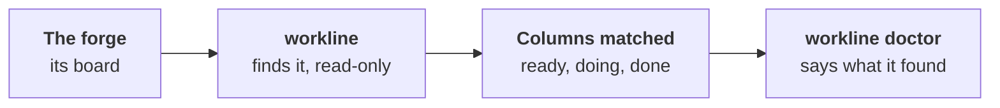

# Boards



People follow the work on a board: To do, Doing, Done. workline finds
the forge's board each run and creates none
([ADR-0057](adr/0057-workline-finds-the-forges-board-and-moves-its-cards.md)).

- **Today it only reads**: `workline doctor` says the board found and
  its columns matched. No card is moved yet; workline's roles mark the
  work with their labels (`workline:ready`, `workline:developing`).
- **Only when it matters**: the doctor looks for a board when the line
  routes the product owner or the developer, the two roles that will
  move cards.

## What is found, by forge

| Forge | The board | Its columns |
|---|---|---|
| GitHub | the open projects linked to the repository; their owner, an organization or a user | the options of the project's Status field |
| GitLab | the project's boards, and its group's | the labels of each board's label lists, scoped (`workflow::Doing`) or plain |
| `local`, `cmd:`, none | none | none: workline's labels only |

- **GitHub's built-in workflows** are read too: *Item closed*, *Pull
  request merged*, *Pull request linked to issue*, each on or off.
- **GitLab's tier is not asked**: Free and Premium boards read the same.
- **Done on GitLab** is the Closed list: the issue's close moves it.

## Columns matched by their names

A name is matched lowercase, letters only, a scope's key dropped
(`workflow::In progress` reads `inprogress`). In each slot, the first
name of its list wins:

| Slot | Names it takes |
|---|---|
| ready | Ready, Todo, To do, Backlog |
| doing | In progress, Doing, WIP, In development, Started |
| done | Done, Closed, Complete, Completed |

A slot with no column moves nothing.

## The `board:` setting

Only when the names above do not fit, in `.workline/config.yaml`:

```yaml
board:
  ready: "Sprint backlog"   # a column's name, matched as loosely
  doing: "Build"
  project: 3                # GitHub: a project's number, when several are linked
```

- **A name no column holds**: a warning, `board-setting-unmatched`; that
  step moves nothing.
- **Several projects, no `project:`**: none is chosen, a note,
  `board-ambiguous`. GitLab boards matching the same labels count as
  one: a label is the same move on each.

## What each role will move

Not built yet; the plan, from
[ADR-0057](adr/0057-workline-finds-the-forges-board-and-moves-its-cards.md#what-each-role-writes):

| Step | Who | The card goes to |
|---|---|---|
| ready | the product owner, setting an issue ready | the ready column |
| doing | the developer, at its claim | the doing column; on GitHub, left to *Pull request linked to issue* when on |
| done | the forge, closing the issue at the merge | Done, by GitHub's workflows or GitLab's Closed list |

- **workline's labels stay**: a person dragging a card never frees a
  claim, and no role moves a card back.

## What the doctor says

| Rule | Level | Means |
|---|---|---|
| `board-found` | ok | the board, each slot's column, GitHub's workflows on and off |
| `board-none` | note | no board, or none with a column workline can set |
| `board-ambiguous` | note | several boards; the fix names the setting |
| `board-setting-unmatched` | warn | `board:` names a column or project that is not there |
| `board-unread` | warn | the forge did not answer; the reason, never read as no board |

- **GitHub, `board-unread`**: a person's token needs the `read:project`
  scope: `gh auth refresh -s read:project`. A GitHub App needs
  *Organization projects: read*; it reads no project a user owns.
