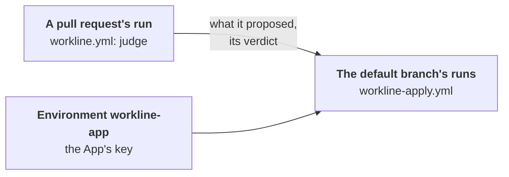

# The GitHub App and its key



The App commits workline's fixes, opens its pull requests and sets the
[merge policy](merge-policy.md)'s statuses; the checks of what it pushes
run by themselves. Its key reaches only the jobs running the default
branch's workflow
([ADR-0044](adr/0044-the-apps-key-stays-with-the-default-branchs-runs.md)).

## Set it up

1. **Create the App**: your settings → Developer settings → GitHub Apps →
   New GitHub App:
   - no webhook;
   - repository permissions **Contents**, **Pull requests**,
     **Issues** and **Checks**, read and write; with the merge policy,
     **Commit statuses** too;
   - **Checks** writes the check `workline findings`: the documentalist's
     findings beside their lines, none a conversation to resolve
     ([#412](https://github.com/JN0V/workline/issues/412)). An App made
     before: Settings → Developer settings → your App → Permissions, then
     accept the new permission on its installation;
   - generate a private key, install the App on the repository.
2. **Its ID**: Settings → Secrets and variables → Actions → Variables →
   `WORKLINE_APP_ID`.
3. **Its key, in an environment**: Settings → Environments → New
   environment, `workline-app`:
   - Deployment branches and tags → Selected branches and tags → `main`,
     your default branch;
   - Environment secrets → `WORKLINE_APP_PRIVATE_KEY`: the whole `.pem`;
   - no required reviewer: each job holding the key would wait for one.
4. **No repository secret of that name**: delete
   `WORKLINE_APP_PRIVATE_KEY` from the repository's secrets if it is
   there. It reaches every branch's workflow; `judge` warns while it is.

The same with `gh`, by an admin of the repository:

```sh
gh api -X PUT repos/OWNER/REPO/environments/workline-app \
  -F 'deployment_branch_policy[protected_branches]=false' \
  -F 'deployment_branch_policy[custom_branch_policies]=true'
gh api -X POST repos/OWNER/REPO/environments/workline-app/deployment-branch-policies \
  -f name=main -f type=branch
gh secret set WORKLINE_APP_PRIVATE_KEY --env workline-app -R OWNER/REPO < app.pem
gh secret delete WORKLINE_APP_PRIVATE_KEY -R OWNER/REPO    # the repository's own
```

- **Environments** need a public repository, or GitHub Pro, Team or
  Enterprise for a private one. Without, the key stays a repository
  secret, in reach of any branch's workflow, the merge policy's statuses
  with it.
- **The release tool's branch** (release-please's
  `release-please--branches--main`): the documentalist's fix for a release
  becomes a pull request of the App's only when the App alone pushed to
  that branch, as GitHub's repository activity says; else the fix goes in
  a comment. Optional, to keep others off it: Settings → Rules → New
  branch ruleset, target `release-please--*`, "Restrict creations",
  "Restrict updates" and "Restrict deletions", the App in the bypass list.
- **Without an App**, the jobs use their own token: the checks of a fix
  wait for someone to approve them, and gardening needs Settings →
  Actions → General → "Allow GitHub Actions to create and approve pull
  requests".

## Why an environment

- **A pull request runs its own workflow**: one from a branch of the
  repository runs the copy its branch holds, with the repository's
  secrets. Whoever can push a branch can change it.
- **The key is what the merge policy trusts**: with it, that run could set
  `workline/verdict` and `workline/accepted` as the App, or open a
  `workline/` pull request as the App.
- **An environment's secrets reach only the jobs naming it**, and its
  branch rule is checked against the run's ref: a pull request's own run
  is `refs/pull/<n>/merge`, never `main`.
- **So only the default branch's workflow holds the key**:
  workline-apply.yml, after each pull request's run and on each push;
  workline-merge.yml, on a label; gardening and the sample. Each records a
  deployment to `workline-app`.
- **They read a pull request's run as data**: its artifacts, outside the
  checkout; the head the event names; only the agents' proposals
  ([`apply --from-merge-request`](commands.md#workline-apply)).
- **What is left**: [ADR-0044](adr/0044-the-apps-key-stays-with-the-default-branchs-runs.md#consequences).
