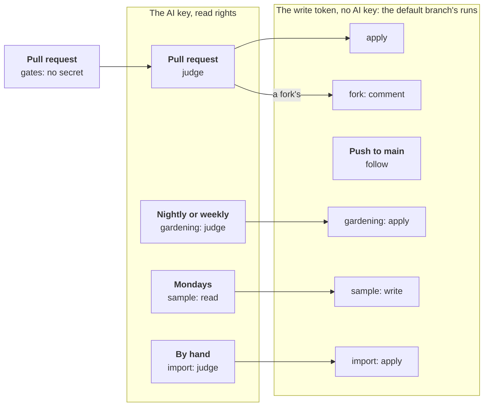

# workline on GitHub Actions

What the jobs are, on every forge: [ci.md](ci.md). This page sets them up
on GitHub. The agent's token reaches only the one step that calls it; a
fork's pull request gets no secret, so no agent and no write. The jobs that
write run the default branch's workflow, never a pull request's own
([ADR-0044](adr/0044-the-apps-key-stays-with-the-default-branchs-runs.md)).

## Set up

1. **Copy the workflows** into `.github/workflows/`:
   - [workline.yml](../ci/github/workline.yml): `judge` on each pull
     request, its own run: no write token; it warns when no workflow
     applies what it proposed. Before it, `gates` runs your gates alone:
     add the install of their tools there ([gates in CI](gates-in-ci.md)).
     On each push to `main`, `gates` runs main's line alone, its
     findings kept as the next base ([main after a merge](main-after-merge.md));
     rename `main` in its `push:` for another default branch.
   - [workline-warn.yml](../ci/github/workline-warn.yml): `warn` beside
     `judge`, the reviewer's lenses that only warn, apart from the
     verdict ([apart](../roles/reviewer/docs/apart.md)), and the
     inspector's triage, given what `gates` found: it waits for that job
     (`actions: read`) ([the triage in CI](gates-in-ci.md#the-inspectors-triage));
     without it, `judge` warns that nothing reads them; it reads only
     beside this release's workline-apply.yml, else warns.
   - [workline-apply.yml](../ci/github/workline-apply.yml), from the
     default branch:
     - `apply` after each `judge`, the fixes committed to the pull
       request's branch, and after each `warn`, the comment of the
       lenses that warn and the inspector's;
     - `main` after main's run: what it found, in one issue;
     - `follow` on each push to `main`: with `update-branches: conflicts`, `main` is merged
       into people's pull requests in conflict only on workline's lines
       ([more](../roles/documentalist/docs/follow.md));
     - with the [merge policy](merge-policy.md), `verdict` and `follow` run
       after `judge`, and `queue` after a merge queue's group;
     - rename `main` in its `push:` for another default branch.
   - [workline-merge.yml](../ci/github/workline-merge.yml), with the merge
     policy: `follow` on a label.
   - [workline-fork.yml](../ci/github/workline-fork.yml): comments a fork's
     pull request, which gets no secret and no right to write
     ([its gates](gates-in-ci.md#a-forks-pull-request)).
   - [workline-release.yml](../ci/github/workline-release.yml), with a
     release tool: runs the release pull request's check again when the
     label `workline:hold-release` changes, or main's runs end; list
     main's workflows in its `workflow_run`
     ([what holds a release](release-holds.md)).
   - [workline-gardening.yml](../ci/github/workline-gardening.yml):
     gardening, nightly while a backlog is caught up, then weekly; its
     `apply` runs every time, and then rebuilds on `main` the pull
     requests it opened before, or closes those with nothing left to merge
     ([ADR-0034, amended](adr/0034-the-release-fix-follows-its-base.md#amendment-2026-10-12-gardenings-merge-requests-follow-too-or-are-closed)).
     It runs **a release's dry run** too, `dry-run` then `dry-run-post`:
     what would hold the release if it were cut now, said in main's
     issue; no agent ([how](release.md)). The release never waits for
     the docs ([ADR-0051](adr/0051-a-check-sits-where-its-catch-is-worth-its-cost.md#cut-1-the-release-weekly)).
     **Upgrading**: delete a copied `workline-release-docs.yml`; its
     command is gone, and the job fails (exit 64).
   - [workline-sample.yml](../ci/github/workline-sample.yml): the
     [weekly sample](ci.md#the-weekly-sample), from the first release
     after v0.2.1.
2. **The agent's token**, if you want one: Settings → Secrets and variables
   → Actions → New repository secret. The templates call Claude when
   `CLAUDE_CODE_OAUTH_TOKEN` is set (`claude setup-token`), and no agent
   otherwise; for another agent, change their `--ai` to a `cmd:`.
3. **A GitHub App** commits the fixes, so the checks run again by
   themselves (with the job's own token, GitHub waits for someone to
   approve them): [set it up](ci-github-app.md) — variable
   `WORKLINE_APP_ID`, its key `WORKLINE_APP_PRIVATE_KEY` in the
   environment `workline-app`, which only the default branch may use.
4. **Protect main** (Settings → Rules): pull requests only, the `judge`
   check required (workline.yml's verdict). The review is on the pull
   request ([ADR-0011](adr/0011-the-review-is-on-the-merge-request-not-the-push.md)):
   an agent never merges. With the merge policy, `workline/accepted` from
   the App too. Leave "Require branches to be up to date" off: main's run
   says a red main ([ADR-0051](adr/0051-a-check-sits-where-its-catch-is-worth-its-cost.md#cut-2-strict-up-to-date-dropped)). A merge queue, on an organisation's repository: "Require
   merge queue" beside them ([a merge queue](merge-queue.md)).
5. **A private repository** without GitHub Advanced Security: remove the
   `upload-sarif` step of workline.yml, code scanning being paid there.

Then open a pull request changing code a doc describes: `judge` judges it,
and `apply`, with the App, commits the fix to its branch,
`Workline-Role: documentalist`.

## What the jobs may do

- `judge` reads the code and the pull request (`pull-requests: read`: the
  reviewer reads its own summary comment, to review only new commits,
  the one the App wrote, told by `WORKLINE_APP_ID`
  ([ADR-0051](adr/0051-a-check-sits-where-its-catch-is-worth-its-cost.md)));
  it writes only code scanning's SARIF, without the documentalist's and
  the reviewer's findings: a conversation each to resolve
  ([#412](https://github.com/JN0V/workline/issues/412)).
- `judge` reads issues, checks, statuses and actions too: on a release
  tool's pull request, what holds the release
  ([what holds a release](release-holds.md)).
- `judge` runs on a pull request opened, pushed to, reopened, and marked
  ready (`ready_for_review`). A draft asks no agent, `workline/verdict`
  pending until it is ready; opened ready or marked ready, the reviewer
  reads every lens once, on the whole change
  ([more](../roles/reviewer/docs/ready.md)). An edit runs nothing: after
  fixing a refused title, re-run `judge` or push
  ([the squash title](../roles/committer/docs/squash-title.md)).
- On a merge queue's group (`merge_group`), `gates` runs the gates on
  the merged result and `judge` gives their verdict: no agent, nothing
  applied; with the merge policy, `queue` sets the App's yes on the
  group's commit ([a merge queue](merge-queue.md)).
- **One `judge` per pull request at a time** (`concurrency`): a push
  cancels the run still on the head before; the newer run reviews its
  commits too, and `apply`, `verdict`, `follow` and the fork's comment skip
  a cancelled run ([#359](https://github.com/JN0V/workline/issues/359)).
  A cancelled run on ready leaves every lens to the next run.
- **One review at a time**: `judge` waits while `apply` writes the review
  before it, then reviews only what is new; `apply` writes it even once
  the branch moved on ([#375](https://github.com/JN0V/workline/issues/375)).
- **The lenses that warn, apart**: `warn`, its own run and lock, never
  fails by what they find; `verdict` and `follow` run after `judge` alone
  ([ADR-0050](adr/0050-each-act-has-its-moment-and-a-wait-budget.md#2-an-act-over-its-budget)).
- `apply`, `follow` and each pair's second job hold the write token, the
  App's when there is one, and no AI key, in the environment
  `workline-app`. `follow`'s merge into a pull request runs its checks
  again only with the App's token; the merge policy acts only with it,
  and needs "Allow auto-merge" (Settings → General).
- `apply` reads the pull request's run as data, only the agents'
  proposals ([more](commands.md#workline-apply)), whatever `judge`
  concluded: one the reviewer holds still gets its comment
  ([#226](https://github.com/JN0V/workline/issues/226)). Its job is in
  Actions, "workline apply"; the check is `judge`'s.
- `apply` posts the reviewer's findings on their lines, a pull request
  review (`pull-requests: write`); a token without it leaves them in the
  summary comment, said
  ([more](../roles/reviewer/docs/lines.md)).
- `apply` writes the documentalist's findings as the annotations of the
  check `workline findings`, the [gates'](gates-in-ci.md) as those of
  `workline gates` (`checks: write`; an App's **Checks**): beside their
  lines, none a conversation; a refusal, said.
- The product owner's issues: read when judging, write when applying —
  the gardening template gives both.
- A GitHub call that fails for a moment is tried again first, a write
  only when GitHub did not take it ([which](github/calls.md)).
- **The sample**: the judge is the repository variable `WORKLINE_JUDGE`,
  or the `sample.judge` setting; its reading job reads the issues and pull
  requests, for every role's acts. For another week than the last whole
  one, run the workflow by hand (Actions → workline sample → Run workflow)
  with its `week` input (`2026-W40`).
- **The summary**: each job's summary page (`$GITHUB_STEP_SUMMARY`), the
  applying job's saying what it did and what failed; a fork's pull request
  gets the judge's as a comment
  ([what a job shows](ci.md#what-a-job-shows)).

## Importing a file

A workflow run by hand (Actions → Run workflow), the steps that install the
engine and the agent as in workline-gardening.yml
([importing a file](ci.md#importing-a-file)): [the workflow](github/import-jobs.md).

## workline's own workflows

workline's .github/workflows/ are the templates, but for a gate and the
engine:

- `gates` installs golangci-lint, pinned by its SHA-256, for
  [the gate](../.workline/config.yaml);
- they build the engine from the commit they run on rather than run a
  release: gardening and the sample, both jobs, from `main`; a pull
  request's jobs, from its commit; workline-apply.yml's and
  workline-merge.yml's, from `main`'s commit, merged and reviewed: what a
  pull request changes in the engine never runs with the write token;
- once a commit ([the action](../.github/actions/engine/action.yml),
  [ADR-0050](adr/0050-each-act-has-its-moment-and-a-wait-budget.md#2-an-act-over-its-budget)):
  the first job on a commit builds it and keeps it in Actions' cache, the
  jobs after take it, nothing to build. Taken or built, it must name the
  commit checked out, unmodified, or the job fails. A pull request's runs
  keep theirs in its own cache, which `main`'s never read;
- no `merge_group`: a user's repository has no merge queue;
- test.yml runs the tests alone: main's whole-repository checks are
  `route main`'s, once a merge ([main after a merge](main-after-merge.md));
  gardening installs lychee, for the links to other sites, at night;
- a project never runs, in a commit's checks, the pin that commit ships: a
  pull request moving the templates to a version not yet tagged would
  download nothing, as on each release from v0.2.0 to v0.2.3
  ([ADR-0017](adr/0017-the-release-manager.md));

**How workline releases** ([ADR-0017](adr/0017-the-release-manager.md)),
with release-please, never a tag by hand:

- on each push to `main`, release-please.yml, with the App's token, keeps
  one pull request open, "chore(main): release X": the next version from
  the conventional commits since the last tag (`feat` moves the minor
  while workline is at 0.x, as a breaking change does), [CHANGELOG.md](../CHANGELOG.md), and
  the templates' `WORKLINE_VERSION` and the one in
  [gitlab-trigger.md](gitlab-trigger.md)'s example, each on a line marked
  `x-release-please-version` (release-please-config.json);
- the App's token, not the job's: a pull request opened with
  `GITHUB_TOKEN` starts no workflow, so its checks would never run;
- on that pull request, `judge` holds it while an open issue is labelled
  `workline:hold-release` or main's tip is not green, and builds the
  binary with GoReleaser: `workline version` must say the version it
  releases ([what holds a release](release-holds.md));
- on that pull request, `judge` passes its branch (`--branch`): it is
  judged as any other, the reviewer leaving the versions it bumps; no
  doc holds it
  ([ADR-0051](adr/0051-a-check-sits-where-its-catch-is-worth-its-cost.md#cut-1-the-release-weekly));
  release-please keeps it on `main` (`always-update`);
- the person merges it each Monday, sooner for a fix that touches a
  real user: that is the decision. release-please tags the
  merged commit `vX.Y.Z` and writes the release with its notes; in the
  same run, release.yml builds the binaries with GoReleaser, which uploads
  them and keeps the notes (`release.mode: keep-existing`), and pushes the
  image;
- a failed publish is run again from the Actions page, never tagged again:
  a tag pushed is never moved (the Go proxy keeps its first commit).
