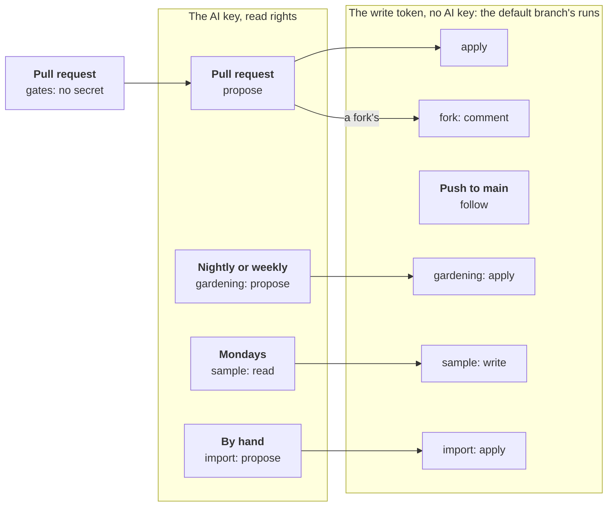

---
sources:
  - defaults/ci/github/workline.yml#name
  - defaults/ci/github/workline-warn.yml#name
  - defaults/ci/github/workline-apply.yml#name
  - defaults/ci/github/workline-apply.yml#on
  - defaults/ci/github/workline-merge.yml#name
  - defaults/ci/github/release-candidate.yml#on
  - defaults/ci/github/workline-fork.yml#name
  - defaults/ci/github/workline-release.yml#name
  - defaults/ci/github/workline-gardening.yml#on
  - defaults/ci/github/workline-gardening.yml#run-name
  - defaults/ci/github/workline-gardening.yml#jobs.apply.if
  - defaults/ci/github/workline-gardening.yml#jobs.dry-run.permissions
  - defaults/ci/github/workline-gardening.yml#jobs.curator.if
  - defaults/ci/github/workline-gardening.yml#jobs.dry-run-post.needs
  - defaults/ci/github/workline-gardening.yml#jobs.dry-run-post.permissions
  - defaults/ci/github/workline-objection.yml#name
  - defaults/ci/github/workline-answer.yml#name
  - defaults/ci/github/workline-develop.yml#name
  - defaults/ci/github/workline-bounds.yml#name
  - defaults/ci/github/workline-sample.yml#on
  - defaults/ci/github/workline-sample.yml#jobs.read.permissions
  - defaults/ci/github/workline-loop.yml#name
checked: 3f432ab14
verified: agent:claude-code
reader: fe1505d43360
---
# workline on GitHub Actions

What the jobs are, on every forge: [ci.md](ci.md). This page sets them up
on GitHub. A fork's pull request gets no secret, so no agent and no write.
The jobs that write run the default branch's workflow, never a pull
request's own
([ADR-0044](adr/0044-the-apps-key-stays-with-the-default-branchs-runs.md)).

> **Before December 2, 2026, on a public repository**: add an Active
> Actions event policy on `workline-bounds.yml` and `workline-merge.yml`
> allowing every event they run on, or no pull request merges
> ([how](github/pull-request-target.md)).

## Set up

1. **Copy the workflows** into `.github/workflows/`: those of
   [the pull requests](#the-pull-requests-workflows), and those of
   [the roles and the schedule](#the-roles-and-the-schedules-workflows)
   your line uses.
2. **The agent's token**, if you want one: Settings → Secrets and variables
   → Actions → New repository secret. The templates call Claude when
   `CLAUDE_CODE_OAUTH_TOKEN` is set (`claude setup-token`), and no agent
   otherwise; for another agent, change their `--ai` to a `cmd:`.
3. **A GitHub App** commits workline's fixes and opens its pull requests,
   so their checks run by themselves (with the job's own token, GitHub
   waits for someone to approve them): [set it up](ci-github-app.md) — variable
   `WORKLINE_APP_ID`, its key `WORKLINE_APP_PRIVATE_KEY` in the
   environment `workline-app`, which only the default branch may use.
4. **Protect main** (Settings → Rules): pull requests only, the `propose`
   check required (workline.yml's verdict); with the developer,
   `workline bounds` too, its source GitHub Actions. The review is on the pull
   request ([ADR-0011](adr/0011-the-review-is-on-the-merge-request-not-the-push.md)):
   an agent never merges. With the merge policy, `workline/accepted` from
   the App too. Leave "Require branches to be up to date" off: main's run
   says a red main ([ADR-0051](adr/0051-a-check-sits-where-its-catch-is-worth-its-cost.md#cut-2-strict-up-to-date-dropped)). A merge queue, on an organisation's repository: "Require
   merge queue" beside them ([a merge queue](merge-queue.md)).
5. **A private repository** without GitHub Advanced Security: remove the
   `upload-sarif` step of workline.yml, code scanning being paid there.

Then open a pull request changing code a doc describes: `propose` reads it,
and `apply`, with the App, posts the doc's fix in a comment, nothing
pushed to its branch.

## The pull requests' workflows

- [workline.yml](../defaults/ci/github/workline.yml): `propose` on each pull
  request, its own run: no write token. Before it, `gates` runs your
  gates alone: add the install of their tools there
  ([gates in CI](gates-in-ci.md)). On each push to `main`, `gates`
  runs main's line alone, its findings kept as the next base
  ([main after a merge](main-after-merge.md)).
- [workline-warn.yml](../defaults/ci/github/workline-warn.yml): `warn` beside
  `propose`, the reviewer's lenses that only warn, apart from the
  verdict ([apart](../roles/reviewer/docs/apart.md)), and the
  inspector's triage of what `gates` found, once that job is done
  ([the triage in CI](gates-triage.md)); without it, `propose` warns
  that nothing reads them.
- [workline-apply.yml](../defaults/ci/github/workline-apply.yml), from the
  default branch:
  - `apply` after each `propose`, the doc fixes in a comment, nothing
    pushed to the branch, and after each `warn`, the comment of the
    lenses that warn;
  - `main` after main's run: what it found, in one issue;
  - with the [merge policy](merge-policy.md), `verdict` and `follow` run
    after `propose`, and `queue` after a merge queue's group;
  - rename `main` in its `push:` for another default branch.
- [workline-merge.yml](../defaults/ci/github/workline-merge.yml), with the merge
  policy: `follow` on a label put or taken off, and hourly; at
  `normal` or above, on a demotion issue closed; at `enterprising`,
  on a release candidate's label and close too.
- [release-candidate.yml](../defaults/ci/github/release-candidate.yml), at
  `enterprising`: on each push to a candidate's branch `release/v*`
  ([the release candidate](release-candidate.md)).
- [workline-fork.yml](../defaults/ci/github/workline-fork.yml): comments a fork's
  pull request, which gets no secret and no right to write
  ([its gates](gates-fork.md)). With the merge policy, `follow` merges
  it on a person's yes, its checks green, never past
  [a fork's limits](merge-policy.md#never-without-a-persons-yes).
- [workline-release.yml](../defaults/ci/github/workline-release.yml), with a
  release tool: runs the release pull request's check again when the
  label `workline:hold-release` changes, or main's runs end; list
  main's workflows in its `workflow_run`
  ([what holds a release](release-holds.md)).

## The roles' and the schedule's workflows

- [workline-gardening.yml](../defaults/ci/github/workline-gardening.yml):
  gardening, weekly, Sunday 18:07 UTC, so that its pull request lands
  before Monday's workday though GitHub may start it hours late; each
  run named by its job, `workline gardening docs and backlog` there, as
  [the tick](tick.md#what-it-lists) reads them; its `apply` runs every
  time ([ADR-0034, amended](adr/0034-the-release-fix-follows-its-base.md#amendment-2026-10-12-gardenings-merge-requests-follow-too-or-are-closed)).
- The same workflow runs **a release's dry run** too, `dry-run` then `dry-run-post`:
  what would hold the release if it were cut now, said in main's
  issue ([how](release.md);
  [ADR-0051](adr/0051-a-check-sits-where-its-catch-is-worth-its-cost.md#cut-1-the-release-weekly)).
  With the variable `WORKLINE_CURATOR` set to `on`, its `curator`
  measures the test corpus, experimental: it may change after 1.0
  ([#264](https://github.com/JN0V/workline/issues/264);
  [how](../roles/tester/docs/curator.md),
  [removals](../roles/tester/docs/removals.md)).
- [workline-objection.yml](../defaults/ci/github/workline-objection.yml) and
  [workline-answer.yml](../defaults/ci/github/workline-answer.yml), with the
  tester: an objection to one of its tests, on its Draft's line, wakes
  its answer; the first notices it with no token, the second answers
  from the default branch ([tester](../roles/tester/docs/objections.md),
  [what each job holds](objection-jobs.md)). With the developer, the
  first also notices a person's reply in a thread on its pull request,
  whose end wakes the review round.
- [workline-develop.yml](../defaults/ci/github/workline-develop.yml), with the
  tester and the developer routed on `issue`: the line of states
  ([ADR-0059](adr/0059-an-issue-moves-by-its-state-each-step-wakes-the-next.md)),
  a person's label running the role an issue's state wakes, each step
  starting the next, an hourly reconciler
  ([its heartbeat](github/heartbeat.md), the environment
  `workline-heartbeat` to create); on its own pull request, the
  reviewer's verdict, the gates' report, a person's comment or a
  project workflow failed runs a review round
  ([the triggers](../roles/developer/docs/triggers.md)); your setup
  steps in `.github/actions/workline-setup/action.yml`
  ([the project's environment](../roles/developer/docs/triggers.md#the-projects-environment)).
- [workline-bounds.yml](../defaults/ci/github/workline-bounds.yml), with the
  developer: the check `workline bounds` on its pull requests, run from
  the default branch's copy, so a pull request cannot edit it out
  ([the bounds on the pull request](../roles/developer/docs/bounds.md#on-the-pull-request)).
- [workline-sample.yml](../defaults/ci/github/workline-sample.yml): the
  [weekly sample](ci.md#the-weekly-sample), on Mondays. It reads the
  tallies the line's jobs keep (`actions: read`;
  [tokens in CI](weekly-sample.md#what-it-writes)).
- [workline-loop.yml](../defaults/ci/github/workline-loop.yml),
  optional: the line's beat, `workline tick` every 3 minutes, one job
  after another all day; a dry run by default, it logs what it would
  start. The variable `WORKLINE_LOOP_DISPATCH=true` starts what it lists
  ([turn it on](tick.md#turn-dispatching-on)). On a private repository
  it bills about 1,440 runner minutes a day
  ([the GitHub loop](tick.md#the-github-loop)).

## What the jobs may do

Each job's permissions, one run at a time, the lenses apart, the sample and
the summary: [what the jobs may do](github/jobs.md).

## Importing a file

A workflow run by hand (Actions → Run workflow)
([importing a file](ci.md#importing-a-file)): [the workflow](github/import-jobs.md).

## workline's own workflows

Where they differ from the templates: [workline's own workflows](github/own-workflows.md).

## Public repositories and pull_request_target

From December 2, 2026, GitHub blocks `pull_request_target` by default in
public repositories: workline-bounds.yml and workline-merge.yml run on it,
and no pull request merges. An Actions event policy allows it; it is an
allow list, so it lists every event of the two files. What to set:
[pull_request_target](github/pull-request-target.md).
