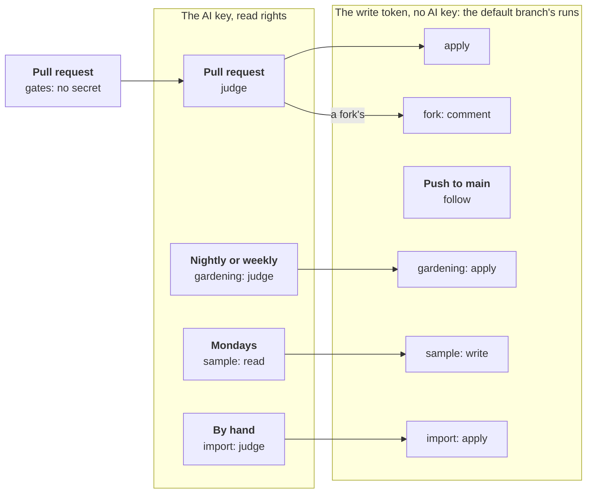

# workline on GitHub Actions

What the jobs are, on every forge: [ci.md](ci.md). This page sets them up
on GitHub. The agent's token reaches only the one step that calls it; a
fork's pull request gets no secret, so no agent and no write. The jobs that
write run the default branch's workflow, never a pull request's own
([ADR-0044](adr/0044-the-apps-key-stays-with-the-default-branchs-runs.md)).

## Set up

1. **Copy the workflows** into `.github/workflows/`:
   - [workline.yml](../ci/github/workline.yml): `judge` on each pull
     request, its own run: no write token; it warns when no workflow
     applies what it proposed. Before it, `gates` runs your gates alone:
     add the install of their tools there ([gates in CI](gates-in-ci.md)).
     On each push to `main`, `gates` runs main's line alone, its
     findings kept as the next base ([main after a merge](main-after-merge.md));
     rename `main` in its `push:` for another default branch.
   - [workline-warn.yml](../ci/github/workline-warn.yml): `warn` beside
     `judge`, the reviewer's lenses that only warn, apart from the
     verdict ([apart](../roles/reviewer/docs/apart.md)), and the
     inspector's triage, given what `gates` found: it waits for that job
     (`actions: read`) ([the triage in CI](gates-in-ci.md#the-inspectors-triage));
     without it, `judge` warns that nothing reads them; it reads only
     beside this release's workline-apply.yml, else warns.
   - [workline-apply.yml](../ci/github/workline-apply.yml), from the
     default branch:
     - `apply` after each `judge`, the doc fixes in a comment, nothing
       pushed to the branch, and after each `warn`, the comment of the
       lenses that warn and the inspector's;
     - `main` after main's run: what it found, in one issue;
     - with the [merge policy](merge-policy.md), `verdict` and `follow` run
       after `judge`, and `queue` after a merge queue's group;
     - rename `main` in its `push:` for another default branch.
   - [workline-merge.yml](../ci/github/workline-merge.yml), with the merge
     policy: `follow` on a label.
   - [workline-fork.yml](../ci/github/workline-fork.yml): comments a fork's
     pull request, which gets no secret and no right to write
     ([its gates](gates-in-ci.md#a-forks-pull-request)).
   - [workline-release.yml](../ci/github/workline-release.yml), with a
     release tool: runs the release pull request's check again when the
     label `workline:hold-release` changes, or main's runs end; list
     main's workflows in its `workflow_run`
     ([what holds a release](release-holds.md)).
   - [workline-gardening.yml](../ci/github/workline-gardening.yml):
     gardening, weekly, Sunday 18:07 UTC, so that its pull request lands
     before Monday's workday though GitHub may start it hours late; its
     `apply` runs every time, and then rebuilds on `main` the pull
     requests it opened before, or closes those with nothing left to merge
     ([ADR-0034, amended](adr/0034-the-release-fix-follows-its-base.md#amendment-2026-10-12-gardenings-merge-requests-follow-too-or-are-closed)).
     It runs **a release's dry run** too, `dry-run` then `dry-run-post`:
     what would hold the release if it were cut now, said in main's
     issue; no agent ([how](release.md)). The release never waits for
     the docs ([ADR-0051](adr/0051-a-check-sits-where-its-catch-is-worth-its-cost.md#cut-1-the-release-weekly)).
     With the variable `WORKLINE_CURATOR` set to `on`, its `curator`
     measures the test corpus, no agent, no write token
     ([how](../roles/tester/docs/curator.md)); with Claude's token, it
     proposes a few redundant tests removed, proven, and `apply` opens
     the pull request ([how](../roles/tester/docs/removals.md)).
     **Upgrading**: delete a copied `workline-release-docs.yml`; its
     command is gone, and the job fails (exit 64).
   - [workline-objection.yml](../ci/github/workline-objection.yml) and
     [workline-answer.yml](../ci/github/workline-answer.yml), with the
     tester: an objection to one of its tests, on its Draft's line, wakes
     its answer; the first notices it with no token, the second answers
     from the default branch ([tester](../roles/tester/README.md#frozen-tests-and-objections),
     [what each job holds](objection-jobs.md)).
   - [workline-develop.yml](../ci/github/workline-develop.yml), with the
     developer routed on `issue`: an issue labelled `workline:ready`
     runs it on that issue; its schedule is gardening's; a verdict or a
     person's comment on its own pull request, a review round
     ([the triggers](../roles/developer/docs/triggers.md)); your setup
     steps in `.github/actions/workline-setup/action.yml`
     ([the project's environment](../roles/developer/docs/triggers.md#the-projects-environment)).
   - [workline-bounds.yml](../ci/github/workline-bounds.yml), with the
     developer: the check `workline bounds` on its pull requests, run from
     the default branch's copy, so a pull request cannot edit it out
     ([the bounds on the pull request](../roles/developer/docs/bounds.md#on-the-pull-request)).
   - [workline-sample.yml](../ci/github/workline-sample.yml): the
     [weekly sample](ci.md#the-weekly-sample), from the first release
     after v0.2.1.
2. **The agent's token**, if you want one: Settings → Secrets and variables
   → Actions → New repository secret. The templates call Claude when
   `CLAUDE_CODE_OAUTH_TOKEN` is set (`claude setup-token`), and no agent
   otherwise; for another agent, change their `--ai` to a `cmd:`.
3. **A GitHub App** commits the fixes, so the checks run again by
   themselves (with the job's own token, GitHub waits for someone to
   approve them): [set it up](ci-github-app.md) — variable
   `WORKLINE_APP_ID`, its key `WORKLINE_APP_PRIVATE_KEY` in the
   environment `workline-app`, which only the default branch may use.
4. **Protect main** (Settings → Rules): pull requests only, the `judge`
   check required (workline.yml's verdict); with the developer,
   `workline bounds` too, its source GitHub Actions. The review is on the pull
   request ([ADR-0011](adr/0011-the-review-is-on-the-merge-request-not-the-push.md)):
   an agent never merges. With the merge policy, `workline/accepted` from
   the App too. Leave "Require branches to be up to date" off: main's run
   says a red main ([ADR-0051](adr/0051-a-check-sits-where-its-catch-is-worth-its-cost.md#cut-2-strict-up-to-date-dropped)). A merge queue, on an organisation's repository: "Require
   merge queue" beside them ([a merge queue](merge-queue.md)).
5. **A private repository** without GitHub Advanced Security: remove the
   `upload-sarif` step of workline.yml, code scanning being paid there.

Then open a pull request changing code a doc describes: `judge` judges it,
and `apply`, with the App, commits the fix to its branch,
`Workline-Role: documentalist`.

## What the jobs may do

Each job's permissions, one run at a time, the lenses apart, the sample and
the summary: [what the jobs may do](github/jobs.md).

## Importing a file

A workflow run by hand (Actions → Run workflow), the steps that install the
engine and the agent as in workline-gardening.yml
([importing a file](ci.md#importing-a-file)): [the workflow](github/import-jobs.md).

## workline's own workflows

Where they differ from the templates: [workline's own workflows](github/own-workflows.md).
