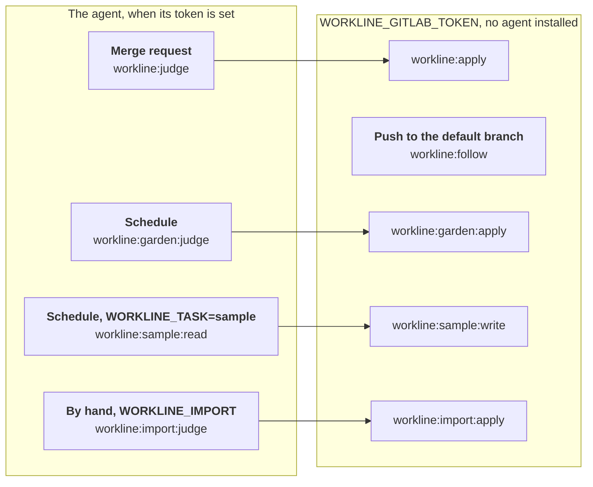

# workline on GitLab CI



What the jobs are, on every forge: [ci.md](ci.md). This page sets them up
on gitlab.com, then on a self-managed instance. A tool starting the
pipelines instead (trigger API, pipelines API, another pipeline):
[gitlab-trigger.md](gitlab-trigger.md).

GitLab gives every variable to every job: the template keeps the write
token out of the judging jobs' commands, not out of their reach — and
gardening's judge (the scheduled run) reads the open merge requests with
it. The agent is
installed only in the judging jobs.

## gitlab.com

### 1. Include the template

Copy [ci/gitlab/workline.gitlab-ci.yml](../ci/gitlab/workline.gitlab-ci.yml)
to `ci/` and add to `.gitlab-ci.yml`:

```yaml
stages: [test, deploy]
include: {local: ci/workline.gitlab-ci.yml}
```

### 2. The variables

Settings → CI/CD → Variables, **masked** and **not protected**: GitLab
gives a protected variable only to protected branches, never to a merge
request's. Anyone who may push a branch can read them from a pipeline they
change: people who may already write to the repository.

- **`WORKLINE_GITLAB_TOKEN`**: a project access token — a bot user of this
  project only ([ADR-0023](adr/0023-the-project-bot-keeps-a-gitlab-backlog.md))
  —, role Developer, scopes `api` and `write_repository`. One command makes
  it and stores it, never shown (glab, logged in as a Maintainer):

  ```sh
  glab token create workline --repo <group/project> --access-level developer \
    --scope api --scope write_repository --duration 8760h \
    | glab variable set WORKLINE_GITLAB_TOKEN --masked --repo <group/project>
  ```

  Or Settings → Access tokens → Add new token, the same role and scopes,
  then the variable. It expires within a year: rotate it the same way
  (`glab variable update`).
- **Where project access tokens are not offered** (GitLab documents them as
  Premium on gitlab.com; one was made on a Free user's project,
  2026-10-05): a personal access token, `api` and `write_repository`, of
  an account made for the line, added to the project as Developer. The
  job's own `CI_JOB_TOKEN` reaches no issue: it is never enough.
- **The agent's credentials**, if you want an agent to judge. The template
  installs Claude Code when `CLAUDE_CODE_OAUTH_TOKEN` is set (`claude
  setup-token`); unset, the jobs run with no agent. For another agent,
  change the template's `--ai` to a `cmd:`.

### 3. Gardening

Gardening is the scheduled run of the documentalist (and the product
owner, when routed): Build → Pipeline schedules → New schedule, nightly or
weekly, on main.

### 4. The weekly sample

The [weekly sample](ci.md#the-weekly-sample): a second schedule, weekly,
with the variable `WORKLINE_TASK` set to `sample`.

- A schedule's variables need Settings → CI/CD → Variables, "Minimum role
  to use pipeline variables", at **Maintainer**: a new gitlab.com project
  allows no one, and setting the variable is refused (403, "not authorized
  to set pipeline schedule variables").
- The judge: the variable `WORKLINE_JUDGE`, or the `sample.judge` setting.
  Another week than the last whole one: set `WORKLINE_SAMPLE_WEEK`
  (`2026-W40`) on the schedule, then play it.
- Its reading job holds `WORKLINE_GITLAB_TOKEN`, as gardening's does: it
  reads every role's acts on the issues and merge requests.

### 5. Protect main

Merge requests only, pipelines must succeed.

### 6. One pipeline per merge request

A push cancels the pipeline still judging the merge request's head before
([#359](https://github.com/JN0V/workline/issues/359)): `workline:judge` is
`interruptible`, the jobs that write are not. GitLab does it when:

- **Auto-cancel redundant pipelines** is checked (Settings → CI/CD →
  General pipelines), `workflow:auto_cancel:on_new_commit` left at its
  default, `conservative`;
- your own jobs in that pipeline are `interruptible: true` too: once one
  that is not has started, GitLab cancels nothing
  ([GitLab's docs](https://docs.gitlab.com/ci/yaml/#interruptible)).

One review at a time: `workline:judge` waits while `workline:apply` writes
the review before it, one resource group per merge request, then reviews
only what is new ([#375](https://github.com/JN0V/workline/issues/375)).

Not tried on a GitLab yet.

### When a schedule runs

gitlab.com runs a schedule at its own interval, not at the minute written:
a cron off the hour (`13 17 * * *`) was listed as due at 18:00 and ran at
18:08. Expect it within the hour after.

## What the template does

- **The whole history** (`GIT_DEPTH: 0`, over the project's "Git shallow
  clone" setting, 20 commits on a new project): the documentalist compares
  each doc's sources since its `checked`, the release looks for its last
  tag. A job set too shallow gets `shallow-clone`, never a pass.
- **A fork's merge request** runs in the fork, which has neither variable:
  judged without an agent, nothing applied or commented.
- **A judge that fails**: the applying jobs still run (`when: always`),
  the pipeline failed by the judge's job.
  - Gardening: what steps passed before one blocked is applied
    ([#142](https://github.com/JN0V/workline/issues/142)).
  - A merge request the reviewer holds still gets its comment
    ([#226](https://github.com/JN0V/workline/issues/226)).
  - An agent out of reach (3) warns (`allow_failure: {exit_codes: [3]}`),
    as on GitHub: a person judges what it would have.
- **`workline:follow`**, each push to the default branch, its bot's token,
  no agent: the documentalist's release merge request rebuilt on the new
  tip ([ADR-0034](adr/0034-the-release-fix-follows-its-base.md)); when set,
  the branch merged into people's merge requests in conflict only on
  workline's lines ([more](../roles/documentalist/docs/follow.md)), and the
  [merge policy](merge-policy.md), also after each judge (`workline:merge`).
- **`workline:garden:apply`** then rebuilds gardening's earlier merge
  requests, or closes those with nothing left to merge
  ([ADR-0034, amended](adr/0034-the-release-fix-follows-its-base.md#amendment-2026-10-12-gardenings-merge-requests-follow-too-or-are-closed)).
- **The summary** ([what a job shows](ci.md#what-a-job-shows)):
  `workline-summary.html`, linked from the job's page (its annotations)
  and, for a merge request, from the merge request's page (`expose_as`);
  `workline-summary.md` printed at the end of the log. Both kept a day as
  artifacts, a week for the applying jobs, which add what they applied to
  the judging job's. The HTML opens through GitLab Pages,
  on by default on gitlab.com; without Pages, the link downloads it.
  - Tried on gitlab.com (2026-10-06), the engine of the branch: a
    scheduled gardening job, the sample's read, and a gardening job
    started through the pipelines API each printed it, and the job's page
    linked the HTML, which Pages showed.
  - Not tried: a merge request's `expose_as` link, an applying job's page,
    a private project's Pages preview, a self-managed instance.
- **The reviewer** ([ADR-0020](adr/0020-the-reviewer-finds-the-engine-verifies-the-person-merges.md)):
  - the judging job reads its summary comment to review only new commits;
    `CI_JOB_TOKEN` may not read a merge request's notes, so give
    `GITLAB_TOKEN` (`read_api`), or each push reviews the whole merge request
    again, said (`record-unread`);
  - the applying job posts each finding as a discussion on its line, with
    `WORKLINE_GITLAB_TOKEN`
    ([more](../roles/reviewer/docs/lines.md));
  - marking a draft ready starts no pipeline: the next one, a push or
    **Run pipeline**, has every lens read the whole change once
    ([how](../roles/reviewer/docs/ready.md); not tried on
    a GitLab yet).
- **The documentalist** reads, with the same `GITLAB_TOKEN`, the records
  its note keeps instead of commits; else it commits them, said
  (`record-unread`, [more](../roles/documentalist/docs/push.md#a-doc-found-with-nothing-to-fix-no-commit)).

## The product owner

`WORKLINE_GITLAB_TOKEN`'s `api` scope covers its issues
([ADR-0023](adr/0023-the-project-bot-keeps-a-gitlab-backlog.md)):

its token's role, who is of the project, and on GitLab Free what an issue waits on: [gitlab/product-owner.md](gitlab/product-owner.md).

**Importing a file** ([how it works](ci.md#importing-a-file)): a pipeline
run by hand (Build → Pipelines → Run pipeline, the variable
`WORKLINE_IMPORT` the file), beside the template;
`WORKLINE_GITLAB_READ_TOKEN`, `read_api`, Reporter
([its variables](gitlab-trigger.md#tokens-and-variables)):

the two jobs to add are in [gitlab/import-jobs.md](gitlab/import-jobs.md).

## A self-managed GitLab

As on gitlab.com, with what an instance of your own changes — the image,
your certificate authority, the address, the agent, tokens:
[ci-gitlab-self-managed.md](ci-gitlab-self-managed.md). Not tried yet.
