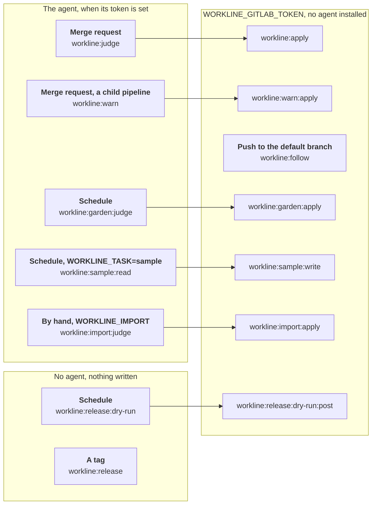

# workline on GitLab CI



What the jobs are, on every forge: [ci.md](ci.md). This page sets them up
on gitlab.com, then on a self-managed instance. A tool starting the
pipelines instead (trigger API, pipelines API, another pipeline):
[gitlab-trigger.md](gitlab-trigger.md).

GitLab gives a variable to every job unless it is scoped to an
environment: the template's jobs holding a token declare `workline`,
those running your tools none ([the environment](gitlab/environment.md)).
Among the others, it keeps the write token out of the judging jobs'
commands, not out of their reach — gardening's judge (the scheduled run)
reads the open merge requests with it. The agent is installed only in
the judging jobs.

## gitlab.com

### 1. Include the template

Copy [ci/gitlab/workline.gitlab-ci.yml](../ci/gitlab/workline.gitlab-ci.yml)
to `ci/` and add to `.gitlab-ci.yml`:

```yaml
stages: [test, deploy]
include: {local: ci/workline.gitlab-ci.yml}
```

Keep that path: `workline:warn:child` starts the same file as a child
pipeline. Elsewhere, change its `include` too.

### 2. The variables

Settings → CI/CD → Variables, **masked**, **not protected**, and scoped
to the environment **`workline`**:

- **Not protected**: GitLab gives a protected variable only to protected
  branches, never to a merge request's. Anyone who may push a branch can
  read them from a pipeline they change: people who may already write to
  the repository.
- **Environment `workline`** (each one's *Environments*): only the jobs
  that hold a token get it, never those running your linters
  ([why and how](gitlab/environment.md)). `workline doctor` warns of one
  left to every environment.
- **`WORKLINE_GITLAB_TOKEN`**: a project access token — a bot user of this
  project only ([ADR-0023](adr/0023-the-project-bot-keeps-a-gitlab-backlog.md))
  —, role Developer, scopes `api` and `write_repository`. One command makes
  it and stores it, never shown (glab, logged in as a Maintainer):

  ```sh
  glab token create workline --repo <group/project> --access-level developer \
    --scope api --scope write_repository --duration 8760h \
    | glab variable set WORKLINE_GITLAB_TOKEN --masked --scope workline --repo <group/project>
  ```

  Or Settings → Access tokens → Add new token, the same role and scopes,
  then the variable. It expires within a year: rotate it the same way
  (`glab variable update`).
- **Where project access tokens are not offered** (GitLab documents them as
  Premium on gitlab.com; one was made on a Free user's project,
  2026-10-05): a personal access token, `api` and `write_repository`, of
  an account made for the line, added to the project as Developer. The
  job's own `CI_JOB_TOKEN` reaches no issue: it is never enough.
- **The agent's credentials**, if you want an agent to judge, scoped to
  `workline` too. The template installs Claude Code when
  `CLAUDE_CODE_OAUTH_TOKEN` is set (`claude setup-token`); unset, the
  jobs run with no agent. For another agent, change the template's
  `--ai` to a `cmd:`.

### 3. Gardening

Gardening is the scheduled run of the documentalist (and the product
owner, when routed): Build → Pipeline schedules → New schedule, weekly on
main, Sunday evening (`7 18 * * 0`), so that its merge request lands before
Monday's workday. The release never waits for the docs
([ADR-0051](adr/0051-a-check-sits-where-its-catch-is-worth-its-cost.md#cut-1-the-release-weekly)).

- **A release's dry run**, on the schedule:
  `workline:release:dry-run`, no agent, no token, then
  `workline:release:dry-run:post`, the bot's token: what would hold the
  release if it were cut now, in main's issue ([how](release.md)).
- **Upgrading**: delete a schedule with `WORKLINE_TASK=release-docs`,
  left from an older template; it runs nothing now.

### 4. The weekly sample

The [weekly sample](ci.md#the-weekly-sample): a second schedule, weekly,
with the variable `WORKLINE_TASK` set to `sample`.

- A schedule's variables need Settings → CI/CD → Variables, "Minimum role
  to use pipeline variables", at **Maintainer**: a new gitlab.com project
  allows no one, and setting the variable is refused (403, "not authorized
  to set pipeline schedule variables").
- The judge: the variable `WORKLINE_JUDGE`, or the `sample.judge` setting.
  Another week than the last whole one: set `WORKLINE_SAMPLE_WEEK`
  (`2026-W40`) on the schedule, then play it.
- Its reading job holds `WORKLINE_GITLAB_TOKEN`, as gardening's does: it
  reads every role's acts on the issues and merge requests.

### 5. Protect main

Merge requests only, pipelines must succeed.

### 6. One pipeline per merge request

A push cancels the pipeline still judging the merge request's head before
([#359](https://github.com/JN0V/workline/issues/359)): `workline:judge` is
`interruptible`, the jobs that write are not. GitLab does it when:

- **Auto-cancel redundant pipelines** is checked (Settings → CI/CD →
  General pipelines), `workflow:auto_cancel:on_new_commit` left at its
  default, `conservative`;
- your own jobs in that pipeline are `interruptible: true` too: once one
  that is not has started, GitLab cancels nothing
  ([GitLab's docs](https://docs.gitlab.com/ci/yaml/#interruptible)).

One review at a time: `workline:judge` waits while `workline:apply` writes
the review before it, one resource group per merge request, then reviews
only what is new ([#375](https://github.com/JN0V/workline/issues/375));
`workline:warn` and `workline:warn:apply` likewise, in a resource group of
their own.

- **Two applies waiting** may start in either order: GitLab's resource
  groups default to `unordered`, and workline sets nothing there.
- **The comment says which run wrote it**: the reviewer's and the
  inspector's name the head and the pipeline (`CI_PIPELINE_ID`) their
  run read, hidden.
- **An older pipeline's apply, run last**, keeps the newer comment's text
  and merges only its record into it
  ([#598](https://github.com/JN0V/workline/issues/598)).

Not tried on a GitLab yet.

### At a release's tag

`workline:release` runs on a tag pipeline: the release's line, no
agent, no token, red when it holds the release. Have your jobs that
publish need it (`needs: [workline:release]`)
([how](release.md#at-a-tag-on-gitlab)).

A release tool's merge request is held while an open issue is labelled
`workline:hold-release` or main's pipeline is not green. No pipeline
starts on a label: run `workline:judge` again once it is off
([what holds a release](release-holds.md)).

### When a schedule runs

gitlab.com runs a schedule at its own interval, not at the minute written:
a cron off the hour (`13 17 * * *`) was listed as due at 18:00 and ran at
18:08. Expect it within the hour after.

## What the template does

- `workline:gates` runs your gates alone, before `workline:judge`, and
  writes what they found the change adds as its Code Quality report;
  install their tools in it ([gates in CI](gates-in-ci.md)). No token:
  `workline:base`, before it, reads the merge base's findings
  ([the environment](gitlab/environment.md)). In a merge train's
  pipeline, they are workline's only jobs; a merged results pipeline
  runs them all ([a merge train](merge-queue.md#gitlab-a-merge-train)).
- **The reviewer's lenses that only warn** read apart from the verdict
  ([apart](../roles/reviewer/docs/apart.md)):
  - `workline:judge` asks those that block (`--warn-apart`; without
    `WORKLINE_GITLAB_TOKEN`, every lens, said in its log and summary).
  - `workline:warn`, with the agent's token and the bot's, asks the
    others (`--warn-only`), and the inspector's triage given the gates'
    `gates.json` ([the triage in CI](gates-in-ci.md#the-inspectors-triage));
    `workline:warn:apply` posts them, each in a comment of its own.
  - **Both in a child pipeline**, `workline:warn:child`, started after
    `workline:gates` whatever its verdict, with no `strategy`: "merge
    when the pipeline succeeds" waits for `allow_failure` jobs too, never
    for a child
    ([ADR-0051](adr/0051-a-check-sits-where-its-catch-is-worth-its-cost.md#4-also)).
  - The child gets the merge request's `CI_MERGE_REQUEST_*` variables and
    the tokens scoped to `workline`. `workline:warn` reads `gates.json`
    from the merge request's pipeline with the bot's token: GitLab's
    `needs:pipeline:job` gives no failed job's artifacts.
  - `workline:merge` reads the verdict from `workline:judge` alone.
- **The whole history** (`GIT_DEPTH: 0`, over the project's "Git shallow
  clone" setting, 20 commits on a new project): the documentalist compares
  each doc's sources since its `checked`, the release looks for its last
  tag. A job set too shallow gets `shallow-clone`, never a pass.
- **A fork's merge request** runs in the fork, which has neither variable:
  judged without an agent, nothing applied or commented
  ([its gates](gates-in-ci.md#a-forks-pull-request)).
- **A judge that fails**: the applying jobs still run (`when: always`),
  the pipeline failed by the judge's job.
  - Gardening: what steps passed before one blocked is applied
    ([#142](https://github.com/JN0V/workline/issues/142)).
  - A role that blocks still posts its comments, the reviewer's as the
    documentalist's ([`on-block`](spec/role-contract.md#one-run)).
  - An agent out of reach (3) warns (`allow_failure: {exit_codes: [3]}`),
    as on GitHub: a person judges what it would have; a GitLab call is
    tried again first ([which](gitlab/calls.md)).
- **`workline:follow`**, each push to the default branch, its bot's token,
  no agent: the [merge policy](merge-policy.md), when set, also after
  each judge (`workline:merge`).
- **`workline:main`**, each push to the default branch, no token, no
  agent: the gates, their findings kept in its artifacts as the next base
  `workline:gates` reads, and the whole repository's checks;
  `workline:main:issue`, the bot's token, keeps what it found in one issue
  ([main after a merge](main-after-merge.md#gitlab)).
- **`workline:garden:apply`** then rebuilds gardening's earlier merge
  requests, or closes those with nothing left to merge
  ([ADR-0034, amended](adr/0034-the-release-fix-follows-its-base.md#amendment-2026-10-12-gardenings-merge-requests-follow-too-or-are-closed)).
- **The summary** ([what a job shows](ci.md#what-a-job-shows)):
  `workline-summary.html`, linked from the job's page (its annotations)
  and, for a merge request, from the merge request's page (`expose_as`);
  `workline-summary.md` printed at the end of the log. Both kept a day as
  artifacts, a week for the applying jobs, which add what they applied to
  the judging job's. The HTML opens through GitLab Pages,
  on by default on gitlab.com; without Pages, the link downloads it.
  - Tried on gitlab.com (2026-10-06), the engine of the branch: a
    scheduled gardening job, the sample's read, and a gardening job
    started through the pipelines API each printed it, and the job's page
    linked the HTML, which Pages showed.
  - Not tried: a merge request's `expose_as` link, an applying job's page,
    a private project's Pages preview, a self-managed instance.
- **The reviewer** ([ADR-0020](adr/0020-the-reviewer-finds-the-engine-verifies-the-person-merges.md)):
  - the judging job reads its summary comment to review only new commits,
    with `CI_JOB_TOKEN`: the notes alone, never the project's members,
    which that token may not list (401,
    [#552](https://github.com/JN0V/workline/issues/552)); a comment it
    cannot read is said (`record-unread`), and the push reviews the whole
    merge request again;
  - the applying job posts each finding as a discussion on its line, with
    `WORKLINE_GITLAB_TOKEN`
    ([more](../roles/reviewer/docs/lines.md));
  - a draft's pipelines ask no agent; marking it ready starts no
    pipeline: the next one, a push or **Run pipeline**, has every lens
    read the whole change once, as the draft's summary says
    ([how](../roles/reviewer/docs/ready.md); not tried on a GitLab yet).
- **The documentalist** reads the records its note keeps instead of
  commits ([more](../roles/documentalist/docs/push.md#a-doc-found-with-nothing-to-fix-no-commit)):
  - only a note workline's own account wrote: `WORKLINE_GITLAB_TOKEN`'s
    user, as GitLab says, or one named in `gitlab: {bots: [<username>]}`
    in `.workline/config.yaml`
    ([ADR-0051](adr/0051-a-check-sits-where-its-catch-is-worth-its-cost.md));
    the reviewer and the inspector read theirs so too;
  - nor one a Maintainer edited last: GitLab says who in GraphQL
    (`lastEditedBy`), which `WORKLINE_GITLAB_TOKEN` may ask and a job's
    own token may not; unasked, no record is read, said
    (`record-unread`);
  - a note carrying its marker that another wrote, a person of the
    project's too: not read, its docs judged again, said
    (`record-unread`);
  - a note it cannot read: it commits the records, said (`record-unread`).

## The product owner

`WORKLINE_GITLAB_TOKEN`'s `api` scope covers its issues
([ADR-0023](adr/0023-the-project-bot-keeps-a-gitlab-backlog.md)):

its token's role, who is of the project, and on GitLab Free what an issue waits on: [gitlab/product-owner.md](gitlab/product-owner.md).

**Importing a file** ([how it works](ci.md#importing-a-file)): a pipeline
run by hand (Build → Pipelines → Run pipeline, the variable
`WORKLINE_IMPORT` the file), beside the template;
`WORKLINE_GITLAB_READ_TOKEN`, `read_api`, Reporter
([its variables](gitlab-trigger.md#tokens-and-variables)):

the two jobs to add are in [gitlab/import-jobs.md](gitlab/import-jobs.md).

## A project that refuses unsigned commits

The push rule *Reject unsigned commits* refuses the bot's pushes too:
give it an SSH key, the File variable `WORKLINE_SIGNING_KEY`, and the
template signs its commits ([how](gitlab/signed-commits.md)).

## A self-managed GitLab

As on gitlab.com, with what an instance of your own changes — the image,
your certificate authority, the address, the agent, tokens:
[ci-gitlab-self-managed.md](ci-gitlab-self-managed.md). Not tried yet.
