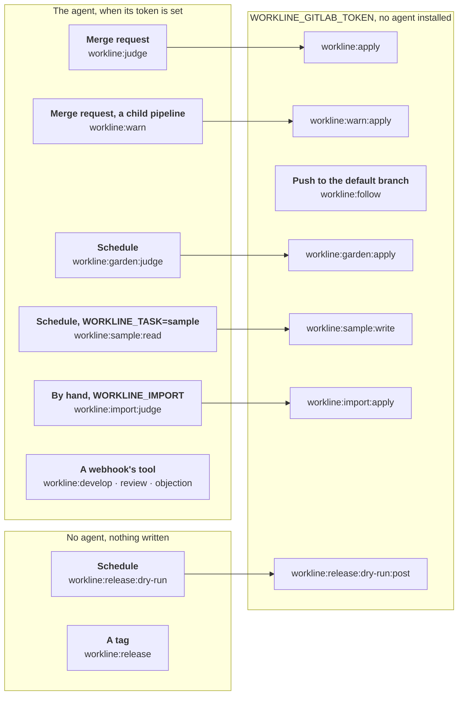

# workline on GitLab CI



What the jobs are, on every forge: [ci.md](ci.md). This page sets them up
on gitlab.com, then on a self-managed instance. A tool starting the
pipelines instead (trigger API, pipelines API, another pipeline):
[gitlab-trigger.md](gitlab-trigger.md).

GitLab gives a variable to every job unless it is scoped to an
environment: the template's jobs holding a token declare `workline`,
those running your tools none ([the environment](gitlab/environment.md)).
Among the others, it keeps the write token out of the judging jobs'
commands, not out of their reach — gardening's judge (the scheduled run)
reads the open merge requests with it. The agent is installed only in
the judging jobs.

## gitlab.com

### 1. Include the template

Copy [ci/gitlab/workline.gitlab-ci.yml](../ci/gitlab/workline.gitlab-ci.yml)
to `ci/` and add to `.gitlab-ci.yml`:

```yaml
stages: [test, deploy]
include: {local: ci/workline.gitlab-ci.yml}
```

Keep that path: `workline:warn:child` starts the same file as a child
pipeline. Elsewhere, change its `include` too.

### 2. The variables

Settings → CI/CD → Variables, **masked**, **not protected**, and scoped
to the environment **`workline`**:

- **Not protected**: GitLab gives a protected variable only to protected
  branches, never to a merge request's. Anyone who may push a branch can
  read them from a pipeline they change: people who may already write to
  the repository.
- **Environment `workline`** (each one's *Environments*): only the jobs
  that hold a token get it, never those running your linters
  ([why and how](gitlab/environment.md)). `workline doctor` warns of one
  left to every environment.
- **`WORKLINE_GITLAB_TOKEN`**: a project access token — a bot user of this
  project only ([ADR-0023](adr/0023-the-project-bot-keeps-a-gitlab-backlog.md))
  —, role Developer, scopes `api` and `write_repository`. One command makes
  it and stores it, never shown (glab, logged in as a Maintainer):

  ```sh
  glab token create workline --repo <group/project> --access-level developer \
    --scope api --scope write_repository --duration 8760h \
    | glab variable set WORKLINE_GITLAB_TOKEN --masked --scope workline --repo <group/project>
  ```

  Or Settings → Access tokens → Add new token, the same role and scopes,
  then the variable. It expires within a year: rotate it the same way
  (`glab variable update`).
- **Where project access tokens are not offered** (GitLab documents them as
  Premium on gitlab.com; one was made on a Free user's project,
  2026-10-05): a personal access token, `api` and `write_repository`, of
  an account made for the line, added to the project as Developer. The
  job's own `CI_JOB_TOKEN` reaches no issue: it is never enough.
- **The agent's credentials**, if you want an agent to judge, scoped to
  `workline` too. The template installs Claude Code when
  `CLAUDE_CODE_OAUTH_TOKEN` is set (`claude setup-token`); unset, the
  jobs run with no agent. For another agent, change the template's
  `--ai` to a `cmd:`.

### 3. Gardening

Gardening is the scheduled run of the documentalist (and the product
owner, when routed): Build → Pipeline schedules → New schedule, weekly on
main, Sunday evening (`7 18 * * 0`), so that its merge request lands before
Monday's workday. The release never waits for the docs
([ADR-0051](adr/0051-a-check-sits-where-its-catch-is-worth-its-cost.md#cut-1-the-release-weekly)).

- **A release's dry run**, on the schedule:
  `workline:release:dry-run`, no agent, no token, then
  `workline:release:dry-run:post`, the bot's token: what would hold the
  release if it were cut now, in main's issue ([how](release.md)).
- **The test corpus's measures**, opt-in (`WORKLINE_CURATOR=on`):
  `workline:curator`, no agent, no token; its image needs your test
  runner ([how](../roles/tester/docs/curator.md)). With Claude's token,
  `workline:curator:judge` and `:apply` propose a few redundant tests
  removed, proven ([how](../roles/tester/docs/removals.md)).
- **Upgrading**: delete a schedule with `WORKLINE_TASK=release-docs`,
  left from an older template; it runs nothing now.

### 4. The weekly sample

The [weekly sample](ci.md#the-weekly-sample): a second schedule, weekly,
with the variable `WORKLINE_TASK` set to `sample`.

- A schedule's variables need Settings → CI/CD → Variables, "Minimum role
  to use pipeline variables", at **Maintainer**: a new gitlab.com project
  allows no one, and setting the variable is refused (403, "not authorized
  to set pipeline schedule variables").
- The judge: the variable `WORKLINE_JUDGE`, or the `sample.judge` setting.
  Another week than the last whole one: set `WORKLINE_SAMPLE_WEEK`
  (`2026-W40`) on the schedule, then play it.
- Its reading job holds `WORKLINE_GITLAB_TOKEN`, as gardening's does: it
  reads every role's acts on the issues and merge requests.

### 5. Protect main

Merge requests only, pipelines must succeed.

### 6. One pipeline per merge request

Check **Auto-cancel redundant pipelines** (Settings → CI/CD → General
pipelines), your own jobs `interruptible: true`; one review at a time
([how](gitlab/one-pipeline.md)).

### At a release's tag

`workline:release` runs on a tag pipeline: the release's line, no
agent, no token, red when it holds the release. Have your jobs that
publish need it (`needs: [workline:release]`)
([how](release.md#at-a-tag-on-gitlab)).

A release tool's merge request is held while an open issue is labelled
`workline:hold-release` or main's pipeline is not green. No pipeline
starts on a label: run `workline:judge` again once it is off
([what holds a release](release-holds.md)).

### When a schedule runs

gitlab.com runs a schedule at its own interval, not at the minute written:
a cron off the hour (`13 17 * * *`) was listed as due at 18:00 and ran at
18:08. Expect it within the hour after.

## What the template does

Each job, what it reads and writes, the summary, and how the reviewer
and the documentalist read their records:
[what the template does](gitlab/template.md).

## The product owner

`WORKLINE_GITLAB_TOKEN`'s `api` scope covers its issues
([ADR-0023](adr/0023-the-project-bot-keeps-a-gitlab-backlog.md)):

its token's role, who is of the project, and on GitLab Free what an issue waits on: [gitlab/product-owner.md](gitlab/product-owner.md).

**Importing a file** ([how it works](ci.md#importing-a-file)): a pipeline
run by hand (Build → Pipelines → Run pipeline, the variable
`WORKLINE_IMPORT` the file), beside the template;
`WORKLINE_GITLAB_READ_TOKEN`, `read_api`, Reporter
([its variables](gitlab-trigger.md#tokens-and-variables)):

the two jobs to add are in [gitlab/import-jobs.md](gitlab/import-jobs.md).

## The tester and the developer

Their runs, objections and review rounds: [on GitLab](gitlab/tester-developer.md).

## A project that refuses unsigned commits

The push rule *Reject unsigned commits* refuses the bot's pushes too:
give it an SSH key, the File variable `WORKLINE_SIGNING_KEY`, and the
template signs its commits ([how](gitlab/signed-commits.md)).

## A self-managed GitLab

As on gitlab.com, with what an instance of your own changes — the image,
your certificate authority, the address, the agent, tokens:
[ci-gitlab-self-managed.md](ci-gitlab-self-managed.md). Not tried yet.
