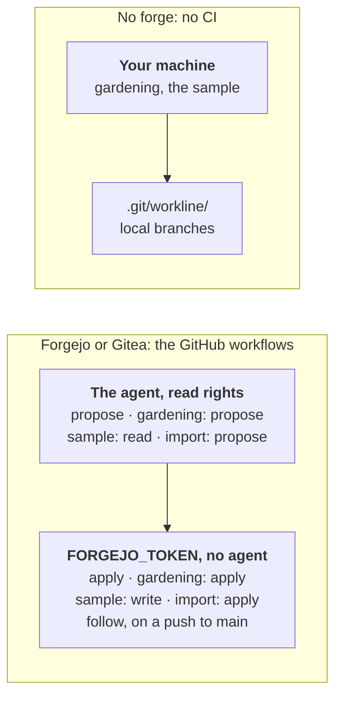

---
sources:
  - defaults/ci/github/workline.yml#jobs.propose.permissions
  - defaults/ci/github/workline.yml#jobs.propose.env
  - defaults/ci/github/workline-apply.yml#jobs.apply.permissions
  - defaults/ci/github/workline-gardening.yml#jobs.propose.permissions
  - defaults/ci/github/workline-gardening.yml#jobs.propose.env
  - defaults/ci/github/workline-gardening.yml#jobs.apply.permissions
  - defaults/ci/github/workline-sample.yml#jobs.read.permissions
  - defaults/ci/github/workline-sample.yml#jobs.read.env
  - defaults/ci/github/workline-sample.yml#jobs.write.permissions
  - defaults/ci/github/workline-apply.yml#on
  - defaults/ci/github/workline-apply.yml#jobs.follow.if
  - docs/github/import-jobs.md
  - internal/forge/local.go#Local
checked: b2a36983f
judged: cd97f28
verified: agent:claude-code
---
# workline on another forge, or none

What the jobs are, on every forge: [ci.md](ci.md). GitHub and GitLab are
spoken natively: [ci-github.md](ci-github.md), [ci-gitlab.md](ci-gitlab.md).

## Gitea, Forgejo, Codeberg…

- **Plugged by a command** that answers a small contract
  ([forge-command.md](spec/forge-command.md)); Forgejo and Gitea have
  one ready: [workline on Forgejo](ci-forgejo.md).

## No forge

- **`forge: local`** keeps issues and merge requests in the clone:
  [workline with no forge](no-forge.md).
