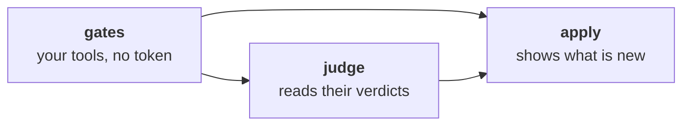

# Gates in CI

Your [gates](spec/gates.md) run your own linters and scanners. In CI
they run in a job of their own, before the line is judged
([ADR-0049](adr/0049-the-inspector-judges-the-new-findings-of-the-projects-tools.md)).
The templates need the first release after v0.35.0.

## The job

- **No write token, no secret**: the tools run the merge request's code,
  a linter's config, a plugin, a build. On GitHub the job holds a read
  token, and its checkout keeps none.
- **Its tools are yours to install**: in the job `gates`, pinned and
  checksum verified, before `workline route`. On GitLab, in
  `workline:gates`'s `before_script`, or give it your image with
  workline in it.
- **The judge reads their verdicts** (`--gates-from`): the line never
  runs a gate beside the agent's token. A verdict missing is an error,
  never a pass.
- **A gate that does not pass** fails the job `gates`, and the judge.
- **No gate in `.workline/config.yaml`**: the job ends at once.

## On GitHub

The job applying the run, in workline-apply.yml, shows what the gates
found the change adds:

- **Beside each line**: the annotations of the check `workline gates`,
  on the head judged. None is a conversation to resolve. Its title gives
  the count; past 500, the rest are counted, not written.
- **One summary comment**, edited on each push: a row per check, its new
  findings and those there before; a line per rule, its first places. It
  lists as many rules as the reviewer's `findings-max` (10).
- **Nothing new, nothing posted**: no check, no comment. A comment an
  earlier push left says "no new finding".
- **A formatter's check** (`fix:` set): its command is said once, rather
  than one annotation per line.
- **Not code scanning**: paid on private repositories, and a
  conversation per alert.
- **A fork's pull request**: nothing is applied; the gates' verdicts are
  in the report workline-fork.yml comments.
- **The branch moved on** before the apply: nothing shown, and said; the
  next run shows its own.

## On GitLab

- **The job's Code Quality report** holds the findings the change adds,
  each as severe as its tool says. The merge request's widget shows it on
  every tier; Ultimate puts each beside its line.
- **GitLab compares it** with the report of the target branch's pipeline
  at the merge base, which holds none of these: each shows as new. With
  no pipeline there, the widget shows nothing.
- **Each fingerprint holds no line number**: a finding that only moves
  keeps it.
- **The variables**: GitLab gives every job the project's. The job unsets
  the agent's token and the project bot's before the gates run; whoever
  may push a branch can still read them
  ([ADR-0044](adr/0044-the-apps-key-stays-with-the-default-branchs-runs.md)).
  A fork's merge request runs in the fork, which has neither.
- **Its summary** is `gates-summary.html`, linked from its page: the
  judge writes its own.
- **One more job a pipeline**, and its minutes.
