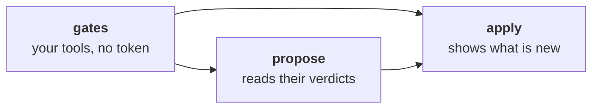

---
sources:
  - defaults/ci/github/workline.yml#jobs.gates
  - defaults/ci/github/workline.yml#jobs.propose.needs
  - defaults/ci/github/workline.yml#jobs.propose.if
  - defaults/ci/gitlab/workline.gitlab-ci.yml#workline:gates
  - defaults/ci/gitlab/workline.gitlab-ci.yml#workline:propose.rules
  - defaults/ci/gitlab/workline.gitlab-ci.yml#workline:main
  - tests/conformance/cases/gates/line-reads-the-gates-job.yaml
  - tests/conformance/cases/gates/line-without-the-gates-job-errs.yaml
  - tests/conformance/cases/gates/base-kept-on-main-read.yaml
  - tests/conformance/cases/gates/base-not-kept-run-again.yaml
checked: e2e165c2d
judged: 14c41d9
verified: agent:claude-code
---
# Gates in CI

Your [gates](spec/gates.md) run your own linters and scanners. In CI
they run in a job of their own, before the line is judged
([ADR-0049](adr/0049-the-inspector-judges-the-new-findings-of-the-projects-tools.md)).
The templates need the first release after v0.35.0.

## The job

- **No write token, no secret**: the tools run the merge request's code,
  a linter's config, a plugin, a build. On GitHub the job holds a read
  token, and its checkout keeps none.
- **Its tools are yours to install**: in the job `gates`, pinned and
  checksum verified, before `workline route`; workline's own installs
  golangci-lint so ([workline's workflows](github/own-workflows.md)).
  On GitLab, in `workline:gates`'s `before_script`, or give it your
  image with workline in it.
- **The propose job reads their verdicts** (`--gates-from`): the line never
  runs a gate beside the agent's token. A verdict missing is an error,
  never a pass.
- **A gate that does not pass** fails the job `gates`, and the propose job.
- **No gate in `.workline/config.yaml`**: the job ends at once.
- **In a merge queue or train**: the same job runs the gates on the
  merged result; on GitHub the propose job gives their verdict, on GitLab the
  job alone runs ([how](merge-queue.md)).
- **On main after a merge**: the same job runs them on the new tip,
  every finding kept by the commit where no branch can write it (Actions'
  cache, main's pipeline artifacts on GitLab); red when the
  merge adds what they count ([how](main-after-merge.md)).
- **The merge base's findings**: read as main kept them, when kept with
  the same command, config and tool: the tools run once, at the head;
  else again at the merge base, said why
  ([the next base](next-base.md)).

## What the findings become

- **On GitHub**: the check `workline gates` beside each line, and one
  summary comment ([on GitHub](gates-findings.md#on-github)).
- **On GitLab**: the job's Code Quality report
  ([on GitLab](gates-findings.md#on-gitlab)).
- **A fork's pull request**: told, not shown beside the lines
  ([a fork's pull request](gates-fork.md)).
- **The inspector's triage** of what they found, apart from the verdict
  ([the triage](gates-triage.md)).
