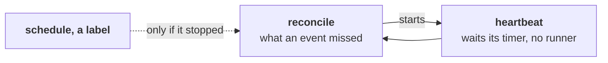

<!-- workline
sources: [ci/github/workline-develop.yml, .github/workflows/workline-develop.yml]
checked: 8538d558
-->
# The reconciler's heartbeat

From [the developer's triggers](../../roles/developer/docs/triggers.md#when-an-issue-becomes-ready).



GitHub runs a schedule late or not at all: an hourly one ran 4 to 6
times a day here ([research](../research/reliable-schedule.md)). So in
[workline-develop.yml](../../ci/github/workline-develop.yml) each
reconcile starts the next one:

- **At its end**, even when it failed, it starts a run of the workflow
  (`workflow_dispatch`, which the job's own token may start).
- **That run's `heartbeat` job waits** the wait timer of the
  environment `workline-heartbeat`: in GitHub, on no runner, no minute
  billed. Then the `reconcile` job runs.
- **The branch's head, not the hour-old commit**: the `reconcile` job
  checks out the branch as it starts. A fix to the engine or to
  `.workline/config.yaml` merged during the wait acts on this reconcile
  ([#898](https://github.com/JN0V/workline/issues/898)). The workflow
  file's own steps stay those of the commit the run started on.
- **One a branch**: a new heartbeat cancels the one waiting.
- **The schedule and a `workline:` label** ask the job `reconcile-due`:
  - not due while a heartbeat or a reconciler's run is queued, waiting
    or running, nor within the gap after the last that succeeded
    ([55 minutes, or your own](#a-shorter-or-longer-period));
  - due, the heartbeat stopped: it starts a reconcile, `workline develop
    reconcile`, which starts the heartbeat again.
- **When it last ran**: read from the workflow's runs, named
  `workline develop heartbeat` and `workline develop reconcile`: one
  call a page of 100 runs, newest first, read on until one that
  succeeded, 5 pages at most. Not the Actions cache: a run started by a
  label may not write it ([#853](https://github.com/JN0V/workline/issues/853)).

## Set it up

A public repository, or a paid plan: GitHub Free has no wait timer on
a private repository.

```sh
gh api -X PUT repos/OWNER/REPO/environments/workline-heartbeat --input - <<'EOF'
{"wait_timer": 55, "deployment_branch_policy": {"protected_branches": false, "custom_branch_policies": true}}
EOF
gh api -X POST repos/OWNER/REPO/environments/workline-heartbeat/deployment-branch-policies \
  -f name=main -f type=branch     # your default branch
```

- **Then start it once**: `gh workflow run workline-develop.yml -f
  reconcile=true`, or wait for the schedule.
- **The wait timer is the period**, in minutes; under 5, no heartbeat.
- **Without the environment**: each reconcile says "no heartbeat" in
  its summary; the schedule and the line's events run it, as GitHub
  can.
- **A shorter or longer period**: see [below](#a-shorter-or-longer-period).
- **To stop it**: delete the environment, or take its wait timer off.
  The heartbeat waiting is then rejected, its run failed, and no
  reconcile starts another.

## A shorter or longer period

Two settings space reconciles; change both, to the same minutes:

- **The environment's wait timer**: the heartbeat's wait (above).
- **The repository variable `WORKLINE_RECONCILE_GAP_MINUTES`**: the gap
  `reconcile-due` asks for after the last reconcile; 55 when unset.

```sh
gh variable set WORKLINE_RECONCILE_GAP_MINUTES --body 5
gh api -X PUT repos/OWNER/REPO/environments/workline-heartbeat -F wait_timer=5
```

- **The variable alone does little**: the heartbeat still waits its
  timer; the variable only lets a label or the schedule start one sooner.
- **A shorter period costs more**: each reconcile's calls and runner
  minutes, 12 times an hour at 5 minutes.

## What it costs

- **A day**: 24 runs, each a heartbeat job of a few seconds and the
  reconcile job.
- **API calls**: the reconcile's own, 1 to read when it last ran, and
  2 for the next heartbeat ([the budget](calls.md#the-api-budget)).
  Where the developer is routed, 1 more to list the pull requests, and
  a few to read the comments and checks of each of the developer's.
- **Each `workline:` label**: a job of a few seconds, 1 call to read the
  runs; none starts a reconcile while the heartbeat waits.
- **Runners**: none while it waits.
