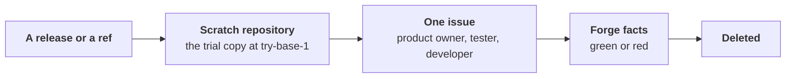

<!-- workline
sources: [scripts/try-on-copy.sh, .github/workflows/try.yml, defaults/ci/github]
checked: 3a8975ce1
-->
# Try a release or a ref on a copy

From [workline's own workflows](own-workflows.md). Why:
[ADR-0071 §2](../adr/0071-the-line-runs-a-pinned-release-tried-on-a-copy.md#2-two-real-tries-one-command).



## Run it

```sh
scripts/try-on-copy.sh v0.78.4          # a release, downloaded as the pin would
scripts/try-on-copy.sh pull/1730/head   # a ref: its engine built, its templates installed
scripts/try-on-copy.sh --dry-run v0.78.4
```

- Or from GitHub: Actions → "try on a copy" → Run workflow, with the
  release or the ref; its log is the run's `try-log` artifact.
- **One at a time**: the workflow queues a second run; the script refuses
  while a `workline-try-*` repository exists, naming it.
- `--keep` keeps the scratch repository; delete it by hand after, or the
  next try refuses.
- `--timeout MIN`: 90 by default.

## What it does

- **Copies** [JN0V/TraceGlass-trial](https://github.com/JN0V/TraceGlass-trial)
  at its tag `try-base-1` into a new public repository,
  `JN0V/workline-try-<id>`. The trial copy itself is never changed.
- **Installs the line** of the release or the ref: every
  `defaults/ci/github/workline*.yml` but workline-release.yml.
  - A release: the templates download it, checksum checked.
  - A ref: the engine built from it, published as a release
    `engine-<sha>` of the scratch repository, which the templates
    download.
- **Sets it up** as the trial copy is: the App's ID and key (the key in
  the environment `workline-app`, `main` only), the agent's token, the
  heartbeat's environment, the labels, the rulesets, the
  `pull_request_target` event policy
  ([why](pull-request-target.md)); the App is added to the scratch
  repository.
- **Opens one issue** as the person, labelled `workline:to-refine`: an
  enhancement the line built on the trial copy on 2026-11-13. `try-base-1`
  is the commit before it was built.
- **Green** only when, within the timeout:
  - the line opened a pull request on `workline/developer/<issue>`;
  - its checks are green, `judge` among them; `workline/accepted`, a
    person's yes, is not waited for;
  - the line set `workline:needs-tests`, `workline:ready` and
    `workline:developing` on the issue.
- **Red** at the timeout, or after a check stays red 15 minutes.
- Prints the facts (the checks, the runs), then green or red and the
  run's link, and deletes the scratch repository.

## Set up

Once, by the maintainer:

- **For the script**, on a person's machine: `gh` logged in with `repo`,
  `workflow` and `delete_repo`; `CLAUDE_CODE_OAUTH_TOKEN`
  (`claude setup-token`); the App's key in `WORKLINE_APP_PRIVATE_KEY`, or
  its file in `WORKLINE_APP_PRIVATE_KEY_FILE`. A ref needs Go.
- **For try.yml**: a repository secret `WORKLINE_TRY_TOKEN`, a classic
  token with `repo`, `workflow` and `delete_repo`: GitHub's own token can
  create no repository. It reuses `CLAUDE_CODE_OAUTH_TOKEN`, the variable
  `WORKLINE_APP_ID` and the key in `workline-app`.
- **The App's installation**: on all of the account's repositories,
  so each scratch repository has it (GitHub → Settings → Applications →
  the App → Configure). On selected ones, the script asks GitHub to add
  the scratch repository; `gh`'s own login token is refused that, so the
  try stops before its issue.
- **Another source**: `scripts/try-on-copy.sh <ref> owner/repo@tag --seed
  issue.md`, the file's first line the issue's title.

## Mind

- A ref's templates run with the App's key in the scratch repository:
  try only refs you have read.
- The scratch repository is public: from December 2, 2026, its
  `pull_request_target` runs need the event policy the script sets.
