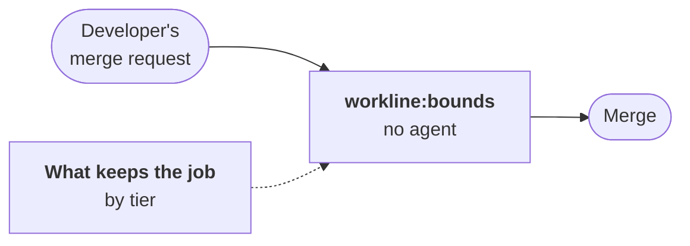

# The developer's bounds on GitLab

Part of [the tester and the developer on GitLab](tester-developer.md).



## The job

- **What it does**: on a merge request from a `workline/developer/<n>`
  branch, each file changed is held to issue `n`'s bounds, read at the
  target branch's tip; a refused file fails the pipeline, whoever pushed
  it ([the bounds](../../roles/developer/docs/bounds.md#on-the-pull-request)).
- **Include it** beside the template:
  `include: [{local: ci/workline.gitlab-ci.yml}, {local: ci/workline-bounds.gitlab-ci.yml}]`
  ([the file](../../ci/gitlab/workline-bounds.gitlab-ci.yml)).
- **Its token**: `WORKLINE_GITLAB_TOKEN`, to read the issue and keep the
  verdict on the merge request. Without it the job fails: the bounds
  unread never pass.
- **It counts**: Settings → Merge requests → *Pipelines must succeed*.

## What keeps it, by tier

GitLab runs a merge request's pipeline from its own branch's
`.gitlab-ci.yml`: the branch can drop the job. What stops that depends
on the tier; `workline doctor` reads it and says which applies.

| Tier | What keeps the job | Set up |
|---|---|---|
| Ultimate | a pipeline execution policy runs it from a project the merge request cannot touch | [below](#ultimate-a-pipeline-execution-policy) |
| Premium | a code owner's approval of the CI files | [below](#premium-code-owners) |
| Free | the review alone | read each change to the CI files |

### Ultimate: a pipeline execution policy

In the group's security policy project, `.gitlab/security-policies/policy.yml`;
copy `workline-bounds.gitlab-ci.yml` into that project and drop its
`include` from the project's `.gitlab-ci.yml`:

```yaml
pipeline_execution_policy:
  - name: workline bounds
    description: The developer's bounds, out of a merge request's reach
    enabled: true
    pipeline_config_strategy: inject_policy
    content:
      include:
        - project: your-group/security-policies
          file: workline-bounds.gitlab-ci.yml
    policy_scope:
      projects:
        including: [{id: 123}]
```

- The file is self-contained: a policy's jobs see no anchor of the
  project's.
- Not tried: no Ultimate project was at hand. The doctor cannot read a
  policy; it notes what to set.

### Premium: code owners

`CODEOWNERS` (root, `docs/` or `.gitlab/`), owning every file that
defines the pipeline:

```text
[CI]
/.gitlab-ci.yml @your-maintainers
/ci/ @your-maintainers
```

Then Settings → Repository → Protected branches → `main`: *Code owner
approval* on. A merge request that changes them waits for an owner. The
doctor checks both, `.gitlab-ci.yml` and each `local:` file it includes.

### Free: the review

Nothing in GitLab Free stops a branch editing its own pipeline. A
person reads each change to `.gitlab-ci.yml` and the files it includes
before merging; the doctor warns.
