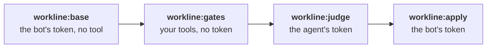

<!-- workline
sources: [ci/gitlab/workline.gitlab-ci.yml, internal/doctor/variables.go, internal/forge/gitlab_variables.go]
checked: cb130c27
judged-in-parts: e8a46f7
-->
# The tokens kept from your tools: the environment `workline`

From [workline on GitLab CI](../ci-gitlab.md#2-the-variables).

GitLab gives a project's variable to every job, unless it is scoped to
an environment ([#520](https://github.com/JN0V/workline/issues/520)).
Left at every environment, the bot's and the agent's tokens reach
`workline:gates`: a linter's config that runs code (`eslint.config.js`)
can read them, even after `unset`, from its parent's start environment.

## Set it up

- **Scope each variable to `workline`**: Settings → CI/CD → Variables,
  the variable's *Environments* field; with glab, `--scope workline`.
  A project's variable can be scoped on every tier; a group's needs
  Premium.
  - `WORKLINE_GITLAB_TOKEN` and the agent's (`CLAUDE_CODE_OAUTH_TOKEN`);
  - when set: `GITLAB_TOKEN`, `WORKLINE_GITLAB_READ_TOKEN`,
    `WORKLINE_SIGNING_KEY`.
- **This release's template**: its jobs that hold a token declare
  `environment: {name: workline, action: prepare}`. An older copy
  declares none: scoped, its jobs would get no token.
- **Your own jobs that use a token** declare it too: the import's
  ([its jobs](import-jobs.md)), those of a pipeline a tool starts
  ([gitlab-trigger.md](../gitlab-trigger.md)).
- **Check it**: `workline doctor` ([below](#workline-doctor)).

## What the template does

- **No environment on the jobs that run your tools**: `workline:gates`,
  `workline:main`, `workline:release`. GitLab gives them no scoped
  variable. They still unset the tokens first, for one left to every
  environment.
- **The stored base** ([main after a merge](../main-after-merge.md#gitlab))
  is read by `workline:base`, first: the bot's token, nothing checked
  out, no tool. Its artifact goes to `workline:gates`, or to
  `workline:main` on the default branch. A job's own token cannot read
  main's artifacts there on Free: GitLab takes it on
  [Premium and Ultimate](https://docs.gitlab.com/api/job_artifacts/).
- **No deployment recorded** (`action: prepare`): the environment shows
  under Operate → Environments, with none.
- **No rule tests a token**: GitLab advises against `rules:` on an
  environment's variable. A job that needs the bot's token runs, and
  without it says so and stops, green.
- **The release's dry run** holds the bot's token, to read the release's
  merge request, while your `release` line's gates run: on the default
  branch's code or the release's branch, never a person's merge request.

## What it does not stop

- **A branch that changes the pipeline** can declare `workline` in a job
  of its own and read the tokens
  ([ADR-0044](../adr/0044-the-apps-key-stays-with-the-default-branchs-runs.md)):
  people who may already push.
- **On Premium**, a
  [protected environment](https://docs.gitlab.com/ci/environments/protected_environments/)
  limits who may run its jobs. Not tried: every merge request's pipeline
  runs them, a Developer's included.

## `workline doctor`

On GitLab (`forge: gitlab`, `--forge gitlab`, or a `.gitlab-ci.yml`
naming workline), it lists the project's variables: their names and
scopes, never a value.

| Rule | Level | Says |
|---|---|---|
| `tokens-not-scoped` | warn | a token left to every environment (`*`): the gates' tools reach it |
| `tokens-scoped` | ok | scoped to `workline`, or a wildcard taking it |
| `tokens-scoped-elsewhere` | note | scoped to another environment: the template's jobs do not get it |
| `tokens-not-project-variables` | note | none is a project variable: a group's or the instance's, checked there |
| `tokens-scope-unread` | warn | the token may not list the variables: only a Maintainer's may, not the bot's (Developer) |

Without doctor: Settings → CI/CD → Variables shows each one's
*Environments*; *All (default)* is `*`.
