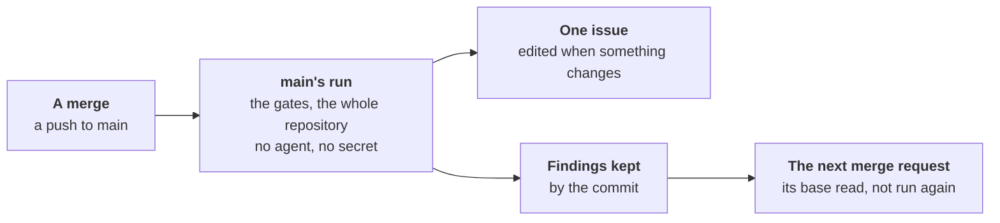

# Main after a merge



After each push to the default branch, workline checks what is about the
repository, not the change, once
([ADR-0050](adr/0050-each-act-has-its-moment-and-a-wait-budget.md#3-the-moment-table)).
Nobody waits for it; nothing in it holds a merge request.

- **The gates**: those of the merge requests' line (`gate:` steps of
  `merge-request`), every finding read. What the push adds since the
  branch's tip before it counts against their thresholds: two merge
  requests green alone, each against its own base, may break main
  together. Then the run is red, and the issue says so.
- **The whole repository's checks**: the documentalist's budgets, links
  inside the repository, passages written twice and line counts, on every
  doc, no agent. No doc is judged there: one suspect from before, and the
  links to other sites, are gardening's. A merge request reads only the
  docs its commits touched.
- **One issue**, *workline: findings on the default branch*:
  - opened when there is something to list; edited in place when what it
    lists changes; left as it is when nothing is new nor gone; never
    commented on;
  - its first line counts the findings by kind; then main red, if so,
    with what main gained since; then, folded, each finding the gates
    found main gained, kept while main holds it, and the whole
    repository's findings. On day one, the old debt is shown once
    ([ADR-0049](adr/0049-the-inspector-judges-the-new-findings-of-the-projects-tools.md#6-guards)),
    then only what changes;
  - red mains counted a week, each once, on the run it turned red at:
    above one a week, the forge's queue is worth turning on
    ([a merge queue or train](merge-queue.md),
    [ADR-0051](adr/0051-a-check-sits-where-its-catch-is-worth-its-cost.md#cut-2-strict-up-to-date-dropped));
  - the product owner leaves it alone, as its other issues;
  - with no release merge request open, the night's release dry run
    keeps a part of its own there, *The next release*: what would hold
    it ([the release](release.md)). Each writer leaves the other's part
    as it is.
- **Base red, not yours**: while main is red, one comment on each open
  merge request whose base holds the red commit, once a red spell: a
  check red there for it is the base's. No merge request waits for
  another to merge ([the merge policy](merge-policy.md#a-red-main)).
- **No agent, no secret** where the tools run; the issue and the
  comments are written by a job allowed to write issues and comments, no
  AI key.

## The next base

- **Kept by commit**: every finding of each SARIF check of main's run,
  in the folder `--gates-kept` names (`<commit>.json`).
- **Read as the merge base's**: a merge request based on that commit
  runs its tools once, at its head, rather than again at the merge base
  ([ADR-0049](adr/0049-the-inspector-judges-the-new-findings-of-the-projects-tools.md#6-guards)).
- **Only when they stand for a run there**: the same command, `output`
  and `config`; no file the tool reads its config from changed by the
  merge request; the same tool, by the version its SARIF names and the
  hash of the binary its command runs. Else the tools run again there,
  and the summary says why.
- **A tool naming no version, not found on the PATH**: run again.
- **None kept for the merge base** (missing, expired, another commit's):
  run again, said.
- **Said in the summary**: `lint 1 new, 3 before it (6.5s; the merge
  base's kept on main, not run again)`.
- **Written by main alone**: a branch's pipeline can never write the base
  another merge request reads, so no finding a change adds can be made
  to look old. Each forge's store below holds to that.

## GitHub

- [workline.yml](../ci/github/workline.yml) runs on `push` to `main`
  too (rename it for another default branch): `gates` runs `route main`,
  with `contents: read` alone.
- **Actions' cache** holds the findings: main's run reads
  `workline-gates-<main's tip before>` and keeps
  `workline-gates-<its commit>`; a pull request reads
  `workline-gates-<its merge base>`, by that exact key.
- **Safe from a branch**: GitHub scopes a cache to the ref that saved
  it. A pull request reads the default branch's entries, and can save
  only into its own merge ref's scope, which no other pull request nor
  main reads
  ([GitHub's docs](https://docs.github.com/en/actions/reference/workflows-and-actions/dependency-caching#restrictions-for-accessing-a-cache)).
  The template saves only on a push to `main`.
- **An entry unused for 7 days is gone**: the tools run again.
- **The issue** and the comments:
  [workline-apply.yml](../ci/github/workline-apply.yml)'s `main` job,
  after that run, with `issues: write`, which comments on a pull request
  too; never after a push to another branch.

## GitLab

- **`workline:main`**, on a push to the default branch, holds no token,
  as `workline:gates`: it declares no environment, and unsets them
  still ([the environment](gitlab/environment.md)). No Code Quality
  report there: the merge requests' widget compares with it, and old
  findings would read as fixed.
- **Main's own artifacts** hold the findings, never a cache: a merge
  request's pipeline can write a cache entry another reads
  (`cache:unprotect`), not the default branch's job's artifacts.
  - `workline:main` keeps `.workline-kept/` as its artifact, 30 days: the
    last 20 commits analysed, carried from its last successful pipeline.
  - `workline:base`, first in each pipeline, reads them,
    `jobs/artifacts/$CI_DEFAULT_BRANCH/raw/...?job=workline:main`: the
    merge base's `<commit>.json` on a merge request, the last 20 on the
    default branch. Its artifact goes to `workline:gates` or
    `workline:main`, which never hold the token that read it.
  - It reads with `WORKLINE_GITLAB_TOKEN`, no tool run, nothing checked
    out; else with the job's token, said in its log, which gitlab.com's
    Free tier refuses there (404, tried).
- **Not found** (expired, a red pipeline's, a base older than those 20):
  the tools run again, said in the job's log and the summary. GitLab
  gives a branch's artifacts from its last successful pipeline only.
- **The issue** and the comments: `workline:main:issue`, with
  `WORKLINE_GITLAB_TOKEN`.

## The commands, for another CI

```sh
workline route main --ai none --forge none --gates-kept kept/ \
  --input range=<before>..<after> --json > main.json
workline apply --main main.json --forge github
workline route merge-request --gates-only --forge none --gates-kept kept/ \
  --input range=<base>..<head> --json > gates.json
```

- **The range's start**: main's tip before the push. Zeros, a branch's
  first push, or no commit here: HEAD's first parent. None: every
  finding is said, none counted; a check that did not run still errs.
- **Kept only** from a tree that is HEAD's commit, every tracked file as
  committed; else said, nothing kept.
- **`apply --main`** reads the result `route main` printed, as data;
  red, it comments on the open merge requests whose base, a branch of
  the clone, holds the red commit.
