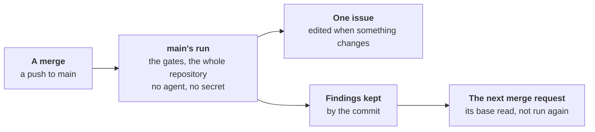

---
sources:
  - internal/line/line.go#mainRun
  - internal/line/line.go#runGate
  - internal/line/line.go#nothingCounted
  - internal/line/line.go#stepsOf
  - roles/documentalist/code/documentalist.go#newPreRun
  - roles/documentalist/code/documentalist.go#preRun.checkHygiene
  - roles/documentalist/code/hygiene.go#Hygiene
  - internal/report/main.go#MainTitle
  - cmd/workline/main.go#noteBaseRed
  - defaults/ci/github/workline.yml#on
  - defaults/ci/github/workline.yml#jobs.gates
  - defaults/ci/github/workline-apply.yml#jobs.main
checked: c46a93d6c
verified: agent:claude-code
judged: 9a88170
judged-in-parts: 9a88170
---
# Main after a merge



After each push to the default branch, workline checks what is about the
repository, not the change, once
([ADR-0050](adr/0050-each-act-has-its-moment-and-a-wait-budget.md#3-the-moment-table)).
Nobody waits for it; nothing in it holds a merge request.

- **One run, the net**: `route main`, beside the project's tests; no
  merge request is brought up to date before it merges
  ([#612](https://github.com/JN0V/workline/pull/612),
  [ADR-0051](adr/0051-a-check-sits-where-its-catch-is-worth-its-cost.md#build-order)).
- **The gates**: those of the merge requests' line (`gate:` steps of
  `merge-request`), every finding read. What the push adds since the
  branch's tip before it counts against their thresholds: two merge
  requests green alone, each against its own base, may break main
  together. Then the run is red, and the issue says so.
- **The whole repository's checks**: the documentalist's budgets, links
  inside the repository, passages written twice and line counts, on every
  doc, no agent. No doc is judged there: one suspect from before, and the
  links to other sites, are gardening's. A merge request reads only the
  docs its commits touched.
- **One issue**, *workline: findings on the default branch*, edited in
  place when what it lists changes ([the issue](main-issue.md)).
- **Base red, not yours**: while main is red, each open merge request
  whose base holds it is told, once a red spell
  ([how](main-issue.md#base-red-not-yours)).
- **The wake**, beside it: where the line may be drifting, read with no
  AI, in an issue of its own ([the wake](wake.md)).
- **No agent, no secret** where the tools run; the issue and the
  comments are written by a job allowed to write issues and comments, no
  AI key.
- **The next base**: every finding of the gates kept by the commit, read
  by the next merge requests rather than run again
  ([the next base](next-base.md)).

## GitHub

- [workline.yml](../defaults/ci/github/workline.yml) runs on `push` to `main`
  too (rename it for another default branch): `gates` runs `route main`,
  with `contents: read` alone.
- **Actions' cache** holds the findings: main's run reads
  `workline-gates-<main's tip before>` and keeps
  `workline-gates-<its commit>`; a pull request reads
  `workline-gates-<its merge base>`, by that exact key.
- **Safe from a branch**: GitHub scopes a cache to the ref that saved
  it. A pull request reads the default branch's entries, and can save
  only into its own merge ref's scope, which no other pull request nor
  main reads
  ([GitHub's docs](https://docs.github.com/en/actions/reference/workflows-and-actions/dependency-caching#restrictions-for-accessing-a-cache)).
  The template saves only on a push to `main`.
- **An entry unused for 7 days is gone**: the tools run again.
- **The issue** and the comments:
  [workline-apply.yml](../defaults/ci/github/workline-apply.yml)'s `main` job,
  after that run, with `issues: write`, which comments on a pull request
  too; never after a push to another branch.

## GitLab

Main's own pipeline artifacts hold the findings, never a cache; its jobs
hold no token where the tools run ([on GitLab](gitlab/main-after-merge.md)).

## The commands, for another CI

```sh
workline route main --ai none --forge none --gates-kept kept/ \
  --input range=<before>..<after> --json > main.json
workline apply --main main.json --forge github
workline route merge-request --gates-only --forge none --gates-kept kept/ \
  --input range=<base>..<head> --json > gates.json
```

- **The range's start**: main's tip before the push. Zeros, a branch's
  first push, or no commit here: HEAD's first parent. None: every
  finding is said, none counted; a check that did not run still errs.
- **Kept only** from a clean tree ([the next base](next-base.md#written-by-main-alone)).
- **`apply --main`** keeps the issue and tells the merge requests
  ([how](main-issue.md#apply---main)).
