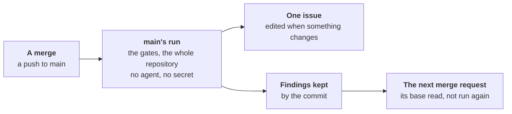

# Main after a merge



After each push to the default branch, workline checks what is about the
repository, not the change, once
([ADR-0050](adr/0050-each-act-has-its-moment-and-a-wait-budget.md#3-the-moment-table)).
Nobody waits for it; nothing in it holds a merge request.

- **The gates**: those of the merge requests' line (`gate:` steps of
  `merge-request`), every finding read. What the push adds since the
  branch's tip before it counts against their thresholds: two merge
  requests green alone, each against its own base, may break main
  together. Then the run is red, and the issue says so.
- **The whole repository's checks**: the documentalist's budgets, links
  inside the repository, passages written twice and line counts, on every
  doc, no agent. No doc is judged there: one suspect from before, and the
  links to other sites, are gardening's. A merge request reads only the
  docs its commits touched.
- **One issue**, *workline: findings on the default branch*:
  - opened when there is something to list; edited in place when what it
    lists changes; left as it is when nothing is new nor gone; never
    commented on;
  - it lists main red, if so, with what main gained since; each finding
    the gates found main gained, kept while main holds it; the whole
    repository's findings;
  - the product owner leaves it alone, as its other issues.
- **No agent, no secret** where the tools run; the issue is written by a
  job holding the issue's right, no AI key.

## The next base

- **Kept by commit**: every finding of each SARIF check of main's run,
  in the folder `--gates-kept` names (`<commit>.json`).
- **Read as the merge base's**: a merge request based on that commit
  runs its tools once, at its head, rather than again at the merge base
  ([ADR-0049](adr/0049-the-inspector-judges-the-new-findings-of-the-projects-tools.md#6-guards)).
- **Only when they stand for a run there**: the same command, `output`
  and `config`; no file the tool reads its config from changed by the
  merge request; the same tool, by the version its SARIF names and the
  hash of the binary its command runs. Else the tools run again there,
  and the summary says why.
- **A tool naming no version, not found on the PATH**: run again.
- **Said in the summary**: `lint 1 new, 3 before it (6.5s; the merge
  base's kept on main, not run again)`.

## GitHub

- [workline.yml](../ci/github/workline.yml) runs on `push` to `main`
  too (rename it for another default branch): `gates` runs `route main`,
  with `contents: read` alone.
- **Actions' cache** holds the findings: main's run reads
  `workline-gates-<main's tip before>` and keeps
  `workline-gates-<its commit>`; a pull request reads
  `workline-gates-<its merge base>`. A pull request reads the default
  branch's entries, never writes them; one unused for 7 days is gone,
  and the tools run again.
- **The issue**: [workline-apply.yml](../ci/github/workline-apply.yml)'s
  `main` job, after that run, with `issues: write`; never after a push to
  another branch.

## GitLab

- **`workline:main`**, on a push to the default branch, unsets the
  agent's and the bot's tokens, as `workline:gates` does. No Code Quality
  report there: the merge requests' widget compares with it, and old
  findings would read as fixed.
- **The cache**: `workline-gates-$CI_COMMIT_BEFORE_SHA` read,
  `workline-gates-$CI_COMMIT_SHA` kept, even when red;
  `workline:gates` reads `workline-gates-$CI_MERGE_REQUEST_DIFF_BASE_SHA`.
- **Shared with merge requests' pipelines** (`unprotect`): whoever may
  push a branch could write an entry, as they can read the bot's token
  ([the template's trust](ci-gitlab.md#what-the-template-does)). A
  runner with no shared cache misses: the tools run again.
- **The issue**: `workline:main:issue`, with `WORKLINE_GITLAB_TOKEN`.

## The commands, for another CI

```sh
workline route main --ai none --forge none --gates-kept kept/ \
  --input range=<before>..<after> --json > main.json
workline apply --main main.json --forge github
workline route merge-request --gates-only --forge none --gates-kept kept/ \
  --input range=<base>..<head> --json > gates.json
```

- **The range's start**: main's tip before the push. Zeros, a branch's
  first push, or no commit here: HEAD's first parent. None: every
  finding is said, none counted; a check that did not run still errs.
- **Kept only** from a tree that is HEAD's commit, every tracked file as
  committed; else said, nothing kept.
- **`apply --main`** reads the result `route main` printed, as data.
