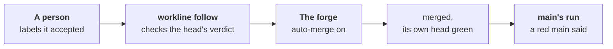

---
sources:
  - internal/engine/merge.go#mergePolicy
  - internal/engine/merge.go#theYes
  - internal/engine/merge.go#accepted
  - defaults/ci/github/workline-merge.yml#on
  - defaults/ci/github/workline-apply.yml#jobs.verdict
  - defaults/ci/github/workline-apply.yml#jobs.queue
  - defaults/ci/github/workline-apply.yml#jobs.follow
  - defaults/ci/gitlab/workline.gitlab-ci.yml#workline:merge
  - defaults/ci/gitlab/workline.gitlab-ci.yml#workline:follow
checked: e81df7b34
verified: agent:claude-code
---
# The merge policy



A person says yes with a label; the forge merges, by its own rules.
`workline follow` turns the forge's auto-merge on for what was accepted;
each merges once its own head is green. No agent is called
([ADR-0042](adr/0042-the-engine-merges-by-the-projects-policy.md)).

```yaml
# .workline/config.yaml
merge: {autonomy: cautious}   # off unless set: no auto-merge is touched
                              # normal: workline's own routine work with no yes, below
                              # enterprising: features and tasks too, a person tries the candidate
```

## What it does

- **Turns auto-merge on** for a pull request labelled `workline:accepted`
  (GitLab: `workline::accepted`), its head's verdict passed:
  - the label put by someone who may push and merge: GitHub's write
    access, GitLab's Developer or above;
  - the line passed on that head, every step that needs an agent answered
    by one, whole. With no agent, every review falls short: nothing is
    turned on where the reviewer runs.
  - **Too large for the reviewer** (`review-not-whole`): read it whole,
    then put `workline:accepted-whole`, a yes that takes that review; a
    red check still holds
    ([why](adr/0042-the-engine-merges-by-the-projects-policy.md#amendment-2026-11-05-1107-a-person-who-read-it-whole-takes-a-review-not-whole)).
  - **The verdict's run only**: the reviewer's lenses that only warn read
    apart, after or beside it. Their findings, and one of them failing,
    may post after the verdict, and after the merge: read their comment
    before you accept ([apart](../roles/reviewer/docs/apart.md)).
- **The forge merges**: GitHub's auto-merge, GitLab's "merge when the
  pipeline succeeds", each checking its own rules. One the forge could
  merge at once is merged at once.
- **An auto-merge the forge left is merged by the next run**: auto-merge
  on, the forge saying it would merge now (GitHub's merge state clean),
  `follow` merges it. GitHub's auto-merge waits for an event, a check
  ending or a push, and may miss one. An hourly run catches one no
  event follows.
- **No one at a time, no update first**: a pull request behind its base
  merges as it is, none waiting for another
  ([ADR-0051](adr/0051-a-check-sits-where-its-catch-is-worth-its-cost.md#cut-2-strict-up-to-date-dropped)).
  Two green alone may break the base together: main's run says it
  ([below](#a-red-main)).
- **The developer's request behind its base**: in conflict, or held by
  the forge, `main` is merged in, by the engine or one developer round;
  never a rebase
  ([behind main](../roles/developer/docs/conflict.md)). Held by the
  forge, one at a time: the head of
  [workline's own merge queue](merge-queue.md#worklines-own-merge-queue)
  alone, each run. On the local
  forge, where no run checks `main`, one whose files `main` changed is
  merged only once the tests pass on `main` merged into it.
- **Auto-merge a person turned on by hand** is their yes, weighed as the
  label's.
- **The labels** are made in the forge's list when missing: put
  `workline:accepted` in bulk, from a saved filter.

## What holds it

- **A person's comment with no answer**: nothing merges, whatever the
  policy, until a role's reply names a test or the person's own yes
  follows it; a push that takes that yes off does not reopen it.
- **Open conversations** the base requires resolved: listed, linked.
- **A red verdict or check, a review short**: nothing turned on, said.
- **Each case**: [what holds a pull request](merge-policy-holds.md).

## The yes covers one head

- **A push after the yes takes it back**: auto-merge off, the label off,
  one comment.
- **But for pushes that add nothing to read**: a release tool's rebuild,
  workline's own commit, checked by its tree.
- **Held by the forge**: the base requires the App's `workline/accepted`
  on the head a yes covers, so a new head cannot merge.
- **The rules, case by case**: [the yes covers one head](merge-policy-one-head.md).

## Never without a person's yes

- **A release pull request** merges only labelled, and **a fork's** only
  labelled with its checks passed; one changing CI, workline's config, a
  gate's file or what steers agents is never merged by the line, a
  person merges it by hand
  ([the rules](merge-policy-never.md)).
- **One changing a guarded file**, one the project's `CODEOWNERS`
  lists, at every level
  ([what never merges alone](merge-policy-normal.md#what-never-merges-alone)).
- **Any other** with no label, whoever opened it — but, at `normal` and
  `enterprising`, workline's own routine work. A bot's own auto-merge (a dependency
  bot's) is left to it.
- **An agent never puts the label**: it is the person's yes.

## `normal`: routine work with no yes

```yaml
merge: {autonomy: normal}   # a project's choice, never a default
```

At `normal`, workline's own routine pull requests merge with no label
too — the developer's fix of a reproduced bug, not a feature nor a task;
an agent's rewording of a page for its reader once the project lets it;
a revert sends their kind back to a person's yes. The kinds, the revert and the limits:
[the merge policy at `normal`](merge-policy-normal.md).

## `enterprising`: features too, the yes on the candidate

```yaml
merge: {autonomy: enterprising}
```

As `normal`, and the developer's features and tasks merge with no label
too, each put in a milestone. Once a milestone's issues are all merged, workline
cuts its release candidate; a person tries it, and their yes, a label on
the candidate's issue, ships the version:
[the release candidate](release-candidate.md).

## The veto is the forge's

- **Draft**: nothing is turned on; auto-merge on goes off. A draft asks
  no agent, so nothing it skips can merge
  ([ADR-0050](adr/0050-each-act-has-its-moment-and-a-wait-budget.md#4-what-the-table-holds-to)).
- **Auto-merge turned off by a person** stays off until labelled again.
- **The label taken off** turns auto-merge off.

## Where the head's verdict lives

- **Written by the proposing job**, kept per forge: GitHub's status
  `workline/verdict` set by the App, GitLab's merge request pipeline,
  the local forge's clone; none on the head yet, or a draft's:
  auto-merge waits ([where it lives](merge-policy-verdict.md)).

## Nobody bypasses `main`

- **`main`'s ruleset has an empty bypass list**, the person included:
  `gh pr merge --admin` and a push to `main` are refused; a person's
  merge is the label
  ([ADR-0068 §6](adr/0068-the-line-steps-back-on-its-own-drift.md#6-nobody-bypasses-on-main)).
- **`workline doctor` checks it**: a token that can bypass the default
  branch's rulesets is a warning.
- **The emergency**, no head able to get `workline/accepted`: add
  yourself to the bypass list, merge the fix, remove yourself.
- **How, on GitHub and GitLab Premium**:
  [nobody bypasses `main`](merge-policy-no-bypass.md).

## Set up

- **GitHub**: the templates' `workline-apply.yml` and
  `workline-merge.yml`, "Allow auto-merge", the GitHub App, and a
  ruleset requiring the checks and `workline/accepted`.
- **GitLab**: the template's `workline:merge` and `workline:follow`
  jobs, the project bot's token, merged results pipelines.
- **Another forge** (`cmd:`): a few forge command operations.
- **The local forge**: nothing to set up.
- **Each step, per forge**: [set up the merge policy](merge-policy-setup.md).

## What the summary says

- **Each run's summary** names, per pull request, what `follow` did, or
  why it turned nothing on, with a word such as `auto-merge-on`,
  `verdict-red` or `accepted-reset`
  ([every word](merge-policy-summary.md)).

## A red main

- **The net is main's run**, after each merge
  ([main after a merge](main-after-merge.md)): red, it says so in its one
  issue, and once on each open pull request into it, "base red, not
  yours".
- **Counted a week**, in that issue. Above one a week, turn on the
  forge's queue: GitHub's merge queue in an organisation, GitLab's merge
  train ([a merge queue or train](merge-queue.md)).

Where it is read (`merge.go`), and the live try: [the code and the try](merge-policy-read.md).
