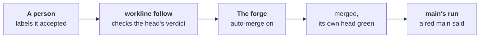

# The merge policy



A person says yes with a label; the forge merges, by its own rules.
`workline follow` turns the forge's auto-merge on for what was accepted;
each merges once its own head is green. No agent is called
([ADR-0042](adr/0042-the-engine-merges-by-the-projects-policy.md)).

```yaml
# .workline/config.yaml
merge: {autonomy: cautious}   # off unless set: no auto-merge is touched
                              # normal: workline's own routine work with no yes, below
                              # enterprising: features and tasks too, a person tries the candidate
```

## What it does

- **Turns auto-merge on** for a pull request labelled `workline:accepted`
  (GitLab: `workline::accepted`), its head's verdict passed:
  - the label put by someone who may push and merge: GitHub's write
    access, GitLab's Developer or above;
  - the line passed on that head, every step that needs an agent answered
    by one, whole. With no agent, every review falls short: nothing is
    turned on where the reviewer runs.
  - **Too large for the reviewer** (`review-not-whole`): read it whole,
    then put `workline:accepted-whole`, a yes that takes that review; a
    red check still holds
    ([why](adr/0042-the-engine-merges-by-the-projects-policy.md#amendment-2026-11-05-1107-a-person-who-read-it-whole-takes-a-review-not-whole)).
  - **The verdict's run only**: the reviewer's lenses that only warn read
    apart, after or beside it. Their findings, and one of them failing,
    may post after the verdict, and after the merge: read their comment
    before you accept ([apart](../roles/reviewer/docs/apart.md)).
- **The forge merges**: GitHub's auto-merge, GitLab's "merge when the
  pipeline succeeds", each checking its own rules. One the forge could
  merge at once is merged at once.
- **An auto-merge the forge left is merged by the next run**: auto-merge
  on, the forge saying it would merge now (GitHub's merge state clean),
  `follow` merges it. GitHub's auto-merge waits for an event, a check
  ending or a push, and may miss one
  ([#993](https://github.com/JN0V/workline/issues/993)). An hourly run
  catches one no event follows.
- **Open conversations that hold it are said**: auto-merge on, its
  checks green, the forge not merging, and its base requiring every
  conversation resolved: `follow` lists each open one, linked, in its
  summary and once on the pull request. The reviewer resolves its own
  once the code answers them
  ([lines](../roles/reviewer/docs/lines.md#not-repeated-found-again));
  a person resolves theirs
  ([#1039](https://github.com/JN0V/workline/issues/1039)).
- **No one at a time, no update first**: a pull request behind its base
  merges as it is, none waiting for another
  ([ADR-0051](adr/0051-a-check-sits-where-its-catch-is-worth-its-cost.md#cut-2-strict-up-to-date-dropped)).
  Two green alone may break the base together: main's run says it
  ([below](#a-red-main)).
- **Auto-merge a person turned on by hand** is their yes, weighed as the
  label's.
- **Nothing turned on, said in the job's summary**: a verdict or a check
  red, a review short. Each check counts by its latest run on the head:
  a failure re-run green since holds nothing. A run the forge cancelled
  is no result: the latest other run of that check counts — on GitLab,
  the newest other pipeline of that head —, else it waits. One not judged yet waits, named.
- **The labels** are made in the forge's list when missing: put
  `workline:accepted` in bulk, from a saved filter.

## The yes covers one head

- **A push after the yes takes it back**: auto-merge off, the label off,
  one comment. When each head was pushed is the forge's word: GitHub's
  repository activity, GitLab's versions.
- **Each yes label by its own pushes**: `workline:accepted` put before a
  push and `workline:accepted-whole` after it, only the stale one goes
  off; the other covers the head and stands.
- **workline's own commit is no push**, checked by its tree; its trailer
  is needed, never taken on trust. The committer checks every commit all
  the same:
  - a role's branch rebuilt on the base, or a merge of the base workline
    made before it stopped writing to people's branches
    ([ADR-0051](adr/0051-a-check-sits-where-its-catch-is-worth-its-cost.md#build-order),
    step 10), never another branch — exactly what workline's own rebuild
    or merge gives;
  - a record: one commit changing, against its parent, only lines
    workline writes in the docs — a header's `checked`, `judged`,
    `judged-in-parts` or `verified`, a derived block as its command gives
    it ([ADR-0041](adr/0041-workline-settles-its-own-lines-when-the-base-moves.md)).
- **Still a push**: a docs fix changing a doc's text or another key, and
  any commit with no workline trailer, whatever it changes; one whose
  message the committer rewrote (`Workline-Role: committer`) is a
  person's.
- **Held by the forge, not by a race**: GitHub keeps auto-merge on after a
  writer's push. So the base requires the status `workline/accepted` from
  the App, which `follow` sets on the head a yes covers: a new head lacks
  it and cannot merge. A base that does not require it, or from any
  source, gets nothing turned on, said. On GitLab, the merge waits for
  the new head's pipeline, which holds `workline:merge`.
- **A merge queue** tests a group's commit against the same checks:
  `follow --merge-group` sets `workline/accepted` there as the head the
  group ends with holds it; the queue's run checks only the gates, the
  yes and the verdict staying the head's ([a merge queue](merge-queue.md)).

## Never without a person's yes

- **A release pull request** merges only labelled; it never waits for
  the docs ([ADR-0051](adr/0051-a-check-sits-where-its-catch-is-worth-its-cost.md#cut-1-the-release-weekly)).
  An issue labelled to hold it, or main not green, turns its verdict red
  until they are gone ([what holds a release](release-holds.md)).
- **A fork's**: its run is the workflow its head holds, so the line
  keeps no verdict of it and reads no review of it:
  - labelled, it merges once every check on its head passed: the
    person's yes carries it;
  - one changing CI, workline's config, a gate's file or what steers
    agents is never merged by the line (`fork-gate-files`): a person
    merges it by hand;
  - unlabelled, `follow` says it waits for a yes
    ([ADR-0042](adr/0042-the-engine-merges-by-the-projects-policy.md#amendment-2026-11-04-1043-a-fork-goes-by-its-yes-and-its-checks)).
- **Any other** with no label, whoever opened it — but, at `normal` and
  `enterprising`, workline's own routine work. A bot's own auto-merge (a dependency
  bot's) is left to it.
- **An agent never puts the label**: it is the person's yes.

## `normal`: routine work with no yes

```yaml
merge: {autonomy: normal}   # a project's choice, never a default
```

At `normal`, workline's own routine pull requests merge with no label
too — the developer's fix of a reproduced bug, not a feature nor a task;
an agent's rewording of a page for its reader once the project lets it;
a revert sends their kind back to a person's yes. The kinds, the revert and the limits:
[the merge policy at `normal`](merge-policy-normal.md).

## `enterprising`: features too, the yes on the candidate

```yaml
merge: {autonomy: enterprising}
```

As `normal`, and the developer's features and tasks merge with no label
too, each put in a milestone. Once a milestone's issues are all merged, workline
cuts its release candidate; a person tries it, and their yes, a label on
the candidate's issue, ships the version:
[the release candidate](release-candidate.md).

## The veto is the forge's

- **Draft**: nothing is turned on; auto-merge on goes off. A draft asks
  no agent, so nothing it skips can merge
  ([ADR-0050](adr/0050-each-act-has-its-moment-and-a-wait-budget.md#4-what-the-table-holds-to)).
- **Auto-merge turned off by a person** stays off until labelled again.
- **The label taken off** turns auto-merge off.

## Where the head's verdict lives

- The judging job writes it: `workline route … --verdict <file>`.
- **GitHub**: a job of its own keeps it, `workline follow --verdict <file>
  --verdict-only`: the status `workline/verdict` on the head, set by the
  App. Only the statuses `follow`'s own token set are read: one a person
  sets with their own token never counts.
- **GitLab**: in hand in the merge request's pipeline, where
  `workline:merge` reads it; nothing kept elsewhere.
- **The local forge**: in the clone, `.git/workline/verdicts/`, kept by
  `workline route merge-request` itself when `merge:` is set.
- No verdict on the head yet: auto-merge waits for it.
- **A draft's verdict** is a review to come (`waits`): the rules and
  gates passed, the AI review waits for it to be marked ready. GitHub's
  `workline/verdict` is pending. Marked ready, auto-merge waits for the
  run on ready's verdict (`review-to-come`), never taking the draft's
  for a pass ([the reviewer on a draft](../roles/reviewer/docs/ready.md)).
- **The App's key, out of a pull request's reach**: GitHub runs a pull
  request's own copy of the workflow, which its branch can change. The key
  sits in an environment only the default branch may use; the jobs
  holding it run the default branch's workflow and read the pull
  request's run as data
  ([ADR-0044](adr/0044-the-apps-key-stays-with-the-default-branchs-runs.md)).
- **The limits**:
  - the verdict is the pull request's run's word: one changing its
    workflow can pass its own head, as its own `judge`; the yes covers
    that head;
  - on GitLab, whoever can run a pipeline can read the project bot's
    token, so a person who may push could act as it.

## Set up

- **GitHub**: the [templates](ci-github.md) — `workline-apply.yml`'s
  `verdict` and `follow` jobs run after `judge`, `queue` after a merge
  queue's group, from the default branch;
  `workline-merge.yml` runs when a label is put or taken off, or a draft
  made, and hourly; on a demotion issue's close; at `enterprising`, on a
  candidate's yes or close too.
  Then:
  - Settings → General → "Allow auto-merge";
  - the [GitHub App](ci-github-app.md), with **Commit statuses** read and
    write besides its other permissions, its key in the environment
    `workline-app`; a merge made with the job's own token starts no
    workflow on `main` — nothing is turned on then, said;
  - a ruleset on the base requiring the checks, and `workline/accepted`
    from the App; "Require branches to be up to date" left off.
- **GitLab**: the [template](ci-gitlab.md)'s `workline:merge` job, after
  the judge; the project bot's token; `workline:follow` on the hourly
  reconcile schedule too. Merged results pipelines on
  (Premium): without them a merge request's pipeline tests its branch
  alone. A label starts no pipeline there: it
  waits for that merge request's own next pipeline.
- **Another forge** (`cmd:`): the operations `merge-state`, `auto-merge`,
  `guarded`, `accept`, `keep-verdict` and `verdict`
  ([forge command](spec/forge-command.md)); at `normal`, more
  ([set up](merge-policy-normal.md#set-up)).
- **The local forge** (`forge: local`): nothing to set up. It has no
  auto-merge, so `workline follow` merges itself what the policy says
  yes to, in the clone, nothing pushed
  ([the line with no forge](local-line.md#6-the-merge)).

## What the summary says

| Said | When |
|---|---|
| `auto-merge-on`, `merged-at-once` | accepted, its head's verdict passed; at `normal`, "with no person's yes", its kind; "merged now", an auto-merge the forge left |
| `merge-refused` | the forge refused to merge now one whose auto-merge it left: auto-merge left on |
| `held-by-conversations`, `conversations-unread` | auto-merge on, checks green, not merged: the open conversations that hold it, or why they could not be read |
| `verdict-kept`, `verdict-missing`, `review-to-come` | the verdict kept; one not judged yet; marked ready, the draft's verdict still on its head |
| `verdict-red`, `review-short`, `checks-red` | nothing turned on, why; a person's yes does not lift a red verdict |
| `review-read-whole` | a review not whole, taken by the reading of who put `workline:accepted-whole` |
| `accepted-reset` | a push after the yes: the yes and auto-merge off |
| `vetoed`, `draft`, `auto-merge-off` | the forge's veto, or the label taken off |
| `label-ignored` | put by someone who may not push nor merge, the label named |
| `merge-unguarded`, `merge-token`, `merge-unsupported` | a base, a token or a forge it cannot act with |
| `checks-unread` | its head's checks could not be read: only the line's verdict counts |
| `merge-state-unread`, `verdict-unread` | its state or its head's verdict could not be read: left as it is |
| `auto-merge-refused`, `label-not-made` | the forge refused to turn auto-merge on, or to make the label; a refusal is said on the request and its issue, a conflict's files named ([#1354](https://github.com/JN0V/workline/issues/1354)) |

## A red main

- **The net is main's run**, after each merge
  ([main after a merge](main-after-merge.md)): red, it says so in its one
  issue, and once on each open pull request into it, "base red, not
  yours".
- **Counted a week**, in that issue. Above one a week, turn on the
  forge's queue: GitHub's merge queue in an organisation, GitLab's merge
  train ([a merge queue or train](merge-queue.md)).

At `normal`, more words:
[what the summary says there](merge-policy-normal.md#what-the-summary-says).

What was tried, live: the documentalist's
[tried.md](../roles/documentalist/docs/tried.md#2026-10-12--the-merge-policy-cautious-live);
what is left: [status.md](../roles/documentalist/docs/status.md).
