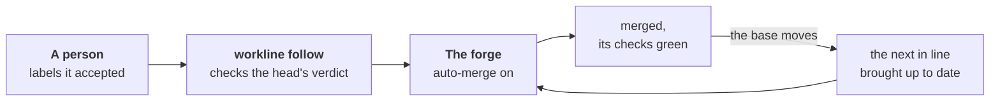

# The merge policy



A person says yes with a label; the forge merges, by its own rules.
`workline follow` turns the forge's auto-merge on for what was accepted
and keeps the line moving, one pull request at a time. No agent is called
([ADR-0042](adr/0042-the-engine-merges-by-the-projects-policy.md)).

```yaml
# .workline/config.yaml
merge: {autonomy: cautious}   # off unless set: no auto-merge is touched
                              # normal: workline's own routine work with no yes, below
```

## What it does

- **Turns auto-merge on** for a pull request labelled `workline:accepted`
  (GitLab: `workline::accepted`), its head's verdict passed:
  - the label put by someone who may push and merge: GitHub's write
    access, GitLab's Developer or above;
  - the line passed on that head, every step that needs an agent answered
    by one, whole. With no agent, every review falls short: nothing is
    turned on where the reviewer runs.
- **The forge merges**: GitHub's auto-merge, GitLab's "merge when the
  pipeline succeeds", each checking its own rules. One GitHub could merge
  at once is merged at once.
- **One at a time**: when the base moves, the first in line that is behind
  is brought up to date; the others wait until it merges:
  - the base merged in, as Update branch does, workline's own lines
    settled ([ADR-0041](adr/0041-workline-settles-its-own-lines-when-the-base-moves.md));
  - a role's own branch rebuilt on the base instead
    ([ADR-0034](adr/0034-the-release-fix-follows-its-base.md)).
- **The order**: the release's docs fix first, then the order the labels
  were put. Auto-merge a person turned on by hand is their yes, weighed as
  the label's.
- **Out of line, said in the job's summary**: a verdict or a check red,
  a review short, a conflict on a person's line, a push refused. A run
  the forge cancelled is no result: another run of that check counts,
  else it waits. One not judged yet waits, named; the next comes up.
- **The label** is made in the forge's list when missing: put it in bulk,
  from a saved filter.

## The yes covers one head

- **A push after the yes takes it back**: auto-merge off, the label off,
  one comment. When each head was pushed is the forge's word: GitHub's
  repository activity, GitLab's versions.
- **`follow`'s own update is no push**: the base merged in, a role's
  branch rebuilt, on the base, never another branch — checked by its
  tree, exactly what workline's own merge or rebuild gives; its trailer is
  never taken on trust. The committer checks every commit all the same.
- **Held by the forge, not by a race**: GitHub keeps auto-merge on after a
  writer's push. So the base requires the status `workline/accepted` from
  the App, which `follow` sets on the head a yes covers: a new head lacks
  it and cannot merge. A base that does not require it, or from any
  source, gets nothing turned on, said. On GitLab, the merge waits for
  the new head's pipeline, which holds `workline:merge`.

## Never without a person's yes

- **A release pull request** merges only labelled. Held for its docs, it
  waits for them, then is brought up to date and merges.
- **A fork's** is never brought up to date: the token cannot write to a
  fork. Its CI run is the fork's own, so the templates keep no verdict of
  it: it waits for a person.
- **Any other** with no label, whoever opened it — but, at `normal`,
  workline's own routine work. A bot's own auto-merge (a dependency
  bot's) is left to it.
- **An agent never puts the label**: it is the person's yes.

## `normal`: routine work with no yes

```yaml
merge: {autonomy: normal}   # a project's choice, never a default
```

- **Merged with no label**: workline's own pull requests, as the forge
  says it — a commit says anything of itself:
  - from a role's branch (`workline/<role>/…`), opened by workline's App;
  - every push to it the App's, every commit committed by it and its own
    by its tree;
  - only docs of the documentalist's that agents are not told to read
    (not AGENTS.md, CLAUDE.md, a page they link to, a prompt…);
  - their head's verdict passed, every agent's review whole.
- **Three kinds, by what changed**:
  - `records`: only when docs were read (`judged`);
  - `derived`: derived blocks, as their commands give them;
  - `docs`: doc text a role wrote — the release's docs fix, gardening's.
- **The same path as a yes**: `workline/accepted` set on the head, auto-merge
  on, in line. The veto is the forge's, as above.
- **Each one recorded**: a comment on it — no person's yes, its kind,
  why —, and the job's summary, whose first line says which kinds merge
  alone.
- **A revert demotes its kind**
  ([why](adr/0042-the-engine-merges-by-the-projects-policy.md#each-merge-recorded-a-revert-demotes-its-kind)):
  `follow` reads every revert on the base once, opens an issue "workline:
  its `<kind>` merge requests wait for a person's yes again (revert …)",
  and that kind needs the label until a person who may push and merge
  **closes the issue**. A revert it cannot tie to a pull request holds
  every kind.
- **What it read is the App's mark** on the base, a status only the App's
  counts. None found — the first run at `normal` too —: every kind waits,
  in an issue, until such a person closes it.
- **Never alone**: the release tool's, a fork's, a person's, another
  bot's, a Draft; with a person's token, nothing.
- **The governance line**: a change an AI wrote and an AI reviewed merges
  with no person's approval — past the two-person rule of SLSA and SOC 2.
- **The App's key, out of a pull request's own run**: none opens a
  `workline/` pull request as the App; a release's fix only when the App
  alone pushed to its branch ([ADR-0044](adr/0044-the-apps-key-stays-with-the-default-branchs-runs.md)).
- **Tried on workline's own repository first**; agents' pull requests come
  later ([#322](https://github.com/JN0V/workline/issues/322); the
  [criteria](adr/0042-the-engine-merges-by-the-projects-policy.md#the-veto-what-never-merges-alone-the-criteria)).

## The veto is the forge's

- **Draft**: nothing is turned on; auto-merge on goes off.
- **Auto-merge turned off by a person** stays off until the label is put
  again.
- **The label taken off** turns auto-merge off.

## Where the head's verdict lives

- The judging job writes it: `workline route … --verdict <file>`.
- **GitHub**: a job of its own keeps it, `workline follow --verdict <file>
  --verdict-only`: the status `workline/verdict` on the head, set by the
  App. Only the statuses `follow`'s own token set are read: one a person
  sets with their own token never counts.
- **GitLab**: in hand in the merge request's pipeline, where
  `workline:merge` reads it; nothing kept elsewhere.
- No verdict on the head yet: auto-merge waits for it.
- **The App's key, out of a pull request's reach**: GitHub runs a pull
  request's own copy of the workflow, which its branch can change. The key
  sits in an environment only the default branch may use; the jobs
  holding it run the default branch's workflow and read the pull
  request's run as data
  ([ADR-0044](adr/0044-the-apps-key-stays-with-the-default-branchs-runs.md)).
- **The limits**:
  - the verdict is the pull request's run's word: one changing its
    workflow can pass its own head, as its own `judge`; the yes covers
    that head;
  - on GitLab, whoever can run a pipeline can read the project bot's
    token, so a person who may push could act as it.

## Set up

- **GitHub**: the [templates](ci-github.md) — `workline-apply.yml`'s
  `verdict` and `follow` jobs run after `judge`, from the default branch;
  `workline-merge.yml` runs when a label changes. Then:
  - Settings → General → "Allow auto-merge";
  - the [GitHub App](ci-github-app.md), with **Commit statuses** read and
    write besides its other permissions, its key in the environment
    `workline-app`; a merge made with the job's own token starts no
    workflow on `main` — nothing is turned on then, said;
  - a ruleset on the base requiring the checks, and `workline/accepted`
    from the App.
- **GitLab**: the [template](ci-gitlab.md)'s `workline:merge` job, after
  the judge; the project bot's token. A label starts no pipeline there: it
  waits for that merge request's own next pipeline.
- **Another forge** (`cmd:`): the operations `merge-state`, `auto-merge`,
  `guarded`, `accept`, `keep-verdict` and `verdict`; at `normal`, also
  `app`, `merge-state`'s `pushers`, `closing`, `mark`, `marked`,
  `comments`, `comment`, `issue` and `open-issue`
  ([forge command](spec/forge-command.md)). The local forge has no
  auto-merge: said, nothing turned on.
- **At `normal`**, the App marks each base commit it read for reverts
  with the status `workline/merge-read`.

## What the summary says

| Said | When |
|---|---|
| `auto-merge-on`, `merged-at-once` | accepted, its head's verdict passed; at `normal`, "with no person's yes", its kind |
| `waits-for-a-yes` | at `normal`: the release tool's; a push, a commit or a page not workline's; a kind demoted |
| `merge-app-unknown` | at `normal`, the token is no App's: nothing merges alone |
| `merge-demoted`, `demotion-unrecorded` | a revert of one merged alone read: its kind demoted, its issue opened or not |
| `revert-unread` | a revert tied to no merge request: every kind demoted |
| `merge-restored`, `restore-ignored`, `restore-unread` | a demotion's issue closed by a person who may lift it; by anyone else; unread |
| `merge-record-lost`, `merge-unmarked` | no mark of the App's on the base's last 100 commits, or none kept: every kind held |
| `updated` | first in line, brought up to date |
| `verdict-kept`, `verdict-missing` | the verdict kept; one not judged yet |
| `verdict-red`, `review-short`, `checks-red` | out of line, why |
| `accepted-reset` | a push after the yes: the yes and auto-merge off |
| `vetoed`, `draft`, `auto-merge-off` | the forge's veto, or the label taken off |
| `waits-for-docs` | a release whose docs are still open |
| `fork-behind`, `update-left` | behind, not brought up to date |
| `label-ignored` | put by someone who may not push nor merge |
| `merge-unguarded`, `merge-token`, `merge-unsupported` | a base, a token or a forge it cannot act with |

What was tried, live: the documentalist's
[tried.md](../roles/documentalist/docs/tried.md#2026-10-12--the-merge-policy-cautious-live);
what is left: [status.md](../roles/documentalist/docs/status.md).
