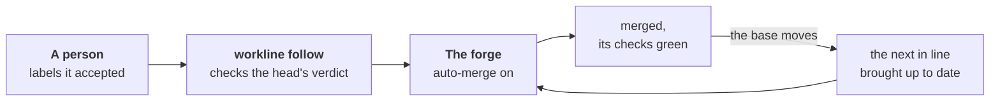

# The merge policy



A person says yes with a label; the forge merges, by its own rules.
`workline follow` turns the forge's auto-merge on for what was accepted
and keeps the line moving, one pull request at a time. No agent is called
([ADR-0042](adr/0042-the-engine-merges-by-the-projects-policy.md)).

```yaml
# .workline/config.yaml
merge: {autonomy: cautious}   # off unless set: no auto-merge is touched
```

## What it does

- **Turns auto-merge on** for a pull request labelled `workline:accepted`
  (GitLab: `workline::accepted`) by someone who can write, its head's
  verdict passed:
  - the line passed on that head;
  - no step that needed an agent ran without one, or not whole (no agent,
    a lens unanswered, the tokens spent).
- **The forge merges**: GitHub's auto-merge, GitLab's "merge when the
  pipeline succeeds", each checking its own rules. One GitHub could merge
  at once is merged at once.
- **One at a time**: when the base moves, the first in line that is behind
  is brought up to date; the others wait until it merges:
  - the base merged in, as Update branch does, workline's own lines
    settled ([ADR-0041](adr/0041-workline-settles-its-own-lines-when-the-base-moves.md));
  - a role's own branch rebuilt on the base instead
    ([ADR-0034](adr/0034-the-release-fix-follows-its-base.md)).
- **The order**: the release's docs fix first, then the order the labels
  were put. One whose auto-merge a person turned on by hand joins the line.
- **Out of line, said in the job's summary**: a verdict or a check red,
  a review short, a conflict on a person's line, a push refused. The next
  one is brought up instead.
- **The label** is made in the forge's list when missing: put it in bulk,
  from a saved filter.

## Never without a person's yes

- **A release pull request** merges only labelled. Held for its docs, it
  waits for them, then is brought up to date and merges.
- **A fork's** is turned on when labelled, never brought up to date: the
  token cannot write to a fork. Its CI run is the fork's own, so the
  templates keep no verdict of it: it waits for a person.
- **Any other** with no label, whoever opened it. A bot's own auto-merge
  (a dependency bot's) is left to it.
- **An agent never puts the label**: it is the person's yes.

## The veto is the forge's

- **Draft**: nothing is turned on; auto-merge on goes off.
- **Auto-merge turned off by a person** stays off until the label is put
  again.
- **The label taken off** turns auto-merge off.
- **A push after the yes**: the yes covers the head it was given on. Any
  commit but `follow`'s own update turns auto-merge off and takes the
  label off, said in one comment. When each head was pushed is the
  forge's word: GitHub's repository activity, GitLab's versions.

## Where the head's verdict lives

- The judging job writes it: `workline route … --verdict <file>`.
- The job holding the write token keeps it, `workline follow --verdict
  <file>`: a git note on the head, `refs/notes/workline/verdicts`,
  pushed. A later run, woken by a label or a push, reads it there.
- No verdict on the head yet: auto-merge waits for it.

## Set up

- **GitHub**: the [templates](ci-github.md) — `workline.yml`'s `follow`
  job runs after `judge`; `workline-merge.yml` runs when a label changes.
  Settings → General → "Allow auto-merge"; a ruleset requiring the checks
  auto-merge waits on. The GitHub App's token, as for `apply`: a merge made
  with the job's own starts no workflow on `main` — nothing is turned on
  then, said.
- **GitLab**: the [template](ci-gitlab.md)'s `workline:merge` job, after
  the judge; the project bot's token. A label starts no pipeline there: it
  is acted on at the next one.
- **Another forge** (`cmd:`): the operations `merge-state` and
  `auto-merge` ([forge command](spec/forge-command.md)). The local forge
  has no auto-merge: said, nothing turned on.

## What the summary says

| Said | When |
|---|---|
| `auto-merge-on`, `merged-at-once` | accepted, its head's verdict passed |
| `updated` | first in line, brought up to date |
| `verdict-missing` | accepted, its head not judged yet |
| `verdict-red`, `review-short`, `checks-red` | out of line, why |
| `accepted-reset` | a push after the yes: label and auto-merge off |
| `vetoed`, `draft`, `auto-merge-off` | the forge's veto, or the label taken off |
| `waits-for-docs` | a release whose docs are still open |
| `fork-behind`, `update-left` | behind, not brought up to date |
| `label-ignored` | put by someone who cannot write |
| `merge-token`, `merge-unsupported` | a token or a forge it cannot act with |

What was tried, live: the documentalist's
[tried.md](../roles/documentalist/docs/tried.md#2026-10-12--the-merge-policy-cautious-live);
what is left: [status.md](../roles/documentalist/docs/status.md).
