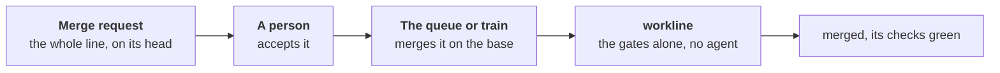

# A merge queue or a merge train



A merge queue (GitHub) or a merge train (GitLab Premium) tests each
merge request merged on the base, and on those ahead of it, before it
merges. Worth turning on once main's run is red more than once a week,
as its [issue](main-after-merge.md) counts
([ADR-0051](adr/0051-a-check-sits-where-its-catch-is-worth-its-cost.md#cut-2-strict-up-to-date-dropped)).
workline's run there guards that combination only
([ADR-0050](adr/0050-each-act-has-its-moment-and-a-wait-budget.md#4-what-the-table-holds-to)):

- **The gates alone**, on the merged result: what it adds over the
  commit it was built on, the base's tip or the group ahead of it.
- **No agent**, none installed nor asked.
- **Not run, said**: the committer, the documentalist, the reviewer. The
  summary names them: their verdict is the head's, given on the merge
  request.
- **Nothing written for a head**: no fix, no comment, no verdict kept
  (`--verdict` is refused). The head's verdict and the person's yes stay
  the merge request's
  ([ADR-0042](adr/0042-the-engine-merges-by-the-projects-policy.md)).
- **No gate in the line**: nothing is checked, said, and the check passes.
- **Its wait**: the gates' own time; workline's budget there is a minute
  ([ADR-0050](adr/0050-each-act-has-its-moment-and-a-wait-budget.md#1-a-wait-budget-per-moment)).
  The summary says each gate's seconds; over that minute, one line more
  names the gate that took the most, never a block (`queue` in
  [the budgets](spec/routing.md#each-steps-seconds-a-moments-budget)).

## GitHub: a merge queue

- **Where**: an organisation's repository, public, or private on
  Enterprise Cloud
  ([changelog](https://github.blog/changelog/2023-07-12-pull-request-merge-queue-is-now-generally-available/)).
  A user's repository has none, workline's own included: its workflows
  have no `merge_group`.
- **The trigger**: [workline.yml](../ci/github/workline.yml) runs on
  `merge_group` too. Without it, the checks the queue requires never
  report on its commit, and it waits until its timeout
  ([GitHub's docs](https://docs.github.com/en/repositories/configuring-branches-and-merges-in-your-repository/configuring-pull-request-merges/managing-a-merge-queue)).
- **The checks**: `gates` runs the gates on the group's commit; `judge`
  gives their verdict, the check the ruleset requires, as on a pull
  request.
- **With the [merge policy](merge-policy.md)**: the base requires
  `workline/accepted` from the App, on the group's commit too.
  [workline-apply.yml](../ci/github/workline-apply.yml)'s `queue` job
  sets it there as the head of the pull request the group ends with
  holds it; a head with no yes fails the group.
- **Set up**: Settings → Rules, on the base: "Require merge queue", and
  the checks required as without a queue.
- **The engine**: from v0.38.0.

## GitLab: a merge train

- **Where**: Premium and Ultimate, merged results pipelines on (Settings
  → Merge requests,
  [GitLab's docs](https://docs.gitlab.com/ci/pipelines/merge_trains/)).
- **A train's pipeline** (`CI_MERGE_REQUEST_EVENT_TYPE` is
  `merge_train`): [the template](../ci/gitlab/workline.gitlab-ci.yml)
  runs `workline:gates` alone, against the target's tip, after
  `workline:base`, which reads that tip's findings main kept. A gate
  that blocks fails the pipeline, and the train drops the merge request.
- **A merged results pipeline** (`merged_result`) is the merge
  request's own, on each push: every job runs there, as on any other.
- **The merge policy**: `workline:merge` runs in the merge request's own
  pipelines, never in the train's; GitLab needs no status of
  workline's there.

## The commands, for another CI

```sh
workline route merge-request --gates-only --forge none --input queue=true \
  --input range=<built-on>..<merged> --json > gates.json
workline route merge-request --ai none --forge none --input queue=true \
  --input range=<built-on>..<merged> --gates-from gates.json
```

- **`--input queue=true`**: the line runs its gates alone, and names
  the steps it left. Only `true` or `false`.
- **Refused with it**: `--verdict` and `--warn-only`.
- **One job is enough** when nothing else needs the gates apart: the
  second command without `--gates-from` runs them.
- **The yes on a group** (GitHub): `workline follow --forge github
  --merge-group <the group's branch> --head <its commit>`, with the
  App's token.
