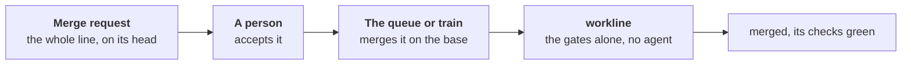

---
sources:
  - internal/line/seconds.go#momentOf
  - internal/line/seconds.go#Measure
  - defaults/routing.yaml#budgets.queue
checked: bd254cd75
judged: e4550b8
verified: agent:claude-code
---
# A merge queue or a merge train

A merge queue (GitHub) or a merge train (GitLab Premium) tests each
merge request merged on the base, and on those ahead of it, before it
merges. Worth turning on once main's run is red more than once a week,
as its [issue](main-after-merge.md) counts
([ADR-0051](adr/0051-a-check-sits-where-its-catch-is-worth-its-cost.md#cut-2-strict-up-to-date-dropped)).
workline's run there guards that combination only
([ADR-0050](adr/0050-each-act-has-its-moment-and-a-wait-budget.md#4-what-the-table-holds-to)):

- **The gates alone**, on the merged result: what it adds over the
  commit it was built on, the base's tip or the group ahead of it.
- **No agent** asked.
- **Not run, said**: the committer, the documentalist, the reviewer. The
  summary names them: their verdict is the head's, given on the merge
  request.
- **Nothing written for a head**: no fix, no comment, no verdict kept
  ([`--verdict` is refused](merge-queue-commands.md)). The head's
  verdict and the person's yes stay the merge request's
  ([ADR-0042](adr/0042-the-engine-merges-by-the-projects-policy.md)).
- **No gate in the line**: nothing is checked, said, and the check passes.
- **Its wait**: the gates' own time; workline's budget there is a minute
  ([ADR-0050](adr/0050-each-act-has-its-moment-and-a-wait-budget.md#1-a-wait-budget-per-moment)).
  The summary says each gate's seconds; over that minute, one line more
  names the gate that took the most, never a block (`queue` in
  [the budgets](spec/routing.md#each-steps-seconds-a-moments-budget)).
  `Measure`, in `seconds.go`, sets it from the `queue` budget of
  `routing.yaml`, once it has found the run is a queue's.

## GitHub: a merge queue

Its checks and its yes: [a merge queue on GitHub](github/merge-queue.md).

## GitLab: a merge train

On Premium: [a merge train on GitLab](gitlab/merge-train.md).

## The commands, for another CI

[The commands, for another CI](merge-queue-commands.md).
