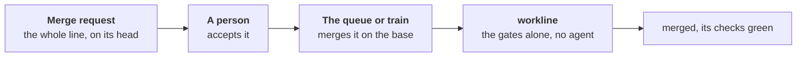

---
sources:
  - internal/line/seconds.go#momentOf
  - internal/line/seconds.go#Measure
  - defaults/routing.yaml#budgets.queue
checked: 3f432ab14
judged: e4550b8
verified: agent:claude-code
---
# A merge queue or a merge train

A merge queue (GitHub) or a merge train (GitLab Premium) tests each
merge request merged on the base, and on those ahead of it, before it
merges. Worth turning on once main's run is red more than once a week,
as its [issue](main-after-merge.md) counts
([ADR-0051](adr/0051-a-check-sits-where-its-catch-is-worth-its-cost.md#cut-2-strict-up-to-date-dropped)).
workline's run there guards that combination only
([ADR-0050](adr/0050-each-act-has-its-moment-and-a-wait-budget.md#4-what-the-table-holds-to)):

- **The gates alone**, on the merged result: what it adds over the
  commit it was built on, the base's tip or the group ahead of it.
- **No agent** asked.
- **Not run, said**: the committer, the documentalist, the reviewer. The
  summary names them: their verdict is the head's, given on the merge
  request.
- **Nothing written for a head**: no fix, no comment, no verdict kept
  ([`--verdict` is refused](merge-queue-commands.md)). The head's
  verdict and the person's yes stay the merge request's
  ([ADR-0042](adr/0042-the-engine-merges-by-the-projects-policy.md)).
- **No gate in the line**: nothing is checked, said, and the check passes.
- **Its wait**: the gates' own time; workline's budget there is a minute
  ([ADR-0050](adr/0050-each-act-has-its-moment-and-a-wait-budget.md#1-a-wait-budget-per-moment)).
  The summary says each gate's seconds; over that minute, one line more
  names the gate that took the most, never a block (`queue` in
  [the budgets](spec/routing.md#each-steps-seconds-a-moments-budget)).
  `Measure`, in `seconds.go`, sets it from the `queue` budget of
  `routing.yaml`, once it has found the run is a queue's.

## workline's own merge queue

A repository that requires branches up to date, with no merge queue of
the forge's (GitHub's needs an organisation) nor a merge train
(GitLab's), holds each accepted pull request behind once `main` moves.
`workline follow` then brings them up to date one after the other, not
all in the same run
([ADR-0075](adr/0075-urgent-work-first-and-a-merge-queue-of-our-own.md#7-a-merge-queue-of-our-own)):

- **In the queue**: the accepted pull requests, auto-merge on, that the
  forge holds behind; and the head once updated, a developer's pull
  request no longer behind, pushed to since its auto-merge was turned
  on, its checks pending: it keeps its place while they run. A draft
  has no auto-merge: never in it.
- **Their order**: the priority of the issue each closes, as the forge
  links it (its description's closing words among them), or its own
  priority label; then when auto-merge was turned on, the earliest
  first, one the forge gives no time for last.
- **The head**: the first held by nothing. `main` is merged into it
  alone; the forge merges it once its checks pass, and the next run
  takes the next one.
- **Passed over, said with its reason**: a red check or a conflict
  (each takes its usual round), an open conversation, a person's
  comment unanswered, a branch not a developer's, said by what it is
  (`workline's tester branch, not a developer's`, `a person's branch`,
  a fork's included): never updated by workline.
- **Pending checks**: the head stays the head, nothing else updated,
  up to 30 minutes after its last update, on the engine's clock
  (`WORKLINE_CLOCK` where set); past them, it is passed over and said
  `checks pending past 30 min`.
- **Said in the run's summary only**, one line each, no comment, no
  marker:
  - `#N: head of the queue, main merged in`;
  - `#N: queued, position k`;
  - `#N: passed over, <reason>`.
- **Nothing to do** where the forge holds no pull request behind but
  for a conflict: a repository that does not require branches up to
  date, or one left to the forge's merge queue or merge train. workline
  updates nothing, builds no queue and says no queue line — a
  conflicting one is said by its conflict only. No setting turns it on
  or off.

## GitHub: a merge queue

Its checks and its yes: [a merge queue on GitHub](github/merge-queue.md).

## GitLab: a merge train

On Premium: [a merge train on GitLab](gitlab/merge-train.md).

## The commands, for another CI

[The commands, for another CI](merge-queue-commands.md).
