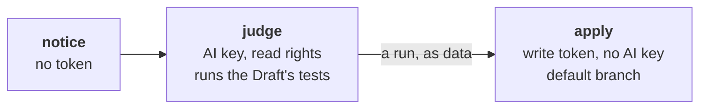

# An objection's jobs

What each job answering an objection holds, and why. An objection is a
comment opened by `workline:objection` on the tester's Draft
([tester](../roles/tester/README.md#frozen-tests-and-objections)).

## Who wakes it

- A person of the project (owner, member, collaborator) or an App
  installed on it, such as workline's own builder.
- Anyone else's comment wakes nothing: no agent's token is spent on a
  stranger's word.
- Any branch `workline/tester/*` of the repository with such a comment
  wakes it, a Draft opened by hand too; never a fork's.

## notice (GitHub only)

- `workline-objection.yml` runs as the pull request's branch holds it,
  so it holds no token and no secret, runs nothing of the repository.
- Its end wakes `workline-answer.yml`, which runs as the default branch
  holds it (`workflow_run`).

## judge

- The agent's token, read rights, no write token: it proposes
  (`--no-apply`).
- It checks out the Draft's head, the one the objection was made on,
  and runs your test command there: a rewrite must be red on the base.
- So it runs the Draft's code: what it leaves is not trusted.
- On GitLab, it reads the forge with the bot's token, which that code
  can reach: not fixed yet
  ([#658](https://github.com/JN0V/workline/issues/658)).

## apply

- The write token (GitHub: the App's, in the environment
  `workline-app`), no AI key, from the default branch's checkout
  ([ADR-0044](adr/0044-the-apps-key-stays-with-the-default-branchs-runs.md)).
- The judge's run is data:
  - it names a run's folder, checked by the job (`<date>T<time>.<ns>-<role>`,
    under the runs folder) and by the engine;
  - on GitHub, downloaded outside the checkout;
  - `workline apply --from-merge-request` reads only its proposals: the
    repository, the roles and the forge are the job's own
    ([`workline apply`](commands.md#workline-apply)).
- Only what the Draft's line may do: its branch, its threads, the issue
  it was opened for (`workline/tester/issue-<n>`); anything else refuses
  the whole run.
- The head: the event's on GitHub, the judge's on GitLab. A branch moved
  on since applies nothing; the objection waits for the next run.

## The Draft's files beside the write token

- The engine checks the Draft's head out, detached, to apply a rewrite
  on the files it was judged on, then the base again: as for every
  merge request's run applied from the base.
- No command of the repository runs there: the engine runs git and the
  forge's API.
- Git's hooks and filter drivers come from git's config, not from the
  files checked out: a branch cannot add one.
