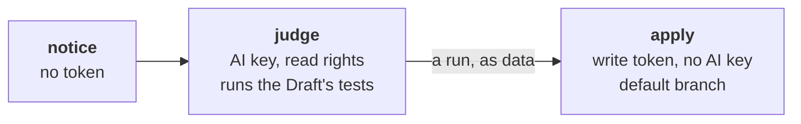

# An objection's jobs

What each job answering an objection holds, and why. An objection is a
comment opened by `workline:objection` on the tester's Draft
([tester](../roles/tester/README.md#frozen-tests-and-objections)).

## Who wakes it

- A person of the project (owner, member, collaborator) or an App
  installed on it, such as workline's own builder.
- Anyone else's comment wakes nothing: no agent's token is spent on a
  stranger's word.
- Only a comment that opens with `workline:objection`: the tester's own
  reply, which names the word to say the form, wakes nothing.
- A reply in an objection's thread, the developer's or a person's,
  wakes it too (GitHub: job `replied-to-tester`); the tester's own
  answers do not.
- Any branch `workline/tester/*` of the repository with such a comment
  wakes it, a Draft opened by hand too; never a fork's.

## notice (GitHub only)

- `workline-objection.yml` runs as the pull request's branch holds it,
  so it holds no token and no secret, runs nothing of the repository.
- Its end wakes `workline-answer.yml`, which runs as the default branch
  holds it (`workflow_run`).

## A reply on the developer's pull request (GitHub only)

- The same workflow notices a person's reply in a thread on a line of
  a `workline/developer/*` pull request (job `replied`): no token, no
  secret, the App's own replies left out.
- Its end wakes `workline-develop.yml`, as the default branch holds it:
  the developer's review round, at once rather than at the hourly
  reconcile ([#1438](https://github.com/JN0V/workline/issues/1438)).

## One objection a run, the queue drained (GitHub only)

- An answer run answers one objection
  ([#1701](https://github.com/JN0V/workline/issues/1701)).
- apply then starts `workline-answer.yml` again on the same Draft
  (`workflow_dispatch`, input `branch`): the next one waiting. With
  none left, the run ends before any agent. 5 answers at most in a
  chain (input `chain`); the reconciler resumes after.
- Each run writes on the Draft the state it ran on, whatever it
  wrote: the tip and each objection waiting
  (`workline test answer --tried`). A run on that same state
  (`--state` says `tried`) calls no agent: only a new comment in a
  waiting thread, a new objection or a new head starts one again.
- The reconciler of `workline-develop.yml` lists the Drafts an
  objection still waits on (`answers` in `workline route reconcile
  --input reconcile=list`) and starts their answer: a run that
  stopped first is resumed with no person acting.

## head (GitLab only)

- Reads the Draft's head with `git ls-remote`, before any of the
  Draft's code runs, holding no agent's token.
- The judge checks that head out; apply applies at that head only.

## judge

- The agent's token, read rights, no write token: it proposes
  (`--no-apply`).
- It checks out the Draft's head, and runs your test command there: a
  rewrite must be red on the base.
- On GitHub, that head is the Draft's open pull request's tip when the
  run starts, never the objection run's `head_sha`: a re-run or a push
  since would leave it behind.
- So it runs the Draft's code: what it leaves is not trusted.
- On GitLab, it reads the forge with the bot's token, which that code
  can reach: not fixed yet
  ([#658](https://github.com/JN0V/workline/issues/658)).

## apply

- The write token (GitHub: the App's, in the environment
  `workline-app`), no AI key, from the default branch's checkout
  ([ADR-0044](adr/0044-the-apps-key-stays-with-the-default-branchs-runs.md)).
- The judge's run is data:
  - it names a run's folder, checked by the job (`<date>T<time>.<ns>-<role>`,
    under the runs folder) and by the engine;
  - on GitHub, downloaded outside the checkout;
  - `workline apply --from-merge-request` reads only its proposals: the
    repository, the roles and the forge are the job's own
    ([`workline apply`](commands.md#workline-apply)).
- Only what the Draft's line may do: its branch, its threads, the issue
  it was opened for (`workline/tester/issue-<n>`); anything else refuses
  the whole run.
- The head: the one judge read on GitHub; on GitLab, the one
  `workline:objection:head` reads before the judge, holding no agent. A
  judge reporting another head applies nothing; so does a branch moved
  on since: the objection waits for the next run.

## The Draft's files beside the write token

- The engine checks the Draft's head out, detached, to apply a rewrite
  on the files it was judged on, then the base again: as for every
  merge request's run applied from the base.
- No command of the repository runs there: the engine runs git and the
  forge's API.
- Git's hooks and filter drivers come from git's config, not from the
  files checked out: a branch cannot add one.
