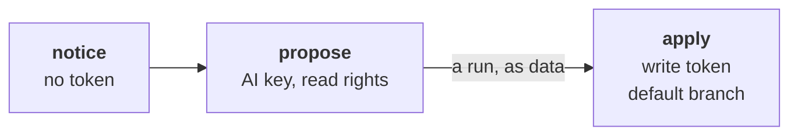

---
sources:
  - defaults/ci/github/workline-objection.yml
  - defaults/ci/github/workline-answer.yml#on
  - defaults/ci/github/workline-answer.yml#jobs.propose.permissions
  - defaults/ci/github/workline-answer.yml#jobs.propose.env
  - defaults/ci/github/workline-answer.yml#jobs.apply.environment
  - defaults/ci/github/workline-answer.yml#jobs.apply.permissions
  - defaults/ci/github/workline-develop.yml#on.workflow_run
  - defaults/ci/github/workline-develop.yml#on.schedule
  - defaults/ci/github/workline-develop.yml#jobs.reconcile
  - internal/engine/fromrun.go#onHead
  - internal/engine/fromrun.go#ResumeFrom
checked: e81df7b34
verified: agent:claude-code
judged-in-parts: 786d304
---
# An objection's jobs

What each job answering an objection holds, and why. An objection is a
comment opened by `workline:objection` on the tester's Draft
([tester](../roles/tester/docs/objections.md)).

- [The propose and apply jobs](objection-jobs-propose.md): what each holds,
  on GitHub and on GitLab.
- [One objection a run](objection-jobs-queue.md): the queue drained,
  on GitHub.
- [What apply takes from the propose job](objection-jobs-apply.md): the run
  read as data, only what the Draft's line may do.

## Who wakes it (GitHub)

- A person of the project (owner, member, collaborator) or an App
  installed on it, such as workline's own builder.
- Anyone else's comment wakes nothing: no agent's token is spent on a
  stranger's word.
- Only a comment that opens with `workline:objection`: the tester's own
  reply, which names the word to say the form, wakes nothing.
- A reply in an objection's thread, the developer's or a person's,
  wakes it too (job `replied-to-tester`); the tester's own
  answers do not.
- Any branch `workline/tester/*` of the repository with such a comment
  wakes it, a Draft opened by hand too; never a fork's.
- The reconciler of `workline-develop.yml` lists the Drafts an
  objection still waits on (`answers` in `workline route reconcile
  --input reconcile=list`) and starts their answer: a run that
  stopped first is resumed with no person acting.

## notice (GitHub only)

- `workline-objection.yml` runs as the pull request's branch holds it,
  so it holds no token and no secret, runs nothing of the repository.
- Its end wakes `workline-answer.yml`, which runs as the default branch
  holds it (`workflow_run`).

## A reply on the developer's pull request (GitHub only)

- The same workflow notices a person's reply in a thread on a line of
  a `workline/developer/*` pull request (job `replied`): no token, no
  secret, the App's own replies left out.
- Its end wakes `workline-develop.yml`, as the default branch holds it:
  the developer's review round, at once rather than at the hourly
  reconcile ([its triggers](../roles/developer/docs/triggers.md#on-its-pull-request),
  [#1438](https://github.com/JN0V/workline/issues/1438)).

## The Draft's files beside the write token

- The engine checks the Draft's head out, detached, to apply a rewrite
  on the files it was judged on, then the base again: as for every
  merge request's run applied from the base.
- No command of the repository runs there: the engine runs git and the
  forge's API.
- Git's hooks and filter drivers come from git's config, not from the
  files checked out: a branch cannot add one.
