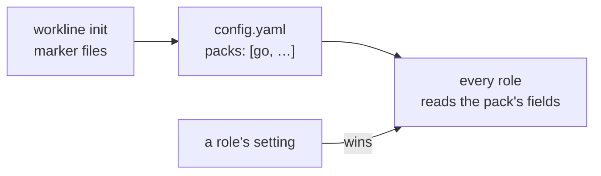

---
sources:
  - internal/packs/packs.go#Pack
  - internal/packs/packs.go#Code
  - internal/packs/packs.go#Code.check
  - internal/packs/packs.go#CodeRows
  - internal/packs/packs.go#parse
  - internal/packs/packs.go#Available
  - internal/packs/packs.go#Listed
  - internal/packs/packs.go#TesterDefaults
  - internal/packs/packs.go#Detected
  - internal/packs/packs.go#Unknown
  - internal/packs/builtin/generic.yaml#test-paths
  - internal/packs/builtin/go.yaml#detect
  - internal/codenav/codenav.go#Of
  - internal/routing/adopt.go#SetPacks
  - internal/doctor/packs.go#languagePacks
checked: 542fc9cb6
verified: agent:claude-code
---
# Language packs

What workline knows of a language, as a file you can read and add to,
never engine code
([ADR-0065](adr/0065-code-only-what-converges-language-knowledge-in-packs.md#language-packs)).



## What a pack holds

One YAML file a language or ecosystem:

| Field | Holds |
|---|---|
| `about` | one line, for a person |
| `detect` | `files`: marker names, at any depth (`go.mod`); `extensions`: the languages it knows, for `workline doctor` |
| `test-paths` | the test files, as patterns, added to the generic ones: the tester's `test-paths` when it sets none |
| `test-homes` | where a test's code lives, read before the generic homes: the tester's `test-homes` when it sets none |
| `build-errors` | how a broken build's error lines read, and which are a missing name: the tester's `build-errors` when it sets none |
| `test-command` | a suggested test command, given by `workline doctor` when the tester has none; never run unless you set it |
| `builtin-names` | the language's own names (built-in exceptions, standard library), which no project code defines |
| `aside` | folders beside the code, ranked after it: the generic pack's only, for now |
| `code-navigation` | how a language's functions are found with no build: [below](#code-navigation) |

- **A field it does not read** is refused, with the pack's name: never
  ignored.
- **A pack never decides a verdict**: its fields are a role's settings
  until the project sets its own.

## The packs built in

One file each in [internal/packs/builtin/](../internal/packs/builtin/),
the pack's name being the file's less `.yaml`: `go.yaml`,
`kotlin-gradle.yaml`, `java-maven.yaml`, `python-pytest.yaml`,
`js-jest.yaml` and `generic.yaml`.

- **`generic`** is always read: `test/`, `tests/`, `__tests__/`
  folders, `test_*`, `*_test.*`, `*.spec.*`…
- **A listed pack adds to it**, never narrows it: a Go project's
  `tests/` folder stays tests. To narrow, set the tester's `test-paths`.
- **Several packs**: each field is the union of theirs (a Go service
  with a Kotlin app reads both test paths).

## Code navigation

How workline finds a language's functions with no build
([code navigation](research/code-navigation.md)): one row a language.
What the code picker reads with them:
[the code picker](spec/code-picker.md#what-it-reads).

```yaml
code-navigation:
  - name: Elixir
    extensions: [.ex, .exs]
    definition: '^\s*defp?\s+(NAME)\b'   # NAME: the function's name
    body: end            # go (Go's parser), braces, indent or end
    hash-comments: true
    keywords: "def defp defmodule do end nil fn"
```

- **The other fields**: `outline` (braces, indent, or none),
  `containers`, `bodies`, `ignore`, `bases`, `preproc`, `line-ends`,
  `param-headers`, `shell-quotes`, `bare-calls`.
  `definition: c-like` is the pattern C, Java, Kotlin and
  most brace languages share.
- **Every built-in pack's rows are read**, whatever the list:
  navigation decides no verdict, and a Go project's shell scripts are
  read too.
- **A listed pack's rows come first**: yours wins on its extensions.
- **A row it cannot read** (no `NAME`, a body it does not know, a
  pattern that does not compile) is refused, with the pack's name.

## Choosing the packs

- **`workline init`** lists in `.workline/config.yaml` the packs whose
  marker files the repository holds, unless `packs:` holds a list
  already, `packs: []` too. A marker in a test or aside folder (a
  fixture's `go.mod`) calls for none.
- **Edit the list** as any setting: `packs: [go, kotlin-gradle]`. A name
  with no pack is an error, said: never skipped.
- **A role's setting wins**: the tester's `test-paths` set, a pack's
  are not read.

## A pack of your own

A file `.workline/packs/<name>.yaml`, listed by its name:

```yaml
# .workline/packs/dart.yaml
about: Dart and Flutter projects
detect: {files: [pubspec.yaml], extensions: [.dart]}
test-paths: ["test/**", "integration_test/**"]
test-command: "flutter test --machine | tojunit > {report}"
```

- **Same name as a built-in pack**: yours replaces it whole, no merge.
- **No pack for your language**: the generic one stands in, and
  `workline doctor` names the language.
- **Only the listed packs are read**: a draft file not listed stops no
  run; `workline doctor` checks them all.

## The engine names no language

For workline's own code: a language's knowledge goes in a pack, never
in the engine
([Rule B](adr/0065-code-only-what-converges-language-knowledge-in-packs.md#rule-b-no-ecosystem-pattern-in-the-engine)).

## What `workline doctor` says

- The packs listed, or none, with the ones the repository calls for.
- **A pack detected, not listed** (a `go.mod` added since):
  a warning, with the line to add.
- **A pack listed, nothing calls for**: a note.
- **A language no listed pack knows**, with its file count: the pack
  built in to list, else the file to write.
- No `test-command` set: the listed packs' suggested ones.

## Where this page reads from

- **The fields, how they merge and are refused**:
  `internal/packs/packs.go`.
- **The packs built in**: `generic.yaml` and `go.yaml` above, the
  others beside them.
- **Code navigation**: `internal/codenav/codenav.go`.
- **What `workline init` lists**: `internal/routing/adopt.go`.
- **What doctor says**: `internal/doctor/packs.go`.
