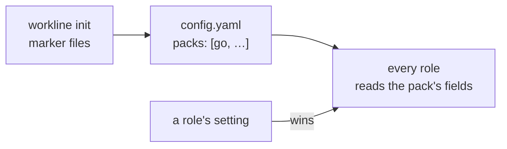

# Language packs

What workline knows of a language, as a file you can read and add to,
never engine code
([ADR-0065](adr/0065-code-only-what-converges-language-knowledge-in-packs.md#language-packs)).



## What a pack holds

One YAML file a language or ecosystem:

| Field | Holds |
|---|---|
| `about` | one line, for a person |
| `detect` | `files`: marker names, at any depth (`go.mod`); `extensions`: the languages it knows, for `workline doctor` |
| `test-paths` | the test files, as patterns, added to the generic ones: the tester's `test-paths` when it sets none |
| `test-homes` | where a test's code lives, read before the generic homes: the tester's `test-homes` when it sets none |
| `test-command` | a suggested test command, given by `workline doctor` when the tester has none; never run unless you set it |
| `aside` | folders beside the code, ranked after it: the generic pack's only, for now |
| `build-errors` | the rows the tester reads a build a new test breaks with (the shape of its `build-errors` setting): the tester's default, a setting set wins |
| `code-navigation` | how a language's functions are found with no build: [below](#code-navigation) |

- **A field it does not read** is refused, with the pack's name: never
  ignored.
- **A pack never decides a verdict**: its fields are a role's settings
  until the project sets its own.
- **The other tables** (build errors, comment syntax, mutation tools)
  still sit in the engine; they move to packs next
  ([#1309](https://github.com/JN0V/workline/issues/1309)).

## The packs built in

`go`, `kotlin-gradle`, `java-maven`, `python-pytest`, `js-jest`, and
`generic`: [internal/packs/builtin/](../internal/packs/builtin/).

- **`generic`** is always read: `test/`, `tests/`, `__tests__/`
  folders, `test_*`, `*_test.*`, `*.spec.*`…
- **A listed pack adds to it**, never narrows it: a Go project's
  `tests/` folder stays tests. To narrow, set the tester's `test-paths`.
- **Several packs**: each field is the union of theirs (a Go service
  with a Kotlin app reads both test paths).

## Code navigation

How the code picker and the reviewer's judge find a function with no
build ([code navigation](research/code-navigation.md)): one row a
language.

```yaml
code-navigation:
  - name: Elixir
    extensions: [.ex, .exs]
    definition: '^\s*defp?\s+(NAME)\b'   # NAME: the function's name
    body: end            # go (Go's parser), braces, indent or end
    hash-comments: true
    keywords: "def defp defmodule do end nil fn"
```

- **The other fields**: `outline` (braces, indent, or none),
  `containers`, `bodies`, `ignore`, `bases`, `preproc`, `line-ends`,
  `param-headers`, `shell-quotes`, `bare-calls`; the built-in packs
  show each. `definition: c-like` is the pattern C, Java, Kotlin and
  most brace languages share.
- **Every built-in pack's rows are read**, whatever the list:
  navigation decides no verdict, and a Go project's shell scripts are
  read too. The generic pack holds the languages with no pack of
  their own yet (shell, C and C++, Rust, Swift…).
- **A listed pack's rows come first**: yours wins on its extensions.
- **A row it cannot read** (no `NAME`, a body it does not know, a
  pattern that does not compile) stops the run, with the pack's name.

## Choosing the packs

- **`workline init`** lists in `.workline/config.yaml` the packs whose
  marker files the repository holds, unless `packs:` holds a list
  already, `packs: []` too. A marker in a test or aside folder (a
  fixture's `go.mod`) calls for none.
- **Edit the list** as any setting: `packs: [go, kotlin-gradle]`. A name
  with no pack stops every run, said: never skipped.
- **A role's setting wins**: the tester's `test-paths` set, a pack's
  are not read.

## A pack of your own

A file `.workline/packs/<name>.yaml`, listed by its name:

```yaml
# .workline/packs/dart.yaml
about: Dart and Flutter projects
detect: {files: [pubspec.yaml], extensions: [.dart]}
test-paths: ["test/**", "integration_test/**"]
test-command: "flutter test --machine | tojunit > {report}"
```

- **Same name as a built-in pack**: yours replaces it whole, no merge.
- **No pack for your language**: the generic one stands in, and
  `workline doctor` names the language.
- **Only the listed packs are read**: a draft file not listed stops no
  run; `workline doctor` checks them all.

## The engine names no language

For workline's own code: a test fails on a string of `internal/` that
holds a pack's marker, extension or path pattern (`"build.gradle.kts"`,
a regex on `\.kt`)
([Rule B](adr/0065-code-only-what-converges-language-knowledge-in-packs.md#rule-b-no-ecosystem-pattern-in-the-engine)).

- **Put it in a pack**: a new language's fix lands in its YAML.
- **It converges** (every ecosystem needs it the same way): a
  `// converges: <reason>` comment on its line; the review judges it.
  `.xml` for a JUnit report needs none: no pack names it.
- **Today's offenders** are listed in
  [rule-b-baseline.txt](../internal/packs/testdata/rule-b-baseline.txt):
  a line only shrinks, never added to.

## What `workline doctor` says

- The packs listed, or none, with the ones the repository calls for.
- **A pack detected, not listed** (a `build.gradle.kts` added since):
  a warning, with the line to add.
- **A pack listed, nothing calls for**: a note.
- **A language no listed pack knows**, with its file count, from a
  subset of [GitHub linguist](https://github.com/github-linguist/linguist)'s
  extensions: the pack built in to list, else the file to write.
- Which test paths every role reads: the tester's, the packs' with the
  generic ones, or the generic ones alone.
- No `test-command` set: the listed packs' suggested ones.
