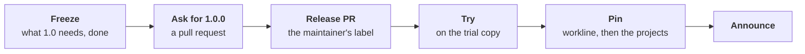

---
sources:
  - release-please-config.json
  - .github/workflows/release-please.yml
  - .github/workflows/release.yml
  - scripts/try-release.sh
checked: 4320cc49f
verified: agent:claude-code
---
# Releasing workline 1.0



workline's releases are cut by release-please, from a pull request it
keeps open ([ADR-0017](adr/0017-the-release-manager.md)). The line runs a
release only once it was tried on a copy
([ADR-0071](adr/0071-the-line-runs-a-pinned-release-tried-on-a-copy.md)).
1.0 follows the same path, with one more step: asking for the version.
This page is for workline's maintainer: it names workline's own
repositories.
What 1.0 is: [ADR-0052](adr/0052-v1-0-when-the-core-roles-are-out-of-beta.md#amendment-2026-11-15-v10-is-the-v1-accepted).

## 1. Freeze

Each a check, before asking for the version:

- **The four sign-offs**: "validated on real use" signed by the
  maintainer in the status page of the
  [product owner](../roles/product-owner/docs/status.md),
  [tester](../roles/tester/docs/status.md),
  [developer](../roles/developer/docs/status.md) and
  [reviewer](../roles/reviewer/docs/status.md).
- **The "before" rows closed**: those of
  [ADR-0052's table](adr/0052-v1-0-when-the-core-roles-are-out-of-beta.md#amendment-2026-11-15-v10-is-the-v1-accepted),
  and [#1556](https://github.com/JN0V/workline/issues/1556).
- **The layout final**: [ADR-0070](adr/0070-a-new-role-runs-from-its-files-on-a-shared-pre-and-post.md)'s
  moves merged; nothing left to rename or move.
- **User docs at 0 suspect** on `main`: no report gives this count.
  The measure is `workline docs --ai none --since <first commit>` on a
  clone of `main`, counting the docs it lists outside `docs/spec/`,
  `docs/adr/` and `docs/research/`. A push's `docs suspect: N` counts
  only what that push touched.
- **Nothing holds the release**: no open issue labelled
  `workline:hold-release`, `main`'s checks green
  ([what holds a release](release-holds.md)).
- **The line pinned to the last 0.x**, its try green: 1.0 changes no
  code by itself.

## 2. Ask for 1.0.0

release-please would cut the next 0.x: before 1.0, a feature moves the
minor version. It takes 1.0.0 when asked.

- **Not by a branch's commit footer**: `main` takes squash merges with
  a blank body, so a footer in a branch's commit never reaches it.
- **By an override block in the pull request's body**: release-please
  reads the merged pull request's body, and a
  `BEGIN_COMMIT_OVERRIDE` block there replaces the commit's message.
  One pull request, its body ending with:

  ```text
  BEGIN_COMMIT_OVERRIDE
  chore: release 1.0.0

  Release-As: 1.0.0
  END_COMMIT_OVERRIDE
  ```

- **No config change**, nothing to take out after.
- **Accepted with the maintainer's label**, as any pull request.
- **On its merge**, release-please rewrites its open pull request as
  `chore(main): release 1.0.0`.

## 3. The release pull request

- **Read it**: its title says 1.0.0; it changes CHANGELOG.md,
  `.release-please-manifest.json`, the templates' `WORKLINE_VERSION`
  under `defaults/ci/` and
  [without-template.md](gitlab/without-template.md); nothing else.
- **Its checks green**, then the maintainer's label `workline:accepted`.
- **On its merge**: release-please tags `v1.0.0` and writes the notes;
  [release.yml](../.github/workflows/release.yml) publishes the binaries
  and the image.

## 4. The try on the trial copy

- **One command**, under the maintainer's own `gh` session:
  `scripts/try-release.sh v1.0.0` ([the script](../scripts/try-release.sh)).
- **It opens the copy's upgrade pull request** on
  [JN0V/TraceGlass-trial](https://github.com/JN0V/TraceGlass-trial) and
  waits; the maintainer labels it there. The script never labels.
- **Then a canned bug** goes through the copy's line to a merge by
  policy, no person's act.
- **Green (exit 0)**: of the links it prints, the pin needs two: the
  copy's merged upgrade pull request and the canned bug's merged one.
- **Red because of the release** (its download, `workline doctor`, the
  upgrade's checks): no pin; fix, release 1.0.1, try again.
- **Red of the try itself** (a command failed, a wait ran out), or
  **waiting on the person (exit 2)**: run it again on the same version;
  it finds the pull request and the issue it made.
- **`--dry-run`** prints the plan and calls no forge.

## 5. The pin on workline

- **One pull request**, `ci: pin the line to v1.0.0`:
  `WORKLINE_VERSION` in every workflow of `.github/workflows/` that has
  it, nothing else.
- **`## Tried`** links the copy's merged upgrade pull request and the
  canned bug's merged pull request
  ([ADR-0043](adr/0043-a-try-is-told-in-its-pull-request.md)).
- **The maintainer's label**: the pin never merges by policy alone.

## 6. The projects that run workline

On [DomoticsCore](https://github.com/JN0V/DomoticsCore) and
[TraceGlass](https://github.com/JN0V/TraceGlass), one pull request each,
`ci: move the line to workline v1.0.0`:

- **The pin** in their `workline*.yml` workflows.
- **The templates**: compared with `defaults/ci/github/` at `v1.0.0`;
  what the release changed copied, the project's own additions kept.
- **The release notes' breaking changes** applied, or said none apply.
- **The maintainer's label** on each.

## 7. Announce

- **The GitHub release's notes**: a short paragraph on top of what
  release-please wrote: what 1.0 is (a need to a merged change, alone,
  on any repository), what comes after, links to
  [ADR-0052](adr/0052-v1-0-when-the-core-roles-are-out-of-beta.md) and
  [the roles](roles.md).
- **The [v1.0 milestone](https://github.com/JN0V/workline/milestone/1)
  closed**, [#264](https://github.com/JN0V/workline/issues/264) moved
  out of it first.
- **Versions from now on**: a fix moves the patch, a feature the minor;
  a breaking change makes 2.0.0. On `main` that is a `!` in the pull
  request's title (`feat!:`), or an override block in its body holding
  a `BREAKING CHANGE:` footer; a footer in a branch's commit is lost. Say it to whoever contributes.
